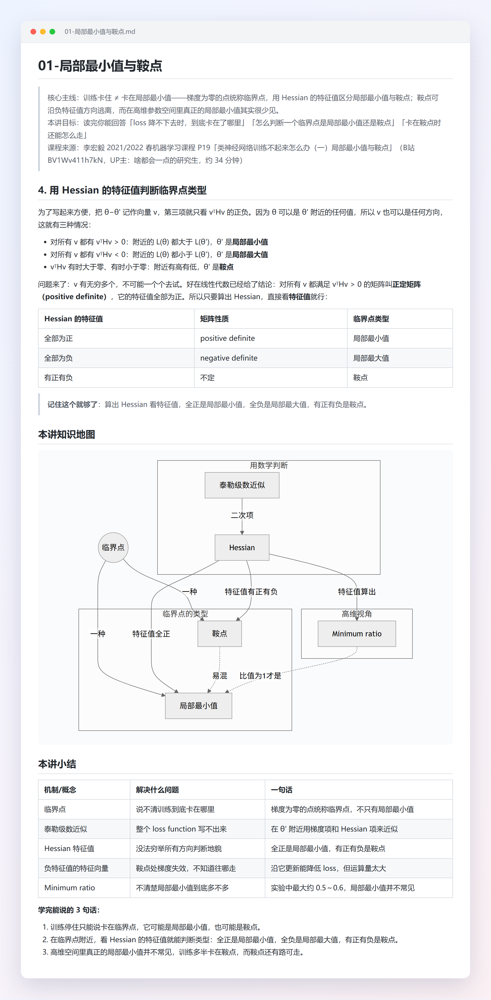

<div align="center">

# bilibili-douyin-notes

**把 B站 / 抖音 / YouTube / 小红书视频一键整理成 Markdown 课堂笔记的 AI Agent Skill**

四平台视频 · 字幕抓取 · 本地语音识别 · 重点截图 · 笔记模板 —— 免登录可用，不调任何付费 API

[](https://github.com/lucky-Luor/bilibili-douyin-notes/actions/workflows/ci.yml)
[](LICENSE)
[]()
[]()
[-orange.svg)]()

简体中文 | [English](README_EN.md)

</div>

> 💬 对 AI 说一句「帮我把这个视频做成课堂笔记：<B站/抖音/YouTube/小红书链接>」，就能得到下面这样的笔记 👇
> （完整示例：[李宏毅机器学习 · 局部最小值与鞍点](examples/01-局部最小值与鞍点.md)；课程节选：[可汗微观经济学 · 前15集](examples/可汗微观经济学-前15集/课程索引.md)）

<p align="center"></p>

> 📜 **仅限个人学习使用**：只处理公开视频、全部在本机运行、不收集任何数据；请勿用于传播或商用。详见[使用声明与数据去向](#-使用声明与数据去向)。

---

## ✨ 功能特性

- **多平台支持**：B站（`bilibili.com` / `b23.tv` 短链 / BV号）、抖音（`douyin.com` / `v.douyin.com` / `iesdouyin.com` 链接 / 分享口令文本）、YouTube（`youtube.com` / `youtu.be` / Shorts 链接，优先取官方/自动字幕）与小红书（`xiaohongshu.com` / `xhslink.com` 视频笔记分享链接）
- **整门课**：发一个B站分P或合集链接，先列清单、报预估并确认范围，再逐集出笔记；支持课程索引、完成回执、续跑门禁复查、单集失败后继续及补跑
- **课程概念表与课程自测**：跨集汇总已有概念与题目，可勾选已掌握、保留勾选并回看原课；对 Agent 说“考考我”，一次一题复习，无需重新提供视频URL
- **字幕优先**：自动抓取B站官方/AI字幕（可选登录），零成本秒出文稿
- **ASR 兜底**：无字幕时用 faster-whisper 本地语音识别（CPU int8，国内走 hf-mirror 镜像），**不调任何付费 API**
- **重点截图**：按转写稿时间戳锚点 + PyAV 抽帧，本地画质初筛自动**校验并标记**黑屏/空屏/模糊帧（像素占比法，白底 PPT 不误判），最终由 Agent 视觉复核决定取舍；无硬编码锚点时自动从文稿提取关键词
- **抖音免登录**：游客身份访问公开视频，无需账号 Cookie；视频只用于本地转写，用完可清理
- **小红书免登录**：解析分享页内嵌数据直接下载视频笔记，无签名、无需账号（仅支持视频笔记，不支持图文与评论）
- **课堂笔记模板**：小节结构 + 关键术语加粗 + 真实代码引用 + 知识地图 + 概念卡片 + 自测题，文末附可回看跳转的视频时间索引；v4 用于语雀直导，v4-obsidian 提供 frontmatter 与 Wiki 目录
- **原语言术语**：英文课用中文整理，正文首次出现术语保留 **中文（Original）**，中文概念卡附原文，便于对照原课

## 🧩 工作流程

```
视频链接（B站/抖音/YouTube/小红书）
        │
        ▼
┌─────────────────────┐
│ 第一步：抓取          │  B站：元数据 + 官方字幕（SESSDATA 可选）
│ （按平台分流）        │  抖音：元数据 + 视频下载供转写（免登录）
│                     │  YouTube：元数据 + 官方/自动字幕（无字幕下载音频）
│                     │  小红书：元数据 + 视频下载（免登录）
└─────────────────────┘
        │ 有字幕？──────否───┐
        ▼ 是                ▼
┌──────────────┐   ┌──────────────────────┐
│ 直接用字幕文本 │   │ 第二步：faster-whisper │
└──────────────┘   │ 本地 ASR 转写          │
        │          └──────────────────────┘
        ▼                  │
┌─────────────────────┐   │
│ 第二步半（可选）      │◄──┘
│ 重点截图（PyAV 抽帧） │
└─────────────────────┘
        │
        ▼
┌─────────────────────┐
│ 第三步：AI 按模板     │  课堂笔记 .md
│ 生成课堂笔记         │  （小节+要点加粗+代码+知识地图+概念卡片+自测题）
└─────────────────────┘
```

## ⚡ 快速开始

```bash
# 一行安装（Claude Code；其他 Agent 把路径换成对应的 skills 目录）
git clone https://github.com/lucky-Luor/bilibili-douyin-notes.git ~/.claude/skills/bilibili-douyin-notes && pip install -r ~/.claude/skills/bilibili-douyin-notes/requirements.txt
```

装好后先跑一次环境自检，按提示修好失败项：

```bash
python ~/.claude/skills/bilibili-douyin-notes/scripts/doctor.py
```

然后直接对 AI 说：**「帮我把这个视频做成课堂笔记：https://www.bilibili.com/video/BVxxxx」**。详细安装与可选配置见下文。

## 📦 安装

本 skill 遵循 **Agent Skills 规范**（`SKILL.md`），任何支持该规范的 AI Agent 均可安装。
支持的安装路径：

- `~/.claude/skills/` —— Claude Code
- `~/.zcode/skills/` —— ZCode
- `~/.agents/skills/` —— DSH、Codex 等多种 Agent 共用的通用 skills 路径

其他兼容 Agent 放入其各自的 skills 目录即可。

> 🧩 **DeepSeek Harness（DSH）用户**：推荐安装插件版 [dsh-video-notes](https://github.com/lucky-Luor/dsh-video-notes)，一条命令装好，随插件升级：
> `npx -y @deepseek-ai/dsh plugin --profile web add github:lucky-Luor/dsh-video-notes`

```bash
# 1. 克隆到你的 agent 的 skills 目录（以 ZCode 为例）
git clone https://github.com/lucky-Luor/bilibili-douyin-notes.git ~/.zcode/skills/bilibili-douyin-notes

# 2. 安装 Python 依赖（按需：各平台流程所需依赖见 requirements.txt 内注释）
pip install -r requirements.txt

# （可选）只装测试依赖：tests/ 离线可跑，无需 faster-whisper / av / gmssl（numpy / pillow 仍需安装）
pip install -r requirements-dev.txt

# 3. （可选）扫码登录B站，自动获取 AI 字幕
python scripts/bili_fetch.py --login   # 生成二维码 PNG 图片并打印路径，B站 App 扫码即登录，SESSDATA 自动写入 config.json
                                       # 无 B站App：cp config.example.json config.json 后按文件内注释手动填写
```

```bash
# 4. 环境自检：逐项给出 ✅ / ⚠️ / ❌ 和修复命令（--platform douyin 只查抖音相关项，--json 供智能体解析）
python scripts/doctor.py
```

> **路径说明**：`SKILL.md` 中示例命令的 `<skill安装目录>` 为占位符，使用时请替换为
> 本 skill 的实际安装路径（脚本内部均基于 `__file__` 相对定位，改路径不影响运行）。

<details>
<summary>最小依赖说明</summary>

| 组件 | 用途 | 是否必需 |
|---|---|---|
| `faster-whisper` | 语音识别兜底 | 做无字幕视频笔记时必需 |
| `av`（PyAV） | 音频解码 / 视频抽帧 | 同上（faster-whisper 依赖链会带上） |
| `gmssl` | 抖音 a_bogus 签名（SM3） | 仅抖音链接需要 |
| `yt-dlp` / `youtube-transcript-api` | YouTube 元数据、字幕与音频（建议另装 deno） | 仅 YouTube 链接需要 |
| `numpy` / `pillow` | 截图画质初筛（像素占比法 QC） | 仅截图流程需要 |

</details>

### 在 Claude Code 里接国产模型

Claude 官方服务不支持中国大陆。可以让 Claude Code 改用国产模型，本 skill 不需要任何改动。三家都提供 Anthropic 兼容接口，只要设置两个环境变量，把 Key 填进 `ANTHROPIC_AUTH_TOKEN`（不要同时设置 `ANTHROPIC_API_KEY`）：

| 模型 | `ANTHROPIC_BASE_URL` | 官方文档（模型名以文档为准） |
|---|---|---|
| DeepSeek | `https://api.deepseek.com/anthropic` | [DeepSeek：Integrate with Claude Code](https://api-docs.deepseek.com/quick_start/agent_integrations/claude_code/) |
| Kimi | `https://api.moonshot.cn/anthropic` | [在 Claude Code 中使用 Kimi](https://platform.kimi.com/docs/guide/claude-code-kimi) |
| 智谱 GLM | `https://open.bigmodel.cn/api/anthropic` | [智谱：Claude API 兼容](https://docs.bigmodel.cn/cn/guide/develop/claude/introduction) |

```bash
# 以 DeepSeek 为例（Windows PowerShell 把 export 换成 $env:NAME="值"）
export ANTHROPIC_BASE_URL=https://api.deepseek.com/anthropic
export ANTHROPIC_AUTH_TOKEN=<你的 DeepSeek API Key>
claude
```

各家的模型名更新很快，`ANTHROPIC_MODEL` 等变量请按上面的官方文档填写。笔记质量取决于所接的模型，质量门禁 `validate_note.py` 会兜住格式下限。

## ⚙️ 配置

复制 `config.example.json` 为同目录 `config.json`：

```jsonc
{
  "SESSDATA": ""  // B站登录 cookie；留空也能用（官方CC字幕+ASR兜底均可）
}
```

获取方式（推荐）：`python scripts/bili_fetch.py --login`，生成二维码 PNG 图片并打印路径，B站 App 扫码即登录，
SESSDATA 自动写入 config.json；二维码过期自动换新。手动路径：浏览器登录 bilibili.com →
F12 → Application → Cookies → 复制 `SESSDATA`。该文件已被 `.gitignore` 排除，不会被提交
（含登录凭据，请勿分享）。抖音、小红书流程无需任何配置；YouTube 被风控时可配 `youtube_proxy`，小红书可选配 `xhs_cookie`。

### 转写性能（可选配置）

CPU 转写慢时可在 config.json 调整：`asr_model`（tiny~large-v3，高阶加载失败自动降一档）、
`asr_device`（auto/cpu/cuda，cuda 失败自动回退 cpu）、`asr_cpu_threads`（0=自动）。
每次降级都会打印原因，不静默。整理完成后可让 AI 询问你是否清理缓存的媒体文件
（`scripts/clean_media.py`，默认只列清单、`--apply` 实删）。

### 笔记模板与语言

`config.note_template` 指定默认模板（`v4` / `v4-obsidian`），课程也可在 `start --template` 显式选择。v4 保持无 frontmatter 的语雀直导格式；v4-obsidian 增加元信息，并用 `+ [[#精确正文标题]]` 生成目录，其它正文、概念卡、自测题和时间索引规则相同。完整规范见 [笔记模板](references/note-template.md)。

B站标题明显是英文原声课（如 Lecture / MIT / Stanford / CS61A），又没有“中字 / 中英 / 配音”等提示时，Agent 会先问是否按英文转写。YouTube 默认选择原语言人工字幕 → 中文人工字幕 → 原语言自动字幕 → 原有兜底，显式 `--lang` 可覆盖默认语言优先级。结合 `audio_lang` / `subtitle_lang` 判断课程语言；英文课正文首次出现术语写 **中文（Original）**，中文概念卡加 `+ 原文：Original`，原本中文课程或纯外文专名卡名免加原文行。

## 🚀 使用

安装后直接对 AI 说：

> 帮我把这个视频做成课堂笔记：https://www.bilibili.com/video/BVxxxx
>
> 总结一下这个抖音视频：https://v.douyin.com/xxxx/
>
> 把这个 YouTube 视频整理成笔记：https://www.youtube.com/watch?v=xxxx
>
> 这个小红书视频做个笔记：<App 里「分享 → 复制链接」得到的整段文本>

整门课先规划，Agent 原样展示确认文案，等你选择后再开工。以下示例只确认前 3 集，`next` 输出本集要执行的步骤：

```bash
python scripts/course_plan.py plan "<B站链接>" "<课程目录>"
python scripts/course_plan.py start "<课程目录>" --first 3 --template v4 --asr-lang zh
python scripts/course_plan.py next "<课程目录>"
```

若选择 Obsidian 与英文原声，在 `start` 改用 `--template v4-obsidian --asr-lang en`；自动检测转写语言用 `--asr-lang auto`。模板未显式指定时取 `config.note_template`。

每集按 `next` 返回的 `note.template`、`note_path` 和命令制作笔记；`existing_note:true` 时在原文件修正，除文件缺失外不整篇重写。转写退出码非 0 或 JSON `status:error` 都算失败。写完笔记、填深链并通过门禁后，由 Agent 调用 `mark … done --note …`，该命令还会执行进程内门禁，拒绝时按报告修正。仍失败则 `mark … failed --reason … --next-step …` 后继续下一集。

续跑 `next` 会先复查已 done 的笔记；笔记 SHA 与模板未变时复用缓存、跳过检查，改坏或缺失则退回 pending、保留 `planned_note` 供修复，不会自动把草稿标成 done。`verify` 可手动复查，与 `next` 共享 SHA 缓存，不能当作强制全量检查；`index` 刷新课程索引；`status` 只读查询。`mark … pending` 可安排失败集补跑。

```bash
# 手动复查、刷新索引、只读查看进度
python scripts/course_plan.py verify "<课程目录>"
python scripts/course_plan.py index "<课程目录>"
python scripts/course_plan.py status "<课程目录>"
```

`next` 返回 `status:finished` 时，Agent 原样转述 `receipt_text` 完成回执（包含课程索引、概念表、课程自测与失败集补跑信息）。只有 `cache.bytes > 0` 才询问是否清理缓存，用户同意后执行 `python scripts/course_plan.py clean "<课程目录>" --apply`；为 0 时不询问。

多分P默认只做当前视频；展开合集用 `--scope season`。超过 200 集或 100 小时的清单只允许选择范围，详见 [SKILL.md](SKILL.md)“整门课模式”。

### 课程复习

课程模型与 CLI 已在本地实现可用。已有课程至少完成一集后，在项目根目录执行；复习不新增依赖，只读取原笔记，兼容已有 `course.json`。

本地完整离线测试与 UTF-8 模式均为 854 项通过、5 项跳过；15 集程序验收通过。40 篇离线性能用例耗时约 0.09 秒；40 集未实测，按用户决定以 15 集验收。详细结果与待完成项目见 [I5 验收记录](docs/verification/I5-概念表.md)。

```bash
python scripts/course_plan.py concepts "<课程目录>" # 生成或刷新概念表.md、课程自测.md
python scripts/course_plan.py concepts "<课程目录>" --unmastered # 只读列出没掌握的概念与对应题目
python scripts/course_plan.py concepts "<课程目录>" --master "机会成本" # 标记已掌握并刷新，可重复传入名称
python scripts/course_plan.py concepts "<课程目录>" --unmaster "机会成本" # 取消掌握标记并刷新
python scripts/course_plan.py concepts "<课程目录>" --check # 只检查、不写文件，有错误时退出码为1
```

`--check`、`--unmastered`、`--master/--unmaster` 三组互斥。汇总包含所有已完成且有笔记路径的集，不受当前所选范围限制。课程索引和完成回执提供两个复习文件的入口；`mark`、`verify`、`next` 结束及 `index` 会顺带刷新，失败时返回 `review_warning`。

在 `概念表.md` 把 `+ [ ]` 改为 `+ [x]` 即标记已掌握，重新生成保留勾选，`course.json` 保存备份；文件读不出时拒绝覆盖。`课程自测.md` 答案不折叠，手动自测先遮住答案；至少勾选一个概念并刷新后，没掌握的题会单列在最前，全部题目仍保留。

对 Agent 说“考考我这门课”或“我哪些没掌握”，上下文中给出课程目录即可，无需视频URL。Agent 先用 `--unmastered`，一次只出一道已有题，先不泄露答案；答后对照原答案说明对错，附回看和笔记链接，无时间点时只给笔记。答对或说“这个我会了”后，仍须征得同意才标记掌握。详见 [复习版内测说明](docs/dev/复习版内测.md)。

也可以直接手动调用脚本（详见 [SKILL.md](SKILL.md) 的工作流程章节）：

```bash
# 先探元数据：不抓字幕、不写文件（确认视频可访问/时长/分P数）
python scripts/bili_fetch.py --probe "<视频链接>"

# B站：抓取元数据与字幕
python scripts/bili_fetch.py "<视频链接>" "<输出目录>"

# 抖音：抓取元数据并下载视频供本地转写（免登录）
python scripts/douyin_fetch.py "<链接或分享口令>" "<输出目录>"

# YouTube：抓取元数据与字幕（无字幕时加 --download 下载音频）
python scripts/yt_fetch.py "<视频链接>" "<输出目录>"

# 小红书：抓取元数据并下载视频（免登录，链接需带 xsec_token）
python scripts/xhs_fetch.py "<分享链接或分享文本>" "<输出目录>"

# 无字幕时：本地语音识别
python scripts/bili_transcribe.py "<输出目录>/metadata.json"

# ASR 术语校正：先 dry-run 看报告，确认后 --apply（自动留 .bak）
python scripts/apply_glossary.py "<输出目录>/01_分P名.txt"

# （可选，带截图时）写完正文后按小节写 shots.json，再按清单抽帧（需 ASCII 文件名时加 --ascii-names）
python scripts/bili_screenshot.py "<输出目录>/metadata.json" "<输出目录>" "<输出目录>/images" --shots "<输出目录>/shots.json"

# 时间索引深链填充（v4 笔记默认执行，short 跳过）
python scripts/note_nav.py "<笔记.md>" --template v4 --meta "<输出目录>/metadata.json" --txt-dir "<输出目录>"

# 生成笔记后的质量门禁（errors 为 0 才交付）
python scripts/validate_note.py "<笔记.md>" --template v4 --meta "<输出目录>/metadata.json" --txt-dir "<输出目录>"

# 单视频 Obsidian 变体：深链和门禁必须使用同一模板
python scripts/note_nav.py "<笔记.md>" --template v4-obsidian --meta "<输出目录>/metadata.json" --txt-dir "<输出目录>"
python scripts/validate_note.py "<笔记.md>" --template v4-obsidian --meta "<输出目录>/metadata.json" --txt-dir "<输出目录>"

# （可选，带截图时）截图上传阿里云 OSS 并改写为 OSS 链接，便于导入语雀（默认预演，--apply 实际执行）
python scripts/upload_images.py "<笔记.md>" --apply
```

## 📁 目录结构

```
├── SKILL.md               # Agent Skills 规范定义：触发条件、三步工作流程、笔记模板
├── scripts/
│   ├── doctor.py          # 环境自检：依赖 / 模型 / 设备 / 编码 / 加密软件 / 网络风控
│   ├── course_plan.py     # 整门课规划、续跑复查、课程索引、回执与询问式清理
│   ├── bili_fetch.py      # B站：元数据 + 字幕抓取（--probe 只探元数据）
│   ├── douyin_fetch.py    # 抖音：元数据 + 视频下载供转写（游客身份）
│   ├── yt_fetch.py        # YouTube：元数据 + 字幕三级回退（无字幕按需下载音频）
│   ├── xhs_fetch.py       # 小红书：视频笔记元数据 + 视频下载（免登录）
│   ├── bili_transcribe.py # faster-whisper 本地 ASR 兜底（多平台兼容）
│   ├── bili_screenshot.py # 重点截图（shots.json 清单 / 关键词兜底 + 多帧择优 + 去重 + 像素占比法 QC）
│   ├── upload_images.py   # 截图上传阿里云 OSS 并改写笔记链接（导入语雀用）
│   ├── transcript_chunk.py# 长转写稿分块（map-reduce 前置）
│   ├── apply_glossary.py  # ASR 术语校正（dry-run 报告 / --apply 落盘）
│   ├── note_nav.py        # 时间索引深链填充
│   ├── clean_media.py     # 询问式媒体清理（默认只列清单、--apply 实删）
│   ├── validate_note.py   # 笔记质量门禁（errors 为 0 才交付）
│   ├── ensure_abogus.py   # abogus.py 缺失时从上游固定 commit 下载（SHA-256 校验）
│   └── abogus.py          # 抖音 a_bogus 签名算法（GPLv3，按需下载，不入仓库）
├── tests/                 # 离线 pytest 测试（不联网、无需重依赖）
├── examples/              # 单篇样例与可汗微观经济学前15集节选
├── docs/images/           # README 配图
├── references/
│   ├── anchors.json       # 截图关键词锚点表（按视频 ID 隔离，仅在不用 --shots 清单时兜底）
│   ├── asr-glossary.json  # ASR 技术术语校正表
│   ├── glossary-user.example.json  # 用户层词表示例
│   └── note-template.md   # 课堂笔记模板
├── config.example.json    # 配置模板（SESSDATA）
└── LICENSE                # MIT
```

[可汗微观经济学前15集节选](examples/可汗微观经济学-前15集/课程索引.md)按“课程目录 → 课程索引 + 逐集笔记”组织，包含15篇中文笔记，覆盖原课前1小时59分1秒；[来源与许可说明](examples/可汗微观经济学-前15集/README.md)单独列出。复习入口：[概念表](examples/可汗微观经济学-前15集/概念表.md)（跨集概念、掌握勾选与回看）和 [课程自测](examples/可汗微观经济学-前15集/课程自测.md)（已有题目、答案与回看）。用户将本次范围缩减为前15集，因此这是课程节选，不是71集整课样例；[I4验收记录](docs/verification/I4-课程版.md)列出了已验证结果及尚未完成的界面抽查。

## ❓ 常见问题

<details>
<summary><b>PowerShell 5.1 显示 NativeCommandError，是脚本失败了吗？</b></summary>

不一定。PowerShell 5.1 可能把原生命令正常写到 stderr 的进度或警告显示为 `NativeCommandError`。请结合进程退出码（命令结束后立即查看 `$LASTEXITCODE`）和 stdout 最后一行 JSON 判断；退出码非 0 或 JSON `status:error` 都应按失败处理，不能仅凭 stderr 的红字判断。
</details>

<details>
<summary><b>需要什么环境？</b></summary>

Python 3.10+，以及任意一个支持 Agent Skills（`SKILL.md`）规范的 AI Agent，如 Claude Code、Codex、ZCode。不需要 GPU，也不需要任何付费 API。不确定装没装好，运行 `python scripts/doctor.py` 自检。
</details>

<details>
<summary><b>脚本报编码错误 / 生成的笔记打开是乱码？</b></summary>

如果电脑装了文件加密（防泄密）软件，用资源管理器、PowerShell 甚至 `git clone` 写出的 `.md`、`.txt` 文件都可能被加密（实测 `.py`、`.json` 不受影响），Python 和 pip 读出来就是乱码。`doctor.py` 会检查出这种情况。

- **根本解决**：请 IT 把 `python.exe` 和你的 AI Agent 加入加密软件白名单；重新 `git clone` 不一定有用
- **`pip install -r requirements.txt` 报 `UnicodeDecodeError`**：说明 `requirements.txt` 被加密了，改用直接列出包名的命令：

  ```bash
  pip install faster-whisper ctranslate2 av numpy pillow qrcode gmssl "yt-dlp>=2026.8.19" "youtube-transcript-api>=1.2.0" oss2
  ```
</details>

<details>
<summary><b>一定要登录 B站吗？</b></summary>

不用。不登录也能抓官方 CC 字幕，没有字幕时自动走本地语音识别。扫码登录（`python scripts/bili_fetch.py --login`）后可以拿到 B站 AI 字幕，多数视频能跳过语音识别，速度快很多。抖音、小红书完全不需要登录；YouTube 一般也不需要，遇到风控时再配 cookies / 代理。
</details>

<details>
<summary><b>语音识别太慢怎么办？</b></summary>

默认的 `small` 模型在 6 核笔记本 CPU 上实测约为视频时长的 0.2 倍（26 分钟的课约 4 分钟）。赶时间可以在 `config.json` 里把 `asr_model` 设为 `base`，速度约快 3 倍，但识别质量明显下降（实测和 `small` 的文字一致度只有 0.72~0.79），术语错得更多；有 NVIDIA 显卡时设置 `asr_device: "cuda"`。也可以先只转写一个分P（`--page 1`）估算耗时。
</details>

<details>
<summary><b>术语识别错了（比如 IoC 被识别成别的词）？</b></summary>

用 `scripts/apply_glossary.py` 做术语校正：先 dry-run 看报告，确认后 `--apply`。发现新的错法可以用 `--add "错法=正确词"` 补进词表，越用越准。
</details>

<details>
<summary><b>抖音链接报 403？</b></summary>

通常是平台更新了签名算法，参见下方「已知限制」里关于 `abogus.py` 的说明，或提一个 [Issue](https://github.com/lucky-Luor/bilibili-douyin-notes/issues) 告诉我。
</details>

<details>
<summary><b>YouTube 提示 "Sign in to confirm you're not a bot"？</b></summary>

YouTube 会拦截部分服务器 IP。给 `yt_fetch.py` 加 `--cookies-from-browser chrome`（或 `--cookies cookies.txt`），必要时加 `--proxy`；并保持 `yt-dlp` 为最新版、安装 deno。
</details>

<details>
<summary><b>小红书链接打不开 / 提示 xsec_token？</b></summary>

小红书必须用带 `xsec_token` 的完整分享链接（App 里「分享 → 复制链接」），只有笔记 ID 不行；token 有时效，过期就重新复制一次。只支持视频笔记，图文笔记会直接提示。
</details>

<details>
<summary><b>生成的笔记长什么样？</b></summary>

看 [examples/](examples/) 目录里的完整示例，包含小节要点、对比表格、知识地图、概念卡片、自测题和可跳转的视频时间索引。
</details>

## 📜 使用声明与数据去向

- **仅限个人学习**：本工具用于把公开课程整理成自己的学习笔记。请勿用于搬运、传播、二次分发或任何商业用途；使用时请遵守各平台的用户协议，尊重创作者的版权。
- **只处理公开内容**：不支持、也不打算支持付费内容、大会员内容和私有收藏夹；B站 SESSDATA 只是抓字幕的可选兜底，不登录也能用。
- **数据去向**：
  - 抓取、语音识别、截图都在你自己的电脑上完成；本项目不收集任何使用数据，也不会把视频、字幕或笔记上传到本项目的服务器（本项目没有服务器）。
  - 下载的视频 / 音频只用于本地语音识别和截图，笔记完成后可用 `clean_media.py` 清理（智能体会先问你）。
  - 截图默认只保存在本地；只有你自己配置了 OSS 并执行 `upload_images.py --apply`，才会上传到**你自己的**存储桶。
  - 笔记由你自己的 AI 智能体生成，字幕和转写文本会按该智能体的规则发给它所接入的模型服务。
- **平台通知**：如收到平台方的通知或异议，维护者会在 48 小时内下线相关模块，并在本 README 说明。

## 🛡️ 平台支持等级

一个人维护四个平台，资源先保证 B站。

| 等级 | 平台 | 承诺 |
|---|---|---|
| 一级 | B站 | 平台改版导致失效后 **7 天内修复**；每周两次真实链接冒烟测试，发版前必跑 |
| 二级 | YouTube、抖音、小红书 | **尽力维护**：失效会在 issue 里确认和跟进，但不承诺修复时间；抖音签名、小红书页面结构都由平台控制，可能临时不可用 |

失效时脚本会输出“原因 / 影响 / 下一步”三段提示，并告诉你是链接本身的问题（换链接即可）还是平台变化（需要等修复）。遇到失效请提 issue，附上链接和这段提示。

## ⚠️ 已知限制

- 无字幕视频需要本地语音识别：CPU int8 实测约为视频时长的 0.2 倍（6 核笔记本 CPU；更老的 CPU 会慢一些），有 NVIDIA GPU 时更快
- ASR 转写的技术术语可能出错（如 IoC、Starter），生成笔记时建议结合上下文或代码仓库校正
- 抖音依赖平台签名算法，平台升级时可能临时失效（表现为 detail 接口 403），需跟进上游项目更新签名实现
- 抖音签名的 `abogus.py` 依赖上游仓库（BiliNote）托管：下载 URL 已固定到上游具体 commit 并做 SHA-256 校验；上游更新签名算法时，可用环境变量 `BILINOTE_ABOGUS_SHA=<新commit>` 临时指向新 revision，或按 `scripts/ensure_abogus.py` 文件头的手动安装步骤放置文件
- YouTube 可能拦截服务器 / 云主机 IP，需要 cookies 或代理；`yt-dlp` 需随 YouTube 变化及时升级
- 小红书依赖分享页内嵌数据结构，平台改版时可能临时失效；频繁请求会触发验证码（461/471），仅支持视频笔记
- 仅支持公开可访问的视频

## 📄 许可证

本仓库主体采用 [MIT](LICENSE) 协议开源。

**例外：`scripts/abogus.py` 不在本仓库中。** 本仓库不包含、也不分发该 GPLv3 组件；
由使用者在自己的机器上按需获取，按其自身条款使用。该文件是抖音 a_bogus 签名算法
代码，源自 [TikTokDownloader](https://github.com/JoeanAmier/TikTokDownloader)
（经 [Evil0ctal/Douyin_TikTok_Download_API](https://github.com/Evil0ctal/Douyin_TikTok_Download_API)
与 [BiliNote](https://github.com/JefferyHcool/BiliNote) 移植）。`scripts/ensure_abogus.py`
在**首次使用抖音功能时**从上游仓库的**固定 commit** 下载到本地，下载内容必须通过
SHA-256 校验与关键字校验（ghproxy 镜像仅作为传输通道，同样必须过校验）；
也可设置环境变量 `BILINOTE_ABOGUS_SHA` 指向其他 revision（详见 `scripts/ensure_abogus.py`
文件头说明）。下载后的该文件遵循其自身的 **GPLv3** 条款（上游文件头的 GPLv3/Apache-2.0
声明自相矛盾，本项目按更严格的 GPLv3 处理）。

> 手动安装（网络受限时）：从 BiliNote 仓库的
> `backend/app/downloaders/douyin_helper/abogus.py`
> 下载文件，放到本 skill 的 `scripts/abogus.py` 即可。

## 🙏 致谢

- [JoeanAmier/TikTokDownloader](https://github.com/JoeanAmier/TikTokDownloader) —— `abogus.py` 原始作者
- [Evil0ctal/Douyin_TikTok_Download_API](https://github.com/Evil0ctal/Douyin_TikTok_Download_API) —— 抖音 Web API 签名与 x-secsdk-web-signature 方案参考
- [JefferyHcool/BiliNote](https://github.com/JefferyHcool/BiliNote) —— 多平台下载器架构、YouTube 字幕优先策略参考
- [jdepoix/youtube-transcript-api](https://github.com/jdepoix/youtube-transcript-api) / [yt-dlp](https://github.com/yt-dlp/yt-dlp) —— YouTube 字幕与音频获取
- [ReaJason/xhs](https://github.com/ReaJason/xhs) —— 小红书笔记页内嵌数据解析思路（MIT）
- [JoeanAmier/XHS-Downloader](https://github.com/JoeanAmier/XHS-Downloader) —— 小红书视频地址选择思路参考（仅参考思路，未使用其代码）
- [faster-whisper](https://github.com/SYSTRAN/faster-whisper) —— 本地语音识别引擎

<div align="center">

**如果这个 skill 帮你省下了记笔记的时间，欢迎点个 ⭐ Star 支持一下！**

用它生成了满意的笔记？欢迎在 [Issues](https://github.com/lucky-Luor/bilibili-douyin-notes/issues) 晒出来，遇到问题或有新想法也欢迎反馈 🙌

</div>
