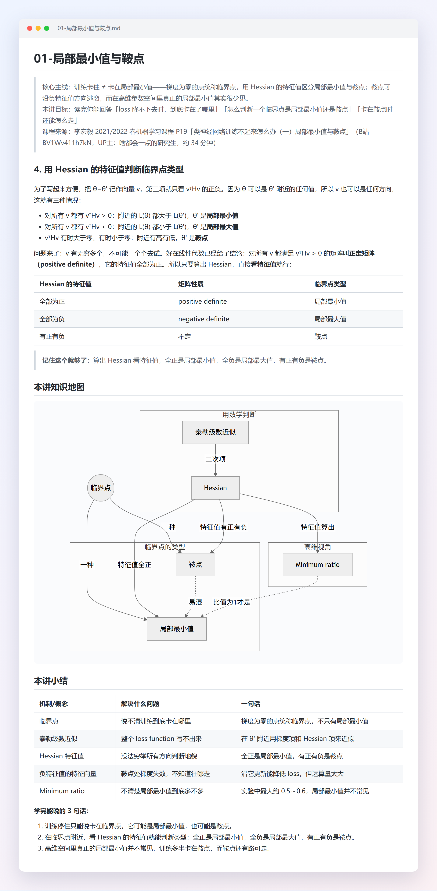

<div align="center">

# bilibili-douyin-notes

**An AI Agent Skill that turns Bilibili / Douyin / YouTube / Xiaohongshu (RedNote) videos into structured Markdown lecture notes**

Four platforms · Subtitle fetching · Local speech recognition · Key-frame screenshots · Note template — works without login, no paid API

[](https://github.com/lucky-Luor/bilibili-douyin-notes/actions/workflows/ci.yml)
[](LICENSE)
[]()
[]()
[-orange.svg)]()

[简体中文](README.md) | English

</div>

> 💬 Just tell your AI agent "make lecture notes from this video: <Bilibili / Douyin / YouTube / Xiaohongshu link>" and you get notes like this 👇
> (Examples in Chinese: [Hung-yi Lee ML course · Local Minima & Saddle Points](examples/01-局部最小值与鞍点.md); [Khan microeconomics · first 15 lessons](examples/可汗微观经济学-前15集/课程索引.md))

<p align="center"></p>

> 📜 **Personal study only**: public videos only, everything runs locally, no data collected; do not use it to redistribute or for commercial purposes. See [Usage Notice & Data Flow](#-usage-notice--data-flow).

---

## ✨ Features

- **Four platforms**: Bilibili (`bilibili.com` / `b23.tv` short links / BV IDs), Douyin (`douyin.com` / `v.douyin.com` / `iesdouyin.com` links / share text), YouTube (`youtube.com` / `youtu.be` / Shorts, official or auto captions first) and Xiaohongshu / RedNote (`xiaohongshu.com` / `xhslink.com` video-note share links)
- **Whole courses**: plan a Bilibili multipart video or collection, review the estimate and confirm a range before processing; includes a course index, a completion receipt, resume-time note checks, and retries while continuing past failed episodes
- **Course concept table and self-test**: aggregate existing concepts and questions across episodes, tick mastered concepts, preserve ticks on regeneration, and jump back to the source; ask the agent to quiz you one question at a time without supplying another video URL
- **Subtitles first**: fetches official / AI subtitles from Bilibili (login optional) — instant transcripts at zero cost
- **Local ASR fallback**: when no subtitles exist, transcribes locally with faster-whisper (CPU int8; uses the hf-mirror inside mainland China). **No paid API calls**
- **Key-frame screenshots**: anchored on transcript timestamps and extracted with PyAV; a local quality check flags black / blank / blurry frames (white-background slides are not misjudged), and the agent makes the final visual call
- **Douyin without login**: accesses public videos as a guest, no account cookie needed; the video is used only for local transcription and can be cleaned up afterwards
- **Xiaohongshu without login**: parses the data embedded in the share page and downloads video notes directly — no signature, no account (video notes only; image notes and comments are not supported)
- **Lecture-note templates**: lecture-style body (each section opens with a scenario or question, develops in paragraphs, and closes with a "remember this" takeaway), bolded key terms, real code references, a concept map, a lesson summary, concept cards, interview-style self-test questions, and an unfolded video time index with deep links; v4 targets Yuque imports, while v4-obsidian adds frontmatter and a Wiki-link table of contents
- **Original-language terms**: English courses produce Chinese notes with **中文（Original）** at each term's first appearance and an original-term field on Chinese concept cards

## 🧩 Workflow

```
Video link (Bilibili / Douyin / YouTube / Xiaohongshu)
        │
        ▼
 Step 1  Fetch metadata + subtitles (Bilibili / YouTube) / download video (Douyin / Xiaohongshu)
        │
        ├── subtitles found ──► use them directly
        └── no subtitles ─────► Step 2  local faster-whisper ASR
        │
        ▼
 Step 2.5 (optional)  key-frame screenshots (PyAV)
        │
        ▼
 Step 3  AI writes the notes from the template → validated by a quality gate
```

## ⚡ Quick Start

```bash
# One-line install (Claude Code; for other agents, use their skills directory)
git clone https://github.com/lucky-Luor/bilibili-douyin-notes.git ~/.claude/skills/bilibili-douyin-notes && pip install -r ~/.claude/skills/bilibili-douyin-notes/requirements.txt
```

Run the environment check once and fix anything it marks as failed:

```bash
python ~/.claude/skills/bilibili-douyin-notes/scripts/doctor.py
```

Then just ask your agent: **"Make lecture notes from this video: https://www.bilibili.com/video/BVxxxx"**.

## 📦 Installation

This skill follows the **Agent Skills spec** (`SKILL.md`) and works with any compatible AI agent. Supported locations:

- `~/.claude/skills/` — Claude Code
- `~/.zcode/skills/` — ZCode
- `~/.agents/skills/` — shared skills path for Codex and other agents

> 🧩 **DeepSeek Harness (DSH) users**: install the plugin edition [dsh-video-notes](https://github.com/lucky-Luor/dsh-video-notes) with one command and get updates with the plugin:
> `npx -y @deepseek-ai/dsh plugin --profile web add github:lucky-Luor/dsh-video-notes`

```bash
# 1. Clone into your agent's skills directory
git clone https://github.com/lucky-Luor/bilibili-douyin-notes.git ~/.claude/skills/bilibili-douyin-notes

# 2. Install Python dependencies
pip install -r requirements.txt

# 3. (Optional) Log in to Bilibili by QR code to get AI subtitles
python scripts/bili_fetch.py --login

# 4. Environment check: ✅ / ⚠️ / ❌ per item with fix commands (--platform douyin for Douyin only, --json for agents)
python scripts/doctor.py
```

| Component | Purpose | Required? |
|---|---|---|
| `faster-whisper` | ASR fallback | For videos without subtitles |
| `av` (PyAV) | Audio decoding / frame extraction | Same as above |
| `gmssl` | Douyin a_bogus signature (SM3) | Douyin links only |
| `yt-dlp` / `youtube-transcript-api` | YouTube metadata, captions and audio (deno recommended) | YouTube links only |
| `numpy` / `pillow` | Screenshot quality check | Screenshot step only |

### Using Chinese models in Claude Code

Claude is not available in mainland China. Claude Code can use Chinese models instead, with no change to this skill: all three providers offer an Anthropic-compatible endpoint. Set the base URL and put your key in `ANTHROPIC_AUTH_TOKEN` (do not also set `ANTHROPIC_API_KEY`):

| Provider | `ANTHROPIC_BASE_URL` | Official guide (check model names there) |
|---|---|---|
| DeepSeek | `https://api.deepseek.com/anthropic` | [Integrate with Claude Code](https://api-docs.deepseek.com/quick_start/agent_integrations/claude_code/) |
| Kimi | `https://api.moonshot.cn/anthropic` | [Claude Code with Kimi](https://platform.kimi.com/docs/guide/claude-code-kimi) |
| Zhipu GLM | `https://open.bigmodel.cn/api/anthropic` | [Claude API compatibility](https://docs.bigmodel.cn/cn/guide/develop/claude/introduction) |

Model names change quickly, so set `ANTHROPIC_MODEL` and related variables according to the official guides. Note quality depends on the model; the `validate_note.py` quality gate keeps the format in check.

## ⚙️ Configuration

Copy `config.example.json` to `config.json` in the same directory. `SESSDATA` (Bilibili login cookie) is optional and is filled in automatically by `--login`. `config.json` is git-ignored — never share it.

ASR tuning: `asr_model` (tiny ~ large-v3, falls back one size automatically on failure), `asr_device` (auto / cpu / cuda, falls back to cpu), `asr_cpu_threads` (0 = auto).

### Note templates and language

`config.note_template` sets the default (`v4` / `v4-obsidian`); a course can explicitly select one with `start --template`. v4 keeps the frontmatter-free Yuque format. v4-obsidian adds frontmatter and uses `+ [[#Exact body heading]]` entries in the table of contents; the body, concept cards, questions and time-index rules remain the same. See the [note template](references/note-template.md) for the full specification.

Notes use a lecture-style body: the opening quote states the lesson goals, a lesson summary follows the concept map, and each self-test answer is one paragraph running from conclusion to reason to example. The quality gate reports these newer conventions as warnings; existing error rules are unchanged, so older notes do not start failing. For Yuque imports, write concept-map subgraphs as `subgraph group-name` (no ID or brackets) and label plain-text code blocks `plain` rather than `text`.

For Bilibili titles that clearly suggest an English-original course (Lecture / MIT / Stanford / CS61A) without Chinese-subtitle, bilingual or dubbing markers (`中字` / `中英` / `配音`), the agent asks whether to transcribe in English first. YouTube defaults to original-language manual captions → Chinese manual captions → original-language auto captions → existing fallbacks; an explicit `--lang` overrides that language priority. Use `audio_lang` / `subtitle_lang` to determine the course language. For English courses, write Chinese prose with **中文（Original）** at each term's first appearance and Chinese concept-card names with `+ 原文：Original`. Originally Chinese courses and cards named with an untranslated foreign proper name do not need that field.

## 🚀 Usage

Talk to your agent:

> Make lecture notes from this video: https://www.bilibili.com/video/BVxxxx
>
> Summarize this Douyin video: https://v.douyin.com/xxxx/
>
> Make notes from this YouTube video: https://www.youtube.com/watch?v=xxxx

For a whole course, the agent first displays the planning confirmation verbatim and waits for your range selection. This example selects only the first three episodes:

```bash
python scripts/course_plan.py plan "<Bilibili URL>" "<course root>"
python scripts/course_plan.py start "<course root>" --first 3 --template v4 --asr-lang zh
python scripts/course_plan.py next "<course root>"
```

For Obsidian and English-original audio, use `--template v4-obsidian --asr-lang en` on `start`; use `--asr-lang auto` for automatic language detection. Without an explicit template, the default comes from `config.note_template`.

Follow the `note.template`, `note_path` and commands returned by `next`. When `existing_note:true`, edit the original note in place; rewrite only if the file is missing. A nonzero transcription exit code or JSON `status:error` means failure. After filling deep links and passing validation, call `mark … done --note …`; it runs an in-process quality gate too. If rejected, fix the reported problems and retry. If an episode still fails, record it with `mark … failed --reason … --next-step …` and continue.

On resume, `next` first rechecks done notes. An unchanged note SHA and template reuse the cache and skip validation; a broken or missing note returns to pending with `planned_note` preserved for repair. Existing drafts are never automatically marked done. `verify` requests a manual recheck and shares the SHA cache with `next`, so it is not a forced full validation. `index` refreshes the course index; `status` is read-only. Use `mark … pending` to schedule a failed episode again.

```bash
# 手动复查、刷新索引、只读查看进度
python scripts/course_plan.py verify "<course root>"
python scripts/course_plan.py index "<course root>"
python scripts/course_plan.py status "<course root>"
```

When `next` returns `status:finished`, the agent relays `receipt_text` verbatim, including the course index, concept table, course self-test and retry information. It asks about cache cleanup only when `cache.bytes > 0`, then runs `python scripts/course_plan.py clean "<course root>" --apply` only after your consent. With zero cache bytes, no cleanup question is needed.

Multipart videos default to the current video; expand a collection with `--scope season`. Lists over 200 episodes or 100 hours require a limited selection. See the whole-course workflow in [SKILL.md](SKILL.md).

### Course review

The course model and CLI are implemented and available locally. Run the commands from the project root after at least one episode is done. Review reads existing notes, adds no dependencies, and accepts existing `course.json` files.

The full offline suite and UTF-8 run currently each pass 869 tests; at I5 acceptance they passed 854 with 5 skipped. Programmatic acceptance passed on 15 real lessons. The synthetic 40-note performance case took about 0.09 seconds; 40 real lessons were not tested, following the user's decision to accept 15. See the [I5 verification record](docs/verification/I5-概念表.md) for results and outstanding checks.

```bash
python scripts/course_plan.py concepts "<course root>" # 生成或刷新概念表.md、课程自测.md
python scripts/course_plan.py concepts "<course root>" --unmastered # 只读列出没掌握的概念与对应题目
python scripts/course_plan.py concepts "<course root>" --master "机会成本" # 标记已掌握并刷新，可重复传入名称
python scripts/course_plan.py concepts "<course root>" --unmaster "机会成本" # 取消掌握标记并刷新
python scripts/course_plan.py concepts "<course root>" --check # 只检查、不写文件，有错误时退出码为1
```

The three groups `--check`, `--unmastered`, and `--master/--unmaster` are mutually exclusive. Aggregation includes all done episodes with note paths, regardless of the current selection. The course index and completion receipt link to both review files. `mark`, `verify`, completion of `next`, and `index` also refresh them; a failed refresh returns `review_warning`.

Change `+ [ ]` to `+ [x]` in `概念表.md` to mark a concept as mastered. Regeneration preserves these ticks and backs them up in `course.json`; an unreadable concept table is not overwritten. Answers in `课程自测.md` are unfolded, so cover them for a manual test. After at least one concept is ticked and the files are refreshed, questions for unmastered concepts appear first; all questions remain available below.

Ask the agent to “quiz me on this course” or “show what I haven't mastered,” with the course directory in context; no video URL is required. It reads `--unmastered`, asks one existing question at a time without revealing the answer, then checks your response against the original answer and adds replay and note links. Without a timestamp, it gives the note link only. A correct response or “I know this” still requires your consent before marking mastery. See the [beta guide in Chinese](docs/dev/复习版内测.md).

Or run the scripts by hand (see [SKILL.md](SKILL.md) for details):

```bash
python scripts/bili_fetch.py --probe "<url>"                 # metadata only
python scripts/bili_fetch.py "<url>" "<outdir>"              # Bilibili: metadata + subtitles
python scripts/douyin_fetch.py "<url or share text>" "<outdir>"  # Douyin: metadata + video
python scripts/yt_fetch.py "<url>" "<outdir>"  # YouTube: metadata + captions (--download for audio)
python scripts/xhs_fetch.py "<share link or text>" "<outdir>"  # Xiaohongshu: metadata + video (link must carry xsec_token)
python scripts/bili_transcribe.py "<outdir>/metadata.json"  # local ASR when no subtitles
python scripts/note_nav.py "<note.md>" --template v4 --meta "<outdir>/metadata.json" --txt-dir "<outdir>"       # fill deep links
python scripts/validate_note.py "<note.md>" --template v4 --meta "<outdir>/metadata.json" --txt-dir "<outdir>"  # quality gate
# 单视频 Obsidian 变体：深链和门禁使用同一模板
python scripts/note_nav.py "<note.md>" --template v4-obsidian --meta "<outdir>/metadata.json" --txt-dir "<outdir>"
python scripts/validate_note.py "<note.md>" --template v4-obsidian --meta "<outdir>/metadata.json" --txt-dir "<outdir>"
```

## Directory layout

```text
├── SKILL.md               # 技能流程与生成规则
├── scripts/               # 抓取、转写、截图、门禁与课程命令
│   └── course_plan.py     # 课程规划、续跑复查、索引、回执与清理
├── references/            # 模板与术语参考
│   └── note-template.md   # v4 / v4-obsidian 规范
├── examples/              # 单篇样例与微观经济学前15集节选
├── docs/images/           # README 配图
└── tests/                 # 离线测试
```

The [first 15 Khan microeconomics lessons](examples/可汗微观经济学-前15集/课程索引.md) provide a course index and 15 Chinese notes covering 1 hour, 59 minutes and 1 second of source video. See the [source and licensing notes](examples/可汗微观经济学-前15集/README.md). Review links: [concept table](examples/可汗微观经济学-前15集/概念表.md) (cross-episode concepts, mastery ticks and replay links) and [course self-test](examples/可汗微观经济学-前15集/课程自测.md) (existing questions, answers and replay links). The user limited this run to the first 15 lessons; this is an excerpt, not the full 71-part course. The [I4 verification record](docs/verification/I4-课程版.md) distinguishes verified results from incomplete desktop checks.

## ❓ FAQ

<details>
<summary><b>Does PowerShell 5.1 NativeCommandError mean the script failed?</b></summary>

Not necessarily. PowerShell 5.1 may display normal native-command stderr progress or warnings as `NativeCommandError`. Check the process exit code (`$LASTEXITCODE` immediately after the command) and the last stdout JSON line. A nonzero exit code or JSON `status:error` means failure; red stderr output alone does not.
</details>

<details>
<summary><b>What do I need?</b></summary>

Python 3.10+ and any AI agent that supports the Agent Skills (`SKILL.md`) spec, such as Claude Code, Codex or ZCode. No GPU and no paid API required. Not sure your setup is complete? Run `python scripts/doctor.py`.
</details>

<details>
<summary><b>Scripts fail with encoding errors / notes open as garbage?</b></summary>

File-encryption (DLP) software can encrypt `.md` and `.txt` files written by Explorer, PowerShell or even `git clone` (`.py` and `.json` were not affected in our tests), so Python and pip read ciphertext. `doctor.py` detects this.

- **Real fix**: ask IT to whitelist `python.exe` and your AI agent; re-cloning may not help
- **`pip install -r requirements.txt` fails with `UnicodeDecodeError`**: `requirements.txt` itself is encrypted — list the packages directly:

  ```bash
  pip install faster-whisper ctranslate2 av numpy pillow qrcode gmssl "yt-dlp>=2026.8.19" "youtube-transcript-api>=1.2.0" oss2
  ```
</details>

<details>
<summary><b>Do I have to log in to Bilibili?</b></summary>

No. Official CC subtitles work without login, and local ASR kicks in when there are none. Logging in by QR code unlocks Bilibili AI subtitles, which lets most videos skip ASR entirely. Douyin and Xiaohongshu need no login at all; YouTube usually doesn't either — add cookies / a proxy only if it blocks you.
</details>

<details>
<summary><b>YouTube says "Sign in to confirm you're not a bot"?</b></summary>

YouTube blocks some server IPs. Pass `--cookies-from-browser chrome` (or `--cookies cookies.txt`) to `yt_fetch.py`, add `--proxy` if needed, keep `yt-dlp` up to date and install deno.
</details>

<details>
<summary><b>Xiaohongshu link fails / mentions xsec_token?</b></summary>

Use the full share link (App → Share → Copy link) that carries `xsec_token`; a bare note ID won't work. Tokens expire — just copy the link again. Only video notes are supported.
</details>

<details>
<summary><b>ASR is too slow?</b></summary>

The default `small` model runs at about 0.2× the video length on a 6-core laptop CPU (a 26-minute lecture takes about 4 minutes). If you are in a hurry, set `asr_model` to `base` in `config.json`: about 3× faster, but noticeably less accurate (only 0.72–0.79 text agreement with `small` in our test). Set `asr_device: "cuda"` if you have an NVIDIA GPU. You can also transcribe a single part first (`--page 1`) to estimate the time.
</details>

<details>
<summary><b>Does it work for English videos?</b></summary>

Yes — faster-whisper is multilingual. For English-original courses, choose `--asr-lang en` at course start (`zh` for Chinese, `auto` for detection). The default notes use Chinese prose with bilingual first-use terms and original-term fields on Chinese concept cards, as described above. Ask your agent explicitly if you want the notes themselves in English.
</details>

## 📜 Usage Notice & Data Flow

- **Personal study only**: this tool turns public courses into your own study notes. Do not use it to repost, redistribute or for any commercial purpose; follow each platform's terms of service and respect creators' copyright.
- **Public content only**: paid / premium content and private favorites are not supported and are not planned; the Bilibili SESSDATA cookie is only an optional fallback for subtitles.
- **Where your data goes**:
  - Fetching, ASR and screenshots all run on your own machine; this project collects no usage data and uploads nothing (it has no server).
  - Downloaded video / audio is used only for local ASR and screenshots, and can be removed with `clean_media.py` afterwards (the agent asks you first).
  - Screenshots stay local unless you configure OSS yourself and run `upload_images.py --apply`, which uploads to **your own** bucket.
  - Notes are written by your own AI agent; subtitles and transcripts are sent to whatever model service that agent uses, under its own rules.
- **Platform notices**: if a platform raises a notice or objection, the maintainer will take the related module offline within 48 hours and explain it in this README.

## 🛡️ Platform Support Tiers

This project is maintained by one person, so Bilibili comes first.

| Tier | Platforms | Commitment |
|---|---|---|
| Tier 1 | Bilibili | Fixed **within 7 days** after a platform change breaks it; real-link smoke tests run twice a week and before every release |
| Tier 2 | YouTube, Douyin, Xiaohongshu | **Best effort**: breakages are confirmed and tracked in issues, with no fixed timeline; Douyin's signature and Xiaohongshu's page structure are controlled by the platforms and may break temporarily |

When something fails, the scripts print a three-part message (cause / impact / next step) and tell you whether the link itself is the problem (just use another link) or the platform changed (wait for a fix). Please open an issue with the link and that message.

## ⚠️ Known Limitations

- Videos without subtitles need local ASR: measured at about 0.2× the video length on a 6-core laptop CPU (CPU int8; older CPUs are slower), faster with an NVIDIA GPU
- ASR may garble technical terms — use `scripts/apply_glossary.py` to correct them
- Douyin depends on the platform's signature algorithm and may break temporarily when the platform updates (detail API returns 403)
- YouTube may block server / cloud IPs (cookies or a proxy needed); keep `yt-dlp` updated
- Xiaohongshu relies on the share page's embedded data and may break when the site changes; frequent requests trigger captchas (461/471); video notes only
- Only publicly accessible videos are supported

## 📄 License

[MIT](LICENSE). **Exception:** `scripts/abogus.py` (Douyin signature, GPLv3) is **not** included in this repository; `scripts/ensure_abogus.py` downloads it from a pinned upstream commit with SHA-256 verification on first use. See the [Chinese README](README.md#-许可证) for details.

## 🙏 Acknowledgements

[JoeanAmier/TikTokDownloader](https://github.com/JoeanAmier/TikTokDownloader) · [Evil0ctal/Douyin_TikTok_Download_API](https://github.com/Evil0ctal/Douyin_TikTok_Download_API) · [JefferyHcool/BiliNote](https://github.com/JefferyHcool/BiliNote) · [youtube-transcript-api](https://github.com/jdepoix/youtube-transcript-api) · [yt-dlp](https://github.com/yt-dlp/yt-dlp) · [ReaJason/xhs](https://github.com/ReaJason/xhs) · [XHS-Downloader](https://github.com/JoeanAmier/XHS-Downloader) (ideas only) · [faster-whisper](https://github.com/SYSTRAN/faster-whisper)

<div align="center">

**If this skill saves you note-taking time, a ⭐ Star would mean a lot!**

Got notes you're happy with? Share them in [Issues](https://github.com/lucky-Luor/bilibili-douyin-notes/issues) — bug reports and ideas are welcome too 🙌

</div>
