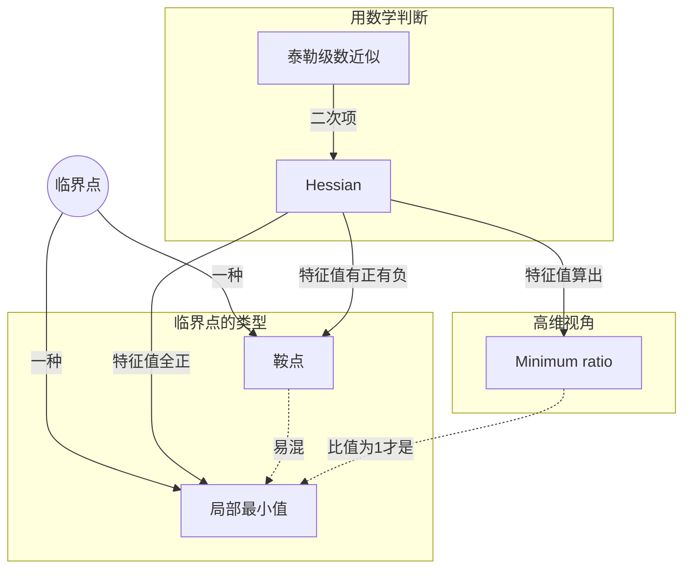

> 核心主线：训练卡住 ≠ 卡在局部最小值——梯度为零的点统称临界点，用 Hessian 的特征值区分局部最小值与鞍点；鞍点可沿负特征值方向逃离，而在高维参数空间里真正的局部最小值其实很少见。  
> 本讲目标：读完你能回答「loss 降不下去时，到底卡在了哪里」「怎么判断一个临界点是局部最小值还是鞍点」「卡在鞍点时还能怎么走」  
> 课程来源：李宏毅 2021/2022 春机器学习课程 P19「类神经网络训练不起来怎么办（一）局部最小值与鞍点」（B站 BV1Wv411h7kN，UP主：啥都会一点的研究生，约 34 分钟）

## 目录
+ [1. 为什么 Optimization 会失败](#1-为什么-optimization-会失败)
+ [2. 临界点：局部最小值与鞍点](#2-临界点局部最小值与鞍点)
+ [3. 用泰勒展开描述临界点附近的地貌](#3-用泰勒展开描述临界点附近的地貌)
+ [4. 用 Hessian 的特征值判断临界点类型](#4-用-hessian-的特征值判断临界点类型)
+ [5. 实例：史上最废的两参数网络](#5-实例史上最废的两参数网络)
+ [6. 沿特征向量方向逃离鞍点](#6-沿特征向量方向逃离鞍点)
+ [7. 高维视角：局部最小值其实并不常见](#7-高维视角局部最小值其实并不常见)
+ [本讲知识地图](#本讲知识地图)
+ [本讲小结](#本讲小结)
+ [概念卡片](#概念卡片)
+ [自测题（面试速答）](#自测题面试速答)
+ [视频时间索引](#视频时间索引)

---

## 1. 为什么 Optimization 会失败
你一定遇到过这种情况：参数不断更新，**training loss** 却不再下降，而这个数值你并不满意。比如深层网络并没有比线性模型或浅层网络做得更好，说明它的能力没有发挥出来。更糟的时候，模型一开始就训练不起来，不管怎么更新，loss 都掉不下去。

这一讲只讨论 **Optimization**，也就是怎么把 gradient descent 做好，和 Overfitting 基本没有关系。

那到底发生了什么？过去常见的猜想是：参数走到了一个对 loss 微分为零的地方。梯度一旦为零，gradient descent 就没办法再更新参数，训练随之停下，loss 自然也不再下降。

> **记住这个就够了**：训练停住的常见解释是梯度为零，gradient descent 在那里无法继续更新参数。

---

## 2. 临界点：局部最小值与鞍点
提到梯度为零，很多人脑海里第一个浮现的就是 **local minima**，于是常说「卡在局部最小值了」。但老师特别提醒：写论文时别这么说，会显得不专业。为什么？因为让梯度为零的不只有它。

还有一种点，梯度同样为零，但既不是局部最小值也不是局部最大值：在某个方向上较高，在另一个方向上较低，形状像马鞍。它叫**鞍点（saddle point）**。这些梯度为零的点统称**临界点（critical point）**，所以准确的说法是「卡在了 critical point」。

区分两者不是咬文嚼字，因为它们决定了接下来还有没有路可走：

| 卡在哪里 | 周围地形 | 还有没有路走 |
|---|---|---|
| 局部最小值 | 四周都比当前点高 | 不知道怎么走到别处，往四周走 loss 都会上升 |
| 鞍点 | 有些方向高、有些方向低 | 有路可走，逃离鞍点 loss 还能继续下降 |

> **记住这个就够了**：梯度为零不等于卡在局部最小值；如果是鞍点，还有路可走。

---

## 3. 用泰勒展开描述临界点附近的地貌
要判断一个临界点属于哪一类，得知道 loss function 的形状。可是网络这么复杂，loss function 不可能完整写出来，怎么办？

虽然整体写不出来，但在给定参数 θ' **附近**，可以用**泰勒级数近似**来表示它：

```plain
L(θ) ≈ L(θ') + (θ−θ')ᵀ g + ½ (θ−θ')ᵀ H (θ−θ')

临界点处 g = 0：
L(θ) ≈ L(θ') + ½ (θ−θ')ᵀ H (θ−θ')
```

这三项各有分工。θ 和 θ' 很接近时，L(θ) 应该和 L(θ') 也很接近，这是第一项；两者之间还有差距，由梯度 **g**（一次微分）组成的第二项来弥补；剩下的差距，再由第三项补足。第三项里的 **H 叫 Hessian**，是一个矩阵，第 i 行第 j 列放的是 L 对 θᵢ、θⱼ 的二次微分。

走到临界点时，g 是零向量，第二项整个消失，只剩第三项。也就是说，θ' 附近的地貌可以由 Hessian 这一项来判断。

> **记住这个就够了**：在临界点附近，loss 的地貌由 Hessian 这一项决定。

---

## 4. 用 Hessian 的特征值判断临界点类型
为了写起来方便，把 θ−θ' 记作向量 v，第三项就只看 vᵀHv 的正负。因为 θ 可以是 θ' 附近的任何值，所以 v 也可以是任何方向，这就有三种情况：

+ 对所有 v 都有 vᵀHv > 0：附近的 L(θ) 都大于 L(θ')，θ' 是**局部最小值**
+ 对所有 v 都有 vᵀHv < 0：附近的 L(θ) 都小于 L(θ')，θ' 是**局部最大值**
+ vᵀHv 有时大于零、有时小于零：附近有高有低，θ' 是**鞍点**

问题来了：v 有无穷多个，不可能一个个去试。好在线性代数已经给了结论：对所有 v 都满足 vᵀHv > 0 的矩阵叫**正定矩阵（positive definite）**，它的特征值全部为正。所以只要算出 Hessian，直接看**特征值**就行：

| Hessian 的特征值 | 矩阵性质 | 临界点类型 |
|---|---|---|
| 全部为正 | positive definite | 局部最小值 |
| 全部为负 | negative definite | 局部最大值 |
| 有正有负 | 不定 | 鞍点 |

> **记住这个就够了**：算出 Hessian 看特征值，全正是局部最小值，全负是局部最大值，有正有负是鞍点。

---

## 5. 实例：史上最废的两参数网络
上面的数学如果没听懂也没关系，老师用一个「史上最废」的网络完整走了一遍。网络是 y = w₁·w₂·x，没有激活函数，也没有 bias；训练数据也只有一笔：x = 1，标签 ŷ = 1。

因为只有两个参数，可以穷举所有 w₁、w₂ 算出 loss，直接画出 **error surface**。从图上看，**原点**是鞍点：往一个方向走 loss 变大，往另一个方向走 loss 变小；两条山沟里则排着一排局部最小值。

那不穷举能判断吗？能。loss 写出来是 L = (1 − w₁w₂)²，w₁ = w₂ = 0 时梯度为零，所以原点是临界点。再收集 L 的二次微分，代入原点就得到 Hessian，算出特征值是 **2 和 −2**，有正有负，所以是鞍点，和图上看到的一致。

```python
# 按视频讲解还原：在原点 (w1, w2) = (0, 0) 处判断临界点类型
import numpy as np

H = np.array([[0, -2],
              [-2, 0]])        # L = (1 - w1*w2)^2 在原点的 Hessian
eigvals, eigvecs = np.linalg.eigh(H)
print(eigvals)                  # [-2.  2.] → 有正有负 → 鞍点
```

> **记住这个就够了**：不用穷举画图，算出原点的 Hessian，特征值 2 和 −2 有正有负，就能确定它是鞍点。

---

## 6. 沿特征向量方向逃离鞍点
走到鞍点时梯度没了，g 派不上用场，是不是就没有方向了？不是，Hessian 还能告诉我们往哪走。

设 u 是 H 的特征向量，λ 是对应的特征值。把 v 换成 u，第三项就变成 uᵀHu = λ‖u‖²。‖u‖² 一定为正，所以只要 λ < 0，这一项就是负的。令 θ = θ' + u，就得到 L(θ) < L(θ')。换句话说，**找出负特征值和它对应的特征向量，沿这个方向更新参数，loss 就会下降**。

回到上一节的例子：λ = −2 对应的特征向量之一是 [1, 1]，沿它更新就能离开原点。代入验算一下，原点的 loss 是 1，走到 (1, 1) 时 loss 是 0，确实变低了（视频中未展开，笔记补充）。

不过实际训练中几乎没有人这么做：要算二次微分的矩阵，再算特征值和特征向量，运算量太大。后面会讲其他运算量小得多的逃离方法。讲这一招，是想说明卡在鞍点并没有那么可怕。

> **记住这个就够了**：负特征值对应的特征向量指出了 loss 下降的方向，只是实际训练中算起来太贵。

---

## 7. 高维视角：局部最小值其实并不常见
既然鞍点没那么可怕，那鞍点和局部最小值到底谁更常见？

**打个比方：** 老师讲了《三体》里魔法师狄奥伦娜的故事：她能从封闭的石棺里取走圣物，再放进一串葡萄。在三维空间看，石棺没有任何路可以进去；但她能进入四维空间，从高维看，石棺并不是封闭的。

error surface 会不会也一样？一维里看起来到处是局部最小值，到二维可能只是鞍点；二维里无路可走的局部最小值，到更高维度可能就有路了。网络参数动辄成百上千万，error surface 的维度同样这么高，可走的路很可能非常多。

实验也支持这个猜想。把训练到梯度很小的网络拿出来分析，用 **Minimum ratio** 衡量它有多像局部最小值：Minimum ratio = 正特征值个数 ÷ 特征值总数，全部为正（比值为 1）才是真正的局部最小值。结果这个比值最大也只有约 0.5～0.6，也就是说，仍有差不多一半的方向可以让 loss 下降。

> **记住这个就够了**：参数空间维度很高，真正的局部最小值并不常见，训练停下来多半是卡在鞍点。

---

## 本讲知识地图


## 本讲小结
| 机制/概念 | 解决什么问题 | 一句话 |
| --- | --- | --- |
| 临界点 | 说不清训练到底卡在哪里 | 梯度为零的点统称临界点，不只有局部最小值 |
| 泰勒级数近似 | 整个 loss function 写不出来 | 在 θ' 附近用梯度项和 Hessian 项来近似 |
| Hessian 特征值 | 没法穷举所有方向判断地貌 | 全正是局部最小值，有正有负是鞍点 |
| 负特征值的特征向量 | 鞍点处梯度失效，不知道往哪走 | 沿它更新能降低 loss，但运算量太大 |
| Minimum ratio | 不清楚局部最小值到底多不多 | 实验中最大约 0.5～0.6，局部最小值并不常见 |

**学完能说的 3 句话：**
1. 训练停住只能说卡在临界点，它可能是局部最小值，也可能是鞍点。
2. 在临界点附近，看 Hessian 的特征值就能判断类型：全正是局部最小值，全负是局部最大值，有正有负是鞍点。
3. 高维空间里真正的局部最小值并不常见，训练多半卡在鞍点，而鞍点还有路可走。

## 概念卡片
### 临界点
+ 定义：梯度为零的点的统称，包括局部最小值、局部最大值和鞍点
+ 出现：第 1 节「为什么 Optimization 会失败」、第 2 节「临界点：局部最小值与鞍点」、第 4 节「用 Hessian 的特征值判断临界点类型」
+ 依赖：
+ 易混：局部最小值——局部最小值只是临界点的一种，训练停住不等于卡在局部最小值

### 鞍点
+ 定义：梯度为零，但某些方向较高、某些方向较低的点，Hessian 特征值有正有负
+ 出现：第 2 节「临界点：局部最小值与鞍点」、第 4 节「用 Hessian 的特征值判断临界点类型」、第 5 节「实例：史上最废的两参数网络」、第 6 节「沿特征向量方向逃离鞍点」、第 7 节「高维视角：局部最小值其实并不常见」
+ 依赖：临界点，Hessian
+ 易混：局部最小值——鞍点周围仍有让 loss 下降的方向

### 局部最小值
+ 定义：附近所有方向的 loss 都比它高的临界点，Hessian 特征值全部为正
+ 出现：第 2 节「临界点：局部最小值与鞍点」、第 4 节「用 Hessian 的特征值判断临界点类型」、第 7 节「高维视角：局部最小值其实并不常见」
+ 依赖：临界点，Hessian
+ 易混：鞍点——局部最小值四周都没有下降路径

### Hessian
+ 定义：由 loss 对参数二次微分组成的矩阵，在临界点处决定附近的地貌
+ 出现：第 3 节「用泰勒展开描述临界点附近的地貌」、第 4 节「用 Hessian 的特征值判断临界点类型」、第 5 节「实例：史上最废的两参数网络」、第 6 节「沿特征向量方向逃离鞍点」
+ 依赖：泰勒级数近似
+ 易混：Minimum ratio——Hessian 是矩阵本身，Minimum ratio 是由其特征值算出的比例

### 泰勒级数近似
+ 定义：在参数 θ' 附近，用 L(θ')、梯度项和 Hessian 项来近似 loss function
+ 出现：第 3 节「用泰勒展开描述临界点附近的地貌」、第 4 节「用 Hessian 的特征值判断临界点类型」
+ 依赖：
+ 易混：Hessian——泰勒展开是描述框架，Hessian 只是其中的二次项

### Minimum ratio
+ 定义：正特征值个数占全部特征值个数的比例，用来衡量临界点有多像局部最小值
+ 出现：第 4 节「用 Hessian 的特征值判断临界点类型」、第 7 节「高维视角：局部最小值其实并不常见」
+ 依赖：Hessian
+ 易混：局部最小值——只有比值为 1 才是真正的局部最小值

## 自测题（面试速答）
1. 训练时 loss 不再下降，为什么不能直接说"卡在了局部最小值"？（对应：临界点）

**答案：** 因为只能确定卡在了临界点，不能断言是局部最小值。梯度为零的点除了局部最小值，还有局部最大值和鞍点，gradient descent 在这些点上都会停下。比如马鞍形状的鞍点，梯度同样为零，但它旁边还有让 loss 下降的方向。

2. 在临界点处，泰勒展开中的哪一项决定了附近的地貌？为什么？（对应：泰勒级数近似）

**答案：** 由 Hessian 所在的二次项决定。泰勒展开里，一次项靠梯度 g，而临界点处 g 是零向量，这一项整个消失，只剩 L(θ') 加上二次项。所以看 (θ−θ')ᵀH(θ−θ') 的正负，就能知道 θ' 附近是高还是低。

3. 如何通过 Hessian 判断一个临界点是局部最小值、局部最大值还是鞍点？（对应：Hessian）

**答案：** 直接看 Hessian 的特征值：全正是局部最小值，全负是局部最大值，有正有负是鞍点。原因是特征值全正的矩阵正定，对所有 v 都有 vᵀHv > 0，这样就不用逐个方向去试。第 5 节的例子里，特征值是 2 和 −2，所以原点是鞍点。

4. 对于 L = (1 − w₁w₂)²，原点的 Hessian 特征值是多少？由此能得出什么结论？（对应：鞍点）

**答案：** 特征值是 2 和 −2，所以原点是鞍点。w₁ = w₂ = 0 时梯度为零，原点是临界点；把二次微分代入原点，Hessian 是 [[0, −2], [−2, 0]]。特征值有正有负，和穷举画出的 error surface 上看到的一致：一个方向 loss 变大，另一个方向 loss 变小。

5. 卡在鞍点时，Hessian 怎样告诉我们参数的更新方向？实际训练中为什么很少这么做？（对应：鞍点）

**答案：** 沿负特征值对应的特征向量更新，loss 就会下降。因为 uᵀHu = λ‖u‖²，λ < 0 时这一项为负，令 θ = θ' + u 就有 L(θ) < L(θ')。实际很少这么做，是因为计算二次微分矩阵及其特征值、特征向量的运算量太大，有其他代价更低的逃离方法。

6. Minimum ratio 是怎么定义的？实验中它的取值说明了什么？（对应：Minimum ratio）

**答案：** 它是正特征值个数除以特征值总数，比值为 1 才是真正的局部最小值。实验把训练到梯度很小的网络拿出来分析，这个比值最大也只有约 0.5～0.6。这说明仍有约一半的方向能让 loss 下降，真正的局部最小值并不常见，训练多半卡在鞍点。

---

## 视频时间索引
+ [00:31](https://www.bilibili.com/video/BV1Wv411h7kN?p=19&t=31) 1. 为什么 Optimization 会失败
+ [01:52](https://www.bilibili.com/video/BV1Wv411h7kN?p=19&t=112) 2. 临界点：局部最小值与鞍点
+ [04:17](https://www.bilibili.com/video/BV1Wv411h7kN?p=19&t=257) 3. 用泰勒展开描述临界点附近的地貌
+ [09:32](https://www.bilibili.com/video/BV1Wv411h7kN?p=19&t=572) 4. 用 Hessian 的特征值判断临界点类型
+ [13:24](https://www.bilibili.com/video/BV1Wv411h7kN?p=19&t=804) 5. 实例：史上最废的两参数网络
+ [19:59](https://www.bilibili.com/video/BV1Wv411h7kN?p=19&t=1199) 6. 沿特征向量方向逃离鞍点
+ [25:52](https://www.bilibili.com/video/BV1Wv411h7kN?p=19&t=1552) 7. 高维视角：局部最小值其实并不常见
