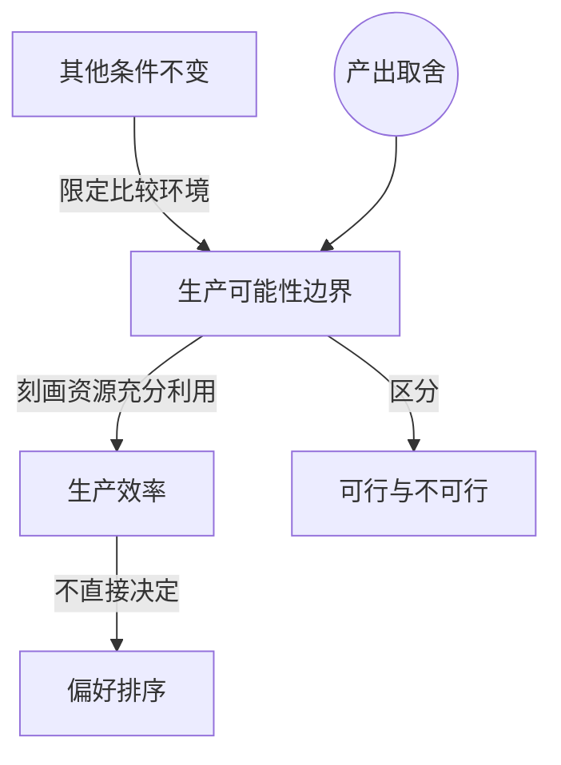

> 核心主线：有限时间迫使人们在两种产出之间取舍，生产可能性边界刻画资源被充分利用时的产出组合，并区分可行、不可行与生产有效率的选择。  
> 课程来源：可汗学院《微观经济学》第1讲「生产可能性边界」（B站 BV1Gy4y1a7aE，上传者：农夫CC，时长10分59秒；原讲者：Sal Khan）  
> 官方原课：[Production possibilities curve](https://www.khanacademy.org/economics-finance-domain/microeconomics/basic-economic-concepts-gen-micro/production-possibilities/v/production-possibilities-frontier)。本篇为中文转述与结构重组，依据原课页面的 [CC BY-NC-SA 4.0](https://creativecommons.org/licenses/by-nc-sa/4.0/) 分享改编内容，属非官方学习整理，不代表 Khan Academy 背书。All Khan Academy content is available for free at www.khanacademy.org

## 目录
+ [1. 有限资源与比较前提](#1-有限资源与比较前提)
+ [2. 用产出组合表达取舍](#2-用产出组合表达取舍)
+ [3. 从离散组合到生产可能性边界](#3-从离散组合到生产可能性边界)
+ [4. 可行性与生产效率的区别](#4-可行性与生产效率的区别)
+ [本讲知识地图](#本讲知识地图)
+ [概念卡片](#概念卡片)
+ [自测题（复习用）](#自测题复习用)
+ [视频时间索引](#视频时间索引)

---

## 1. 有限资源与比较前提
**核心思想：** 分析两种产出的取舍，需要先固定总资源和生产条件。

+ 假设一个狩猎采集者只能捕捉兔子、采集浆果。一天除睡眠等活动以外的可用时间有限，更多时间用于捕兔，就意味着更少时间用于采集浆果。
+ 这里比较的是**资源分配**的不同方案，并没有同时增加劳动时间或改进捕猎、采集技术。
+ **其他条件不变（Ceteris paribus）**指比较某个变量的变化时，把其余相关条件保持相同。本例中包括可用时间、休息安排和生产方法。
+ 先把条件固定下来，才能把产出变化归因于时间在两项活动之间的重新分配。否则，多获得浆果可能来自工作更久或技术改善，而非减少捕兔时间。

## 2. 用产出组合表达取舍
**核心思想：** 一项方案应同时记录两种产出，不能只看其中一种。

+ 将全部可用时间用于捕兔时，平均每天可以获得5只兔子和0颗浆果；将全部时间用于采集时，则可以获得0只兔子和300颗浆果。
+ 从捕兔活动中移出部分时间，可以增加浆果产出，但要放弃部分兔子。表格中的每行表示一个完整的日均产出组合。
+ 这些数值是课程设定的例子，用于说明取舍关系，不是对所有狩猎者都成立的经验规律。

| 方案 | 兔子数量 | 浆果数量 |
|---|---:|---:|
| A | 5 | 0 |
| B | 4 | 100 |
| C | 3 | 180 |
| D | 2 | 240 |
| E | 1 | 280 |
| F | 0 | 300 |

+ **生产可能性边界（Production possibilities frontier）**连接的是资源得到充分利用时能够实现的产出组合。表中各点是边界上的若干示例。
+ 评价一个组合时，两种产出需要一起考虑。例如B方案比A多100颗浆果，同时少1只兔子，不能只说B“产出更多”。

## 3. 从离散组合到生产可能性边界
**核心思想：** 边界不只包含列出的几个方案，还概括同一生产条件下其他可实现的最大产出组合。

+ 以兔子数量为横轴、浆果数量为纵轴，把A到F依次画在图上，就能直观看到一种产出增加时另一种产出的变化。
+ 将这些点连接得到一条曲线，称为生产可能性边界，也常称生产可能性曲线。课程没有把选择限制在六个整数方案中。
+ 兔子数量允许理解为多天平均值，因此平均每天4.5只兔子等中间组合也可以讨论；相应的浆果数量不必恰好等于表中某个数。
+ 其他条件不变是解释这条边界的前提：图中展示的是同样时间、资源和方法下的取舍，而不是把不同技术条件的方案混在一起。
+ **生产效率（Productive efficiency）**用于判断是否已经充分利用当前资源。边界上的组合体现的是“在这些条件下已做到所能做到的最多”，而非社会偏好的排序。

## 4. 可行性与生产效率的区别
**核心思想：** 能生产出来，并不等于已充分利用资源；充分利用资源，也不等于某个组合最值得选择。

+ 边界以外、要求两种产出超过现有能力的点，在本例固定条件下不可实现。不能仅靠重新分配同一天的时间达到这些点。
+ 边界以内的点是可行的。例如1只兔子与200颗浆果可以实现，但同样时间条件下，本可以在保留1只兔子的同时获得更多浆果。
+ 因此，内部点可能代表时间没有充分利用、注意力不足，或者生产活动安排不够有效；课程也将同样思路推广到工厂的资源利用。
+ 边界上的点具有生产效率，但不同边界点之间仍存在兔子和浆果的取舍。课程没有据此判定A比F更好，或某个中间点最优。
+ 阅读生产可能性边界时，应分别回答三个问题：组合能否实现、资源是否充分利用，以及人们更偏好哪种组合。本讲主要解决前两个问题，没有给出第三个问题的选择准则。

## 本讲知识地图

## 概念卡片
### 其他条件不变
+ 原文：Ceteris paribus
+ 定义：比较某项变量变化时保持其余相关条件相同的分析前提。
+ 出现：第 1 节「有限资源与比较前提」、第 3 节「从离散组合到生产可能性边界」
+ 依赖：
+ 易混：生产效率——前者限定比较条件，后者判断资源是否充分利用。

### 生产可能性边界
+ 原文：Production possibilities frontier
+ 定义：在给定资源和生产条件下，充分利用资源所能实现的不同产出组合构成的边界。
+ 出现：第 2 节「用产出组合表达取舍」、第 3 节「从离散组合到生产可能性边界」、第 4 节「可行性与生产效率的区别」
+ 依赖：其他条件不变
+ 易混：生产效率——边界是组合的集合，效率是对资源利用状态的判断。

### 生产效率
+ 原文：Productive efficiency
+ 定义：在既定资源与生产条件下，产出组合已位于生产可能性边界、资源得到充分利用的状态。
+ 出现：第 3 节「从离散组合到生产可能性边界」、第 4 节「可行性与生产效率的区别」
+ 依赖：生产可能性边界
+ 易混：其他条件不变——生产有效率不表示所有条件都相同，也不直接给出偏好排序。

## 自测题（复习用）
1. 比较不同捕兔和采集方案时，为什么要固定可用时间和生产技术？（对应：其他条件不变）

**答案：** 这样才能将产出差异归因于资源重新分配，而不是工作时间增加或技术变化。

2. 从A方案改为B方案，两种产出分别如何变化？（对应：生产可能性边界）

**答案：** 兔子从5只减至4只，浆果从0颗增至100颗，表现为增加一种产出同时放弃另一种产出。

3. 表中只有六种方案，为什么边界仍可理解为连续的产出组合？（对应：生产可能性边界）

**答案：** 六点只是选出的示例，产出还可按多天平均值理解，中间分配方式也对应其他组合。

4. 每天生产1只兔子和200颗浆果，为什么可以实现却缺乏生产效率？（对应：生产效率）

**答案：** 该组合在边界以内，同样资源下保留1只兔子还可以获得更多浆果，说明资源未充分利用。

5. 为什么不能根据某个组合位于边界上，就断言它比另一个边界组合更好？（对应：生产效率）

**答案：** 边界说明生产能力已充分利用，但不同组合的优劣还需要偏好信息，本讲没有给出这种排序。

---

## 视频时间索引
+ [00:00](https://www.bilibili.com/video/BV1Gy4y1a7aE?p=1&t=0) 1. 有限资源与比较前提
+ [00:28](https://www.bilibili.com/video/BV1Gy4y1a7aE?p=1&t=28) 2. 用产出组合表达取舍
+ [06:28](https://www.bilibili.com/video/BV1Gy4y1a7aE?p=1&t=388) 3. 从离散组合到生产可能性边界
+ [09:21](https://www.bilibili.com/video/BV1Gy4y1a7aE?p=1&t=561) 4. 可行性与生产效率的区别
