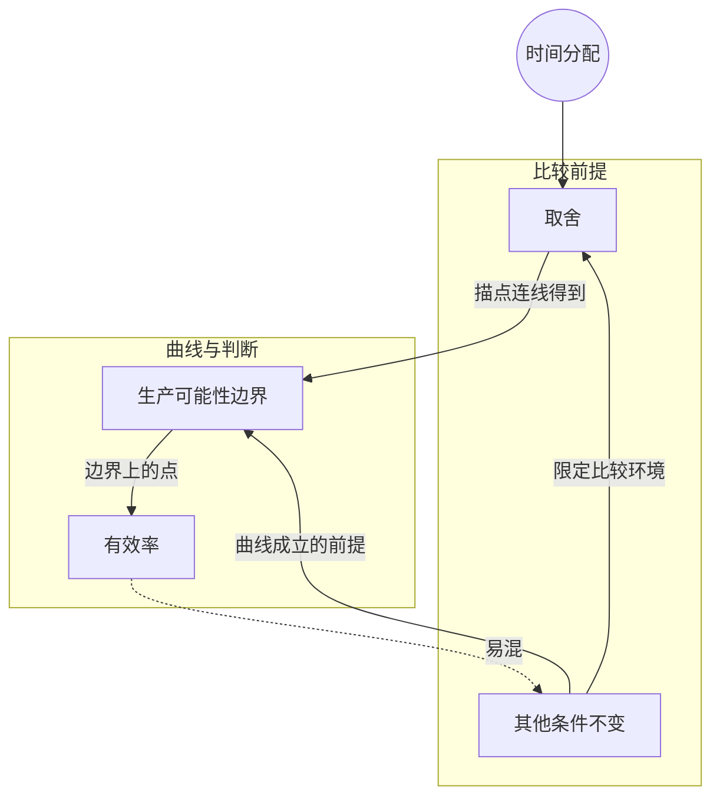

> 核心主线：时间有限，多抓兔子就得少采浆果——把各种分配方案画成一条曲线，就得到生产可能性边界；边界外做不到，边界内做得到但没有效率，边界上才是“已经做到最多”。  
> 本讲目标：读完你能回答「比较不同分配方案前为什么要先假设其他条件不变」「生产可能性边界是怎么从几个方案画出来的」「边界外、边界内、边界上的点各意味着什么」  
> 课程来源：可汗学院《微观经济学》第1讲「生产可能性边界」（B站 BV1Gy4y1a7aE，上传者：农夫CC，时长10分59秒；原讲者：Sal Khan）  
> 官方原课：[Production possibilities curve](https://www.khanacademy.org/economics-finance-domain/microeconomics/basic-economic-concepts-gen-micro/production-possibilities/v/production-possibilities-frontier)。本篇为中文转述与结构重组，依据原课页面的 [CC BY-NC-SA 4.0](https://creativecommons.org/licenses/by-nc-sa/4.0/) 分享改编内容，属非官方学习整理，不代表 Khan Academy 背书。All Khan Academy content is available for free at www.khanacademy.org

## 目录
+ [1. 时间有限，先把其他条件固定住](#1-时间有限先把其他条件固定住)
+ [2. 六种方案：用产出组合表达取舍](#2-六种方案用产出组合表达取舍)
+ [3. 连点成线：生产可能性边界](#3-连点成线生产可能性边界)
+ [4. 边界外、边界内与边界上](#4-边界外边界内与边界上)
+ [本讲知识地图](#本讲知识地图)
+ [本讲小结](#本讲小结)
+ [概念卡片](#概念卡片)
+ [自测题（面试速答）](#自测题面试速答)
+ [视频时间索引](#视频时间索引)

---

## 1. 时间有限，先把其他条件固定住
假设你是一个狩猎采集者，每天都要决定：多少时间去打猎，多少时间去采集？为了让讨论简单，课程假设能打的只有兔子，能采的只有浆果。

一天里除去睡觉、穿衣这些必要的事，剩下的时间是固定的。多花时间追兔子，留给浆果的时间就少了，这就是两种产出之间的**取舍（trade-off）**。

可是比较不同方案时有个前提：你不能偷偷多干几个小时、少睡一会儿，也不能顺便改进了打猎或采集的技巧，更不能把时间挪去干别的事。只有这些都不变，产出的差别才能归到“时间怎么分”这一件事上。

经济学把这个前提叫**其他条件不变（ceteris paribus）**。讲者说这个词在聊天里说出来显得很高深，意思其实很朴素：ceteris 就是“其他的东西”，和 et cetera（等等）是同一个词根。（转写稿在解释 paribus 的含义处中断，随后直接进入“在其他条件不变下再列几个方案”。）

**打个比方（笔记补充）：** 这就像做对照实验时只改一个变量，其余全部锁死。这个比方的边界是：实验能真的锁住条件，而经济分析里的“不变”只是一个假设。

> **记住这个就够了**：比较取舍之前先锁住其他条件，产出的变化才能归因于时间怎么分配。

---

## 2. 六种方案：用产出组合表达取舍
把全部时间都拿去抓兔子，一天能抓多少？课程设定平均 5 只，但这样就一颗浆果也采不到。这是方案 A。

如果分一点时间给浆果、少抓一只兔子呢？方案 B 是平均 4 只兔子，换来 100 颗浆果。照这个思路继续往下排，直到方案 F 把全部时间用来采浆果：300 颗浆果、0 只兔子。

| 方案 | 兔子（只/天，平均） | 浆果（颗/天，平均） |
|---|---:|---:|
| A | 5 | 0 |
| B | 4 | 100 |
| C | 3 | 180 |
| D | 2 | 240 |
| E | 1 | 280 |
| F | 0 | 300 |

这张表需要说明两处转写缺口：方案 C 的数值是在后面画图时才念出来的（3 只兔子、180 颗浆果），列表阶段的这一段转写稿缺失；方案 E 讲者只说“再少花点时间抓兔子，就能采到 280 颗”，没有念出兔子只数，按 5 到 0 逐只递减理解为 1 只。

读表时要注意，每一行是一个**完整的组合**，两种产出必须一起看。从 A 换到 B，多了 100 颗浆果，同时少了 1 只兔子，不能只说 B “产出更多”。

> **记住这个就够了**：每个方案都是“兔子 + 浆果”的组合，多要一种，就得少要另一种。

---

## 3. 连点成线：生产可能性边界
六个方案摆在表里，取舍的样子还不够直观。怎么让它一眼看出来？

讲者把它们画到图上：一根轴是兔子数（0 到 5），另一根轴是浆果数（100、200、300），从 A 到 F 依次描点。这些点有一个听起来很“高级”、其实很简单的名字——它们都在你这个狩猎采集者的**生产可能性边界（production possibilities frontier）**上。

为什么叫“边界”而不只是六个点？因为这六个方案是讲者随手挑的。兔子数是多天的平均值，你完全可以平均每天抓 4.5 只或 3.5 只，对应的浆果数也会不同。把这些点用虚线连起来，就得到一条曲线，它代表兔子和浆果**所有可能的组合**。

转写稿在曲线连好之后有约两分钟几乎缺失（只剩零星板书词），从讲者紧接着说“曲线这一侧不可能”来看，这里应该在讲边界外的区域，具体论述无法还原。

> **记住这个就够了**：把各种时间分配方案描点连线，得到的曲线就是生产可能性边界，表里的方案只是它上面的几个样本。

---

## 4. 边界外、边界内与边界上
有了这条曲线，平面上的任意一个组合都可以问一句：它落在哪儿？

曲线外侧的组合是**不可能**的：在其他条件不变时，光靠重新分配同样的时间做不到。曲线内侧（下方、左侧）的组合都**可能**做到，比如 1 只兔子加 200 颗浆果就很容易。

做得到，就够好了吗？不够。内侧的点**没有效率（not efficient）**：也许你没把资源用到最好，也许只是不够专注。按方案表推算，同样抓 1 只兔子，方案 E 能采到 280 颗浆果，比 200 颗多 80 颗（笔记据方案表推算）。讲者还把这个道理推广到工厂：决定生产这个还是那个时，内侧的点同样说明资源没有被最优利用。

边界上的点则是**有效率（efficient）**的：你已经做到了能做的最多，时间被用足了。（转写稿在“可能”与“没有效率”之间有一段缺失，只剩板书词 POSSIBLE。）

| 位置 | 能否实现 | 是否有效率 |
|---|---|---|
| 边界外 | 不能 | 谈不上 |
| 边界内 | 能 | 没有效率，资源没用足 |
| 边界上 | 能 | 有效率，已做到最多 |

最后讲者特意强调：现在**不评判**边界上哪个方案更好。A、F 或中间任何一点都有效率，选哪个是另一个问题。

> **记住这个就够了**：边界外做不到，边界内做得到但没效率，边界上有效率，但“有效率”不等于“最好”。

---

## 本讲知识地图

## 本讲小结
| 机制/概念 | 解决什么问题 | 一句话 |
| --- | --- | --- |
| 其他条件不变 | 产出变化可能来自多干活或技术进步 | 锁住其他条件，只看时间怎么分 |
| 方案表 | 取舍关系说不清 | 每行是一个兔子加浆果的完整组合 |
| 生产可能性边界 | 几个离散方案看不出全貌 | 描点连线，代表所有可能组合 |
| 边界内外与边界上 | 判断一个组合做不做得到、有没有浪费 | 外不可能，内无效率，上有效率 |

**学完能说的 3 句话：**
1. 比较不同分配方案时要假设其他条件不变，产出差异才只来自时间的重新分配。
2. 把多抓兔子、少采浆果的各种方案描点连线，就得到生产可能性边界。
3. 边界外的组合做不到，边界内的组合没有效率，边界上的组合有效率，但本讲不评判哪个最好。

## 概念卡片
### 取舍
+ 原文：trade-off
+ 定义：资源有限时，多得到一种产出就要少得到另一种产出
+ 出现：第 1 节「时间有限，先把其他条件固定住」、第 2 节「六种方案：用产出组合表达取舍」、第 3 节「连点成线：生产可能性边界」
+ 依赖：其他条件不变
+ 易混：

### 其他条件不变
+ 原文：ceteris paribus
+ 定义：比较某个变量的变化时，假设其余相关条件都保持相同
+ 出现：第 1 节「时间有限，先把其他条件固定住」、第 4 节「边界外、边界内与边界上」
+ 依赖：
+ 易混：有效率——前者是比较的前提，后者是对资源是否用足的判断

### 生产可能性边界
+ 原文：production possibilities frontier
+ 定义：在给定资源和条件下，两种产出所有可能组合连成的曲线，曲线上的点代表资源已被用足
+ 出现：第 3 节「连点成线：生产可能性边界」、第 4 节「边界外、边界内与边界上」
+ 依赖：取舍、其他条件不变
+ 易混：有效率——边界是一组组合，有效率是对某个组合的判断

### 有效率
+ 原文：efficient
+ 定义：组合落在生产可能性边界上，已经做到在现有资源下能做的最多
+ 出现：第 4 节「边界外、边界内与边界上」、第 3 节「连点成线：生产可能性边界」
+ 依赖：生产可能性边界
+ 易混：其他条件不变——有效率不涉及条件是否相同，也不说明哪个组合更好

## 自测题（面试速答）
1. 比较狩猎采集者的不同时间分配方案时，为什么要先假设其他条件不变？（对应：其他条件不变）

**答案：** 为了让产出差异只归因于时间怎么分。如果允许多干几个小时、少睡觉或改进技巧，多出来的浆果就说不清是分配换来的还是额外投入换来的。课程里明确锁住了可用时间、睡眠和打猎采集技巧，再去比较 A 到 F 各方案。

2. 表里只有六个方案，为什么说生产可能性边界代表的是“所有可能组合”？（对应：生产可能性边界）

**答案：** 因为六个方案只是从曲线上挑出来的样本。兔子数是多天的平均值，可以是 4.5 只、3.5 只这样的中间值，对应的浆果数也会落在曲线上。所以讲者把六个点用虚线连成曲线，用整条曲线表示兔子和浆果的全部可能组合。

3. 从方案 A 换到方案 B，为什么不能简单说 B 产出更多？应该怎么描述？（对应：取舍）

**答案：** 因为 B 是用 1 只兔子换来了 100 颗浆果。时间有限，多给浆果的时间就是从抓兔子那里挪来的，两种产出是此消彼长的取舍。每个方案都是一个完整组合，A 是 5 只兔子 0 颗浆果，B 是 4 只兔子 100 颗浆果，必须两样一起看。

4. 每天 1 只兔子加 200 颗浆果做得到，为什么还说它没有效率？（对应：有效率）

**答案：** 因为它在边界内侧，资源没有用足。同样的时间里本可以拿到更多：按方案表，同样 1 只兔子的方案 E 能采到 280 颗浆果（笔记据方案表推算）。讲者认为这类点说明没有最优地利用资源，也许只是不够专注；放到工厂里也是同一个道理。

5. 边界上的点都有效率，为什么还不能据此判断哪个方案最好？（对应：有效率）

**答案：** 因为有效率只说明已经做到最多，不说明哪个组合最值得选。讲者在本讲结尾明确表示，现在不评判边界上的各种可能性谁更好。A 全抓兔子、F 全采浆果和中间的方案都在边界上，它们之间仍然是取舍关系，选哪个需要另外的判断标准。

---

## 视频时间索引
+ [00:00](https://www.bilibili.com/video/BV1Gy4y1a7aE?p=1&t=0) 1. 时间有限，先把其他条件固定住
+ [00:28](https://www.bilibili.com/video/BV1Gy4y1a7aE?p=1&t=28) 2. 六种方案：用产出组合表达取舍
+ [03:40](https://www.bilibili.com/video/BV1Gy4y1a7aE?p=1&t=220) 3. 连点成线：生产可能性边界
+ [09:21](https://www.bilibili.com/video/BV1Gy4y1a7aE?p=1&t=561) 4. 边界外、边界内与边界上
