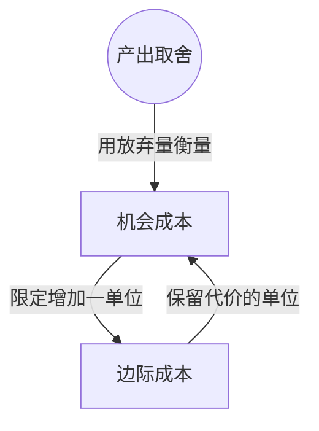

> 核心主线：用放弃的另一种产出来衡量机会成本，再把增量换算到一单位，得到边际成本。  
> 课程来源：Sal Khan / Khan Academy《第2讲 机会成本》，B站 BV1Gy4y1a7aE，UP主：农夫CC，P2，约 6 分钟；[本集视频](https://www.bilibili.com/video/BV1Gy4y1a7aE/?p=2)。本笔记为非官方中文转述，具体内容以本集转写为准；[官方课程总页](https://www.khanacademy.org/economics-finance-domain/microeconomics)。整课许可尚未逐讲核实。

## 目录
+ [1. 增加兔子要放弃什么](#1-增加兔子要放弃什么)
+ [2. 把增量成本换成单位成本](#2-把增量成本换成单位成本)
+ [本讲知识地图](#本讲知识地图)
+ [概念卡片](#概念卡片)
+ [自测题（复习用）](#自测题复习用)
+ [视频时间索引](#视频时间索引)

## 1. 增加兔子要放弃什么
**核心思想：** 在生产边界上增加一种产出，代价是放弃另一种产出。

+ 讲师从情景 E 出发：平均捕到 1 只兔子、采到 280 个浆果；现在希望增加蛋白质来源，多捕兔子。
+ **生产可能性边界（Production Possibilities Frontier）**限定当前能够实现的产出组合。不能因为想多捕兔子，就直接进入边界外不可达到的区域。
+ 本例多捕 1 只兔子需要放弃 40 个浆果，这 40 个浆果就是增加这只兔子的**机会成本（Opportunity Cost）**。成本用被放弃的产出表示，而非必须用货币表示。
+ 讲师强调这个数字对应所讨论的情景，换到边界上的其它位置，机会成本可能变化。不能把 40 个浆果当成所有位置通用的兑换比率。
+ **边际成本（Marginal Cost）**关注增加一单位产出的机会成本；因此“多捕 1 只兔子放弃 40 个浆果”已经是以兔子为单位的边际成本表述。

## 2. 把增量成本换成单位成本
**核心思想：** 机会成本可以针对一批新增产出，边际成本要把分母明确为一单位。

+ 另一方向的例子是多采 20 个浆果，代价为少捕 1 只兔子；这是增加 20 个浆果这批产出的机会成本。
+ 若要表述多采 1 个浆果的边际成本，就把上述两边同时除以 20：平均每增加 1 个浆果，放弃 1/20 只兔子。
+ 这里的分数表达平均产出之间的取舍，不要求每次实际捕到五分之一或二十分之一只兔子。
+ 两个例子讨论的新增产出方向不同：增加兔子时，代价以浆果计；增加浆果时，代价以兔子计。阅读数字时须连同产出方向与单位一起看。

| 本集表述 | 增加的产出 | 放弃的产出 | 如何理解 |
| --- | --- | --- | --- |
| 多捕兔子 | 1 只兔子 | 40 个浆果 | 一单位兔子的边际成本 |
| 多采浆果 | 20 个浆果 | 1 只兔子 | 一批新增浆果的机会成本 |
| 将上一行单位化 | 1 个浆果 | 1/20 只兔子 | 一单位浆果的边际成本 |

## 本讲知识地图

## 概念卡片
### 机会成本
+ 原文：Opportunity Cost
+ 定义：为了获得某项新增产出而放弃的另一种产出。
+ 出现：第 1 节「增加兔子要放弃什么」、第 2 节「把增量成本换成单位成本」
+ 依赖：
+ 易混：边际成本——机会成本可以描述一批新增产出，边际成本限定为增加一单位。

### 边际成本
+ 原文：Marginal Cost
+ 定义：本集语境中，增加一单位产出的机会成本。
+ 出现：第 1 节「增加兔子要放弃什么」、第 2 节「把增量成本换成单位成本」
+ 依赖：机会成本
+ 易混：机会成本——报告新增 20 单位的代价时，还要换算为一单位才能作本集的边际成本表述。

## 自测题（复习用）
1. 多捕 1 只兔子要放弃 40 个浆果时，机会成本是什么，单位是什么？（对应：机会成本）

**答案：** 机会成本是 40 个浆果，代价的单位是浆果。

2. 为什么多采 20 个浆果而少捕 1 只兔子的说法还没有直接写成边际成本？（对应：边际成本）

**答案：** 它描述的是新增 20 单位的代价，尚未换算为增加 1 单位浆果的代价。

3. 怎样把本集采浆果例子换算成一单位的边际成本？（对应：边际成本）

**答案：** 两边除以 20，得到平均多采 1 个浆果放弃 1/20 只兔子。

4. 为什么不能把多捕兔子的 40 个浆果代价推广到整条边界？（对应：机会成本）

**答案：** 讲师说明该代价对应特定情景，边界上其它位置的取舍可能不同。

---

## 视频时间索引
+ [00:00](https://www.bilibili.com/video/BV1Gy4y1a7aE?p=2&t=0) 1. 增加兔子要放弃什么
+ [03:19](https://www.bilibili.com/video/BV1Gy4y1a7aE?p=2&t=199) 2. 把增量成本换成单位成本
