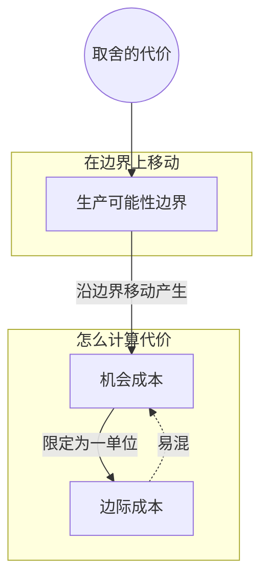

> 核心主线：在生产可能性边界上多要一种东西，代价就是必须放弃的另一种东西——这就是机会成本；把代价落到“多一单位”上，就是边际成本。  
> 本讲目标：读完你能回答「多抓一只兔子的机会成本是什么、为什么会随方案变化」「机会成本和边际成本差在哪里」「怎样把一批产出的代价换算成一单位的代价」  
> 课程来源：Sal Khan / Khan Academy《第2讲 机会成本》，B站 BV1Gy4y1a7aE，UP主：农夫CC，P2，约 6 分钟；[本集视频](https://www.bilibili.com/video/BV1Gy4y1a7aE/?p=2)。本笔记为非官方中文转述，具体内容以本集转写为准；[官方课程总页](https://www.khanacademy.org/economics-finance-domain/microeconomics)。整课许可尚未逐讲核实。

## 目录
+ [1. 想多抓一只兔子，要放弃什么](#1-想多抓一只兔子要放弃什么)
+ [2. 只算多一单位：边际成本](#2-只算多一单位边际成本)
+ [3. 反过来多要浆果：把一批的代价换算成一单位](#3-反过来多要浆果把一批的代价换算成一单位)
+ [本讲知识地图](#本讲知识地图)
+ [本讲小结](#本讲小结)
+ [概念卡片](#概念卡片)
+ [自测题（面试速答）](#自测题面试速答)
+ [视频时间索引](#视频时间索引)

---

## 1. 想多抓一只兔子，要放弃什么
假设你已经在方案 E 待了好些天：平均每天 1 只兔子、280 颗浆果，讲者调侃说这阵子“想吃浆果”。现在你突然想多吃点蛋白质，想再多抓一只兔子，要付出什么？

先看能不能“白拿”。不能：多抓一只兔子，你没法跑到曲线外那片**不可能达到**的区域，只能留在**生产可能性边界（production possibilities frontier）**上，讲者顺带提了它的缩写 **PPF**。沿着边界往多兔子的方向走一步，浆果就掉下去了。

掉了多少？平均 40 颗。也就是说，多一只兔子，代价是放弃 40 颗浆果。描述这件事的专业说法是：多抓一只兔子的**机会成本（opportunity cost）**是 40 颗浆果。注意这里的代价是用被放弃的另一种产出（浆果）来计的。

讲者特别强调，这个 40 颗只属于方案 E。换一个出发点，机会成本会变，至少在这个例子里是这样。（开头讲者写下“从方案 E 出发”之后，有约半分钟转写缺失，只剩 “EB” 两个字母。）

> **记住这个就够了**：机会成本是“为多要一样东西而必须放弃的另一样东西”，而且它取决于你现在站在边界的哪个位置。

---

## 2. 只算多一单位：边际成本
机会成本可以说“多要一批东西要放弃多少”。可如果只想知道“再多生产一个”的代价呢？

讲者给出定义：多生产**一单位**产出的机会成本，叫**边际成本（marginal cost）**。按这个定义，方案 E 里“多 1 只兔子放弃 40 颗浆果”说的正好是一单位兔子的代价，可以直接当作这一点上兔子的边际成本（笔记据定义推得）。

这一段的转写不完整：定义前后各有一小段缺失，中间只剩 “in the context of” 几个词，讲者是在什么语境下展开边际成本的，转写稿里看不到。

> **记住这个就够了**：边际成本就是“只多一单位”时的机会成本，分母必须是 1。

---

## 3. 反过来多要浆果：把一批的代价换算成一单位
讲者说“我们来确认一下是不是真的理解了机会成本”，然后换了个方向：还是在方案 E，这回想多要浆果。

多要 20 颗浆果，就得少抓 1 只兔子。所以在方案 E，**多 20 颗浆果的机会成本是 1 只兔子**。

这句话是边际成本吗？不是。讲者指出，它说的是 20 个单位的代价，而不是 1 个单位。要改写成边际成本，把两边同时除以 20：多 1 颗浆果，平均要放弃 **1/20 只兔子**。（转写稿此处有一句说成了“少 1/20 颗浆果”，从上下文看应是“1/20 只兔子”，属口误或识别错误。）

| 说法 | 多要的 | 放弃的 | 算不算边际成本 |
| --- | --- | --- | --- |
| 方案 E 多抓兔子 | 1 只兔子 | 40 颗浆果 | 算，分母是一单位 |
| 方案 E 多采浆果 | 20 颗浆果 | 1 只兔子 | 不算，是 20 单位的代价 |
| 上一行除以 20 | 1 颗浆果 | 1/20 只兔子 | 算 |

这里的“1/20 只兔子”是平均意义上的取舍，不是真的去抓二十分之一只兔子。讲到这个换算之后，转写稿结尾只剩板书词 “Marginal Cost” 和 “1/20th of a rabbit”。

> **记住这个就够了**：一批产出的代价除以数量，就换算成了一单位的代价，也就是边际成本。

---

## 本讲知识地图

## 本讲小结
| 机制/概念 | 解决什么问题 | 一句话 |
| --- | --- | --- |
| 机会成本 | 多要一种产出到底花了什么 | 用必须放弃的另一种产出来衡量 |
| 边际成本 | 一批产出的代价不好横向比较 | 只看多一单位的机会成本 |
| 除以数量换算 | 手上只有一批产出的代价 | 两边同除以数量，得到一单位的代价 |

**学完能说的 3 句话：**
1. 在生产可能性边界上多要一种产出，就必须放弃另一种产出，被放弃的部分就是机会成本。
2. 机会成本取决于出发点，方案 E 多抓一只兔子要放弃 40 颗浆果，换个方案数字会变。
3. 多生产一单位的机会成本叫边际成本，多 20 颗浆果放弃 1 只兔子，换算后就是 1 颗浆果的边际成本为 1/20 只兔子。

## 概念卡片
### 机会成本
+ 原文：opportunity cost
+ 定义：为了多得到某种产出而必须放弃的另一种产出
+ 出现：第 1 节「想多抓一只兔子，要放弃什么」、第 2 节「只算多一单位：边际成本」、第 3 节「反过来多要浆果：把一批的代价换算成一单位」
+ 依赖：生产可能性边界
+ 易混：边际成本——机会成本可以针对一批产出，边际成本只针对多一单位

### 边际成本
+ 原文：marginal cost
+ 定义：多生产一单位产出的机会成本
+ 出现：第 2 节「只算多一单位：边际成本」、第 3 节「反过来多要浆果：把一批的代价换算成一单位」
+ 依赖：机会成本
+ 易混：机会成本——多 20 颗浆果放弃 1 只兔子是机会成本，除以 20 之后才是边际成本

### 生产可能性边界
+ 原文：production possibilities frontier
+ 定义：现有资源下两种产出所有可能组合连成的曲线，缩写 PPF；多要一种产出时只能沿它移动
+ 出现：第 1 节「想多抓一只兔子，要放弃什么」、第 3 节「反过来多要浆果：把一批的代价换算成一单位」
+ 依赖：
+ 易混：

## 自测题（面试速答）
1. 在方案 E 多抓一只兔子，机会成本是多少？它的单位为什么是浆果？（对应：机会成本）

**答案：** 机会成本是 40 颗浆果。因为机会成本衡量的是为了多要一种产出而必须放弃的另一种产出，这里放弃的是浆果，所以单位是浆果。例子里从方案 E 的 1 只兔子、280 颗浆果出发，多抓一只兔子就要沿边界少采 40 颗浆果。

2. 为什么“多抓一只兔子要放弃 40 颗浆果”不能推广到边界上的所有位置？（对应：机会成本）

**答案：** 因为机会成本取决于你站在边界的哪个位置。讲者明确说这个 40 颗只针对方案 E，换一个方案，代价会变化，至少在这个例子里如此。所以引用机会成本时要连同出发点一起说，例如“在方案 E 多抓一只兔子”。

3. 想多抓一只兔子时，为什么不能直接跑到曲线外面去？（对应：生产可能性边界）

**答案：** 因为曲线外是不可能达到的区域，多要一种产出只能沿生产可能性边界移动。时间和条件都固定，想多一只兔子，只能从浆果那里挪时间。正因为必须留在边界上，浆果才会掉下去，机会成本才出现。

4. 机会成本和边际成本有什么区别？（对应：边际成本）

**答案：** 边际成本是机会成本的特例，只看多生产一单位时的代价。机会成本可以描述一批产出的代价，而边际成本要求分母是一单位。比如方案 E 里“多 20 颗浆果放弃 1 只兔子”是机会成本，讲者明确说它不是边际成本，因为说的是 20 个单位。

5. “多 20 颗浆果放弃 1 只兔子”怎样改写成边际成本？（对应：边际成本）

**答案：** 两边同时除以 20，得到多 1 颗浆果平均放弃 1/20 只兔子。这样分母变成了一单位浆果，符合边际成本“多生产一单位”的定义。这里的 1/20 只兔子是平均意义上的取舍，不是真的去抓二十分之一只兔子。

---

## 视频时间索引
+ [00:00](https://www.bilibili.com/video/BV1Gy4y1a7aE?p=2&t=0) 1. 想多抓一只兔子，要放弃什么
+ [02:11](https://www.bilibili.com/video/BV1Gy4y1a7aE?p=2&t=131) 2. 只算多一单位：边际成本
+ [02:51](https://www.bilibili.com/video/BV1Gy4y1a7aE?p=2&t=171) 3. 反过来多要浆果：把一批的代价换算成一单位
