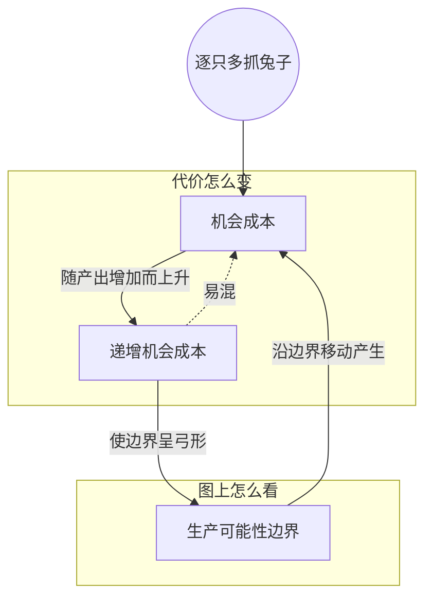

> 核心主线：从全采浆果开始逐只多抓兔子，每只兔子要放弃的浆果从 20 涨到 100——这就是递增机会成本；原因是兔子越抓越难、放弃的浆果越来越好采，画在图上就是一条越来越陡的弓形曲线。  
> 本讲目标：读完你能回答「为什么同样多抓一只兔子，代价会越来越大」「递增机会成本在生产可能性边界上长什么样」  
> 课程来源：Sal Khan / Khan Academy《第3讲 递增机会成本》，B站 BV1Gy4y1a7aE，UP主：农夫CC，P3，约 6 分钟；[本集视频](https://www.bilibili.com/video/BV1Gy4y1a7aE/?p=3)。非官方中文转述，具体引用以本集转写为准；[官方课程总页](https://www.khanacademy.org/economics-finance-domain/microeconomics)。整课许可尚未逐讲核实。

## 目录
+ [1. 逐只多抓兔子，代价越来越大](#1-逐只多抓兔子代价越来越大)
+ [2. 为什么会递增：难抓的兔子与好采的浆果](#2-为什么会递增难抓的兔子与好采的浆果)
+ [3. 在图上：越来越陡的弓形曲线](#3-在图上越来越陡的弓形曲线)
+ [本讲知识地图](#本讲知识地图)
+ [本讲小结](#本讲小结)
+ [概念卡片](#概念卡片)
+ [自测题（面试速答）](#自测题面试速答)
+ [视频时间索引](#视频时间索引)

---

## 1. 逐只多抓兔子，代价越来越大
多抓一只兔子要放弃多少浆果，在边界上的不同方案之间是一样的吗？讲者这一讲就来看这个代价怎样随方案变化。

讲者从方案 F 出发：你是素食者，只采浆果，完全不抓兔子。后来开始想吃点蛋白质，多抓一只兔子的**机会成本（opportunity cost）**是多少？你必须留在**生产可能性边界（production possibilities frontier）**上，于是从 F 移到 E，放弃 20 颗浆果。

接着一只一只往下加，讲者用“越来越像肉食动物”来形容这个过程：

| 移动 | 兔子（只/天） | 这一步放弃的浆果 |
| --- | --- | --- |
| F → E | 0 → 1 | 20 颗 |
| E → D | 1 → 2 | 40 颗 |
| D → C | 2 → 3 | 60 颗（从 240 降到 180） |
| C → B | 3 → 4 | 80 颗 |
| B → A | 4 → 5 | 100 颗，浆果归零 |

注意表里是**每一步**新增一只兔子的代价，不是累计放弃了多少。抓的兔子越多，再多抓一只要放弃的浆果就越多，机会成本在上升。这个现象叫**递增机会成本（increasing opportunity cost）**。讲者提醒：它并不总是成立，但在这个例子里成立，而且在很多经济情境里都能看到。

> **记住这个就够了**：同样是多抓一只兔子，抓得越多，要放弃的浆果就越多，这就是递增机会成本。

---

## 2. 为什么会递增：难抓的兔子与好采的浆果
每一只兔子都是一只兔子，凭什么后面的更“贵”？讲者从兔子和浆果的难易程度来解释。（第 1 节结束后有将近一分钟转写缺失，只剩零星字符。）

回到方案 F。你一只兔子都不抓，连那只最慢、最迟钝、喜欢凑在你身边玩你的长矛和弓箭的兔子都不去抓。时间全花在浆果上，不只采了低处唾手可得的，连灌木高处、得费劲才够得着的浆果也采了。所以第一只兔子很便宜：抓的是最容易的那只，放弃的是最难采的那些浆果。

想每天抓两只时，情况变了。除了最慢的兔子，你还得去抓一只稍快、稍机灵、“没那么想送死”的兔子，这要多花一点时间。而这时你放弃的也不再是长在树顶、被荆棘护着的浆果，而是靠近下面、更好采的浆果。

一边是越来越难抓的兔子，一边是越来越好采的浆果，每多一只兔子付出的浆果自然越来越多。（这段在“讲第二只兔子”的论述之间和末尾各有一段转写缺失，讲者对第三只以后是否逐只展开，转写稿里看不到。）

> **记住这个就够了**：先抓的是最容易的兔子、先放弃的是最难采的浆果，越往后两头都对你越不利，代价就递增了。

---

## 3. 在图上：越来越陡的弓形曲线
递增机会成本能不能直接从图上看出来？讲者说，它在生产可能性边界上表现为一条**弓形曲线（bow-shaped curve）**。

怎么看？在曲线上画切线，看切线的斜率。讲者先在一处画出切线，再往多兔子的方向走：到 E 点切线更陡，到 D 点更陡，再往后还更陡。（引出弓形曲线前后各有一段转写缺失。）切线越陡，意味着每多一单位兔子要放弃的浆果越多。

所以讲者总结：只要看到这种弓形曲线，就说明存在递增机会成本，某种产出生产得越多，就得放弃越来越多的另一种产出。

> **记住这个就够了**：弓形的生产可能性边界、越来越陡的切线，就是递增机会成本在图上的样子。

---

## 本讲知识地图

## 本讲小结
| 机制/概念 | 解决什么问题 | 一句话 |
| --- | --- | --- |
| 逐只代价表 | 机会成本会不会随方案变化 | 从 F 到 A，每只兔子的代价依次是 20、40、60、80、100 颗浆果 |
| 递增机会成本 | 为什么后面的兔子更贵 | 兔子越来越难抓，放弃的浆果越来越好采 |
| 弓形曲线与切线 | 怎样在图上认出这种现象 | 切线越来越陡，说明每单位代价越来越大 |

**学完能说的 3 句话：**
1. 本例从全采浆果开始逐只多抓兔子，每只兔子要放弃的浆果依次是 20、40、60、80、100 颗。
2. 代价递增是因为先抓的是最容易的兔子、先放弃的是最难采的浆果，越往后两头越不利。
3. 递增机会成本让生产可能性边界呈弓形，越往多兔子的方向切线越陡。

## 概念卡片
### 递增机会成本
+ 原文：increasing opportunity cost
+ 定义：某种产出越多，再多生产一单位所要放弃的另一种产出越多的现象
+ 出现：第 1 节「逐只多抓兔子，代价越来越大」、第 2 节「为什么会递增：难抓的兔子与好采的浆果」、第 3 节「在图上：越来越陡的弓形曲线」
+ 依赖：机会成本、生产可能性边界
+ 易混：机会成本——机会成本是某一步的代价，递增机会成本说的是这个代价随产出增加而变大

### 机会成本
+ 原文：opportunity cost
+ 定义：为了多得到某种产出而必须放弃的另一种产出
+ 出现：第 1 节「逐只多抓兔子，代价越来越大」、第 2 节「为什么会递增：难抓的兔子与好采的浆果」
+ 依赖：生产可能性边界
+ 易混：

### 生产可能性边界
+ 原文：production possibilities frontier
+ 定义：现有资源下两种产出所有可能组合连成的曲线；本例中它是弓形的
+ 出现：第 1 节「逐只多抓兔子，代价越来越大」、第 3 节「在图上：越来越陡的弓形曲线」
+ 依赖：
+ 易混：

## 自测题（面试速答）
1. 本例从方案 F 开始逐只多抓兔子，每一步的机会成本怎么变化？（对应：机会成本）

**答案：** 每一步要放弃的浆果依次是 20、40、60、80、100 颗，逐步上升。因为每次都必须沿生产可能性边界移动，从 F 到 E、E 到 D 一直到 A，每多一只兔子都要少采一些浆果。要注意这是每一步新增一只的代价，不是累计放弃的总数。

2. 什么是递增机会成本？讲者对它的适用范围怎么说？（对应：递增机会成本）

**答案：** 递增机会成本是指某种产出越多，再多一单位要放弃的另一种产出就越多。讲者明确说它并不总是成立，但在本例中成立，而且在很多经济情境里都能看到。本例中第一只兔子只要 20 颗浆果，第五只就要 100 颗。

3. 为什么后面的兔子比第一只“更贵”？（对应：递增机会成本）

**答案：** 因为越往后兔子越难抓，而放弃的浆果越好采。全采浆果时，你连最慢、最不怕人的兔子都没抓，却连高处带刺的浆果都采了，所以第一只兔子只需放弃那些难采的浆果。到第二只就得去抓更快更机灵的兔子，花的时间更多，放弃的又是靠近下面、好采的浆果。

4. 递增机会成本在生产可能性边界上怎么体现？（对应：生产可能性边界）

**答案：** 体现为弓形曲线，越往多兔子的方向切线越陡。切线的陡峭程度反映每多一单位兔子要放弃多少浆果，讲者画出的切线到 E 点更陡、到 D 点又更陡。所以看到这种弓形的边界，就能判断存在递增机会成本。

---

## 视频时间索引
+ [00:00](https://www.bilibili.com/video/BV1Gy4y1a7aE?p=3&t=0) 1. 逐只多抓兔子，代价越来越大
+ [03:19](https://www.bilibili.com/video/BV1Gy4y1a7aE?p=3&t=199) 2. 为什么会递增：难抓的兔子与好采的浆果
+ [05:27](https://www.bilibili.com/video/BV1Gy4y1a7aE?p=3&t=327) 3. 在图上：越来越陡的弓形曲线
