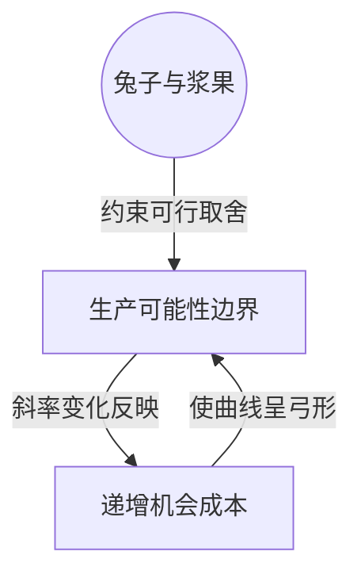

> 核心主线：沿生产边界不断增加兔子产出，每多一只要放弃的浆果逐步增加，这种取舍体现为弯曲边界上越来越陡的斜率。  
> 课程来源：Sal Khan / Khan Academy《第3讲 递增机会成本》，B站 BV1Gy4y1a7aE，UP主：农夫CC，P3，约 6 分钟；[本集视频](https://www.bilibili.com/video/BV1Gy4y1a7aE/?p=3)。非官方中文转述，具体引用以本集转写为准；[官方课程总页](https://www.khanacademy.org/economics-finance-domain/microeconomics)。整课许可尚未逐讲核实。

## 目录
+ [1. 逐只增加兔子的代价](#1-逐只增加兔子的代价)
+ [2. 捕获难度与边界斜率](#2-捕获难度与边界斜率)
+ [本讲知识地图](#本讲知识地图)
+ [概念卡片](#概念卡片)
+ [自测题（复习用）](#自测题复习用)
+ [视频时间索引](#视频时间索引)

## 1. 逐只增加兔子的代价
**核心思想：** 本例中增加同样一只兔子，牺牲的浆果并不相同。

+ 情景 F 把时间全部用于采浆果，不捕兔子；转到情景 E，多捕第一只兔子，需要放弃 20 个浆果。
+ 继续增加兔子时，每次新增一只依次要放弃 40、60、80、100 个浆果。这里比较的是每一步新增产出的代价，而不是累计放弃量。
+ **递增机会成本（Increasing Opportunity Cost）**指随着某种产出增加，再多生产一单位所牺牲的另一种产出越来越多。讲师明确说明，这个现象出现在本例和许多经济情景中，但并非总是如此。
+ **生产可能性边界（Production Possibilities Frontier）**要求取舍发生在可实现的产出组合之间；本例沿边界增加兔子，同时减少浆果。

| 每天兔子产出的变化 | 这一步放弃的浆果 |
| --- | --- |
| 0 只到 1 只 | 20 个 |
| 1 只到 2 只 | 40 个 |
| 2 只到 3 只 | 60 个 |
| 3 只到 4 只 | 80 个 |
| 4 只到 5 只 | 100 个 |

## 2. 捕获难度与边界斜率
**核心思想：** 更难捕的兔子与更容易采的浆果之间的取舍，使边界表现出递增的单位代价。

+ 完全不捕兔子时，连最慢、最不怕人的兔子也不捕，时间全部用于浆果，既采容易够到的，也采高处较难够到的浆果。
+ 若希望每天捕到两只兔子，除了最容易捕的，还要去捕稍快、稍机警的兔子，需要更多时间；与此同时，放弃的浆果也变成更靠近低处、较容易采到的部分。
+ 这种变化解释了递增机会成本：每增加同样一只兔子，占用的采集机会更多，放弃的浆果数量上升。
+ 在本例的生产可能性边界上，这体现为弓形曲线。沿增加兔子的方向移动，切线变得更陡，表示每单位兔子要放弃更多浆果。
+ 曲线形状表达的是产出之间的取舍变化；不要把“越来越陡”误读成可以不减少浆果而增加兔子。

## 本讲知识地图

## 概念卡片
### 递增机会成本
+ 原文：Increasing Opportunity Cost
+ 定义：某种产出越多，再增加一单位所要放弃的替代产出越多的现象。
+ 出现：第 1 节「逐只增加兔子的代价」、第 2 节「捕获难度与边界斜率」
+ 依赖：生产可能性边界
+ 易混：

### 生产可能性边界
+ 原文：Production Possibilities Frontier
+ 定义：本例中限制兔子与浆果可实现产出组合的边界，其弯曲与斜率表达取舍的变化。
+ 出现：第 1 节「逐只增加兔子的代价」、第 2 节「捕获难度与边界斜率」
+ 依赖：
+ 易混：

## 自测题（复习用）
1. 本例从零只兔子增加到两只，每一步的浆果代价分别是多少？（对应：递增机会成本）

**答案：** 第一只的代价是 20 个浆果，第二只的代价是 40 个浆果。

2. 为什么把新增兔子的代价写成固定 20 个浆果不符合本例？（对应：递增机会成本）

**答案：** 各步新增一只的代价依次为 20、40、60、80、100 个浆果，单位代价逐步增加。

3. 本例更难捕的兔子如何帮助解释单位代价递增？（对应：递增机会成本）

**答案：** 后续兔子更快、更机警，捕获需要更多时间，同时放弃更容易采到的浆果。

4. 本例沿增加兔子的方向切线更陡，意味着什么取舍？（对应：生产可能性边界）

**答案：** 每多一只兔子必须放弃更多浆果，表现为递增的单位机会成本。

---

## 视频时间索引
+ [00:00](https://www.bilibili.com/video/BV1Gy4y1a7aE?p=3&t=0) 1. 逐只增加兔子的代价
+ [03:19](https://www.bilibili.com/video/BV1Gy4y1a7aE?p=3&t=199) 2. 捕获难度与边界斜率
