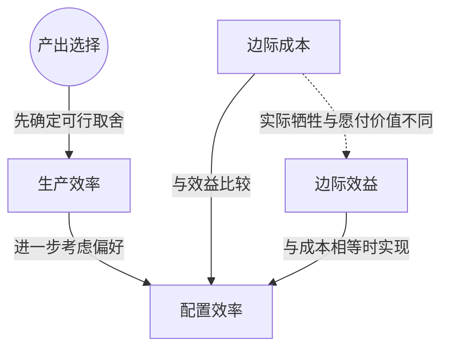

> 核心主线：生产边界说明能否有效生产，边际效益与边际成本的比较则帮助选择最符合偏好的产出组合。  
> 课程来源：Sal Khan / Khan Academy《第4讲 配置效率和边际效益》，B站 BV1Gy4y1a7aE，UP主：农夫CC，P4，约 14 分钟；[本集视频](https://www.bilibili.com/video/BV1Gy4y1a7aE/?p=4)。非官方中文转述，具体引用以本集转写为准；[官方课程总页](https://www.khanacademy.org/economics-finance-domain/microeconomics)。整课许可尚未逐讲核实。

## 目录
+ [1. 有效生产与偏好选择](#1-有效生产与偏好选择)
+ [2. 用浆果比较新增兔子的代价与价值](#2-用浆果比较新增兔子的代价与价值)
+ [3. 根据边际比较选择情景](#3-根据边际比较选择情景)
+ [本讲知识地图](#本讲知识地图)
+ [概念卡片](#概念卡片)
+ [自测题（复习用）](#自测题复习用)
+ [视频时间索引](#视频时间索引)

## 1. 有效生产与偏好选择
**核心思想：** 边界上的点都能有效生产，但最符合个人偏好的组合还需要进一步选择。

+ **生产效率（Productive Efficiency）**在本例中表现为处在生产可能性边界上：要多得到一种产出，就必须放弃另一种产出。
+ 边界内部的点仍可以不减少浆果而增加兔子，或不减少兔子而增加浆果，所以没有达到生产效率。
+ 达到生产效率仍未回答“选哪一种组合”。**配置效率（Allocative Efficiency）**关注怎样分配时间，使产出组合符合狩猎采集者的偏好。
+ 后一种判断带有偏好因素。不同人的偏好可以不同，本课用一组示例数字说明判断框架。

## 2. 用浆果比较新增兔子的代价与价值
**核心思想：** 把新增兔子的代价与愿意支付的价值都写成浆果，才能直接比较。

+ **边际成本（Marginal Cost）**是多获得一只兔子实际要放弃的浆果数量；在本例沿边界增加兔子时，该代价上升。
+ **边际效益（Marginal Benefit）**用思想实验衡量：假设有一家只卖兔子、只收浆果的便利店，自己愿意为额外一只兔子最多给多少浆果？
+ 没有兔子、浆果很多时，愿意支付较多浆果。随着已有兔子增加、浆果减少，对额外兔子的需要降低，愿意付出的浆果也减少。
+ 这组边际效益数值来自讲师设定的个人偏好，不是所有人共用的测量结果。曲线画成直线是简化，本课没有主张真实情况必须线性。

| 情景 | 已有兔子数量 | 新增兔子的边际成本，单位为浆果 | 新增兔子的边际效益，单位为浆果 |
| --- | --- | --- | --- |
| F | 0 | 20 | 100 |
| E | 1 | 40 | 80 |
| D | 2 | 60 | 60 |
| C | 3 | 80 | 40 |
| B | 4 | 100 | 20 |

+ 横向比较时，成本和效益都对应当前情景中的“再增加一只”；不能把已有兔子数量当成新增数量，也不能把浆果代价写成兔子代价。

## 3. 根据边际比较选择情景
**核心思想：** 效益超过成本就继续增加，效益低于成本就不再向该方向推进，相等处实现本例的配置效率。

+ 在 F 和 E，边际效益高于边际成本：例如 F 愿意付 100 个浆果，而实际只需放弃 20 个，所以有理由增加兔子。
+ 越接近 D，两条边际曲线越接近。在 D，愿意为下一只兔子支付 60 个浆果，恰好等于实际需要放弃的 60 个浆果。
+ 超过 D 后，额外兔子的边际效益低于边际成本；继续增加兔子带来的价值不足以补偿被放弃的浆果。
+ 因此本例选择 D，在边际成本与边际效益相等处达到配置效率。这是在具有生产效率的边界上，进一步选择符合所设偏好的组合。
+ 结论依赖示例的成本与偏好数字；不能仅凭“在边界上”就判定所有组合具有相同的配置效率。

## 本讲知识地图

## 概念卡片
### 生产效率
+ 原文：Productive Efficiency
+ 定义：处于生产边界上，增加一种产出必须牺牲另一种产出的状态。
+ 出现：第 1 节「有效生产与偏好选择」、第 3 节「根据边际比较选择情景」
+ 依赖：
+ 易混：配置效率——生产效率没有单独决定哪个边界点最符合偏好。

### 配置效率
+ 原文：Allocative Efficiency
+ 定义：按本例偏好选择产出组合，在边际成本等于边际效益处实现的状态。
+ 出现：第 1 节「有效生产与偏好选择」、第 3 节「根据边际比较选择情景」
+ 依赖：边际成本、边际效益
+ 易混：生产效率——边界上各点可都有生产效率，但偏好选择不相同。

### 边际成本
+ 原文：Marginal Cost
+ 定义：本例中再获得一只兔子必须放弃的浆果数量。
+ 出现：第 2 节「用浆果比较新增兔子的代价与价值」、第 3 节「根据边际比较选择情景」
+ 依赖：
+ 易混：边际效益——成本是实际牺牲，效益是个人愿意支付的价值。

### 边际效益
+ 原文：Marginal Benefit
+ 定义：本例中个人愿为额外一只兔子支付的浆果数量，用来表达其偏好。
+ 出现：第 2 节「用浆果比较新增兔子的代价与价值」、第 3 节「根据边际比较选择情景」
+ 依赖：
+ 易混：边际成本——愿付多少与必须付出多少是不同问题。

## 自测题（复习用）
1. 为什么边界内部的点没有达到生产效率？（对应：生产效率）

**答案：** 仍有机会在不减少一种产出的情况下增加另一种产出。

2. 为什么所有边界点具有生产效率还不能决定最终选择？（对应：配置效率）

**答案：** 还需要比较不同组合是否符合个人偏好，而生产边界本身没有给出这种偏好。

3. 假想便利店在本课中用于回答什么问题？（对应：边际效益）

**答案：** 用愿意支付的浆果数量表达额外一只兔子对个人的价值。

4. 情景 E 为何有理由继续增加兔子？（对应：边际效益）

**答案：** 新增兔子的效益为 80 个浆果，高于 40 个浆果的成本。

5. 情景 D 的两项边际数量分别是多少，为何选择它？（对应：配置效率）

**答案：** 成本与效益都为 60 个浆果，相等处实现本例所设偏好下的配置效率。

6. 超过 D 继续增加兔子会遇到什么问题？（对应：边际成本）

**答案：** 新增兔子的成本超过其效益，放弃的浆果价值高于新增兔子的价值。

---

## 视频时间索引
+ [00:00](https://www.bilibili.com/video/BV1Gy4y1a7aE?p=4&t=0) 1. 有效生产与偏好选择
+ [02:50](https://www.bilibili.com/video/BV1Gy4y1a7aE?p=4&t=170) 2. 用浆果比较新增兔子的代价与价值
+ [11:06](https://www.bilibili.com/video/BV1Gy4y1a7aE?p=4&t=666) 3. 根据边际比较选择情景
