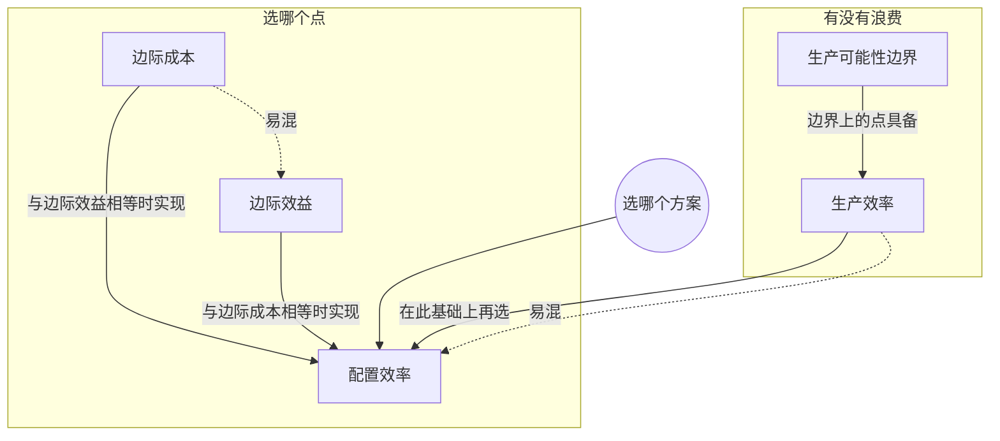

> 核心主线：边界上的点都有生产效率，但到底选哪个点，要看配置效率——把“多一只兔子要放弃多少浆果”（边际成本）和“愿意为多一只兔子付多少浆果”（边际效益）画在一起，两者相等的方案 D 就是答案。  
> 本讲目标：读完你能回答「生产效率和配置效率差在哪里」「边际效益在本讲里怎么衡量」「为什么要停在边际成本等于边际效益的地方」  
> 课程来源：Sal Khan / Khan Academy《第4讲 配置效率和边际效益》，B站 BV1Gy4y1a7aE，UP主：农夫CC，P4，约 14 分钟；[本集视频](https://www.bilibili.com/video/BV1Gy4y1a7aE/?p=4)。非官方中文转述，具体引用以本集转写为准；[官方课程总页](https://www.khanacademy.org/economics-finance-domain/microeconomics)。整课许可尚未逐讲核实。

## 目录
+ [1. 边界上的点都有生产效率](#1-边界上的点都有生产效率)
+ [2. 下一个问题：选哪个点](#2-下一个问题选哪个点)
+ [3. 边际成本：每多一只兔子的代价](#3-边际成本每多一只兔子的代价)
+ [4. 边际效益：愿意为下一只兔子付多少](#4-边际效益愿意为下一只兔子付多少)
+ [5. 边际成本等于边际效益：停在方案 D](#5-边际成本等于边际效益停在方案-d)
+ [本讲知识地图](#本讲知识地图)
+ [本讲小结](#本讲小结)
+ [概念卡片](#概念卡片)
+ [自测题（面试速答）](#自测题面试速答)
+ [视频时间索引](#视频时间索引)

---

## 1. 边界上的点都有生产效率
前面花了不少时间看 A 到 F 这六个方案，它们有个共同点：都落在**生产可能性边界（production possibilities frontier）**上。这意味着什么？

讲者的回答是：在这些方案里，你都达到了**生产效率（productive efficiency）**。而且不只是这六个，曲线上的任何一点都是如此。

换个角度理解：只要站在曲线上，想多要一样东西，就必须放弃另一样。比如在 C 点想多一只兔子，就得少些浆果；想多些浆果，就得少抓兔子。

那曲线内侧的点呢？讲者在内侧取了一个点：从它出发，你不用放弃任何浆果就能多抓兔子、走到 B，也可以不放弃任何兔子就多采浆果、走到 D。能“白拿”，说明这个点**没有效率（inefficient）**。

> **记住这个就够了**：想多要一样就必须放弃另一样，说明你在边界上、有生产效率；能白拿，说明你在边界内、没效率。

---

## 2. 下一个问题：选哪个点
五六个方案都有生产效率，都很好。可你每天到底该怎么分配时间，选哪一个？

生产效率回答不了这个问题。讲者在这一讲引入**配置效率（allocative efficiency）**：在有生产效率的方案里，找出最符合你偏好的那一个。

讲者坦白，这件事多少有点主观，取决于这个狩猎采集者自己的偏好；但它至少提供了一个思考框架，帮你判断哪个方案最合你心意。

> **记住这个就够了**：生产效率说明“没浪费”，配置效率回答“选哪个”，后者取决于偏好。

---

## 3. 边际成本：每多一只兔子的代价
要做选择，先得知道每多一只兔子要付出什么。讲者回顾了上一讲的内容：每多一只兔子的机会成本，也就是多一单位的代价，就是**边际成本（marginal cost）**。

于是把每个方案下“再多抓一只兔子”的代价列出来（单位：浆果）。从 F 出发多一只兔子放弃 20 颗，E 是 40 颗，D 是 60 颗，B 是 100 颗；方案 A 已经没有浆果可放弃，也不可能再多抓兔子，所以不列。方案 C 的数值在转写中缺失（这段只剩重复的 “Scenarios” 字样），按递增规律和后面图上念出的 “40、60、80、100” 理解为 80 颗。

接着讲者把它画成图。横轴本来想写方案名，后来改成**已有的兔子数**（讲者还口误说成了“松鼠”）：0 只对应 F，1 只对应 E，依此类推。把各点连起来，就是一条**边际成本曲线**，表示边际成本随已有兔子数的变化。

这些点恰好排成一条直线。讲者说现实中不一定是直线，只是很多入门经济学课程为了简单常把它画成直线。（画图过程中有几段转写只剩板书词，例如 “RABBITZ”。）

> **记住这个就够了**：边际成本曲线画的是“已有几只兔子时，再多一只要放弃多少浆果”，本例中它随兔子增多而上升。

---

## 4. 边际效益：愿意为下一只兔子付多少
画出了边际成本，还是不知道该选哪个方案，因为它只说明了代价，没说明你有多想要。为此讲者引入**边际效益（marginal benefit）**：多一只兔子对你值多少，同样用浆果来计。

**打个比方：** 想象附近有一家只卖兔子、而且只收浆果的便利店。你站在某个方案里，问自己：为了再买一只兔子，愿意付给它多少浆果？这个愿付的数量就是边际效益。

在 F，你一只兔子都没有，手里有 300 颗浆果，正想吃兔子，愿意付很多，比如 100 颗。到 E，已经有一只兔子，浆果也少了，既没那么需要兔子，能拿出的浆果也少了，可能只愿付 80 颗。D、C、B 依次更少：

| 方案 | 已有兔子 | 边际效益（愿付浆果） |
| --- | --- | --- |
| F | 0 | 100 |
| E | 1 | 80 |
| D | 2 | 60 |
| C | 3 | 40 |
| B | 4 | 20 |

讲者反复强调，这不是能测量出来的东西，完全基于这个人的偏好。把它画到同一张图上就是**边际效益曲线**，为了简单，这里同样是一条直线。

> **记住这个就够了**：边际效益是你愿意为下一只兔子付出的浆果，兔子越多、浆果越少，愿付得越少。

---

## 5. 边际成本等于边际效益：停在方案 D
两条线画在一起了，理性的你会怎么选？

在 F，多一只兔子只要放弃 20 颗浆果，你却愿意付 100 颗，当然要多抓兔子。（这里转写稿有两处口误：“20 rabbits” 应为 20 颗浆果，“120 berries” 随即被讲者改口为 100 颗。）在图上看，边际效益远高于边际成本，所以你会沿着生产可能性边界往多兔子的方向走。到 E 也一样：愿付 80，代价只有 40。

在 E 和 D 之间的某个点，边际成本仍低于边际效益，还会继续往前。到了 D，你变得“无所谓”了：愿意为一只兔子付 60 颗，而多抓一只恰好也要放弃 60 颗。

再往前走呢？比如平均每天 2.5 只兔子的位置，多一只兔子带来的效益已经小于它的代价，不值得再往前。所以你不会越过 D。

| 方案 | 边际成本 | 边际效益 | 怎么做 |
| --- | --- | --- | --- |
| F | 20 | 100 | 效益远大于成本，多抓兔子 |
| E | 40 | 80 | 效益大于成本，继续多抓 |
| D | 60 | 60 | 相等，停下 |
| D 之后 | 更高 | 更低 | 效益小于成本，不再往前 |

结论：在边际成本等于边际效益的地方，达到**配置效率**。讲者也说明，这是按他“设计好的数字”得出的，本例应停在方案 D。

> **记住这个就够了**：边际效益大于边际成本就继续，小于就停，两者相等的点就是配置效率。

---

## 本讲知识地图

## 本讲小结
| 机制/概念 | 解决什么问题 | 一句话 |
| --- | --- | --- |
| 生产效率 | 判断有没有浪费资源 | 在边界上，多要一样就得放弃另一样 |
| 配置效率 | 边界上那么多点，选哪个 | 选最符合偏好的点，即边际成本等于边际效益处 |
| 边际成本曲线 | 每多一只兔子代价多大 | 已有兔子越多，代价越高 |
| 边际效益曲线 | 每多一只兔子对你值多少 | 用假想便利店里愿付的浆果来衡量，兔子越多愿付越少 |

**学完能说的 3 句话：**
1. 生产可能性边界上的点都有生产效率，边界内的点能白拿更多，所以没有效率。
2. 配置效率要在有生产效率的点里按偏好做选择，方法是比较边际成本和边际效益。
3. 边际效益大于边际成本就继续多抓兔子，两者相等时停下，本例停在 60 颗浆果相等的方案 D。

## 概念卡片
### 生产效率
+ 原文：productive efficiency
+ 定义：处在生产可能性边界上，想多要一种产出就必须放弃另一种产出的状态
+ 出现：第 1 节「边界上的点都有生产效率」、第 2 节「下一个问题：选哪个点」
+ 依赖：生产可能性边界
+ 易混：配置效率——生产效率只说明没浪费，不决定选哪个点

### 配置效率
+ 原文：allocative efficiency
+ 定义：在有生产效率的方案中选出最符合偏好的那个，本例在边际成本等于边际效益处实现
+ 出现：第 2 节「下一个问题：选哪个点」、第 5 节「边际成本等于边际效益：停在方案 D」
+ 依赖：生产效率、边际成本、边际效益
+ 易混：生产效率——边界上所有点都有生产效率，但只有一个点达到本例的配置效率

### 边际成本
+ 原文：marginal cost
+ 定义：再多生产一单位产出的机会成本，本例是再多一只兔子要放弃的浆果数
+ 出现：第 3 节「边际成本：每多一只兔子的代价」、第 4 节「边际效益：愿意为下一只兔子付多少」、第 5 节「边际成本等于边际效益：停在方案 D」
+ 依赖：
+ 易混：边际效益——成本是必须放弃多少，效益是愿意付出多少

### 边际效益
+ 原文：marginal benefit
+ 定义：多一单位产出对你值多少，本例用愿意为下一只兔子支付的浆果数衡量，取决于个人偏好
+ 出现：第 4 节「边际效益：愿意为下一只兔子付多少」、第 5 节「边际成本等于边际效益：停在方案 D」
+ 依赖：
+ 易混：边际成本——愿付多少和必须付多少是两回事

### 生产可能性边界
+ 原文：production possibilities frontier
+ 定义：现有资源下两种产出所有可能组合连成的曲线，曲线上的点都有生产效率
+ 出现：第 1 节「边界上的点都有生产效率」、第 5 节「边际成本等于边际效益：停在方案 D」
+ 依赖：
+ 易混：

## 自测题（面试速答）
1. 为什么边界内的点没有生产效率？（对应：生产效率）

**答案：** 因为在边界内能“白拿”：不放弃任何一种产出，就能多得另一种。边界上的点则不同，想多要一样就必须放弃另一样。讲者在曲线内侧取的那个点，不用放弃浆果就能多抓兔子走到 B，也能不放弃兔子就多采浆果走到 D。

2. 既然边界上所有点都有生产效率，为什么还要讲配置效率？（对应：配置效率）

**答案：** 因为生产效率只说明没浪费，回答不了“选哪个点”。边界上的方案都有生产效率，但你每天到底该怎么分配时间，要看哪个方案最符合你的偏好，这就是配置效率要解决的问题。讲者也承认这一步多少有些主观，但它给了一个判断框架。

3. 本讲的边际效益是怎么衡量的？为什么说它是主观的？（对应：边际效益）

**答案：** 用你愿意为下一只兔子付出多少浆果来衡量。讲者假想一家只卖兔子、只收浆果的便利店，问在每个方案下愿付多少：F 是 100、E 是 80，依次降到 B 的 20。这些数字不是测出来的，完全取决于这个狩猎采集者的偏好，所以是主观的。

4. 边际成本曲线是怎么画出来的？为什么本例是一条直线？（对应：边际成本）

**答案：** 以已有兔子数为横轴，把每个方案下再多一只兔子要放弃的浆果描点连线。F 到 B 依次是 20、40、60、80、100 颗，所以曲线随兔子增多而上升。它是直线只是本例的数字恰好如此，讲者说现实中不一定，很多入门课为了简单才画成直线。

5. 在方案 F 和 E，为什么理性的选择是继续多抓兔子？（对应：边际效益）

**答案：** 因为这两处的边际效益都大于边际成本。在 F，你愿意为一只兔子付 100 颗浆果，实际只需放弃 20 颗；在 E，愿付 80 颗，代价只有 40 颗。多抓一只兔子的价值超过代价，所以会沿着边界往多兔子的方向走。

6. 为什么最终停在方案 D，而不是继续多抓兔子？（对应：配置效率）

**答案：** 因为 D 处边际成本等于边际效益，达到了配置效率。在 D，愿意为一只兔子付 60 颗浆果，多抓一只也恰好要放弃 60 颗；再往前，比如平均 2.5 只兔子的位置，多一只兔子的效益已经小于代价。讲者也说明这个结论依赖他设定的数字。

---

## 视频时间索引
+ [00:00](https://www.bilibili.com/video/BV1Gy4y1a7aE?p=4&t=0) 1. 边界上的点都有生产效率
+ [01:22](https://www.bilibili.com/video/BV1Gy4y1a7aE?p=4&t=82) 2. 下一个问题：选哪个点
+ [01:52](https://www.bilibili.com/video/BV1Gy4y1a7aE?p=4&t=112) 3. 边际成本：每多一只兔子的代价
+ [07:33](https://www.bilibili.com/video/BV1Gy4y1a7aE?p=4&t=453) 4. 边际效益：愿意为下一只兔子付多少
+ [11:06](https://www.bilibili.com/video/BV1Gy4y1a7aE?p=4&t=666) 5. 边际成本等于边际效益：停在方案 D
