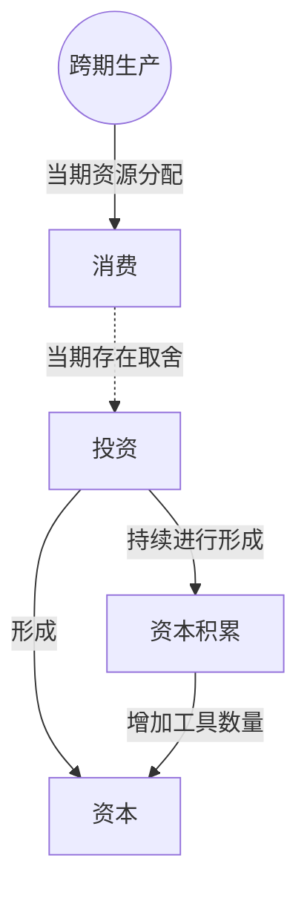

> 核心主线：减少部分当期兔子消费、转而制作捕兔工具，可以积累资本并提高未来捕兔能力，使生产边界向外扩展。  
> 课程来源：Sal Khan / Khan Academy《第5讲 通过投资的经济增长》，B站 BV1Gy4y1a7aE，UP主：农夫CC，P5，约 8 分钟；[本集视频](https://www.bilibili.com/video/BV1Gy4y1a7aE/?p=5)。非官方中文转述，具体引用以本集转写为准；[官方课程总页](https://www.khanacademy.org/economics-finance-domain/microeconomics)。整课许可尚未逐讲核实。

## 目录
+ [1. 当期捕兔与制作工具的取舍](#1-当期捕兔与制作工具的取舍)
+ [2. 工具积累与未来生产能力](#2-工具积累与未来生产能力)
+ [本讲知识地图](#本讲知识地图)
+ [概念卡片](#概念卡片)
+ [自测题（复习用）](#自测题复习用)
+ [视频时间索引](#视频时间索引)

## 1. 当期捕兔与制作工具的取舍
**核心思想：** 当前生产边界上的取舍，可以发生在当期食物与提高未来产出的工具之间。

+ 讲师把狩猎采集者简化为只关心兔子的肉食者，把图中的两种产出改为兔子与捕兔陷阱。
+ 分析采用**其它条件不变（Ceteris Paribus）**的假设；二维图只表示两种产出之间的取舍，若有三种产出就需要三维曲面。
+ 把全部时间都用来捕兔，就不能制作陷阱。示例改为每天捕 4 只兔子、制作 1 个陷阱，意味着放弃部分当期捕兔产出。
+ 用于当期吃掉的兔子属于**消费（Consumption）**；制作能够帮助以后捕兔的工具属于**投资（Investment）**。这种取舍不是单纯把当期兔子产出推到最大。
+ 工具作为能够提高生产能力的**资本（Capital）**被留下来，而不是像当期食物那样直接消费掉。

## 2. 工具积累与未来生产能力
**核心思想：** 投资形成的工具提高捕兔效率，但未必同样提高其它产出的效率。

+ 第一个陷阱形成后，同样时间可以捕到更多兔子。讲师举例：捕兔能力可能提高到每天 6 只，而每天最多制作 3 个陷阱的能力没有随之增加。
+ 因而生产边界朝捕兔产出方向扩展，不要求两个轴的最大产出同时提高。沿原边界移动与改变边界本身是不同的变化。
+ 继续投入后可以积累更多工具，进一步提高生产能力。讲师提醒，示例为了说明机制，可能夸大了生产率增长的速度。
+ 这种不断留下工具的过程是**资本积累（Capital Accumulation）**，本例积累的具体资本是捕兔陷阱。
+ 投资需要牺牲部分当期消费，但仍要保留满足生存的基本消费。把个人看成一个经济体，投资提高的是未来整体生产能力，而不是凭空增加今天的全部消费。

## 本讲知识地图

## 概念卡片
### 消费
+ 原文：Consumption
+ 定义：本例中用于当期吃掉、满足生活需要的兔子产出。
+ 出现：第 1 节「当期捕兔与制作工具的取舍」、第 2 节「工具积累与未来生产能力」
+ 依赖：
+ 易混：投资——消费满足当期需要，投资形成提高未来生产能力的工具。

### 投资
+ 原文：Investment
+ 定义：本例中牺牲部分当期消费，把时间用于制作能提高未来捕兔能力的工具。
+ 出现：第 1 节「当期捕兔与制作工具的取舍」、第 2 节「工具积累与未来生产能力」
+ 依赖：资本
+ 易混：消费——投资的目的在于未来生产能力，不是当期吃掉更多兔子。

### 资本
+ 原文：Capital
+ 定义：用于帮助生产的工具，本例具体指捕兔陷阱。
+ 出现：第 1 节「当期捕兔与制作工具的取舍」、第 2 节「工具积累与未来生产能力」
+ 依赖：
+ 易混：资本积累——资本是工具本身，资本积累是持续增加工具的过程。

### 资本积累
+ 原文：Capital Accumulation
+ 定义：通过投资不断形成并保留生产工具，从而提高生产能力的过程。
+ 出现：第 2 节「工具积累与未来生产能力」、第 1 节「当期捕兔与制作工具的取舍」
+ 依赖：投资、资本
+ 易混：资本——过程与形成的工具存量不同。

## 自测题（复习用）
1. 为什么每天捕 4 只兔子并制作 1 个陷阱可以称为投资选择？（对应：投资）

**答案：** 它牺牲部分当期捕兔产出，把时间用于形成能提高未来产出的工具。

2. 本例中的资本具体是什么，其作用是什么？（对应：资本）

**答案：** 资本是捕兔陷阱，能帮助在相同时间内捕到更多兔子。

3. 为什么陷阱增加后，生产边界不必在两个方向上等比例外移？（对应：资本）

**答案：** 陷阱提高捕兔能力，却未必提高制作陷阱本身的能力。

4. 为什么不能把本例投资理解为可以完全放弃当期消费？（对应：消费）

**答案：** 讲师说明仍需保留维持生存的基本消费。

5. 制作并保留越来越多陷阱，对应哪个过程，示例速度有什么限制？（对应：资本积累）

**答案：** 对应资本积累，讲师提醒示例可能夸大了生产率提升的速度。

---

## 视频时间索引
+ [00:00](https://www.bilibili.com/video/BV1Gy4y1a7aE?p=5&t=0) 1. 当期捕兔与制作工具的取舍
+ [04:03](https://www.bilibili.com/video/BV1Gy4y1a7aE?p=5&t=243) 2. 工具积累与未来生产能力
