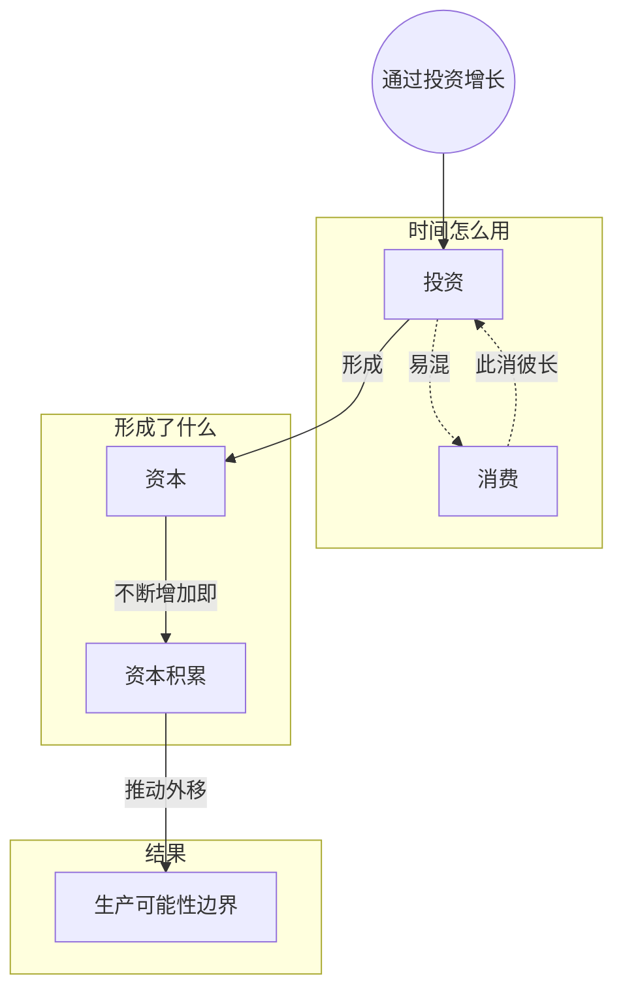

> 核心主线：生产可能性边界不是一成不变的——今天少抓一只兔子、腾出时间做捕兔陷阱，就是投资；陷阱这种资本让以后同样的时间能抓到更多兔子，边界随之向外扩张。  
> 本讲目标：读完你能回答「沿着边界移动和让边界本身外移有什么不同」「少抓兔子去做陷阱为什么能让边界外移」「投资、消费、资本、资本积累分别指什么」  
> 课程来源：Sal Khan / Khan Academy《第5讲 通过投资的经济增长》，B站 BV1Gy4y1a7aE，UP主：农夫CC，P5，约 8 分钟；[本集视频](https://www.bilibili.com/video/BV1Gy4y1a7aE/?p=5)。非官方中文转述，具体引用以本集转写为准；[官方课程总页](https://www.khanacademy.org/economics-finance-domain/microeconomics)。整课许可尚未逐讲核实。

## 目录
+ [1. 边界只能沿着走吗](#1-边界只能沿着走吗)
+ [2. 兔子与陷阱：当前的边界](#2-兔子与陷阱当前的边界)
+ [3. 少抓一只兔子做陷阱，边界向外移](#3-少抓一只兔子做陷阱边界向外移)
+ [4. 投资、消费与资本积累](#4-投资消费与资本积累)
+ [本讲知识地图](#本讲知识地图)
+ [本讲小结](#本讲小结)
+ [概念卡片](#概念卡片)
+ [自测题（面试速答）](#自测题面试速答)
+ [视频时间索引](#视频时间索引)

---

## 1. 边界只能沿着走吗
前几个视频里，**生产可能性边界（production possibilities frontier）**像是一个静态的东西：你可以沿着它移动，却改变不了它。

这一讲换个问题：有没有办法改变、甚至扩大这条边界？

为了讲清楚，讲者让狩猎采集者变成一个彻底的肉食者，只关心兔子，人生的全部幸福就是让每天能抓到、吃到的兔子尽量多。（引出新例子后，有一分多钟的转写几乎缺失，只剩 “1.” 和 “Rabbit Trap” 等板书词，新坐标轴和方案表的设定无法完整还原。）

> **记住这个就够了**：沿着边界移动是在既定能力下做取舍，本讲要问的是能不能让边界本身变大。

---

## 2. 兔子与陷阱：当前的边界
新例子里的两种产出是兔子和**捕兔陷阱**。从残存的转写看，方案里出现了每天做 2 个、3 个陷阱的情形。

讲者照例假设**其他条件不变（ceteris paribus）**，不考虑别的因素。他顺带解释：入门经济学里画生产可能性边界一般只画两种东西，所以是一条普通的曲线；如果在三种东西之间取舍，就得画三维图，那时边界会变成一个曲面。

他把当前的边界记作 **P₀**（下标 0 表示起点）。狩猎采集者待在这条曲线上的任何一点，都达到了生产效率。

> **记住这个就够了**：本讲的边界画的是“兔子 vs 陷阱”，当前这条记作 P₀。

---

## 3. 少抓一只兔子做陷阱，边界向外移
如果他把所有时间都花在抓兔子上，会怎样？他永远做不出陷阱，边界也就永远改变不了。

换一种做法：每天少抓一只，只抓 4 只兔子，腾出的时间刚好够做 1 个陷阱。他选择待在这个方案里。

有了陷阱，同样的时间能抓到更多兔子。但陷阱帮不了他做陷阱，所以每天最多做 3 个陷阱这一点不变，而兔子这一头可能提高到每天 6 只。新边界就只在兔子方向上往外扩，变成“一天之后的边界”。

再过一段时间，他做出了第二个陷阱，生产力更高，“两天之后的边界”又往外移了一些。讲者也承认，这个例子可能夸大了生产力增长的速度。（这一节中间有两段转写缺失，第二次外移后的具体数字没有念出来。）

| 阶段 | 兔子方向的最大产出 | 陷阱方向的最大产出 |
| --- | --- | --- |
| 起点 P₀ | 转写缺失 | 3 个 |
| 一天之后 | 可能 6 只 | 仍是 3 个 |
| 两天之后 | 继续外移（未给数字） | 未给出 |

> **记住这个就够了**：今天少抓一只兔子去做陷阱，明天同样的时间就能抓更多兔子，边界就往外移了。

---

## 4. 投资、消费与资本积累
少抓兔子去做陷阱，这件事在经济学里叫什么？

讲者说，他在做**投资（investment）**，在积累**资本（capital）**——陷阱本身就是资本。直接吃掉的兔子则是**消费（consumption）**：总有一个维持生存的基本消费量省不掉，但只要他拿出一部分时间去投资，整体的生产能力就会提高。

讲者接着把这个人自己看成一个经济体：如果他去投资，整体的生产能力就会提高；后面一句讲“用投资替代……”时转写中断，后半句缺失。

讲者把这种过程称为**资本积累（capital accumulation）**：不断造出能让自己更有生产力的工具。他接着提到“另一种投资是……”，但这段转写缺失，结尾只剩一句“在这个例子里，恰好是捕兔陷阱”。

| 用途 | 属于什么 | 作用 |
| --- | --- | --- |
| 当天吃掉的兔子 | 消费 | 满足眼前需要，至少保留生存所需的基本量 |
| 做陷阱花的时间 | 投资 | 牺牲眼前的兔子，换取以后更强的生产能力 |
| 做出来的陷阱 | 资本 | 让同样的时间抓到更多兔子 |
| 陷阱越攒越多 | 资本积累 | 生产能力持续提高，边界不断外移 |

> **记住这个就够了**：放弃一部分眼前消费去造工具就是投资，工具是资本，不断积累资本，生产可能性边界就会向外扩张。

---

## 本讲知识地图

## 本讲小结
| 机制/概念 | 解决什么问题 | 一句话 |
| --- | --- | --- |
| 边界外移 | 边界是不是只能沿着走 | 投资能让边界本身向外扩张 |
| 投资 | 怎样提高以后的生产能力 | 少抓一只兔子，把时间拿去做陷阱 |
| 资本 | 投资留下了什么 | 陷阱这样的工具，让同样时间抓到更多兔子 |
| 消费 | 投资的代价落在哪里 | 少吃眼前的兔子，但要保留生存所需的基本量 |

**学完能说的 3 句话：**
1. 前几讲只是沿着生产可能性边界移动，本讲说明投资能让边界本身向外移。
2. 狩猎采集者每天少抓一只兔子去做陷阱就是投资，陷阱是资本，让他以后同样的时间抓到更多兔子。
3. 陷阱提高的是抓兔子的能力，不提高做陷阱的能力，所以边界主要在兔子方向外扩；不断积累资本，边界就不断外移。

## 概念卡片
### 生产可能性边界
+ 原文：production possibilities frontier
+ 定义：现有资源和能力下两种产出所有可能组合连成的曲线；能力提高时它会向外移
+ 出现：第 1 节「边界只能沿着走吗」、第 2 节「兔子与陷阱：当前的边界」、第 3 节「少抓一只兔子做陷阱，边界向外移」
+ 依赖：
+ 易混：

### 投资
+ 原文：investment
+ 定义：放弃一部分眼前消费，把时间用来造能提高以后生产能力的工具
+ 出现：第 3 节「少抓一只兔子做陷阱，边界向外移」、第 4 节「投资、消费与资本积累」
+ 依赖：
+ 易混：消费——消费满足眼前需要，投资换取以后的生产能力

### 消费
+ 原文：consumption
+ 定义：直接用掉、满足眼前需要的产出，本例是当天吃掉的兔子；有一个维持生存的基本量
+ 出现：第 3 节「少抓一只兔子做陷阱，边界向外移」、第 4 节「投资、消费与资本积累」
+ 依赖：
+ 易混：投资——两者分享同样的时间，多投资就要少消费

### 资本
+ 原文：capital
+ 定义：能让生产更有效率的工具，本例是捕兔陷阱
+ 出现：第 3 节「少抓一只兔子做陷阱，边界向外移」、第 4 节「投资、消费与资本积累」
+ 依赖：投资
+ 易混：资本积累——资本是工具本身，资本积累是工具不断增加的过程

### 资本积累
+ 原文：capital accumulation
+ 定义：通过投资不断造出并保留生产工具，使生产能力持续提高的过程
+ 出现：第 3 节「少抓一只兔子做陷阱，边界向外移」、第 4 节「投资、消费与资本积累」
+ 依赖：投资、资本
+ 易混：资本——过程和工具存量不是一回事

## 自测题（面试速答）
1. 沿着生产可能性边界移动，和让边界本身外移，有什么区别？（对应：生产可能性边界）

**答案：** 沿边界移动是在既定能力下换一种分配，边界外移是生产能力本身提高了。前几讲在兔子和浆果之间换来换去，边界始终不变；本讲狩猎采集者做出陷阱之后，同样的时间能抓更多兔子，于是从 P₀ 变成了“一天之后”“两天之后”更靠外的边界。

2. 为什么把所有时间都用来抓兔子，边界就永远改变不了？（对应：投资）

**答案：** 因为没有时间做陷阱，就没有投资，生产能力也就不会提高。讲者的做法是每天少抓一只、只抓 4 只兔子，把腾出的时间用来做 1 个陷阱。正是这份对眼前兔子的放弃，换来了以后更高的捕兔能力。

3. 有了陷阱以后，边界为什么主要在兔子方向往外扩？（对应：资本）

**答案：** 因为陷阱这种资本提高的是抓兔子的能力，不提高做陷阱的能力。讲者举例说，有了一个陷阱后每天可能抓到 6 只兔子，但每天最多做 3 个陷阱这一点不变。所以新边界只在兔子一端外移，而不是两端等比例扩大。

4. 投资和消费有什么区别？为什么不能把时间全部拿去投资？（对应：消费）

**答案：** 消费是满足眼前需要，投资是牺牲眼前去换以后的生产能力。两者分享同样的时间，多做陷阱就要少吃兔子。但讲者指出，总有一个维持生存的基本消费量省不掉，所以投资只能用基本消费之外的部分。

5. 什么是资本积累？本讲例子里它是怎样推动边界外移的？（对应：资本积累）

**答案：** 资本积累是不断造出让自己更有生产力的工具的过程。狩猎采集者先做出第一个陷阱，边界外移到“一天之后”；再做出第二个，又外移到“两天之后”。讲者也提醒，这个例子可能夸大了生产力增长的速度。

---

## 视频时间索引
+ [00:00](https://www.bilibili.com/video/BV1Gy4y1a7aE?p=5&t=0) 1. 边界只能沿着走吗
+ [01:47](https://www.bilibili.com/video/BV1Gy4y1a7aE?p=5&t=107) 2. 兔子与陷阱：当前的边界
+ [03:16](https://www.bilibili.com/video/BV1Gy4y1a7aE?p=5&t=196) 3. 少抓一只兔子做陷阱，边界向外移
+ [05:51](https://www.bilibili.com/video/BV1Gy4y1a7aE?p=5&t=351) 4. 投资、消费与资本积累
