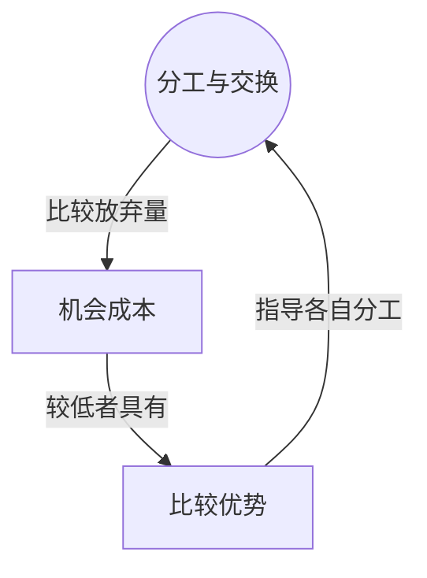

> 核心主线：以机会成本判断各自适合生产什么，按比较优势分工再交换，可以获得各自单独生产时无法实现的组合。  
> 课程来源：Sal Khan / Khan Academy《第6讲 比较优势专业化和贸易利得》，B站 BV1Gy4y1a7aE，UP主：农夫CC，P6，约 9 分钟；[本集视频](https://www.bilibili.com/video/BV1Gy4y1a7aE/?p=6)。非官方中文转述，具体引用以本集转写为准；[官方课程总页](https://www.khanacademy.org/economics-finance-domain/microeconomics)。整课许可尚未逐讲核实。

## 目录
+ [1. 计算杯子和盘子的机会成本](#1-计算杯子和盘子的机会成本)
+ [2. 分工交换后的产出组合](#2-分工交换后的产出组合)
+ [本讲知识地图](#本讲知识地图)
+ [概念卡片](#概念卡片)
+ [自测题（复习用）](#自测题复习用)
+ [视频时间索引](#视频时间索引)

## 1. 计算杯子和盘子的机会成本
**核心思想：** 比较新增一种产品要放弃多少另一种产品，可以识别相对低成本的生产者。

+ 本例使用直线型的**生产可能性边界（Production Possibilities Frontier）**，所以沿各自边界移动时斜率不变，**机会成本（Opportunity Cost）**也不变。
+ Charlie 全部生产杯子可做 30 个，全部生产盘子可做 10 个；因此每个盘子的代价是 3 个杯子，每个杯子的代价是 1/3 个盘子。
+ Patty 每天全部生产杯子可做 10 个，全部生产盘子可做 30 个；因此每个盘子的代价是 1/3 个杯子，每个杯子的代价是 3 个盘子。
+ **比较优势（Comparative Advantage）**由较低的机会成本决定：Patty 做盘子牺牲的杯子较少，Charlie 做杯子牺牲的盘子较少。

| 生产者 | 全做杯子 | 全做盘子 | 每个盘子的代价 | 每个杯子的代价 |
| --- | --- | --- | --- | --- |
| Charlie | 30 个 | 10 个 | 3 个杯子 | 1/3 个盘子 |
| Patty | 10 个 | 30 个 | 1/3 个杯子 | 3 个盘子 |

## 2. 分工交换后的产出组合
**核心思想：** 生产时各做自己相对低代价的产品，再交换得到双方都想要的组合。

+ 按比较优势分工，Charlie 专做杯子，Patty 专做盘子；本例便可以得到 30 个杯子和 30 个盘子。
+ 讲师采用 1 个杯子换 1 个盘子的交换示例。Charlie 交出 15 个杯子换来 15 个盘子，Patty 作反向交换。
+ 结果每人都持有 15 个杯子和 15 个盘子。这个组合超过了各自单独生产时的能力：Charlie 单独最多只能做 10 个盘子，Patty 单独最多只能做 10 个杯子。
+ 这里改变的是分工与交换后的可得组合，不是声称单个人能在原生产边界外直接生产。双方能交换多少仍取决于对方愿意交换多少。
+ 机会成本让交换的价值更明确：Charlie 自产一个盘子要放弃 3 个杯子，而示例交换只交出 1 个杯子；Patty 获得杯子也有类似好处。

## 本讲知识地图

## 概念卡片
### 机会成本
+ 原文：Opportunity Cost
+ 定义：本例生产一单位杯子或盘子所放弃的另一种产品数量。
+ 出现：第 1 节「计算杯子和盘子的机会成本」、第 2 节「分工交换后的产出组合」
+ 依赖：
+ 易混：

### 比较优势
+ 原文：Comparative Advantage
+ 定义：与另一生产者相比，生产某种产品具有较低机会成本的优势。
+ 出现：第 1 节「计算杯子和盘子的机会成本」、第 2 节「分工交换后的产出组合」
+ 依赖：机会成本
+ 易混：

## 自测题（复习用）
1. Charlie 做一个盘子的代价为什么是 3 个杯子？（对应：机会成本）

**答案：** 他全部做 10 个盘子会放弃全部可做的 30 个杯子，两边除以 10 得到该代价。

2. Patty 为什么在盘子上具有比较优势？（对应：比较优势）

**答案：** 她每个盘子只放弃 1/3 个杯子，低于 Charlie 的 3 个杯子。

3. Charlie 应专做哪一种产品，依据是什么？（对应：比较优势）

**答案：** 专做杯子，因为其代价为 1/3 个盘子，低于 Patty 的 3 个盘子。

4. 本例如何让两人各得到 15 个杯子和 15 个盘子？（对应：比较优势）

**答案：** Charlie 做 30 个杯子，Patty 做 30 个盘子，再交换 15 个杯子与 15 个盘子。

5. 为什么不能把交换后的组合解释成个人直接突破了原生产边界？（对应：机会成本）

**答案：** 组合由分工后交换获得，个人原有的生产能力与自产取舍并未因此改变。

---

## 视频时间索引
+ [00:00](https://www.bilibili.com/video/BV1Gy4y1a7aE?p=6&t=0) 1. 计算杯子和盘子的机会成本
+ [05:31](https://www.bilibili.com/video/BV1Gy4y1a7aE?p=6&t=331) 2. 分工交换后的产出组合
