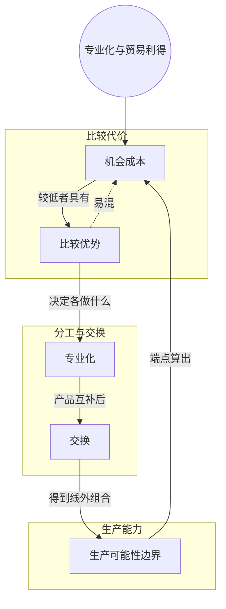

> 核心主线：用机会成本比较两个生产者——谁做某样东西放弃得更少，谁就在这样东西上有比较优势；各自专做有比较优势的产品再交换，双方都能拿到单靠自己生产不出来的组合。  
> 本讲目标：读完你能回答「怎么用机会成本判断谁在哪种产品上有比较优势」「为什么专业化再交换能让双方都超出各自的生产可能性边界」  
> 课程来源：Sal Khan / Khan Academy《第6讲 比较优势专业化和贸易利得》，B站 BV1Gy4y1a7aE，UP主：农夫CC，P6，约 9 分钟；[本集视频](https://www.bilibili.com/video/BV1Gy4y1a7aE/?p=6)。非官方中文转述，具体引用以本集转写为准；[官方课程总页](https://www.khanacademy.org/economics-finance-domain/microeconomics)。整课许可尚未逐讲核实。

## 目录
+ [1. 杯子和盘子的两条生产可能性边界](#1-杯子和盘子的两条生产可能性边界)
+ [2. 做一个盘子要放弃多少杯子](#2-做一个盘子要放弃多少杯子)
+ [3. 做一个杯子要放弃多少盘子](#3-做一个杯子要放弃多少盘子)
+ [4. 按比较优势专业化](#4-按比较优势专业化)
+ [5. 交换后超出各自的生产可能性边界](#5-交换后超出各自的生产可能性边界)
+ [本讲知识地图](#本讲知识地图)
+ [本讲小结](#本讲小结)
+ [概念卡片](#概念卡片)
+ [自测题（面试速答）](#自测题面试速答)
+ [视频时间索引](#视频时间索引)

---

## 1. 杯子和盘子的两条生产可能性边界
这一讲离开前几讲的狩猎采集者，换到一个更日常的场景：餐具市场。市场上只有两种产品，杯子和盘子，讲者用两个生产者 Charlie 和 Patty 来举例。

先看 Charlie。如果他把全部时间都用来做杯子，能做 30 个；全部用来做盘子，能做 10 个。把这两个端点连起来，就是他的**生产可能性边界（Production Possibilities Frontier）**，简称 PPF。

再看 Patty，她正好反过来：一天全做杯子只能做 10 个，全做盘子却能做 30 个。

| 生产者 | 全做杯子 | 全做盘子 |
| --- | --- | --- |
| Charlie | 30 个 | 10 个 |
| Patty | 10 个 | 30 个 |

讲者特意假设两人的 PPF 都是直线。直线的斜率处处相同，不像前面狩猎采集者那条向外弯的曲线，所以沿着边界移动时，换一种产品的代价始终不变，后面的计算可以直接用端点来算。

> **记住这个就够了**：Charlie 擅长做杯子、Patty 擅长做盘子，两人的生产可能性边界都是直线，换产的代价固定不变。

---

## 2. 做一个盘子要放弃多少杯子
两个人谁更适合做盘子？只看谁做得多还不够，要看做盘子时**放弃了多少杯子**，这就是**机会成本（Opportunity Cost）**。

Charlie 从全做杯子的端点出发，想做出 10 个盘子，就得放掉全部 30 个杯子。所以 10 个盘子的机会成本是 30 个杯子，两边同除以 10，**一个盘子的机会成本是 3 个杯子**。（这一段的推导，转写稿中间有一小段缺失，只剩结论「等于 30 个杯子」和后面的除法。）

Patty 同样从全做杯子的端点出发，想做 30 个盘子，要放弃 10 个杯子。两边同除以 30，**一个盘子的机会成本只有 1/3 个杯子**。讲者说他是故意用端点来算，这样数字最直观。

| 生产者 | 一个盘子的机会成本 |
| --- | --- |
| Charlie | 3 个杯子 |
| Patty | 1/3 个杯子 |

用杯子来衡量，Patty 做盘子的代价远低于 Charlie。谁做某样东西的机会成本更低，谁就在这样东西上有**比较优势（Comparative Advantage）**，所以 Patty 在盘子上有比较优势。（转写稿在讲者引出「比较优势」这个词之后有将近一分钟缺段，具体怎么下定义没能转写出来；Patty 因同样理由专做盘子，见第 4 节。）

> **记住这个就够了**：做一个盘子，Charlie 要放弃 3 个杯子，Patty 只放弃 1/3 个杯子，所以 Patty 在盘子上有比较优势。

---

## 3. 做一个杯子要放弃多少盘子
反过来问：谁在杯子上有比较优势？

把 Charlie 的等式「1 个盘子 = 3 个杯子」两边对调，再同除以 3：Charlie 做 3 个杯子要放弃 1 个盘子，**做一个杯子的机会成本是 1/3 个盘子**。

Patty 那边的推导，转写稿有一段缺失，但讲者随后给出的比较是「只要 1/3 个盘子，相对于 3 个盘子」，也就是 Patty 做一个杯子要放弃 3 个盘子。这和她「10 个杯子换 30 个盘子」的端点是一致的。

| 生产者 | 一个杯子的机会成本 | 一个盘子的机会成本 |
| --- | --- | --- |
| Charlie | 1/3 个盘子 | 3 个杯子 |
| Patty | 3 个盘子 | 1/3 个杯子 |

所以 Charlie 在杯子上有比较优势。注意表中每个人的两个机会成本互为倒数：一个人做杯子越「便宜」，做盘子就越「贵」，因此两个人、两种产品时，不会出现一个人在两样东西上都有比较优势（视频中未展开，笔记补充）。

> **记住这个就够了**：做一个杯子，Charlie 只放弃 1/3 个盘子，Patty 要放弃 3 个盘子，所以 Charlie 在杯子上有比较优势。

---

## 4. 按比较优势专业化
知道了各自的比较优势，接下来怎么办？讲者的答案是：各自只做自己有比较优势的那样东西，做出来再互通有无。

这种「只做一样」的安排叫**专业化（Specialization）**。Charlie 做杯子的机会成本更低，就让他专做杯子；Patty 出于同样的理由，专做盘子。按两人的端点，Charlie 一天能做出 30 个杯子，Patty 一天能做出 30 个盘子。

讲者先把结论摆在前面：双方按比较优势专业化之后再**交换（Trade）**，就能得到超出各自生产可能性边界的结果。比如两人最后各拿到 15 个杯子和 15 个盘子——这在各干各的情况下是做不到的。

> **记住这个就够了**：专业化就是各自只生产自己机会成本更低的那种产品，这是后面交换能带来好处的前提。

---

## 5. 交换后超出各自的生产可能性边界
专业化之后，Charlie 手里全是杯子，Patty 手里全是盘子，谁都没法只靠自己的产品过日子，于是要交换。

讲者的例子是：两人都想到达「15 个杯子 + 15 个盘子」这个组合，那么 Charlie 拿 15 个杯子去换 Patty 的 15 个盘子，交换之后两人各有 15 个杯子和 15 个盘子。当然，最后落在哪个组合，取决于对方愿意换多少。

为什么说这超出了各自的生产可能性边界？按第 1 节的数字推算：Charlie 单干时最多只能做 10 个盘子，15 个盘子根本够不着；Patty 单干时最多只能做 10 个杯子，15 个杯子也够不着（视频中未展开，笔记补充）。也就是说，两人都没有变得更能干，生产能力还是原来那条线，是分工加交换让他们拿到了线外的组合。

再从机会成本看这笔交换为什么划算：这次交换是 1 个杯子换 1 个盘子，Charlie 自己做一个盘子要放弃 3 个杯子，换来一个盘子却只交出 1 个杯子；Patty 自己做一个杯子要放弃 3 个盘子，换来一个杯子只交出 1 个盘子（视频中未展开，笔记补充）。

转写稿说明：这一节的前大半段（约两分钟）转写稿只剩「1 cup, 1 cup, 1 plate」「$1.00」等零碎片段，讲者可能在这里讲了交换比率或价格，具体内容无法还原；另有一句转写为 Patty「拿杯子换盘子」，按上下文应是拿盘子换杯子，疑为口误或识别错误；结尾一句也未能转写。

> **记住这个就够了**：专业化后按 15 换 15 交换，两人都拿到了单靠自己生产不出的 15 个杯子加 15 个盘子。

---

## 本讲知识地图

## 本讲小结
| 机制/概念 | 解决什么问题 | 一句话 |
| --- | --- | --- |
| 机会成本 | 只看产量说不清谁做什么更划算 | 用「做一个要放弃多少另一种」来衡量代价 |
| 比较优势 | 两个人该怎么分工 | 谁的机会成本低，谁就在这种产品上有比较优势 |
| 专业化 | 各自什么都做，效率不高 | 各自只做有比较优势的产品 |
| 交换 | 专业化后每人只有一种产品 | 互换产品，双方都拿到边界外的组合 |

**学完能说的 3 句话：**
1. 做一个盘子，Charlie 要放弃 3 个杯子、Patty 只放弃 1/3 个杯子，所以 Patty 在盘子上有比较优势，Charlie 在杯子上有比较优势。
2. 两人各自专做有比较优势的产品，Charlie 能做 30 个杯子，Patty 能做 30 个盘子。
3. 再按 15 个杯子换 15 个盘子交换，两人各得 15 个杯子和 15 个盘子，超出了各自单干时的生产可能性边界。

## 概念卡片
### 生产可能性边界
+ 原文：Production Possibilities Frontier
+ 定义：一个生产者把时间在两种产品之间分配时，能生产出的所有最大产量组合连成的线；本讲两人的都是直线
+ 出现：第 1 节「杯子和盘子的两条生产可能性边界」、第 2 节「做一个盘子要放弃多少杯子」、第 5 节「交换后超出各自的生产可能性边界」
+ 依赖：
+ 易混：

### 机会成本
+ 原文：Opportunity Cost
+ 定义：多生产一单位某种产品所必须放弃的另一种产品的数量
+ 出现：第 2 节「做一个盘子要放弃多少杯子」、第 3 节「做一个杯子要放弃多少盘子」、第 5 节「交换后超出各自的生产可能性边界」
+ 依赖：生产可能性边界
+ 易混：

### 比较优势
+ 原文：Comparative Advantage
+ 定义：与另一个生产者相比，生产某种产品的机会成本更低
+ 出现：第 2 节「做一个盘子要放弃多少杯子」、第 3 节「做一个杯子要放弃多少盘子」、第 4 节「按比较优势专业化」
+ 依赖：机会成本
+ 易混：机会成本——机会成本是一个人自己的代价，比较优势是两个人的代价相互比较的结果

### 专业化
+ 原文：Specialization
+ 定义：各生产者只生产自己有比较优势的那种产品
+ 出现：第 4 节「按比较优势专业化」、第 5 节「交换后超出各自的生产可能性边界」
+ 依赖：比较优势
+ 易混：

### 交换
+ 原文：Trade
+ 定义：专业化后的生产者互相交换产品，使双方都能得到超出各自生产可能性边界的组合
+ 出现：第 4 节「按比较优势专业化」、第 5 节「交换后超出各自的生产可能性边界」
+ 依赖：专业化
+ 易混：

## 自测题（面试速答）
1. 判断谁在盘子上有比较优势，应该比较什么？（对应：比较优势）

**答案：** 比较两人做一个盘子各自要放弃多少杯子，放弃得少的一方有比较优势。因为比较优势看的是机会成本的高低，而不是谁做得多。本讲中 Charlie 做一个盘子要放弃 3 个杯子，Patty 只放弃 1/3 个杯子，所以 Patty 在盘子上有比较优势。

2. Charlie 做一个盘子的机会成本怎么从他的生产可能性边界算出来？（对应：机会成本）

**答案：** 是 3 个杯子，直接用端点就能算。他全做杯子能做 30 个、全做盘子能做 10 个，从全做杯子转到全做盘子，就是用 30 个杯子换来 10 个盘子；边界是直线、代价不变，两边同除以 10 就得到一个盘子等于 3 个杯子。

3. 为什么两个人、两种产品时，一个人不会在两种产品上都有比较优势？（对应：机会成本）

**答案：** 因为同一个人的两个机会成本互为倒数。Charlie 做一个盘子要放弃 3 个杯子，反过来做一个杯子就只放弃 1/3 个盘子；Patty 正好相反。一个人在一种产品上代价低，在另一种上代价就高，所以 Patty 占盘子、Charlie 占杯子（倒数关系的一般性结论，视频中未展开，笔记补充）。

4. 本讲中 Charlie 和 Patty 应该怎样专业化？依据是什么？（对应：专业化）

**答案：** Charlie 专做杯子，Patty 专做盘子。依据是机会成本：Charlie 做一个杯子只放弃 1/3 个盘子，Patty 却要放弃 3 个盘子；Patty 做盘子的代价同样更低。专业化之后，Charlie 一天能做 30 个杯子，Patty 一天能做 30 个盘子。

5. 两人交换后各得 15 个杯子和 15 个盘子，为什么说这超出了各自的生产可能性边界？（对应：交换）

**答案：** 因为这个组合单靠自己根本生产不出来。Charlie 单干最多只能做 10 个盘子，Patty 单干最多只能做 10 个杯子，15 个都够不着；两人专业化后再按 15 个杯子换 15 个盘子，才拿到这个组合。生产能力本身没变，是分工加交换让双方都得到了线外的结果。

6. 交换能帮双方到达哪个组合，由什么决定？（对应：交换）

**答案：** 取决于对方愿意交换多少，不是一方说了算。讲者的例子假设两人都想到达 15 个杯子加 15 个盘子，于是 Charlie 用 15 个杯子换 Patty 的 15 个盘子；如果对方愿意换的数量不同，两人最后落在的组合也会不同。

---

## 视频时间索引
+ [00:00](https://www.bilibili.com/video/BV1Gy4y1a7aE?p=6&t=0) 1. 杯子和盘子的两条生产可能性边界
+ [00:57](https://www.bilibili.com/video/BV1Gy4y1a7aE?p=6&t=57) 2. 做一个盘子要放弃多少杯子
+ [04:14](https://www.bilibili.com/video/BV1Gy4y1a7aE?p=6&t=254) 3. 做一个杯子要放弃多少盘子
+ [05:31](https://www.bilibili.com/video/BV1Gy4y1a7aE?p=6&t=331) 4. 按比较优势专业化
+ [06:43](https://www.bilibili.com/video/BV1Gy4y1a7aE?p=6&t=403) 5. 交换后超出各自的生产可能性边界
