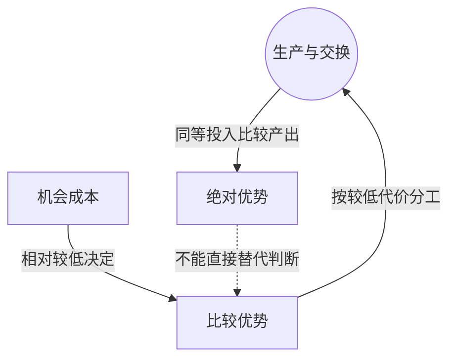

> 核心主线：同等投入下两种产品都做得更多，不代表两种产品都具有较低机会成本；比较优势仍能支持互利分工与交换。  
> 课程来源：Sal Khan / Khan Academy《第7讲 比较优势和绝对优势》，B站 BV1Gy4y1a7aE，UP主：农夫CC，P7，约 10 分钟；[本集视频](https://www.bilibili.com/video/BV1Gy4y1a7aE/?p=7)。非官方中文转述，具体引用以本集转写为准；[官方课程总页](https://www.khanacademy.org/economics-finance-domain/microeconomics)。整课许可尚未逐讲核实。

## 目录
+ [1. 产出数量与相对代价](#1-产出数量与相对代价)
+ [2. 双方仍能通过交换获益](#2-双方仍能通过交换获益)
+ [本讲知识地图](#本讲知识地图)
+ [概念卡片](#概念卡片)
+ [自测题（复习用）](#自测题复习用)
+ [视频时间索引](#视频时间索引)

## 1. 产出数量与相对代价
**核心思想：** 生产能力比较与生产取舍比较，回答的是不同的问题。

+ **绝对优势（Absolute Advantage）**比较同样投入、同样时间内谁能生产更多。新情景中，Charlie 可专做 40 个杯子或 40 个盘子，Patty 则仍是 10 个杯子或 30 个盘子，Charlie 两种产品都有绝对优势。
+ **比较优势（Comparative Advantage）**比较生产某产品的**机会成本（Opportunity Cost）**。Charlie 做 40 个盘子会放弃 40 个杯子，所以每个盘子的代价为 1 个杯子，反向也一样。
+ Patty 每个杯子的代价仍为 3 个盘子。Charlie 每个杯子只放弃 1 个盘子，因此仍应专做杯子；Patty 应专做盘子。
+ Charlie 的杯子代价由原情景的 1/3 个盘子变为 1 个盘子，并不与整体生产能力改善矛盾：另一种产品的生产能力也变了，相对取舍不能只看单一产出的增长。

| 生产者 | 全做杯子 | 全做盘子 | 每个杯子的代价 | 本例适合专做 |
| --- | --- | --- | --- | --- |
| Charlie | 40 个 | 40 个 | 1 个盘子 | 杯子 |
| Patty | 10 个 | 30 个 | 3 个盘子 | 盘子 |

## 2. 双方仍能通过交换获益
**核心思想：** 只要交换优于各自的自产取舍，即使一方产出全面领先，双方仍有获益空间。

+ 按比较优势分工后，Charlie 做 40 个杯子，Patty 做 30 个盘子；Charlie 的双重绝对优势没有消除这项分工依据。
+ 示例交换条件是 1 个杯子换 2 个盘子。Patty 自产 1 个杯子要放弃 3 个盘子，交换只需 2 个，所以愿意交换。
+ Charlie 自产 1 个盘子要放弃 1 个杯子，交换则只需半个杯子，获得盘子的代价也更低。
+ 本集最终选用交换 10 个杯子与 20 个盘子的例子。按给定产出与交换量相减，Charlie 剩 30 个杯子并得到 20 个盘子，Patty 剩 10 个盘子并得到 10 个杯子。
+ 这些组合通过分工交换取得；互利来自不同机会成本，而非要求双方各自在某种产品的数量上领先。

## 本讲知识地图

## 概念卡片
### 绝对优势
+ 原文：Absolute Advantage
+ 定义：同样投入和时间内，能够生产比另一方更多某种产品的优势。
+ 出现：第 1 节「产出数量与相对代价」、第 2 节「双方仍能通过交换获益」
+ 依赖：
+ 易混：比较优势——数量领先与相对代价较低是不同判断。

### 比较优势
+ 原文：Comparative Advantage
+ 定义：生产某种产品的机会成本相对较低的优势。
+ 出现：第 1 节「产出数量与相对代价」、第 2 节「双方仍能通过交换获益」
+ 依赖：机会成本
+ 易混：绝对优势——两种产出都领先，也不必两种取舍都更划算。

### 机会成本
+ 原文：Opportunity Cost
+ 定义：为了多生产某种产品所放弃的另一种产品数量。
+ 出现：第 1 节「产出数量与相对代价」、第 2 节「双方仍能通过交换获益」
+ 依赖：
+ 易混：

## 自测题（复习用）
1. 新情景中 Charlie 为何在两种产品上都有绝对优势？（对应：绝对优势）

**答案：** 同样投入和一天时间内，他可做 40 个杯子或 40 个盘子，分别超过 Patty 的 10 和 30 个。

2. Charlie 为什么仍应专做杯子？（对应：比较优势）

**答案：** 每个杯子只放弃 1 个盘子，低于 Patty 放弃 3 个盘子的代价。

3. 一杯换两盘为何对 Patty 有吸引力？（对应：机会成本）

**答案：** 她自产一杯要放弃三盘，交换只用两盘。

4. 同样交换条件下 Charlie 获得一个盘子的代价怎样变化？（对应：机会成本）

**答案：** 从自产的一杯降为交换的半杯，获取盘子更划算。

5. 本例怎样反驳“产出全面领先就不需要交换”的推断？（对应：比较优势）

**答案：** Charlie 虽全面领先，双方不同的相对代价仍让分工与交换比各自自产更有利。

---

## 视频时间索引
+ [00:00](https://www.bilibili.com/video/BV1Gy4y1a7aE?p=7&t=0) 1. 产出数量与相对代价
+ [06:26](https://www.bilibili.com/video/BV1Gy4y1a7aE?p=7&t=386) 2. 双方仍能通过交换获益
