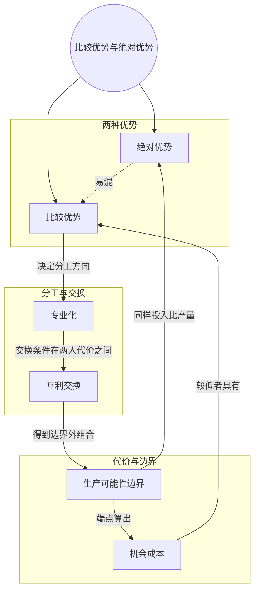

> 核心主线：绝对优势比的是同样投入下谁做得多，比较优势比的是谁的机会成本低；即使 Charlie 两种产品都做得更多，两人的机会成本仍然不同，按比较优势专业化再交换，双方照样都能获益。  
> 本讲目标：读完你能回答「绝对优势和比较优势有什么区别」「一方两样都做得更多时，为什么还值得分工交换」「一杯换两盘为什么对双方都划算」  
> 课程来源：Sal Khan / Khan Academy《第7讲 比较优势和绝对优势》，B站 BV1Gy4y1a7aE，UP主：农夫CC，P7，约 10 分钟；[本集视频](https://www.bilibili.com/video/BV1Gy4y1a7aE/?p=7)。非官方中文转述，具体引用以本集转写为准；[官方课程总页](https://www.khanacademy.org/economics-finance-domain/microeconomics)。整课许可尚未逐讲核实。

## 目录
+ [1. 先回顾比较优势](#1-先回顾比较优势)
+ [2. 绝对优势：两种产品都做得更多](#2-绝对优势两种产品都做得更多)
+ [3. 全面领先者的机会成本](#3-全面领先者的机会成本)
+ [4. 仍按比较优势专业化](#4-仍按比较优势专业化)
+ [5. 一杯换两盘的互利交换](#5-一杯换两盘的互利交换)
+ [6. 交换后的结果](#6-交换后的结果)
+ [本讲知识地图](#本讲知识地图)
+ [本讲小结](#本讲小结)
+ [概念卡片](#概念卡片)
+ [自测题（面试速答）](#自测题面试速答)
+ [视频时间索引](#视频时间索引)

---

## 1. 先回顾比较优势
两个人比本事，可以比「谁做得多」，也可以比「谁做起来代价小」。这两种「比别人强」到底差在哪？这一讲就是要把它们分清楚。

先回到上一讲的结论：Patty 在盘子上相对 Charlie 有**比较优势（Comparative Advantage）**，因为她做一个盘子的**机会成本（Opportunity Cost）**更低——她只放弃 1/3 个杯子，Charlie 要放弃 3 个杯子。

和它相对的另一个概念叫**绝对优势（Absolute Advantage）**，下一节用一个新情景来说明。

转写稿说明：讲者在开头用了大约两分钟回顾上一讲的数字，这一段转写稿只剩「1/3 cup, 3 cups」「and so on」以及一句意思不明的「Patti can produce 10 cups with one person」等碎片，具体讲法无法还原。

> **记住这个就够了**：比较优势看的是机会成本谁更低，Patty 做盘子的机会成本更低，所以她在盘子上有比较优势。

---

## 2. 绝对优势：两种产品都做得更多
设想 Charlie 的生产能力大幅提升了，也许是做了投资或研发。Patty 没变，她的**生产可能性边界（Production Possibilities Frontier）**还是原来那条：全做杯子 10 个，全做盘子 30 个。

Charlie 的边界则整体向外扩张了：假设两人一天投入的生产要素数量相同，Charlie 一天能做 40 个杯子，或者 40 个盘子。

| 生产者 | 全做杯子 | 全做盘子 |
| --- | --- | --- |
| Charlie（新） | 40 个 | 40 个 |
| Patty | 10 个 | 30 个 |

同样的投入、同样的一天，谁能生产得更多，谁就有**绝对优势**。杯子上 Charlie 40 个对 Patty 10 个，盘子上 40 个对 30 个，所以现在 Charlie 在两种产品上**都有绝对优势**。

那是不是 Charlie 自己什么都做就行了？讲者的回答是否定的：因为两人的机会成本不同，比较优势也不同，**专业化（Specialization）**仍然有意义。

> **记住这个就够了**：绝对优势比的是同样投入下谁产得多，Charlie 现在两种产品都占绝对优势。

---

## 3. 全面领先者的机会成本
Charlie 变得这么能干，他的机会成本是不是也全面变低了？算一算就知道。

Charlie 从全做杯子的端点出发，想做 40 个盘子，就得放弃全部 40 个杯子。所以 40 个盘子的机会成本是 40 个杯子，两边同除以 40，**一个盘子的机会成本是 1 个杯子**；反过来，**一个杯子的机会成本也是 1 个盘子**。讲者说这样的数字让计算很容易。

有意思的是，Charlie 做杯子的机会成本反而比以前高了：以前做一个杯子只放弃 1/3 个盘子，现在要放弃 1 个盘子。讲者的解释是，以前的 Charlie 更「偏科」，杯子特别强、盘子特别弱；现在他整体更能干了，但两种产品的能力更均衡。讲者还说，这一点后面会看到反而是件好事。（这里转写稿有将近一分钟缺段，中间的推导只剩片段。）

| 生产者 | 一个杯子的机会成本 | 一个盘子的机会成本 |
| --- | --- | --- |
| Charlie（新） | 1 个盘子 | 1 个杯子 |
| Patty | 3 个盘子 | 1/3 个杯子 |

> **记住这个就够了**：生产能力全面提升不等于机会成本全面降低，Charlie 做杯子的机会成本从 1/3 个盘子升到了 1 个盘子。

---

## 4. 仍按比较优势专业化
既然 Charlie 两样都做得多，分工的依据还成立吗？比较的仍然是机会成本。

Patty 做一个杯子要放弃 3 个盘子，Charlie 只放弃 1 个盘子，所以 Charlie **依然在杯子上有比较优势**，应当继续专做杯子。Patty 则继续专做盘子：她做一个盘子只放弃 1/3 个杯子，比 Charlie 的 1 个杯子低（盘子这一侧的对比按上表推算，讲者只直接说了「Patty 仍应专做盘子」）。

于是 Charlie 每天专做 40 个杯子，Patty 每天专做 30 个盘子。讲者要证明的是：即使这样，两人交换后也能拿到超出 Charlie 生产可能性边界的组合。

| 判断 | 比什么 | 本讲结果 |
| --- | --- | --- |
| 绝对优势 | 同样投入下的产量 | Charlie 两种产品都占 |
| 比较优势 | 机会成本 | Charlie 占杯子，Patty 占盘子 |

> **记住这个就够了**：分工看比较优势而不是绝对优势，Charlie 全面领先，仍然该专做杯子、让 Patty 专做盘子。

---

## 5. 一杯换两盘的互利交换
两人分工之后，按什么条件交换，才能让双方都愿意？讲者把这一步叫作**互利交换（Trade for Mutual Benefit）**。

他给的条件是 **1 个杯子换 2 个盘子**，Patty 愿意用 2 个盘子换 1 个杯子。对 Patty 来说，自己做一个杯子要放弃 3 个盘子，通过交换只要付出 2 个盘子，当然愿意。（Patty 这一侧的推理落在转写缺段里，按前面的数字补齐。）

对 Charlie 来说，自己做一个盘子要放弃 1 个杯子；按这个交换条件，1 个杯子能换 2 个盘子，相当于每个盘子只付出半个杯子。讲者说：不论怎么算，这都比他自己的机会成本更划算。

> **记住这个就够了**：交换条件只要落在两人的机会成本之间，比如一杯换两盘，双方换来东西的代价都比自己生产更低。

---

## 6. 交换后的结果
按一杯换两盘，具体换多少？讲者先想让 Charlie 换出 20 个杯子，随即改口说这个例子不好，因为对方不够换。

为什么不够？按一杯换两盘，20 个杯子要换 40 个盘子，而 Patty 一天只做 30 个盘子（视频中未展开，笔记补充）。转写稿这里写的是「Patty 的杯子不够」，按上下文应是盘子不够，疑为口误或识别错误。

于是改成 Charlie 拿 **10 个杯子换 20 个盘子**。交换后，Charlie 剩 30 个杯子、得到 20 个盘子；Patty 剩 10 个盘子、得到 10 个杯子（按产量与交换量相减得到，结果这一段转写稿缺失）。讲者最后说，这同样超出了 Patty 的生产可能性边界，对 Patty 来说也是相当不错的结果。

再验证一下 Charlie：他的边界是「杯子 + 盘子 = 40」这条直线，单干时有 30 个杯子就最多只能有 10 个盘子，现在却有 20 个盘子；Patty 单干时如果有 10 个杯子，就一个盘子也做不出来，现在却还剩 10 个盘子（视频中未展开，笔记补充）。

> **记住这个就够了**：Charlie 用 10 个杯子换 Patty 20 个盘子后，两人拿到的组合都超出了各自单干的生产可能性边界。

---

## 本讲知识地图

## 本讲小结
| 机制/概念 | 解决什么问题 | 一句话 |
| --- | --- | --- |
| 绝对优势 | 同样投入下谁的生产能力更强 | 产量更多的一方有绝对优势，可以两种产品都占 |
| 比较优势 | 两人该怎么分工 | 机会成本更低的一方有比较优势，决定分工方向 |
| 机会成本 | 能力全面提升后代价怎么变 | Charlie 做杯子的机会成本从 1/3 个盘子升到 1 个盘子 |
| 互利交换 | 分工后用什么条件交换双方都愿意 | 一杯换两盘，双方换来东西的代价都低于自产 |

**学完能说的 3 句话：**
1. 绝对优势比同样投入下谁产得多，比较优势比谁的机会成本低，两者回答的是不同问题。
2. Charlie 两种产品都有绝对优势，但做杯子只放弃 1 个盘子、Patty 要放弃 3 个，所以他仍该专做杯子，Patty 专做盘子。
3. 按一杯换两盘交换，Patty 换一个杯子少付 1 个盘子，Charlie 换一个盘子只付半个杯子，双方都得到超出各自边界的组合。

## 概念卡片
### 比较优势
+ 原文：Comparative Advantage
+ 定义：与另一个生产者相比，生产某种产品的机会成本更低
+ 出现：第 1 节「先回顾比较优势」、第 4 节「仍按比较优势专业化」
+ 依赖：机会成本
+ 易混：绝对优势——绝对优势比产量，比较优势比机会成本

### 绝对优势
+ 原文：Absolute Advantage
+ 定义：在同样投入、同样时间内，能比另一个生产者生产更多某种产品
+ 出现：第 2 节「绝对优势：两种产品都做得更多」、第 4 节「仍按比较优势专业化」
+ 依赖：生产可能性边界
+ 易混：比较优势——一方可以两种产品都有绝对优势，但不可能两种都有比较优势

### 机会成本
+ 原文：Opportunity Cost
+ 定义：多生产一单位某种产品所必须放弃的另一种产品的数量
+ 出现：第 1 节「先回顾比较优势」、第 3 节「全面领先者的机会成本」、第 4 节「仍按比较优势专业化」、第 5 节「一杯换两盘的互利交换」
+ 依赖：生产可能性边界
+ 易混：

### 生产可能性边界
+ 原文：Production Possibilities Frontier
+ 定义：一个生产者在两种产品之间分配投入时，能生产出的最大产量组合连成的线
+ 出现：第 2 节「绝对优势：两种产品都做得更多」、第 3 节「全面领先者的机会成本」、第 6 节「交换后的结果」
+ 依赖：
+ 易混：

### 专业化
+ 原文：Specialization
+ 定义：各生产者只生产自己有比较优势的那种产品
+ 出现：第 2 节「绝对优势：两种产品都做得更多」、第 4 节「仍按比较优势专业化」
+ 依赖：比较优势
+ 易混：

### 互利交换
+ 原文：Trade for Mutual Benefit
+ 定义：专业化后按落在双方机会成本之间的条件交换，使双方换来产品的代价都低于自己生产
+ 出现：第 5 节「一杯换两盘的互利交换」、第 6 节「交换后的结果」
+ 依赖：专业化，机会成本
+ 易混：

## 自测题（面试速答）
1. 绝对优势和比较优势有什么区别？（对应：绝对优势）

**答案：** 绝对优势比的是同样投入下谁产得多，比较优势比的是谁的机会成本低。前者衡量生产能力，后者衡量放弃的代价，决定分工的是后者。本讲中 Charlie 一天能做 40 个杯子或 40 个盘子，两样都比 Patty 多，有双重绝对优势，但比较优势只在杯子上。

2. Charlie 两种产品都做得比 Patty 多，为什么还要分工交换？（对应：比较优势）

**答案：** 因为两人的机会成本不同，按比较优势分工仍能让双方获益。Charlie 做一个杯子只放弃 1 个盘子，Patty 要放弃 3 个盘子，所以 Charlie 在杯子上有比较优势，Patty 在盘子上有比较优势。分工后按一杯换两盘交换，两人得到的组合都超出了各自单干的生产可能性边界。

3. Charlie 生产能力全面提升后，做杯子的机会成本为什么反而变高了？（对应：机会成本）

**答案：** 因为机会成本取决于两种产品能力的相对比例，而不是总产量。以前他全做杯子 30 个、全做盘子 10 个，很「偏科」，一个杯子只放弃 1/3 个盘子；现在两样都是 40 个，一个杯子要放弃 1 个盘子。他整体更能干了，但杯子相对盘子的优势变小了。

4. 一个杯子换两个盘子，为什么对 Patty 和 Charlie 都划算？（对应：互利交换）

**答案：** 因为这个交换条件落在两人的机会成本之间。Patty 自己做一个杯子要放弃 3 个盘子，交换只付 2 个；Charlie 自己做一个盘子要放弃 1 个杯子，交换只付半个杯子。双方通过交换拿到东西的代价都比自己生产更低。

5. 讲者为什么把「换 20 个杯子」改成「换 10 个杯子」？交换后两人各得到什么？（对应：互利交换）

**答案：** 因为按一杯换两盘，20 个杯子要换 40 个盘子，而 Patty 一天只做 30 个盘子，不够换（原因视频中未展开，笔记补充）。改成 10 个杯子换 20 个盘子后，Charlie 剩 30 个杯子、得到 20 个盘子，Patty 剩 10 个盘子、得到 10 个杯子，两人的组合都超出了各自的生产可能性边界。

6. 为什么说一个人可以两种产品都有绝对优势，却不能两种都有比较优势？（对应：专业化）

**答案：** 因为绝对优势只看产量，比较优势看的是同一个人两种产品之间的相对代价。产量可以两样都领先，比如 Charlie 的 40 个杯子和 40 个盘子；但一个人在一种产品上机会成本低，另一种上就相对高，所以 Charlie 占杯子、Patty 占盘子，各自专业化（一般性结论视频中未展开，笔记补充）。

---

## 视频时间索引
+ [00:00](https://www.bilibili.com/video/BV1Gy4y1a7aE?p=7&t=0) 1. 先回顾比较优势
+ [02:17](https://www.bilibili.com/video/BV1Gy4y1a7aE?p=7&t=137) 2. 绝对优势：两种产品都做得更多
+ [03:58](https://www.bilibili.com/video/BV1Gy4y1a7aE?p=7&t=238) 3. 全面领先者的机会成本
+ [06:08](https://www.bilibili.com/video/BV1Gy4y1a7aE?p=7&t=368) 4. 仍按比较优势专业化
+ [06:56](https://www.bilibili.com/video/BV1Gy4y1a7aE?p=7&t=416) 5. 一杯换两盘的互利交换
+ [08:54](https://www.bilibili.com/video/BV1Gy4y1a7aE?p=7&t=534) 6. 交换后的结果
