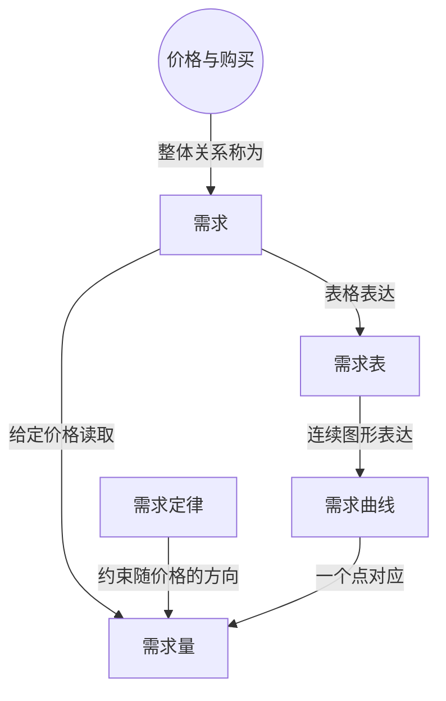

> 核心主线：其它条件不变时，价格与购买数量反向变化；某一价格下的数量，与描述所有价格数量组合的整条关系必须区分。  
> 课程来源：Sal Khan / Khan Academy《第8讲 需求定律》，B站 BV1Gy4y1a7aE，UP主：农夫CC，P8，约 8 分钟；[本集视频](https://www.bilibili.com/video/BV1Gy4y1a7aE/?p=8)。非官方中文转述，具体引用以本集转写为准；[官方课程总页](https://www.khanacademy.org/economics-finance-domain/microeconomics)。整课许可尚未逐讲核实。

## 目录
+ [1. 价格与购买数量的关系](#1-价格与购买数量的关系)
+ [2. 从表格到曲线并区分变化](#2-从表格到曲线并区分变化)
+ [本讲知识地图](#本讲知识地图)
+ [概念卡片](#概念卡片)
+ [自测题（复习用）](#自测题复习用)
+ [视频时间索引](#视频时间索引)

## 1. 价格与购买数量的关系
**核心思想：** 在其它条件相同时，价格上升会减少愿意购买的数量。

+ **需求（Demand）**在正式经济学表达中是价格与购买数量之间的整套关系；它本身不是一个数量。
+ **需求量（Quantity Demanded）**是在其它条件不变、给定价格下，消费者愿意购买或下载的数量。讨论具体多少份电子书时，应使用这个词。
+ **需求定律（Law of Demand）**描述价格与购买数量的反向关系：提高价格，数量减少；降低价格则相反。
+ 讲师以即将发行的科幻电子书为例，通过不同定价情景展示数量变化，并纠正了自己把价格与“需求”直接对应的口误。
+ 例中价格为 4 美元时有 40,000 次下载，6 美元时为 30,000 次，8 美元时为 25,000 次，10 美元时为 23,000 次。这里的下载数量不是美元金额。

## 2. 从表格到曲线并区分变化
**核心思想：** 表格与曲线表达整套关系，沿曲线改变一个点和改变整条关系不同。

+ **需求表（Demand Schedule）**把不同价格与对应需求量列成表；它完整表达的是需求，而不是只表达其中某一行的数量。
+ 把这些价格数量组合画成点，再连接成**需求曲线（Demand Curve）**，就可以表达表格中间的情景，而不只限于列出的几个定价。
+ 本例还可以定价为 2.01 美元或 4.50 美元，曲线用连续关系表达这些可能性，不能把五个示例点理解成全部可选价格。
+ 在其它条件不变时，价格改变引起需求量改变，表现为沿同一条曲线移动；需求本身改变，则意味着整条曲线或表格中的对应关系发生变化。
+ 本集重点是价格变化下的需求量变化；哪些因素改变整条关系，讲师留到后续视频，没有在这里展开。

## 本讲知识地图

## 概念卡片
### 需求
+ 原文：Demand
+ 定义：其它条件不变时，价格与需求量之间的整套关系。
+ 出现：第 1 节「价格与购买数量的关系」、第 2 节「从表格到曲线并区分变化」
+ 依赖：
+ 易混：需求量——整套关系与给定价格下的一个数量不同。

### 需求量
+ 原文：Quantity Demanded
+ 定义：给定价格且其它条件不变时，消费者愿意购买或下载的数量。
+ 出现：第 1 节「价格与购买数量的关系」、第 2 节「从表格到曲线并区分变化」
+ 依赖：需求
+ 易混：需求——价格引起点的移动，不等同于整条关系改变。

### 需求定律
+ 原文：Law of Demand
+ 定义：其它条件不变时，价格升高导致购买数量降低的关系。
+ 出现：第 1 节「价格与购买数量的关系」、第 2 节「从表格到曲线并区分变化」
+ 依赖：需求量
+ 易混：

### 需求表
+ 原文：Demand Schedule
+ 定义：列出各个价格及相应需求量、表达整套关系的表格。
+ 出现：第 2 节「从表格到曲线并区分变化」、第 1 节「价格与购买数量的关系」
+ 依赖：需求
+ 易混：

### 需求曲线
+ 原文：Demand Curve
+ 定义：用连续图形表达价格与需求量关系的曲线。
+ 出现：第 2 节「从表格到曲线并区分变化」、第 1 节「价格与购买数量的关系」
+ 依赖：需求表
+ 易混：

## 自测题（复习用）
1. 其它条件相同时，提高电子书价格会怎样影响购买数量？（对应：需求定律）

**答案：** 购买数量下降，价格与数量呈反向关系。

2. “6 美元时下载 30,000 次”中的 30,000 应叫什么？（对应：需求量）

**答案：** 叫需求量，是给定价格下的数量，不是整套需求关系。

3. 为什么不能把需求直接解释成某个下载次数？（对应：需求）

**答案：** 需求指所有价格与对应数量构成的关系，不是其中一个数。

4. 需求曲线相对列出几个价格的表格，还能怎样表达定价情景？（对应：需求曲线）

**答案：** 连续曲线能表达已列价格之间的组合，例如 4.50 美元的定价情景。

5. 沿原曲线移动与整条曲线改变，各对应什么变化？（对应：需求）

**答案：** 前者是价格引起需求量变化，后者是需求所代表的整套关系改变。

---

## 视频时间索引
+ [00:00](https://www.bilibili.com/video/BV1Gy4y1a7aE?p=8&t=0) 1. 价格与购买数量的关系
+ [04:01](https://www.bilibili.com/video/BV1Gy4y1a7aE?p=8&t=241) 2. 从表格到曲线并区分变化
