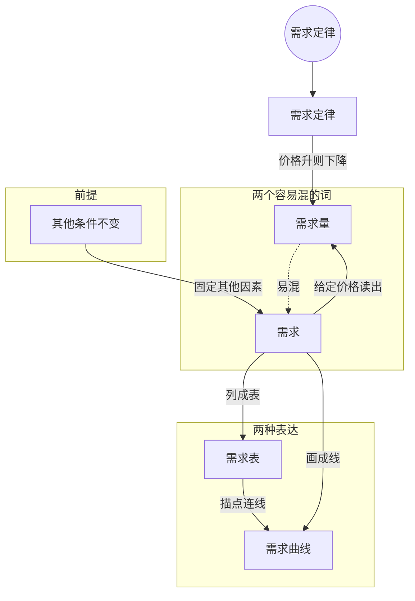

> 核心主线：其他条件不变时，价格越高需求量越低，这就是需求定律；「需求」是价格与需求量之间的整套关系（整张需求表、整条需求曲线），「需求量」只是某个价格下的一个数——价格变动让你沿曲线移动，需求变化才会让整条曲线移动。  
> 本讲目标：读完你能回答「需求定律说的是什么」「需求和需求量有什么区别」「沿需求曲线移动和整条曲线移动分别意味着什么」  
> 课程来源：Sal Khan / Khan Academy《第8讲 需求定律》，B站 BV1Gy4y1a7aE，UP主：农夫CC，P8，约 8 分钟；[本集视频](https://www.bilibili.com/video/BV1Gy4y1a7aE/?p=8)。非官方中文转述，具体引用以本集转写为准；[官方课程总页](https://www.khanacademy.org/economics-finance-domain/microeconomics)。整课许可尚未逐讲核实。

## 目录
+ [1. 需求定律：价格越高，需求量越低](#1-需求定律价格越高需求量越低)
+ [2. 需求和需求量是两回事](#2-需求和需求量是两回事)
+ [3. 需求表：电子书的定价情景](#3-需求表电子书的定价情景)
+ [4. 从需求表到需求曲线](#4-从需求表到需求曲线)
+ [5. 沿曲线移动与整条曲线移动](#5-沿曲线移动与整条曲线移动)
+ [本讲知识地图](#本讲知识地图)
+ [本讲小结](#本讲小结)
+ [概念卡片](#概念卡片)
+ [自测题（面试速答）](#自测题面试速答)
+ [视频时间索引](#视频时间索引)

---

## 1. 需求定律：价格越高，需求量越低
假设你要给一件商品涨价，愿意买的人会变多还是变少？直觉告诉你会变少，而经济学正是把这个直觉写成了一条规律。

这一讲的主角是**需求（Demand）**这一组概念。其中最基础的一条叫**需求定律（Law of Demand）**，讲者说它是微观经济学的核心思想之一，而且相当直观：提高一种产品的价格，这种产品的**需求量（Quantity Demanded）**就会下降；反过来，降低价格，需求量就会上升。

价格和需求量朝相反方向变动，这就是需求定律的全部内容。（讲者紧接着展开「降价」这一侧时，转写稿有一小段缺失，只剩一句被误识别的「The Law of the Man」，应为「law of demand」。）

> **记住这个就够了**：需求定律说的是价格和需求量反向变动——涨价，需求量下降；降价，需求量上升。

---

## 2. 需求和需求量是两回事
日常说话里，「需求」常被当成「要买多少」。讲者特别强调，他会「费尽力气不把这两个词搞混」，因为在正式的经济学里，它们是两回事。

**需求**不是一个数量，而是价格和需求量之间的**整套关系**，而且是在**其他条件不变（Ceteris Paribus）**的前提下——讲者也说成「all else equal」，意思是除了价格，别的因素都先固定住。

如果要说一个具体的数量，比如「有多少人会买」，应该说**需求量**。

| 词 | 指什么 | 例子 |
| --- | --- | --- |
| 需求 | 所有价格与需求量的整套对应关系 | 整张表、整条曲线 |
| 需求量 | 某个给定价格下愿意购买的数量 | 某个价格下有多少人下载 |

讲者也承认这一开始有点绕：这一讲先专注需求量怎样随价格变化；需求这整套关系本身会因为哪些因素而改变，留到后面几讲。

> **记住这个就够了**：需求是价格与需求量的整套关系，需求量是某个价格下的一个数，两个词不能混用。

---

## 3. 需求表：电子书的定价情景
抽象概念不好记，讲者换成一个具体例子：他要发行一本自己写的科幻电子书，并且做过市场调研，知道不同价格下会有多少人下载。

把这些「价格—需求量」对应列成一张表，就叫**需求表（Demand Schedule）**。讲者在这里还当场抓到自己一个口误：他先说成「价格和需求的关系」，马上更正为「价格和需求量的关系」——需求表展示的是其他条件不变时，价格与需求量之间的对应。

| 情景 | 价格 | 需求量（下载人数） |
| --- | --- | --- |
| A | 2 美元 | 转写缺失 |
| B | 4 美元 | 40,000 |
| C | 6 美元 | 30,000 |
| D | 8 美元 | 25,000 |
| E | 10 美元 | 23,000 |

每次涨价 2 美元，下载人数都在下降，讲者说这张表就体现了需求定律。

转写稿说明：情景 A 只剩一个「60,000」的碎片，A 的价格按「涨 2 美元到 4 美元」倒推为 2 美元，60,000 可能是 A 的需求量，但无法确认；另外转写稿把 25,000、23,000 识别成了美元金额，按上下文它们是下载人数。

> **记住这个就够了**：需求表把不同价格下的需求量逐行列出来，整张表体现的就是需求定律。

---

## 4. 从需求表到需求曲线
需求表只列了五个价格，可是书只能卖这五个价吗？

当然不是。讲者说，书也可以卖 2.01 美元，也可以卖 4.50 美元，表格之间的任何价格都是可能的。所以要把表里的点画到坐标图上，再用一条曲线把它们连起来，这条线就是**需求曲线（Demand Curve）**。

需求曲线是连续的，能表达的不只是那五个点，而是所有价格下的需求量。

转写稿说明：讲者画坐标轴、逐个描点的约两分半钟，转写稿只剩坐标刻度和「8 美元、25,000」之类的碎片，画图过程无法还原；坐标轴各放什么，转写稿里没有明确说出。

> **记住这个就够了**：需求曲线就是把需求表的点连成连续曲线，能表达表里没列出的价格。

---

## 5. 沿曲线移动与整条曲线移动
回到第 2 节的区分：既然有了表和曲线，「需求」和「需求量」在图上分别对应什么？

**需求量**是在其他条件不变时，某个给定价格下，人们愿意下载或购买多少本电子书，对应曲线上的**一个点**、表里的**一行**。

**需求**则是整套关系，也就是**整张需求表**，或者说**整条需求曲线**。

所以两种「变化」在图上完全不同：

| 变化 | 图上的表现 | 表上的表现 |
| --- | --- | --- |
| 需求量变化 | 沿着同一条曲线移动 | 换到同一张表的另一行 |
| 需求变化 | 整条曲线移动，变成另一条曲线 | 表里的数字整体改变 |

转写稿说明：讲者讲到「需求量变化时沿曲线移动、保持其他条件不变」后，结尾约二十秒转写缺失。

> **记住这个就够了**：价格变动只让你沿着同一条需求曲线移动；只有需求本身变了，整条曲线才会移动。

---

## 本讲知识地图

## 本讲小结
| 机制/概念 | 解决什么问题 | 一句话 |
| --- | --- | --- |
| 需求定律 | 价格变化时购买量怎么变 | 其他条件不变，价格越高需求量越低 |
| 需求与需求量 | 日常用语把关系和数量混为一谈 | 需求是整套关系，需求量是某个价格下的一个数 |
| 需求表 | 怎么具体列出价格与需求量的关系 | 每行一个价格及其需求量 |
| 需求曲线 | 表格只能列有限几个价格 | 把点连成连续曲线，表达所有价格 |

**学完能说的 3 句话：**
1. 需求定律：其他条件不变时，涨价让需求量下降，降价让需求量上升。
2. 需求是价格与需求量之间的整套关系，也就是整张需求表或整条需求曲线；需求量只是某个价格下的一个数量。
3. 价格变动引起需求量变化，是沿着同一条曲线移动；需求变化则是整条曲线移动。

## 概念卡片
### 需求定律
+ 原文：Law of Demand
+ 定义：其他条件不变时，一种产品的价格上升，其需求量下降；价格下降，需求量上升
+ 出现：第 1 节「需求定律：价格越高，需求量越低」、第 3 节「需求表：电子书的定价情景」
+ 依赖：需求量，其他条件不变
+ 易混：

### 需求
+ 原文：Demand
+ 定义：其他条件不变时，价格与需求量之间的整套对应关系，用整张需求表或整条需求曲线表示
+ 出现：第 2 节「需求和需求量是两回事」、第 5 节「沿曲线移动与整条曲线移动」
+ 依赖：其他条件不变
+ 易混：需求量——需求是整套关系，需求量是其中一个价格对应的数量

### 需求量
+ 原文：Quantity Demanded
+ 定义：其他条件不变时，在某个给定价格下人们愿意购买的数量
+ 出现：第 1 节「需求定律：价格越高，需求量越低」、第 2 节「需求和需求量是两回事」、第 5 节「沿曲线移动与整条曲线移动」
+ 依赖：需求
+ 易混：需求——需求量变化是沿曲线移动，需求变化是整条曲线移动

### 其他条件不变
+ 原文：Ceteris Paribus
+ 定义：分析价格与需求量关系时，把价格以外的其他因素都固定住的前提，讲者也说成 all else equal
+ 出现：第 2 节「需求和需求量是两回事」、第 3 节「需求表：电子书的定价情景」、第 5 节「沿曲线移动与整条曲线移动」
+ 依赖：
+ 易混：

### 需求表
+ 原文：Demand Schedule
+ 定义：把不同价格及其对应需求量逐行列出的表格
+ 出现：第 3 节「需求表：电子书的定价情景」、第 4 节「从需求表到需求曲线」、第 5 节「沿曲线移动与整条曲线移动」
+ 依赖：需求
+ 易混：需求曲线——需求表只列有限几个价格，需求曲线是连续的

### 需求曲线
+ 原文：Demand Curve
+ 定义：把需求表中的价格与需求量画成点并连成的连续曲线
+ 出现：第 4 节「从需求表到需求曲线」、第 5 节「沿曲线移动与整条曲线移动」
+ 依赖：需求表
+ 易混：

## 自测题（面试速答）
1. 需求定律说的是什么？讲者用什么例子说明？（对应：需求定律）

**答案：** 其他条件不变时，价格越高，需求量越低，价格与需求量反向变动。原因很直观：涨价会让一部分人不再购买。讲者的科幻电子书例子里，价格从 4 美元每次涨 2 美元，下载人数依次从 40,000 降到 30,000、25,000、23,000。

2. 需求和需求量有什么区别？（对应：需求）

**答案：** 需求是价格与需求量之间的整套关系，需求量是某个给定价格下的一个具体数量。讲者特别强调，正式的经济学里「需求」不指数量，要说数量就该说需求量。比如「6 美元时有 30,000 人下载」里的 30,000 是需求量，而整张定价表才是需求。

3. 讲者说「需求表展示价格和需求的关系」时为什么马上更正自己？（对应：需求表）

**答案：** 因为需求表展示的是价格与需求量的对应，而不是价格与需求的对应。需求本身就是这整套关系，每一行里和价格对应的是一个数量，也就是需求量。这个口误正好说明两个词很容易混，讲者才会当场纠正。

4. 已经有了需求表，为什么还要画需求曲线？（对应：需求曲线）

**答案：** 因为需求表只列了有限几个价格，需求曲线能表达所有价格。电子书例子只列了五个定价情景，但书也可以卖 2.01 美元或 4.50 美元；把表中的点连成连续曲线，表与表之间的价格对应的需求量也都能表示出来。

5. 电子书涨价导致下载人数下降，这在图上是沿曲线移动还是整条曲线移动？（对应：需求量）

**答案：** 是沿着同一条需求曲线移动，属于需求量的变化。因为其他条件不变，只有价格变了，人们只是在同一套价格—数量关系里换了一个点。只有需求本身改变时，整条曲线或整张表的数字才会移动。

6. 为什么讨论需求定律时要强调「其他条件不变」？（对应：其他条件不变）

**答案：** 因为只有把价格以外的因素固定住，才能单独看清价格和需求量的关系。讲者定义需求时特意加上「all else equal」，需求表也是在这个前提下列出的；如果别的因素也在变，看到的就不再是沿着同一条曲线的移动，而可能是整条曲线变了。

---

## 视频时间索引
+ [00:00](https://www.bilibili.com/video/BV1Gy4y1a7aE?p=8&t=0) 1. 需求定律：价格越高，需求量越低
+ [00:48](https://www.bilibili.com/video/BV1Gy4y1a7aE?p=8&t=48) 2. 需求和需求量是两回事
+ [01:47](https://www.bilibili.com/video/BV1Gy4y1a7aE?p=8&t=107) 3. 需求表：电子书的定价情景
+ [04:01](https://www.bilibili.com/video/BV1Gy4y1a7aE?p=8&t=241) 4. 从需求表到需求曲线
+ [06:55](https://www.bilibili.com/video/BV1Gy4y1a7aE?p=8&t=415) 5. 沿曲线移动与整条曲线移动
