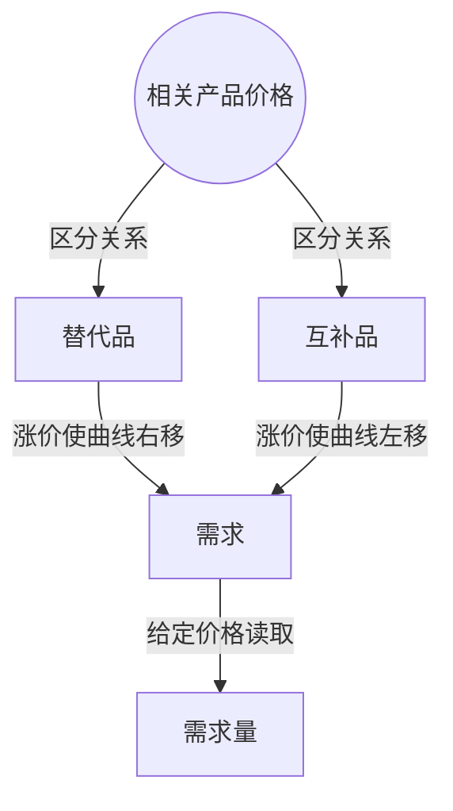

> 核心主线：相关产品价格改变会移动整条需求曲线，方向取决于它与本产品是相互替代还是配合使用。  
> 课程来源：Sal Khan / Khan Academy《第9讲 相关产品价格和需求》，B站 BV1Gy4y1a7aE，UP主：农夫CC，P9，约 6 分钟；[本集视频](https://www.bilibili.com/video/BV1Gy4y1a7aE/?p=9)。非官方中文转述，具体引用以本集转写为准；[官方课程总页](https://www.khanacademy.org/economics-finance-domain/microeconomics)。整课许可尚未逐讲核实。

## 目录
+ [1. 其它电子书变贵后的选择](#1-其它电子书变贵后的选择)
+ [2. 阅读设备变贵后的选择](#2-阅读设备变贵后的选择)
+ [本讲知识地图](#本讲知识地图)
+ [概念卡片](#概念卡片)
+ [自测题（复习用）](#自测题复习用)
+ [视频时间索引](#视频时间索引)

## 1. 其它电子书变贵后的选择
**核心思想：** 相关产品的价格变化，会改变本产品在每个价格下的吸引力。

+ **需求（Demand）**是价格与购买数量的整套关系；**需求量（Quantity Demanded）**则是给定价格下的具体数量。只改变本产品价格且其它条件不变时，是沿原曲线移动。
+ 原先保持不变的条件之一，是相关产品的价格。这些产品不一定都与本产品竞争，因此不能把所有相关产品一概称为竞争品。
+ **替代品（Substitutes）**可以相互代替，本例是其它内容可供选择的电子书。其它电子书变贵后，本书在 2、4、6、8、10 美元各个定价下都会更有吸引力。
+ 因而每个价格对应的需求量增加，整条需求曲线右移；反过来，替代品变便宜，本书的整条曲线左移。
+ 这里变化的是整套关系，不是本书自己降价后沿原曲线移动。

## 2. 阅读设备变贵后的选择
**核心思想：** 配合使用的产品变贵，会减少本产品在各价格下的购买数量。

+ **互补品（Complements）**是配合使用的产品。本例中，Kindle、iPad 等设备用于阅读电子书；消费者不是在“买书”和“买设备”之间简单二选一。
+ Kindle 价格上涨后，阅读所需设备变贵，会降低本书在任何给定价格下的需求量，使整条需求曲线左移。
+ Kindle 价格下降则相反，设备更便宜，本书的需求曲线右移。判断方向前先识别产品关系，再判断相关产品价格如何变化。
+ 替代品与互补品的方向不同，但两者都能改变需求这一整套关系。给定价格下的一个数量，仍叫需求量。

| 相关产品关系 | 相关产品价格变化 | 本书曲线变化 |
| --- | --- | --- |
| 替代品，如其它电子书 | 上涨 | 右移 |
| 替代品，如其它电子书 | 下跌 | 左移 |
| 互补品，如阅读设备 | 上涨 | 左移 |
| 互补品，如阅读设备 | 下跌 | 右移 |

## 本讲知识地图

## 概念卡片
### 需求
+ 原文：Demand
+ 定义：本产品价格与购买数量之间的整套关系，可因相关产品价格变化而移动。
+ 出现：第 1 节「其它电子书变贵后的选择」、第 2 节「阅读设备变贵后的选择」
+ 依赖：
+ 易混：需求量——整条关系不同于特定价格下的一个数量。

### 需求量
+ 原文：Quantity Demanded
+ 定义：给定本产品价格、其它条件确定时的购买数量。
+ 出现：第 1 节「其它电子书变贵后的选择」、第 2 节「阅读设备变贵后的选择」
+ 依赖：需求
+ 易混：需求——只改变本产品价格时是沿曲线移动。

### 替代品
+ 原文：Substitutes
+ 定义：消费者可以在其中选择一个来代替另一个的相关产品。
+ 出现：第 1 节「其它电子书变贵后的选择」、第 2 节「阅读设备变贵后的选择」
+ 依赖：需求
+ 易混：互补品——替代品相互代替，互补品配合使用。

### 互补品
+ 原文：Complements
+ 定义：与本产品配合使用、其价格会影响本产品购买的相关产品。
+ 出现：第 2 节「阅读设备变贵后的选择」、第 1 节「其它电子书变贵后的选择」
+ 依赖：需求
+ 易混：替代品——阅读设备与电子书不是简单二选一的替代关系。

## 自测题（复习用）
1. 其它电子书变贵时，本书的曲线为何右移？（对应：替代品）

**答案：** 本书在各个价格下都变得相对更有吸引力，相应购买数量增加。

2. Kindle 价格上涨为什么使本书曲线左移？（对应：互补品）

**答案：** 阅读设备变贵使配合使用的电子书在各价格下购买数量减少。

3. 为什么不能把所有相关产品都称为竞争品？（对应：互补品）

**答案：** 有些产品与本产品配合使用，如电子书与阅读设备，并非相互替代。

4. 本书自己降价与其它电子书涨价，对曲线有何不同影响？（对应：需求）

**答案：** 前者在其它条件不变时沿原曲线移动，后者改变整套关系并使曲线右移。

5. “本书定价 4 美元时有多少人买”描述哪个概念？（对应：需求量）

**答案：** 描述给定价格下的需求量，而非整条需求关系。

---

## 视频时间索引
+ [00:00](https://www.bilibili.com/video/BV1Gy4y1a7aE?p=9&t=0) 1. 其它电子书变贵后的选择
+ [03:41](https://www.bilibili.com/video/BV1Gy4y1a7aE?p=9&t=221) 2. 阅读设备变贵后的选择
