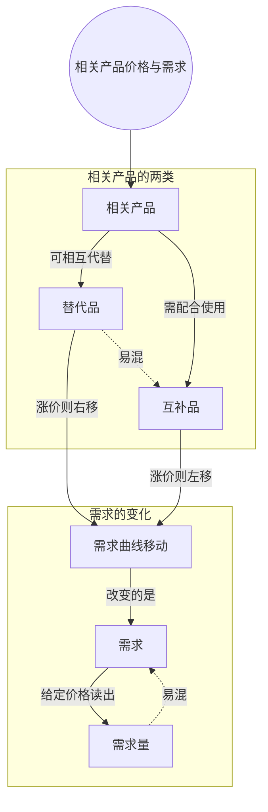

> 核心主线：在同一条需求曲线上移动的前提是「其他条件不变」，相关产品的价格就是被固定住的条件之一；一旦它变了，整条需求曲线就会移动——替代品涨价让曲线右移，互补品涨价让曲线左移。  
> 本讲目标：读完你能回答「相关产品价格变化为什么会移动整条需求曲线」「替代品和互补品涨价，需求曲线分别往哪边移」「沿曲线移动和移动曲线怎么区分」  
> 课程来源：Sal Khan / Khan Academy《第9讲 相关产品价格和需求》，B站 BV1Gy4y1a7aE，UP主：农夫CC，P9，约 6 分钟；[本集视频](https://www.bilibili.com/video/BV1Gy4y1a7aE/?p=9)。非官方中文转述，具体引用以本集转写为准；[官方课程总页](https://www.khanacademy.org/economics-finance-domain/microeconomics)。整课许可尚未逐讲核实。

## 目录
+ [1. 被固定住的其他条件](#1-被固定住的其他条件)
+ [2. 相关产品不一定是竞争品](#2-相关产品不一定是竞争品)
+ [3. 替代品涨价：需求曲线右移](#3-替代品涨价需求曲线右移)
+ [4. 沿曲线移动还是移动曲线](#4-沿曲线移动还是移动曲线)
+ [5. 互补品涨价：需求曲线左移](#5-互补品涨价需求曲线左移)
+ [6. 四种情形汇总](#6-四种情形汇总)
+ [本讲知识地图](#本讲知识地图)
+ [本讲小结](#本讲小结)
+ [概念卡片](#概念卡片)
+ [自测题（面试速答）](#自测题面试速答)
+ [视频时间索引](#视频时间索引)

---

## 1. 被固定住的其他条件
上一讲把**需求（Demand）**和**需求量（Quantity Demanded）**分开了，还讲了需求定律：其他条件不变时，涨价让需求量下降，降价让需求量上升。讲者说这是常识，后面还会看到几种特殊情况。

可是「其他条件不变」里的「其他条件」到底是什么？正是这些被固定住的东西，才让我们能说「沿着这条曲线移动」。

这一讲换个角度：如果被固定住的条件里有一个变了，会发生什么？讲者的回答是，变的就不再是曲线上的某个点，而是**整条曲线**，也就是整套价格—需求量关系。

> **记住这个就够了**：在同一条需求曲线上移动的前提是其他条件不变；其他条件一变，整条曲线都会变。

---

## 2. 相关产品不一定是竞争品
讲者要看的第一个「其他条件」，是别的产品的价格。他一开始说成「竞争产品的价格」，随即改口：应该说**相关产品（Related Products）**的价格，因为后面会看到，相关产品并不都是竞争关系。

在画出需求曲线时，我们默认相关产品的价格是固定的。现在要问：如果它们的价格变了，我们的电子书的需求会怎样？

讲者沿用上一讲的科幻电子书例子，分两种情形来看：别的电子书涨价，和阅读设备 Kindle 涨价。

> **记住这个就够了**：相关产品的价格是需求曲线背后被固定住的条件之一，而相关产品不只有竞争品。

---

## 3. 替代品涨价：需求曲线右移
情景一：别的电子书都涨价了，你的电子书会怎样？

讲者的推理是：别的电子书变贵了，不管你的书定价多少，你的书都会显得更划算。2 美元时会有更多人想要，4 美元、6 美元、8 美元、10 美元时也都是更多人想要。

每一个价格下的需求量都增加了，整条需求曲线就**向右移动**。讲者把这叫作「需求向右移动」——变的是整套关系，而不是某一个点。

这些别的电子书叫**替代品（Substitutes）**。读者可能会想：「那本书看起来差不多，哪本便宜我就读哪本。」两者可以相互代替。

反过来，如果别的电子书降价了，整条需求曲线就会**向左移动**。这种整条曲线的平移，就是**需求曲线移动（Shift in Demand）**。

> **记住这个就够了**：替代品涨价，你的产品在每个价格下都更有吸引力，整条需求曲线右移；替代品降价则左移。

---

## 4. 沿曲线移动还是移动曲线
讲到这里，讲者特意停下来强调一个点，他说「真的想确保你把这一点弄清楚」。

当其他条件都不变时，我们是在**一条给定的需求曲线上移动**：价格—需求量的关系是固定的，选一个价格，就得到一个需求量。

如果改变了那些被固定住的条件之一，比如替代品的价格，就可能**移动整条曲线**，也就是改变了整张需求表、整条需求曲线。

| 发生了什么 | 图上的表现 | 变的是 |
| --- | --- | --- |
| 只有本产品价格变了 | 沿同一条曲线移动 | 需求量 |
| 相关产品价格等其他条件变了 | 整条曲线移动 | 需求 |

> **记住这个就够了**：只改本产品价格是沿曲线移动、变的是需求量；改了其他条件是移动曲线、变的是需求。

---

## 5. 互补品涨价：需求曲线左移
相关产品不一定都是替代品。情景二：Kindle 涨价了，你的电子书会怎样？

Kindle 不是替代品，人们不会在「买你的电子书」和「买 Kindle」之间二选一。恰恰相反，要读你的电子书，需要一台 Kindle、iPad 之类的设备。这种需要配合使用的产品叫**互补品（Complements）**。（转写稿把这个词拼成了同音的 compliment，按上下文应为 complement。）

互补品变贵了，用来读书的设备更贵，那么在任何给定价格下，你的电子书的需求量都会下降，整条需求曲线**向左移动**。

反过来，Kindle 降价，你的需求曲线会向右移动。

转写稿说明：讲者讲完「任何给定价格下需求量都会下降」后，有约二十秒转写缺失，随后直接接上「需求曲线左移」的结论。

> **记住这个就够了**：互补品涨价，用你的产品变得更贵，每个价格下的需求量都下降，整条需求曲线左移。

---

## 6. 四种情形汇总
替代品和互补品，各自涨价或降价，一共四种情形，讲者把剩下的几种也顺手点了一遍：

| 相关产品 | 相关产品价格 | 你的需求曲线 |
| --- | --- | --- |
| 替代品（别的电子书） | 上涨 | 右移 |
| 替代品（别的电子书） | 下降 | 左移 |
| 互补品（Kindle） | 上涨 | 左移 |
| 互补品（Kindle） | 下降 | 右移 |

讲者鼓励你自己动手：换一种产品，先想清楚它有哪些相关产品，哪些是替代品、哪些可能是互补品，再想它们的价格变化时会发生什么，最好自己画出来。

最后他再次提醒：需求是整套关系、整条曲线，其他条件不变、只改价格时，我们沿着它移动；需求量是在其他条件不变时，某个特定价格下的特定数量。

> **记住这个就够了**：先判断相关产品是替代品还是互补品，再看它涨价还是降价，就能推出需求曲线往哪边移。

---

## 本讲知识地图

## 本讲小结
| 机制/概念 | 解决什么问题 | 一句话 |
| --- | --- | --- |
| 相关产品 | 需求曲线背后固定了哪些条件 | 相关产品的价格是被固定住的条件之一 |
| 替代品 | 别的同类产品变贵会怎样 | 替代品涨价，需求曲线右移；降价则左移 |
| 互补品 | 配合使用的产品变贵会怎样 | 互补品涨价，需求曲线左移；降价则右移 |
| 需求曲线移动 | 区分「点在动」还是「线在动」 | 其他条件变了是整条曲线移动，只改价格是沿曲线移动 |

**学完能说的 3 句话：**
1. 需求曲线是在其他条件不变的前提下画出来的，相关产品的价格就是被固定住的条件之一。
2. 别的电子书这类替代品涨价，会让你的书在每个价格下都更受欢迎，需求曲线右移；Kindle 这类互补品涨价，则让需求曲线左移。
3. 只改本产品价格是沿曲线移动、变的是需求量；相关产品价格变了是整条曲线移动、变的是需求。

## 概念卡片
### 需求
+ 原文：Demand
+ 定义：其他条件不变时，价格与需求量之间的整套关系，即整张需求表、整条需求曲线
+ 出现：第 1 节「被固定住的其他条件」、第 4 节「沿曲线移动还是移动曲线」、第 6 节「四种情形汇总」
+ 依赖：
+ 易混：需求量——需求是整条曲线，需求量是某个价格下的一个数

### 需求量
+ 原文：Quantity Demanded
+ 定义：其他条件不变时，某个特定价格下人们愿意购买的特定数量
+ 出现：第 1 节「被固定住的其他条件」、第 4 节「沿曲线移动还是移动曲线」、第 5 节「互补品涨价：需求曲线左移」
+ 依赖：需求
+ 易混：需求——只改本产品价格时变的是需求量，沿曲线移动

### 相关产品
+ 原文：Related Products
+ 定义：价格会影响本产品需求的其他产品，包括替代品和互补品，不一定是竞争品
+ 出现：第 2 节「相关产品不一定是竞争品」、第 3 节「替代品涨价：需求曲线右移」、第 5 节「互补品涨价：需求曲线左移」
+ 依赖：
+ 易混：

### 替代品
+ 原文：Substitutes
+ 定义：可以与本产品相互代替的产品，比如别的电子书；它涨价会让本产品需求曲线右移
+ 出现：第 3 节「替代品涨价：需求曲线右移」、第 6 节「四种情形汇总」
+ 依赖：相关产品
+ 易混：互补品——替代品是二选一，互补品要配合使用

### 互补品
+ 原文：Complements
+ 定义：需要与本产品配合使用的产品，比如读电子书用的 Kindle；它涨价会让本产品需求曲线左移
+ 出现：第 5 节「互补品涨价：需求曲线左移」、第 6 节「四种情形汇总」
+ 依赖：相关产品
+ 易混：替代品——涨价时两者让需求曲线朝相反方向移动

### 需求曲线移动
+ 原文：Shift in Demand
+ 定义：被固定住的其他条件改变后，每个价格下的需求量都变化，整条需求曲线向左或向右平移
+ 出现：第 3 节「替代品涨价：需求曲线右移」、第 4 节「沿曲线移动还是移动曲线」、第 5 节「互补品涨价：需求曲线左移」
+ 依赖：需求，相关产品
+ 易混：需求量——沿曲线移动只是需求量变化，不是需求曲线移动

## 自测题（面试速答）
1. 别的电子书涨价，为什么你的电子书需求曲线会右移？（对应：替代品）

**答案：** 因为别的电子书是替代品，它变贵后，你的书在每个价格下都更有吸引力。讲者逐个价格推了一遍：2 美元、4 美元一直到 10 美元，都会有更多人想要你的书。每个价格下的需求量都增加，整条需求曲线就向右移动。

2. Kindle 涨价为什么会让电子书的需求曲线左移？（对应：互补品）

**答案：** 因为 Kindle 是互补品，读电子书要配合它使用。人们不会在电子书和 Kindle 之间二选一，而是需要 Kindle、iPad 之类的设备才能读书；设备变贵后，任何给定价格下电子书的需求量都会下降，整条需求曲线左移。

3. 讲者为什么把「竞争产品的价格」改口为「相关产品的价格」？（对应：相关产品）

**答案：** 因为相关产品不都是竞争关系。别的电子书是替代品，确实和你的书竞争；但 Kindle 是互补品，要和你的书配合使用，并不和它竞争。两类产品的价格都会影响你的需求，只说「竞争产品」就漏掉了互补品。

4. 本产品自己降价，和替代品涨价，在需求曲线上的表现有什么不同？（对应：需求曲线移动）

**答案：** 本产品降价是沿着同一条曲线移动，替代品涨价是整条曲线右移。前者其他条件都没变，只是在既定的价格—需求量关系上换了一个点，变的是需求量；后者改变了被固定住的条件，整套关系都变了，变的是需求。

5. 替代品和互补品降价时，需求曲线分别怎么移动？（对应：需求）

**答案：** 替代品降价让需求曲线左移，互补品降价让需求曲线右移，方向与涨价时正好相反。别的电子书变便宜，你的书就显得没那么划算；Kindle 变便宜，读电子书的门槛降低，更多人会买你的书。两种情况变的都是整条需求曲线，也就是需求。

6. 讲者最后为什么还要再强调需求和需求量的区别？（对应：需求量）

**答案：** 因为判断「点在动」还是「线在动」全靠这个区分。需求量是其他条件不变时某个特定价格下的特定数量，只改价格时在曲线上移动；需求是整条曲线，相关产品价格这类条件一变，整条曲线就会移动。分不清这两者，就会把替代品涨价和本产品降价混为一谈。

---

## 视频时间索引
+ [00:00](https://www.bilibili.com/video/BV1Gy4y1a7aE?p=9&t=0) 1. 被固定住的其他条件
+ [00:29](https://www.bilibili.com/video/BV1Gy4y1a7aE?p=9&t=29) 2. 相关产品不一定是竞争品
+ [00:59](https://www.bilibili.com/video/BV1Gy4y1a7aE?p=9&t=59) 3. 替代品涨价：需求曲线右移
+ [03:11](https://www.bilibili.com/video/BV1Gy4y1a7aE?p=9&t=191) 4. 沿曲线移动还是移动曲线
+ [03:41](https://www.bilibili.com/video/BV1Gy4y1a7aE?p=9&t=221) 5. 互补品涨价：需求曲线左移
+ [04:53](https://www.bilibili.com/video/BV1Gy4y1a7aE?p=9&t=293) 6. 四种情形汇总
