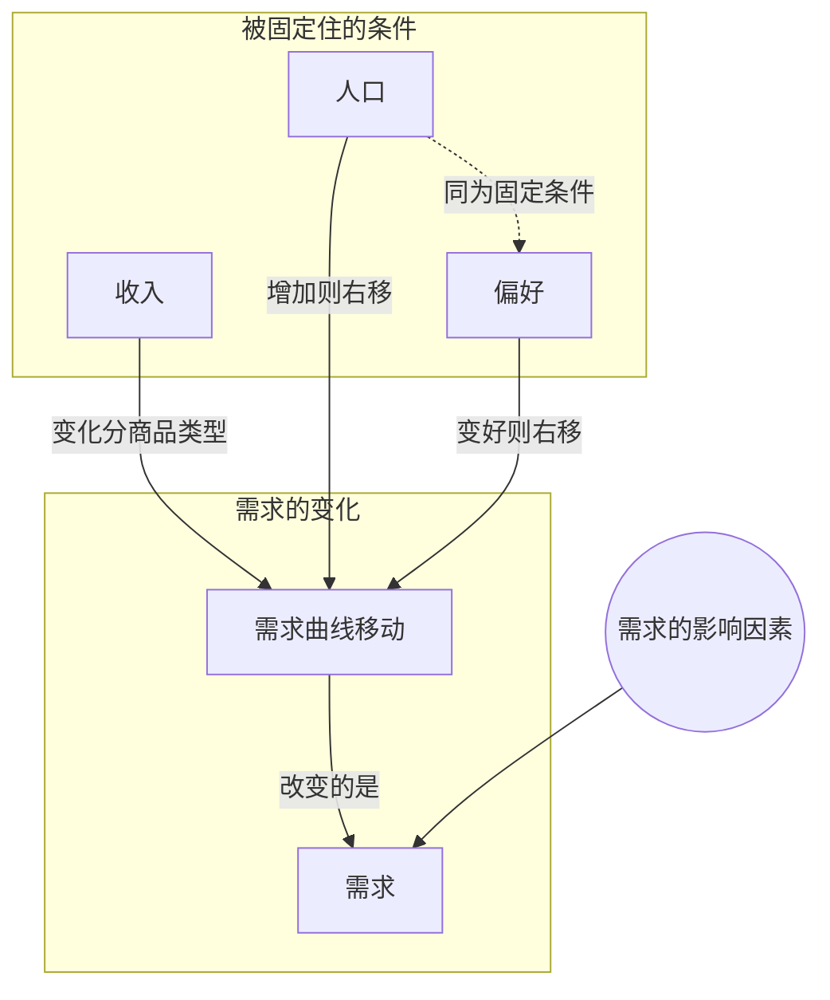

> 核心主线：一条需求曲线背后固定着一串条件——相关产品价格、价格预期、收入、人口、偏好；其中任何一个变了，每个价格下的需求量都会变，整条需求曲线随之左移或右移。  
> 本讲目标：读完你能回答「在同一条需求曲线上移动，需要固定住哪些条件」「人口和偏好变化时需求曲线往哪边移」「为什么收入这一条要区分正常商品和劣等商品」  
> 课程来源：Sal Khan / Khan Academy《第10讲 收入、人口或偏好变化》，B站 BV1Gy4y1a7aE，UP主：农夫CC，P10，约 4 分钟；[本集视频](https://www.bilibili.com/video/BV1Gy4y1a7aE/?p=10)。非官方中文转述，具体引用以本集转写为准；[官方课程总页](https://www.khanacademy.org/economics-finance-domain/microeconomics)。整课许可尚未逐讲核实。

## 目录
+ [1. 一条需求曲线背后固定了哪些条件](#1-一条需求曲线背后固定了哪些条件)
+ [2. 收入：只对正常商品成立的结论](#2-收入只对正常商品成立的结论)
+ [3. 人口：买的人多了，曲线右移](#3-人口买的人多了曲线右移)
+ [4. 偏好：口碑变了，曲线跟着移](#4-偏好口碑变了曲线跟着移)
+ [本讲知识地图](#本讲知识地图)
+ [本讲小结](#本讲小结)
+ [概念卡片](#概念卡片)
+ [自测题（面试速答）](#自测题面试速答)
+ [视频时间索引](#视频时间索引)

---

## 1. 一条需求曲线背后固定了哪些条件
前面几讲反复说「其他条件不变」，那到底有哪些条件被固定住了？这一讲讲者把它们列成一张清单。

先回顾：**需求（Demand）**是价格与需求量之间的整套关系。要想只在同一条需求曲线上移动、让曲线本身不动，就得把价格以外的一些条件固定住。讲者在黑板上写下「held constant（保持不变）」，然后逐条列出：

| 被固定住的条件 | 本讲怎么处理 |
| --- | --- |
| 相关产品的价格（Price of Related Goods） | 讲者说之前已经讲过 |
| 本产品的价格预期（Price Expectations） | 讲者说之前已经讲过 |
| **收入（Income）** | 本讲第 2 节 |
| **人口（Population）** | 本讲第 3 节 |
| **偏好（Preferences）** | 本讲第 4 节 |

讲者说后面几条都相当直观，但接下来几讲会看到，它们往往也有特殊情况。

> **记住这个就够了**：需求曲线背后固定着相关产品价格、价格预期、收入、人口和偏好，任何一个变了，曲线都可能移动。

---

## 2. 收入：只对正常商品成立的结论
清单里的第三条是收入。讲者说，这也是我们为了停留在同一条需求曲线上而一直固定住的条件。

收入变化会怎样影响需求？讲者在这里讲了大约一分钟，可惜这一段转写稿几乎全部缺失（只剩「1. Income」和无意义的碎片），收入变化的方向和他举的例子都无法还原，本笔记不补写。

能确认的是他随后的限定：刚才关于收入的结论，**只对正常商品（Normal Goods）成立**。以后的视频会讲到一类叫**劣等商品（Inferior Goods）**的东西，对它们来说这个结论不一定成立——按定义就不成立。

所以收入这一条，要先分清商品是正常商品还是劣等商品，才能判断需求往哪边变；课程下一讲「正常商品和劣等商品」会专门展开。

> **记住这个就够了**：收入也是被固定住的条件之一，但收入变化对需求的影响要分正常商品和劣等商品来看。

---

## 3. 人口：买的人多了，曲线右移
如果人口变多了，同样定价的一本书，会怎样？

讲者说这很显然：人口增加，在任何一个给定价格下，都会有更多人想要它，所以整条需求曲线**向右移动**，也就是**需求增加**。

反过来，人口减少，需求就会减少，整条曲线**向左移动**。

关键在于「任何一个给定价格下」：变的不是某个价格对应的一个点，而是每个价格下的需求量都变了，这就是整条曲线的平移，即**需求曲线移动（Shift in Demand）**。

> **记住这个就够了**：人口增加，每个价格下想买的人都更多，需求增加、曲线右移；人口减少则需求减少、曲线左移。

---

## 4. 偏好：口碑变了，曲线跟着移
清单最后一条是偏好。在一条具体的需求曲线上移动时，我们假定人们的口味和偏好不变。偏好一旦变了，曲线就会变。

讲者举了两个相反的例子，还是那本电子书：

| 发生了什么 | 偏好 | 每个价格下的需求量 | 需求曲线 |
| --- | --- | --- | --- |
| 作者上了一档很火的访谈节目，节目告诉所有人这是有史以来最好的书 | 上升 | 更多人愿意买 | 右移，需求增加 |
| 同一档节目曝光作者有不光彩的过去，而且整本书是抄袭的 | 下降 | 需求量下降 | 左移，需求减少 |

注意讲者在第二个例子里的措辞：是「整条曲线」变了，不论价格是多少，在任何一个给定价格下需求量都会下降。书的定价一分没动，变的是人们对书的态度。

转写稿说明：「不光彩的过去」原文被识别为「sorted past」，按上下文应为「sordid past」。

> **记住这个就够了**：偏好变好，每个价格下更多人愿意买，曲线右移；偏好变坏，每个价格下需求量都下降，曲线左移。

---

## 本讲知识地图

## 本讲小结
| 机制/概念 | 解决什么问题 | 一句话 |
| --- | --- | --- |
| 被固定住的条件 | 「其他条件不变」到底指什么 | 相关产品价格、价格预期、收入、人口、偏好 |
| 收入 | 收入变了需求怎么变 | 结论要分正常商品和劣等商品，下一讲展开 |
| 人口 | 买的人变多变少会怎样 | 人口增加需求曲线右移，减少则左移 |
| 偏好 | 口碑、喜好变化会怎样 | 偏好变好曲线右移，变坏曲线左移，与定价无关 |

**学完能说的 3 句话：**
1. 在同一条需求曲线上移动，要固定住相关产品价格、价格预期、收入、人口和偏好。
2. 人口增加或偏好变好，每个价格下的需求量都增加，整条需求曲线右移；反之左移。
3. 收入变化对需求的影响要分商品类型，讲者的结论只对正常商品成立，对劣等商品不成立。

## 概念卡片
### 需求
+ 原文：Demand
+ 定义：价格与需求量之间的整套关系；被固定住的条件改变时，整条需求曲线会移动
+ 出现：第 1 节「一条需求曲线背后固定了哪些条件」、第 3 节「人口：买的人多了，曲线右移」、第 4 节「偏好：口碑变了，曲线跟着移」
+ 依赖：
+ 易混：需求曲线移动——需求是关系本身，需求曲线移动是这个关系发生了变化

### 收入
+ 原文：Income
+ 定义：画需求曲线时被固定住的条件之一；它变化时对需求的影响要区分正常商品和劣等商品
+ 出现：第 1 节「一条需求曲线背后固定了哪些条件」、第 2 节「收入：只对正常商品成立的结论」
+ 依赖：需求
+ 易混：

### 人口
+ 原文：Population
+ 定义：画需求曲线时被固定住的条件之一；人口增加使每个价格下想买的人更多，需求曲线右移
+ 出现：第 1 节「一条需求曲线背后固定了哪些条件」、第 3 节「人口：买的人多了，曲线右移」
+ 依赖：需求
+ 易混：

### 偏好
+ 原文：Preferences
+ 定义：人们的口味和喜好，画需求曲线时假定不变；偏好变好使需求曲线右移，变坏则左移
+ 出现：第 1 节「一条需求曲线背后固定了哪些条件」、第 4 节「偏好：口碑变了，曲线跟着移」
+ 依赖：需求
+ 易混：

### 需求曲线移动
+ 原文：Shift in Demand
+ 定义：被固定住的条件改变后，每个价格下的需求量都变化，整条需求曲线向左或向右平移
+ 出现：第 3 节「人口：买的人多了，曲线右移」、第 4 节「偏好：口碑变了，曲线跟着移」
+ 依赖：需求，人口，偏好
+ 易混：需求——需求曲线移动是需求这套关系本身变了，不是在原曲线上换一个点

## 自测题（面试速答）
1. 要在同一条需求曲线上移动，需要固定住哪些条件？（对应：需求）

**答案：** 要固定住价格以外的条件：相关产品的价格、本产品的价格预期、收入、人口和偏好。因为需求曲线描述的是其他条件不变时价格与需求量的关系，这些条件一变，曲线本身就会移动。讲者在本讲把它们写成一张「held constant」清单逐条讲解。

2. 人口增加，为什么是整条需求曲线右移，而不是沿曲线移动？（对应：人口）

**答案：** 因为人口增加让每一个价格下想买的人都变多了，而不是只改变某一个价格对应的数量。沿曲线移动只发生在其他条件不变、只有本产品价格变化时；人口变化改变的是被固定住的条件，所以需求增加，整条曲线右移，人口减少则左移。

3. 作者上热门访谈节目被夸成「最好的书」，需求怎么变？（对应：偏好）

**答案：** 需求增加，整条需求曲线右移。原因是偏好上升了，而偏好正是画需求曲线时被固定住的条件；在任何给定价格下，都会有更多人愿意买这本书。这本书自己的定价并没有变，变的是人们对它的喜好。

4. 抄袭被曝光后，为什么说是「需求」下降而不是「需求量」下降？（对应：需求曲线移动）

**答案：** 因为不论定价多少，每个价格下的需求量都下降了，这是整条曲线左移，即需求下降。讲者特意说是「整条曲线」变了：书的价格没动，是偏好变坏了。需求量的变化只指在同一条曲线上因价格变动而换一个点。

5. 讲到收入时，讲者为什么要特别区分正常商品和劣等商品？（对应：收入）

**答案：** 因为他关于收入影响需求的结论只对正常商品成立，对劣等商品按定义就不成立。收入和人口、偏好一样是被固定住的条件，但它对需求的作用方向取决于商品类型。讲者说以后的视频会专门讲劣等商品；本讲收入的具体推导在转写稿里缺失。

---

## 视频时间索引
+ [00:00](https://www.bilibili.com/video/BV1Gy4y1a7aE?p=10&t=0) 1. 一条需求曲线背后固定了哪些条件
+ [00:45](https://www.bilibili.com/video/BV1Gy4y1a7aE?p=10&t=45) 2. 收入：只对正常商品成立的结论
+ [01:56](https://www.bilibili.com/video/BV1Gy4y1a7aE?p=10&t=116) 3. 人口：买的人多了，曲线右移
+ [02:40](https://www.bilibili.com/video/BV1Gy4y1a7aE?p=10&t=160) 4. 偏好：口碑变了，曲线跟着移
