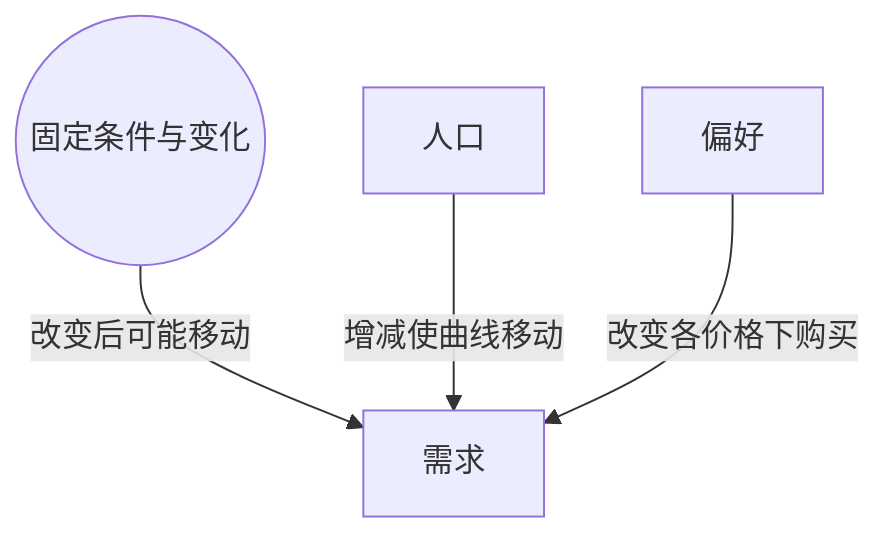

> 核心主线：沿同一条曲线分析价格变化，必须固定其它条件；人口与偏好变化会改变各个价格下的购买数量。  
> 课程来源：Sal Khan / Khan Academy《第10讲 收入、人口或偏好变化》，B站 BV1Gy4y1a7aE，UP主：农夫CC，P10，约 4 分钟；[本集视频](https://www.bilibili.com/video/BV1Gy4y1a7aE/?p=10)。非官方中文转述，具体引用以本集转写为准；[官方课程总页](https://www.khanacademy.org/economics-finance-domain/microeconomics)。整课许可尚未逐讲核实。

## 目录
+ [1. 同一条曲线背后的固定条件](#1-同一条曲线背后的固定条件)
+ [2. 人口与偏好改变整套关系](#2-人口与偏好改变整套关系)
+ [本讲知识地图](#本讲知识地图)
+ [概念卡片](#概念卡片)
+ [自测题（复习用）](#自测题复习用)
+ [视频时间索引](#视频时间索引)

## 1. 同一条曲线背后的固定条件
**核心思想：** 只讨论价格沿原曲线的作用，意味着其它影响因素保持不变。

+ **需求（Demand）**表示价格与购买数量的整套关系；在同一条曲线上移动时，不能同时把其它影响因素也视为已经改变。
+ 讲师回顾了相关产品价格和本产品价格预期，并把**收入（Income）**列为另一项固定条件。
+ 本集还列出**人口（Population）**与**偏好（Preferences）**：要维持同一条曲线，就假定人口以及消费者的口味和偏好没有变化。
+ 收入部分的正式转写存在缺段；可确认讲师提及**正常品（Normal Goods）**，并说明后续会讨论**低档品（Inferior Goods）**这一不同情形。本笔记不补写缺失段落中的方向与例子。

## 2. 人口与偏好改变整套关系
**核心思想：** 在给定价格下购买人数发生变化，会体现为整条曲线移动。

+ 人口增加时，给定价格下会有更多人想购买，需求增加，曲线右移；人口减少则需求减少，曲线左移。
+ 偏好改变也会改变曲线。例如作者在热门访谈节目中得到“这是最好的书”的赞誉，会让本书更受欢迎，各个价格下都有更多人愿意购买。
+ 反方向的例子是节目揭露作者抄袭整本书，读者对书的评价转差，各个价格下愿意购买的数量下降。
+ 两个例子改变的是整套需求关系，并不要求本书自己的价格先改变。判断时应比较“相同价格下”的购买数量，而非只比较两个不同价格对应的数量。

| 因素变化 | 给定价格下的购买数量 | 曲线方向 |
| --- | --- | --- |
| 人口增加 | 增加 | 右移 |
| 人口减少 | 减少 | 左移 |
| 对本书评价转好 | 增加 | 右移 |
| 抄袭曝光使评价转差 | 减少 | 左移 |

## 本讲知识地图

## 概念卡片
### 需求
+ 原文：Demand
+ 定义：价格与购买数量的整套关系，其曲线可随原固定条件改变而移动。
+ 出现：第 1 节「同一条曲线背后的固定条件」、第 2 节「人口与偏好改变整套关系」
+ 依赖：
+ 易混：

### 人口
+ 原文：Population
+ 定义：本集用以说明购买人数基础变化、影响各价格下购买数量的因素。
+ 出现：第 1 节「同一条曲线背后的固定条件」、第 2 节「人口与偏好改变整套关系」
+ 依赖：需求
+ 易混：

### 偏好
+ 原文：Preferences
+ 定义：消费者对产品的口味与评价，改变时会影响各价格下的购买意愿。
+ 出现：第 1 节「同一条曲线背后的固定条件」、第 2 节「人口与偏好改变整套关系」
+ 依赖：需求
+ 易混：

## 自测题（复习用）
1. 沿同一条曲线分析本产品价格变化，需要怎样处理其它影响因素？（对应：需求）

**答案：** 将相关产品价格、价格预期、收入、人口与偏好等条件保持固定。

2. 人口增加为什么让本例曲线右移？（对应：人口）

**答案：** 同样价格下会有更多人想购买，整套价格数量关系对应的购买数量增加。

3. 热门节目赞誉电子书，通过什么因素改变曲线？（对应：偏好）

**答案：** 改善消费者对书的评价与购买意愿，使各价格下更多人愿意购买。

4. 抄袭曝光为何不只是沿原曲线换一个点？（对应：需求）

**答案：** 它改变偏好，使相同价格下的购买数量也下降，整套关系因而改变。

---

## 视频时间索引
+ [00:00](https://www.bilibili.com/video/BV1Gy4y1a7aE?p=10&t=0) 1. 同一条曲线背后的固定条件
+ [02:16](https://www.bilibili.com/video/BV1Gy4y1a7aE?p=10&t=136) 2. 人口与偏好改变整套关系
