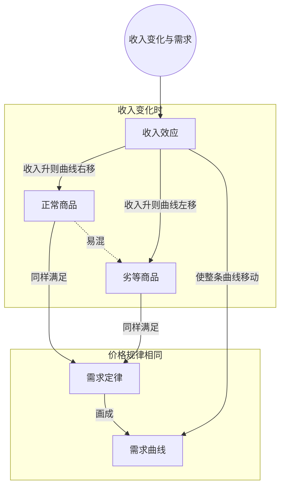

> 核心主线：笔记本电脑和最便宜的汽车都满足需求定律，区分它们的不是需求曲线的形状，而是收入变化时整条曲线往哪边移——收入上升，正常商品的需求右移，劣等商品的需求左移。  
> 本讲目标：读完你能回答「什么是正常商品、什么是劣等商品」「为什么收入上升时最便宜的汽车反而卖得少」「能不能凭需求曲线的形状判断一种商品是不是劣等商品」  
> 课程来源：Sal Khan / Khan Academy《第11讲 正常商品和劣等商品》，B站 BV1Gy4y1a7aE，UP主：农夫CC，P11，约 6 分钟；[本集视频](https://www.bilibili.com/video/BV1Gy4y1a7aE/?p=11)。非官方中文转述，具体引用以本集转写为准；[官方课程总页](https://www.khanacademy.org/economics-finance-domain/microeconomics)。整课许可尚未逐讲核实。  
> 转写说明：本集英文 ASR 有三处缺段——收入上升的假设刚说出口后一小段、便宜汽车需求变化的推理过程与「劣等商品」定义处、结尾总结之前一小段（该处仅识别出无意义的「EBP」）；笔记只整理可确认的内容，缺段处在正文中注明，未补造。

## 目录
+ [1. 两条同样向右下倾斜的需求曲线](#1-两条同样向右下倾斜的需求曲线)
+ [2. 收入上升：笔记本电脑是正常商品](#2-收入上升笔记本电脑是正常商品)
+ [3. 收入上升：最便宜的汽车反而少卖](#3-收入上升最便宜的汽车反而少卖)
+ [4. 收入下降：被迫换成便宜车](#4-收入下降被迫换成便宜车)
+ [本讲知识地图](#本讲知识地图)
+ [本讲小结](#本讲小结)
+ [概念卡片](#概念卡片)
+ [自测题（面试速答）](#自测题面试速答)
+ [视频时间索引](#视频时间索引)

---

## 1. 两条同样向右下倾斜的需求曲线
这一讲摆出两件商品：一台市面上的笔记本电脑，和一辆「市场上最便宜的汽车」。画面里是一辆 1985 年的车（转写为 “you go”，疑为 Yugo 车型），讲者只是假设它是市场上最便宜的那款。

先给两者各画一张图：纵轴是价格，横轴是数量。两件商品都满足**需求定律（law of demand）**：价格很高时，**需求量（quantity demanded）**很低；价格降下来，需求量就增加。所以两条**需求曲线（demand curve）**都从左上走向右下。讲者特意说明，它不一定是直线，画成曲线、画成别的形状都可以，他也不去标具体价格，只讲大意。

这两条线都是当前的需求，前提是**其他条件不变（all else equal）**——前几讲讨论过的那些会让曲线移动的因素，这里先都不动。

> **记住这个就够了**：笔记本电脑和最便宜的汽车都满足需求定律，单看两条向右下倾斜的需求曲线，分不出它们有什么不同。

---

## 2. 收入上升：笔记本电脑是正常商品
既然价格规律一样，差别在哪？讲者只动一个因素：收入。他说这一讲专门看收入因素，并把它称为**收入效应（income effect）**——收入变化时，两件商品的需求各自怎么变。（教科书里「收入效应」更常指价格变化通过购买力影响需求量的那部分，和这里的用法不同，笔记补充。）

假设整个人群的收入普遍上升。（转写稿在这句假设之后有一小段缺失。）接下来能确认的是：对笔记本电脑来说，在任何一个价格上，需求量都更高了。各价格下的需求量一起增加，在图上就表现为**整条曲线右移**，讲者说这就是「需求增加了」。

这完全说得通：人们钱多了，买笔记本电脑的人就多。反过来，收入下降时，人们可以花的钱变少，需求就下降，整条曲线左移。

讲者说**大多数商品都是这样**：收入上升需求上升、曲线右移，收入下降需求下降、曲线左移。这类商品叫**正常商品（normal good）**，笔记本电脑就是例子。

> **记住这个就够了**：收入上升、整条需求曲线右移的商品是正常商品，大多数商品都属于这一类。

---

## 3. 收入上升：最便宜的汽车反而少卖
同样让收入上升，最便宜的汽车会怎样？讲者先加了一个设定：我们身处一个发达国家，几乎人人都已经有某种汽车。

人们手里钱多了，会把钱花在市场上最便宜的那款车上吗？讲者的回答是：多数情况下，收入普遍上升后，人们会想「我现在钱多了一点，也许可以买一辆稍好一点的车」。

（转写稿此处有缺段，中间的推理过程没有被识别出来。）能确认的结论是：这款车的需求会**下降**，曲线可能**左移**——方向和笔记本电脑正好相反。紧接着讲者给出这类商品的名字：**劣等商品（inferior good）**，但转写稿在命名处同样缺了一段，只留下这个词本身。

> **记住这个就够了**：收入上升时，人们会从最便宜的车升级到更好的车，所以这款车的需求反而下降、曲线左移。

---

## 4. 收入下降：被迫换成便宜车
那怎样一般性地理解劣等商品？讲者的说法是：人们如果钱更多，就不想拥有它，会少买这类东西。

换个方向看更清楚：如果收入下降，很多人预算吃紧，买不起奔驰、宝马，甚至连中型轿车也负担不起了，只好「降级」，改买这款便宜车。于是出现一个看起来奇怪的情况：**收入下降，它的需求反而上升**。（讲者随后的一小段转写稿只识别出无意义的「EBP」，内容缺失。）

讲者的总结是：在收入效应上，劣等商品和正常商品**方向正好相反**。原因在于人们的意愿——收入上升时，人们想换掉它、买更好的；收入下降时，人们会说「我只能买这个了」。

| 商品类别 | 收入上升 | 收入下降 | 本讲例子 |
| --- | --- | --- | --- |
| 正常商品 | 需求增加，曲线右移 | 需求减少，曲线左移 | 笔记本电脑 |
| 劣等商品 | 需求减少，曲线左移 | 需求增加，曲线右移 | 发达国家里最便宜的汽车 |

注意两类商品都仍然满足需求定律，区分它们的只是收入变化时整条曲线移动的方向。

> **记住这个就够了**：劣等商品对收入的反应和正常商品相反——收入降、需求升，因为人们被迫从更好的选择降级到它。

---

## 本讲知识地图

## 本讲小结
| 机制/概念 | 解决什么问题 | 一句话 |
| --- | --- | --- |
| 需求定律 | 价格变化时需求量怎么变 | 价格越高需求量越低，两件商品都满足 |
| 收入效应 | 收入变化时整条需求曲线往哪移 | 本讲只动收入，看两类商品的曲线各自怎么移 |
| 正常商品 | 收入上升后需求怎么变 | 收入升需求升、曲线右移，大多数商品如此 |
| 劣等商品 | 为什么有的商品收入升了反而少卖 | 收入升时人们升级换掉它，收入降时被迫转向它 |

**学完能说的 3 句话：**
1. 正常商品和劣等商品都满足需求定律，需求曲线都向右下倾斜，区别只在收入变化时曲线移动的方向。
2. 收入上升时，正常商品的整条需求曲线右移，劣等商品的需求曲线左移；收入下降时两者都反过来。
3. 劣等商品的需求随收入反向变化，是因为人们有钱时想升级换掉它，没钱时只能降级买它。

## 概念卡片
### 需求定律
+ 原文：Law of Demand
+ 定义：其他条件不变时，价格越高需求量越低、价格越低需求量越高
+ 出现：第 1 节「两条同样向右下倾斜的需求曲线」、第 4 节「收入下降：被迫换成便宜车」
+ 依赖：
+ 易混：劣等商品——劣等商品照样满足需求定律，它的特殊之处在收入反应

### 需求曲线
+ 原文：Demand Curve
+ 定义：纵轴为价格、横轴为数量，表示各价格下需求量的线，满足需求定律时从左上走向右下
+ 出现：第 1 节「两条同样向右下倾斜的需求曲线」、第 2 节「收入上升：笔记本电脑是正常商品」、第 3 节「收入上升：最便宜的汽车反而少卖」
+ 依赖：需求定律
+ 易混：

### 收入效应
+ 原文：Income Effect
+ 定义：本讲中指收入这一因素变化时，商品需求随之变化、整条需求曲线移动的效果
+ 出现：第 2 节「收入上升：笔记本电脑是正常商品」、第 4 节「收入下降：被迫换成便宜车」
+ 依赖：需求曲线
+ 易混：

### 正常商品
+ 原文：Normal Good
+ 定义：收入上升时需求增加、整条需求曲线右移，收入下降时需求减少、曲线左移的商品
+ 出现：第 2 节「收入上升：笔记本电脑是正常商品」、第 4 节「收入下降：被迫换成便宜车」
+ 依赖：收入效应
+ 易混：劣等商品——两者对收入变化的反应方向相反

### 劣等商品
+ 原文：Inferior Good
+ 定义：收入上升时人们想换掉它、需求下降，收入下降时人们被迫转向它、需求上升的商品
+ 出现：第 3 节「收入上升：最便宜的汽车反而少卖」、第 4 节「收入下降：被迫换成便宜车」
+ 依赖：收入效应
+ 易混：正常商品——区别在收入反应，不在需求曲线的形状

## 自测题（面试速答）
1. 正常商品和劣等商品的根本区别在哪里？（对应：正常商品）

**答案：** 区别在收入变化时需求往哪个方向移，而不在价格规律。收入上升时，正常商品在每个价格上的需求量都增加、整条需求曲线右移，劣等商品则需求下降、曲线左移；收入下降时两者都反过来。课程里笔记本电脑是正常商品，发达国家里市场上最便宜的汽车是劣等商品。

2. 劣等商品的需求曲线也向右下倾斜，为什么不能凭曲线形状判断它是劣等商品？（对应：需求定律）

**答案：** 因为劣等商品同样满足需求定律，形状上看不出区别。课程开头给笔记本电脑和最便宜的汽车各画了一条需求曲线，两条都是价格高时需求量低、价格低时需求量高，都从左上走到右下。判断它属于哪一类，要看收入变化时整条曲线往哪边移。

3. 为什么收入普遍上升时，市场上最便宜的汽车反而卖得更少？（对应：劣等商品）

**答案：** 因为人们会用多出来的钱升级到更好的车。讲者设定在几乎人人都有车的发达国家，收入上升后人们会想「我钱多了一点，也许可以买辆稍好的车」，而不是再买最便宜的那款。于是这款车的需求下降、曲线左移，这正是劣等商品的表现。

4. 收入下降时，劣等商品的需求为什么会上升？（对应：劣等商品）

**答案：** 因为预算吃紧的人被迫降级购买它。课程举例说，收入下降后很多人买不起奔驰、宝马，甚至买不起中型轿车，只好转买最便宜的那款车。所以出现收入下降、需求反而上升的情况，和正常商品的方向正好相反。

5. 收入上升时，正常商品的需求变化在图上怎么表示？为什么是整条曲线移动？（对应：需求曲线）

**答案：** 用整条需求曲线右移来表示。收入是价格以外的因素，它变化后，任何一个价格上的需求量都更高了，所以整条线一起向右挪，而不是沿着原曲线移动（后半句为笔记补充）。课程里笔记本电脑在收入上升后就是这样；收入下降时则整条曲线左移。

6. 本讲所说的「收入效应」指什么？和价格变化引起的需求量变化有什么不同？（对应：收入效应）

**答案：** 本讲的收入效应指只改变收入、看需求如何随之变化。价格变化时，是沿着同一条需求曲线移动（视频中未展开，笔记补充）；收入变化时，在各个价格上的需求量一起变，表现为整条曲线平移。课程正是用这个视角，比较笔记本电脑右移、最便宜的汽车左移，从而区分正常商品和劣等商品。

---

## 视频时间索引
+ [00:00](https://www.bilibili.com/video/BV1Gy4y1a7aE?p=11&t=0) 1. 两条同样向右下倾斜的需求曲线
+ [01:44](https://www.bilibili.com/video/BV1Gy4y1a7aE?p=11&t=104) 2. 收入上升：笔记本电脑是正常商品
+ [03:11](https://www.bilibili.com/video/BV1Gy4y1a7aE?p=11&t=191) 3. 收入上升：最便宜的汽车反而少卖
+ [04:29](https://www.bilibili.com/video/BV1Gy4y1a7aE?p=11&t=269) 4. 收入下降：被迫换成便宜车
