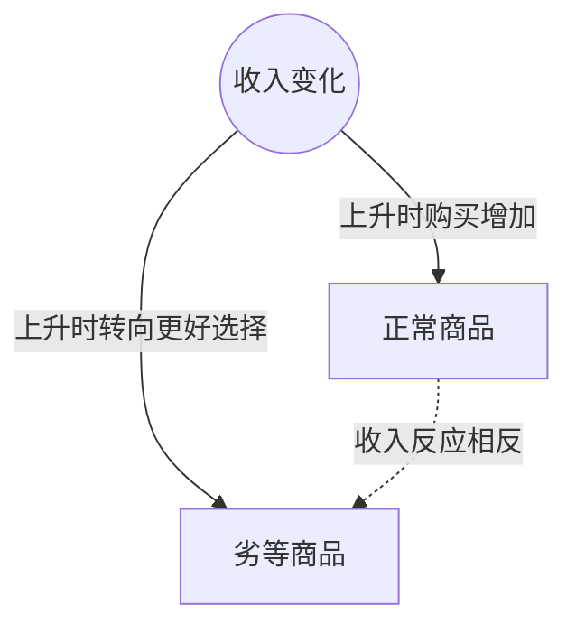

> 核心主线：两类商品都可满足价格越高购买越少，但收入变化对它们的整条需求曲线有相反影响。  
> 课程来源：Sal Khan / Khan Academy《第11讲 正常商品和劣等商品》，B站 BV1Gy4y1a7aE，UP主：农夫CC，P11，约 6 分钟；[本集视频](https://www.bilibili.com/video/BV1Gy4y1a7aE/?p=11)。非官方中文转述，具体引用以本集转写为准；[官方课程总页](https://www.khanacademy.org/economics-finance-domain/microeconomics)。整课许可尚未逐讲核实。

## 目录
+ [1. 相同的价格规律与不同的收入反应](#1-相同的价格规律与不同的收入反应)
+ [2. 预算变化如何改变购买选择](#2-预算变化如何改变购买选择)
+ [本讲知识地图](#本讲知识地图)
+ [概念卡片](#概念卡片)
+ [自测题（复习用）](#自测题复习用)
+ [视频时间索引](#视频时间索引)

## 1. 相同的价格规律与不同的收入反应
**核心思想：** 曲线向右下倾斜，并不能单独决定收入增加后整条曲线向哪边移动。

+ 讲师比较一台笔记本电脑与市场上最便宜的汽车，分别画出价格在纵轴、数量在横轴的图。两者都满足价格高时购买数量较少、价格低时购买数量较多的规律。
+ 这些都是其它条件不变时的当前关系；本集随后专门改变收入，而不是改变商品自己的价格。
+ **正常商品（Normal Good）**在收入上升时，各价格下的购买数量增加，整条曲线右移；收入下降则相反。笔记本电脑被用作这类商品的例子。
+ **劣等商品（Inferior Good）**的收入反应相反：收入提高时消费者希望换掉它，收入下降时反而更多人因预算受限转向它。讲师用最便宜的汽车说明这种选择。
+ 因而两类商品的差别在于收入改变后的反应，不能把劣等商品误解为必然不满足价格与购买数量反向变化的规律。

## 2. 预算变化如何改变购买选择
**核心思想：** 购买力提高后是否想换掉原产品，是本例解释两类商品差异的关键。

+ 在笔记本电脑例子中，收入提高让消费者有更多钱购买；收入降低时，购买能力减弱，对正常商品的整套关系向左移动。
+ 对最便宜的汽车，讲师假定处于几乎人人已有某种汽车的发达国家。收入提高后，人们可能买稍好的车，而不是继续购买市场上最便宜的型号。
+ 收入下降时，有些消费者无法再负担原本更好的车型，只能降低选择标准、转买便宜车，所以劣等商品在各价格下的购买数量可能增加。
+ 这个例子依赖商品与消费者处境的设定；讲师用特定汽车说明收入变化的机制，没有把所有汽车归为同一类别。

| 商品类别 | 收入上升 | 收入下降 | 本集例子 |
| --- | --- | --- | --- |
| 正常商品 | 曲线右移 | 曲线左移 | 笔记本电脑 |
| 劣等商品 | 曲线左移 | 曲线右移 | 设定情景中的最便宜汽车 |

## 本讲知识地图

## 概念卡片
### 正常商品
+ 原文：Normal Good
+ 定义：其它条件不变时，收入增加使购买需求增加、收入下降使其减少的商品。
+ 出现：第 1 节「相同的价格规律与不同的收入反应」、第 2 节「预算变化如何改变购买选择」
+ 依赖：
+ 易混：劣等商品——两类商品对收入变化的反应方向相反。

### 劣等商品
+ 原文：Inferior Good
+ 定义：本例中收入上升时消费者希望换掉、收入下降时因预算限制更多转向的商品。
+ 出现：第 1 节「相同的价格规律与不同的收入反应」、第 2 节「预算变化如何改变购买选择」
+ 依赖：
+ 易混：正常商品——区别是收入反应，不能据此断定自身价格与购买数量的规律相反。

## 自测题（复习用）
1. 笔记本电脑作为本例的正常商品，收入上升后曲线如何变化？（对应：正常商品）

**答案：** 各价格下购买数量增加，整条曲线右移。

2. 为什么收入提高可能减少最便宜汽车的购买？（对应：劣等商品）

**答案：** 消费者有更多预算后，可能转向更好的车型而换掉原先的便宜选择。

3. 收入下降为何可能增加本例便宜车的购买？（对应：劣等商品）

**答案：** 原本购买更好车型的消费者受预算限制，转向更便宜的车。

4. 为什么不能用向右下倾斜这一形状区分两类商品？（对应：正常商品）

**答案：** 两者都可满足自身价格与购买数量反向变化，分类依据是收入变化引起的反应。

5. 讲师为何交代便宜车例子所在的消费者处境？（对应：劣等商品）

**答案：** 几乎人人已有车的设定帮助说明收入提高后升级、收入降低后降级购买的机制。

---

## 视频时间索引
+ [00:00](https://www.bilibili.com/video/BV1Gy4y1a7aE?p=11&t=0) 1. 相同的价格规律与不同的收入反应
+ [03:11](https://www.bilibili.com/video/BV1Gy4y1a7aE?p=11&t=191) 2. 预算变化如何改变购买选择
