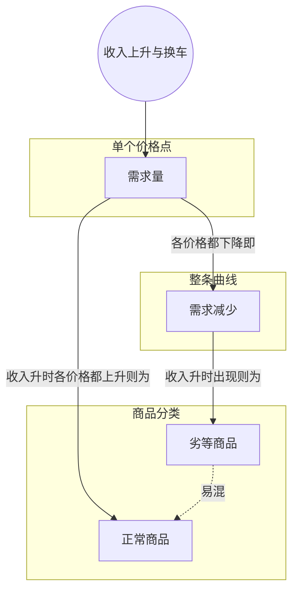

> 核心主线：劣等商品说的是特定市场里的具体产品，而不是“汽车”这一整类——在人人有车的发达国家，收入上升让人们从最便宜的车升级到更好的车，它在每个价格上的需求量都下降，整条需求曲线左移，所以是劣等商品；中档车和高档车的曲线右移，是正常商品。  
> 本讲目标：读完你能回答「为什么说“最便宜的车是劣等商品”不等于“汽车是劣等商品”」「收入上升后，三款车的买家分别怎么流动」「“需求减少”和“某个价格上的需求量减少”有什么区别」  
> 课程来源：Sal Khan / Khan Academy《第12讲 劣等商品阐明》，B站 BV1Gy4y1a7aE，UP主：农夫CC，P12，约 5 分钟；[本集视频](https://www.bilibili.com/video/BV1Gy4y1a7aE/?p=12)。非官方中文转述，具体引用以本集转写为准；[官方课程总页](https://www.khanacademy.org/economics-finance-domain/microeconomics)。整课许可尚未逐讲核实。  
> 转写说明：本集英文 ASR 有三处缺段——介绍另外两款车及其人群占比的一段（仅识别出无意义的「EBP」）、收入上升的假设处（仅识别出「1. Income」）、讲“整条曲线移动”与“是否完美平移”之间的一段（仅识别出「Quantity」）；开头的 “in for your good” 应为 “inferior good” 的误识别。笔记只整理可确认的内容，缺段处在正文中注明，未补造。

## 目录
+ [1. 澄清误会：说的不是“汽车是劣等商品”](#1-澄清误会说的不是汽车是劣等商品)
+ [2. 用人群分布看收入上升后的换车](#2-用人群分布看收入上升后的换车)
+ [3. 三款车的需求各自怎么变](#3-三款车的需求各自怎么变)
+ [4. 从一个价格点到整条曲线移动](#4-从一个价格点到整条曲线移动)
+ [本讲知识地图](#本讲知识地图)
+ [本讲小结](#本讲小结)
+ [概念卡片](#概念卡片)
+ [自测题（面试速答）](#自测题面试速答)
+ [视频时间索引](#视频时间索引)

---

## 1. 澄清误会：说的不是“汽车是劣等商品”
上一讲把市场上最便宜的汽车称为**劣等商品（inferior good）**。讲者察觉到观众有些困惑，于是专门补了这一讲。

困惑在哪？有人以为他在说“汽车整体是劣等商品”。他澄清：不是这个意思。他的前提是，我们生活在一个人人都有车、汽车是生活必需品的现实里——发达国家很多地方确实如此。在这个前提下，**市场上最便宜的那款车**才可能被看作劣等商品。

为了把这件事讲清楚，他假设市场上有三款车，并且不再只盯着一个人，而是把整个人群放进来一起看。

> **记住这个就够了**：劣等商品针对的是特定市场里的具体产品，“最便宜的车是劣等商品”不等于“汽车是劣等商品”。

---

## 2. 用人群分布看收入上升后的换车
怎么“看整个人群”？讲者画了一条线，代表这个人人有车的发达国家的全部人口，再按大家开的车把这条线分成几段。最便宜的车用蓝色表示，假设现在大约三分之一的人开的是它。

（转写稿此处缺段：另外两款车——中型轿车和很贵的车——在图上怎么画、各占多少人，以及“收入上升”这一假设的具体说法，都没有被识别出来。）

接下来讲的是收入上升后各段人群怎么动。最穷的那部分人，未必马上就能升级到中型轿车；他们也许在别的东西上手头宽裕了些，或者能买到这款车更好一点的版本，但大体上还是开这款最便宜的车。

变化发生在**分界处**：原本开便宜车、又刚好在边界附近的人，收入上涨后买得起中型轿车了，而那正是他们想要的，于是他们开始改买中型车。同样，中型车和很贵的车的分界处，也有少数人现在有钱买很贵的车、又合自己口味，于是很贵的车也多了一小部分买家。

> **记住这个就够了**：收入上升后不是人人升级，而是处在分界处的人往上换一档：便宜车的买家流向中型车，中型车的买家有少数流向很贵的车。

---

## 3. 三款车的需求各自怎么变
把上一节的人流汇总一下：收入上升后，盯住某个特定价格，三款车各自卖得更多还是更少？

讲者的结论是：最便宜那款车在这个价格上的**需求量（quantity demanded）**下降了。中型车的需求上升了——它从蓝色那段拿走的人，比被很贵的车（图中橙色）从它那里拿走的人多得多。很贵的车的需求也上升了。

| 车型 | 收入上升后买家怎么动 | 需求方向 |
| --- | --- | --- |
| 最便宜的车 | 分界处的人升级到中型车 | 下降 |
| 中型轿车 | 从便宜车流入的多，流向贵车的少 | 上升 |
| 很贵的车 | 少数人从中型车升级过来 | 上升 |

这只是在一个价格点上的观察。讲者接着补了一个前提：只要这三款车始终分别是最贵、居中和最便宜的那款，上面的结论**在几乎任何价格点上都成立**。

> **记住这个就够了**：收入上升后，最便宜的车在各个价格上的需求量都下降，中型车和很贵的车则都上升。

---

## 4. 从一个价格点到整条曲线移动
在每个价格点上需求量都下降，画到图上是什么样？讲者给最便宜的车画出它原来的需求曲线：纵轴价格、横轴数量。最初他只盯着其中一个价格点看，发现收入上升后，那个价格上的需求量下降了；只要这款车始终是最便宜的，任何价格点都是如此。

所以这里说的是**需求减少（decrease in demand）**。讲者特别提醒：说“需求减少”，指的是**整条曲线的移动**，而不只是某一个价格点上的变化。

（转写稿此处有缺段，只识别出「Quantity」一词，随后的内容从一句「It can.」接上。）可以确认的是讲者接着说的：现实中很少会是“完美”的平移。不同价格点上的变化幅度可能不太一样，所以曲线一边移动、形状也可能一边改变。

回到正题：这款便宜车有一个不寻常的性质——收入上升时，它的需求曲线向左移。这就是称它为劣等商品的原因。另外两款车则相反：收入上升后需求上升，整条曲线右移，所以它们是**正常商品（normal good）**。

> **记住这个就够了**：每个价格上的需求量都变了才叫需求变化，表现为整条曲线移动（不必是完美平移）；便宜车左移是劣等商品，另两款右移是正常商品。

---

## 本讲知识地图

## 本讲小结
| 机制/概念 | 解决什么问题 | 一句话 |
| --- | --- | --- |
| 具体产品的分类 | 有人误以为“汽车是劣等商品” | 劣等商品针对人人有车的市场里最便宜的那款车 |
| 分界处的升级 | 收入上升后谁会换车 | 不是人人升级，而是分界附近的人往上换一档 |
| 需求减少 | 一个价格点的变化和整体变化怎么区分 | 每个价格的需求量都下降，就是整条曲线左移 |
| 劣等商品与正常商品 | 同一市场三款车为何归类不同 | 便宜车曲线左移是劣等商品，中档和高档车右移是正常商品 |

**学完能说的 3 句话：**
1. 劣等商品说的是特定市场里的具体产品，在人人有车的发达国家，最便宜的那款车才是劣等商品，汽车整体不是。
2. 收入上升时，分界处的人从便宜车升级到中型车、从中型车升级到很贵的车，所以便宜车需求下降，另两款上升。
3. 需求减少指整条需求曲线左移，而不只是一个价格点上的需求量减少；而且曲线移动时形状也可能改变。

## 概念卡片
### 劣等商品
+ 原文：Inferior Good
+ 定义：在特定市场中，收入上升时需求下降、整条需求曲线左移的具体产品
+ 出现：第 1 节「澄清误会：说的不是“汽车是劣等商品”」、第 4 节「从一个价格点到整条曲线移动」
+ 依赖：需求减少
+ 易混：正常商品——同一市场里不同车型可以分属两类，分类看具体产品的收入反应

### 正常商品
+ 原文：Normal Good
+ 定义：收入上升时需求上升、整条需求曲线右移的商品，本讲中是中型轿车和很贵的车
+ 出现：第 3 节「三款车的需求各自怎么变」、第 4 节「从一个价格点到整条曲线移动」
+ 依赖：需求量
+ 易混：劣等商品——两者在收入上升时曲线移动方向相反

### 需求量
+ 原文：Quantity Demanded
+ 定义：在某一个特定价格上，人们想买的数量
+ 出现：第 3 节「三款车的需求各自怎么变」、第 4 节「从一个价格点到整条曲线移动」
+ 依赖：
+ 易混：需求减少——需求量是单个价格点上的数量，需求减少是整条曲线的移动

### 需求减少
+ 原文：Decrease in Demand
+ 定义：在各个价格上需求量都下降，表现为整条需求曲线左移，移动时形状也可能改变
+ 出现：第 4 节「从一个价格点到整条曲线移动」、第 3 节「三款车的需求各自怎么变」
+ 依赖：需求量
+ 易混：需求量——只在一个价格点上看到下降，还不足以说整条曲线移动

## 自测题（面试速答）
1. 说“市场上最便宜的车是劣等商品”，为什么不等于说“汽车是劣等商品”？（对应：劣等商品）

**答案：** 因为劣等商品针对的是特定市场里的具体产品。讲者的前提是人人都有车、汽车是生活必需品的发达国家，在这里收入上升时人们会从最便宜的车升级，只有这款车的需求下降。同一个市场里，中型轿车和很贵的车在收入上升后需求反而上升，是正常商品。

2. 收入普遍上升后，为什么不是所有开便宜车的人都会升级？（对应：劣等商品）

**答案：** 因为只有处在分界附近的人才刚好买得起更好的车。最穷的那部分人收入涨了也未必买得起中型轿车，可能只是在别处宽裕一些，或者买这款车更好的版本，大体上还开它。真正流走的是边界附近的买家，他们改买中型车，所以便宜车的需求下降。

3. 本讲中，中型轿车为什么是正常商品，尽管它也有买家流向很贵的车？（对应：正常商品）

**答案：** 因为它流入的买家远多于流出的买家。收入上升后，中型车从便宜车那段人群里拿走一大块，被很贵的车拿走的只是一小块，所以净效果是需求上升。在各个价格点上都如此，整条曲线右移，所以是正常商品。

4. “需求减少”和“某个价格上的需求量减少”有什么区别？（对应：需求减少）

**答案：** 需求减少指整条需求曲线移动，需求量减少只是一个价格点上的变化。讲者最初只看一个价格点，发现收入上升后便宜车在那里的需求量下降；只有当这款车始终最便宜、在任何价格点上都下降时，才说它的需求减少、整条曲线左移。

5. 收入变化导致需求曲线移动时，曲线一定是平行移动吗？为什么？（对应：需求减少）

**答案：** 不一定，讲者说很少会是完美的平移。不同价格点上的变化幅度可能不同，所以曲线在移动时形状也可能改变。判断劣等商品看的是收入上升时曲线整体往左移，不要求形状保持不变。

6. 收入上升后，最便宜的车在一个价格点上需求量下降，凭什么推断它在其他价格点也下降？（对应：需求量）

**答案：** 靠一个前提：这款车在讨论的价格范围内始终是市场上最便宜的。讲者说只要三款车始终分别是最贵、居中和最便宜的，分界处的人往上换车的逻辑在几乎任何价格点都成立，所以各价格的需求量都下降，汇总起来就是整条需求曲线左移。

---

## 视频时间索引
+ [00:00](https://www.bilibili.com/video/BV1Gy4y1a7aE?p=12&t=0) 1. 澄清误会：说的不是“汽车是劣等商品”
+ [00:33](https://www.bilibili.com/video/BV1Gy4y1a7aE?p=12&t=33) 2. 用人群分布看收入上升后的换车
+ [02:46](https://www.bilibili.com/video/BV1Gy4y1a7aE?p=12&t=166) 3. 三款车的需求各自怎么变
+ [03:12](https://www.bilibili.com/video/BV1Gy4y1a7aE?p=12&t=192) 4. 从一个价格点到整条曲线移动
