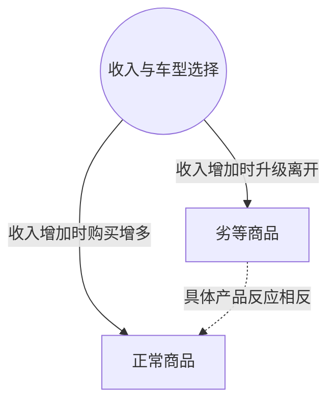

> 核心主线：劣等商品的判断针对特定市场中的具体产品，收入增加引起购买者升级，可能使最便宜车型的整条需求曲线左移。  
> 课程来源：Sal Khan / Khan Academy《第12讲 劣等商品阐明》，B站 BV1Gy4y1a7aE，UP主：农夫CC，P12，约 5 分钟；[本集视频](https://www.bilibili.com/video/BV1Gy4y1a7aE/?p=12)。非官方中文转述，具体引用以本集转写为准；[官方课程总页](https://www.khanacademy.org/economics-finance-domain/microeconomics)。整课许可尚未逐讲核实。

## 目录
+ [1. 区分汽车类别与具体车型](#1-区分汽车类别与具体车型)
+ [2. 从购买者升级看整条曲线](#2-从购买者升级看整条曲线)
+ [本讲知识地图](#本讲知识地图)
+ [概念卡片](#概念卡片)
+ [自测题（复习用）](#自测题复习用)
+ [视频时间索引](#视频时间索引)

## 1. 区分汽车类别与具体车型
**核心思想：** 分类依据是特定产品在收入变化时的购买反应，不能把一个例子扩展到所有汽车。

+ 本集澄清的市场设定是人人有车、汽车属于生活必需品的情景。讲师讨论的是市场上最便宜的汽车可能成为**劣等商品（Inferior Good）**，没有把汽车整体都归为这一类。
+ 图示区分最便宜车型、中档轿车和最昂贵车型，并用不同人群持有不同车型来说明购买者分布。
+ 收入上升不意味着每个人都立即升级。最贫困人群可能仍然买不起中档车，只能继续开便宜车，或者买同类中更好的版本。
+ 处在购买能力分界附近的人则可能买得起自己想要的中档车型；另有少部分人从中档车型升级到昂贵车型。
+ 在这个设定中，中档和昂贵车型呈现**正常商品（Normal Goods）**的反应：收入增加后购买需求增加。分类要看具体车型及人群处境。

## 2. 从购买者升级看整条曲线
**核心思想：** 在各个价格下都减少购买，才体现为整套关系左移，而非只看一个数量。

+ 购买者升级使最便宜车型在某个给定价格下的购买数量减少；讲师进一步假定它在所讨论价格下始终是市场上最便宜的车，因此类似反应可出现在多个价格点。
+ 这类收入增加后曲线左移的特征，是本例将便宜车称为劣等商品的依据。不是因为它的价格低，就自动得到这个结论。
+ 中档车型从便宜车型吸引的买家，多于它向昂贵车型流失的买家；在讲师的示例设定下，中档与昂贵车型的曲线都右移，因而是正常商品。
+ 曲线移动不要求保持完全相同的形状。不同价格点的变化幅度可以不同，整条曲线在移动时也可能改变形状。
+ 因此“需求减少”指整条关系改变，不能与某一价格下数量减少完全混为一谈，也不能把移动一律想成严格平行移动。

## 本讲知识地图

## 概念卡片
### 劣等商品
+ 原文：Inferior Good
+ 定义：本集特定市场设定中，收入增加后整条需求曲线向左移动的商品。
+ 出现：第 1 节「区分汽车类别与具体车型」、第 2 节「从购买者升级看整条曲线」
+ 依赖：
+ 易混：正常商品——分类针对具体产品的收入反应，不能推广到整个汽车类别。

### 正常商品
+ 原文：Normal Goods
+ 定义：本例中收入增加后购买需求增加、整条曲线右移的商品。
+ 出现：第 1 节「区分汽车类别与具体车型」、第 2 节「从购买者升级看整条曲线」
+ 依赖：
+ 易混：劣等商品——相同市场中，不同车型可以具有不同的收入反应。

## 自测题（复习用）
1. 为什么不能把讲师的例子归纳为“汽车都是劣等商品”？（对应：劣等商品）

**答案：** 例子只针对人人有车的市场中最便宜的车型，其它车型可有不同收入反应。

2. 收入增加后，最贫困群体为何不一定立即升级车型？（对应：劣等商品）

**答案：** 他们即使收入提高，也可能仍买不起中档车型。

3. 本例中档车型为何能成为正常商品？（对应：正常商品）

**答案：** 从便宜车型升级而来的买家多于转向昂贵车型的买家，收入增加后其购买需求增加。

4. 将便宜车归为劣等商品的直接判断依据是什么？（对应：劣等商品）

**答案：** 在给定市场与价格设定下，收入增加使各价格下购买数量减少、曲线左移。

5. 为什么画收入变化后的曲线时不必强求平行移动？（对应：正常商品）

**答案：** 各价格点的变化幅度可以不同，曲线移动时形状也可能改变。

---

## 视频时间索引
+ [00:07](https://www.bilibili.com/video/BV1Gy4y1a7aE?p=12&t=7) 1. 区分汽车类别与具体车型
+ [02:18](https://www.bilibili.com/video/BV1Gy4y1a7aE?p=12&t=138) 2. 从购买者升级看整条曲线
