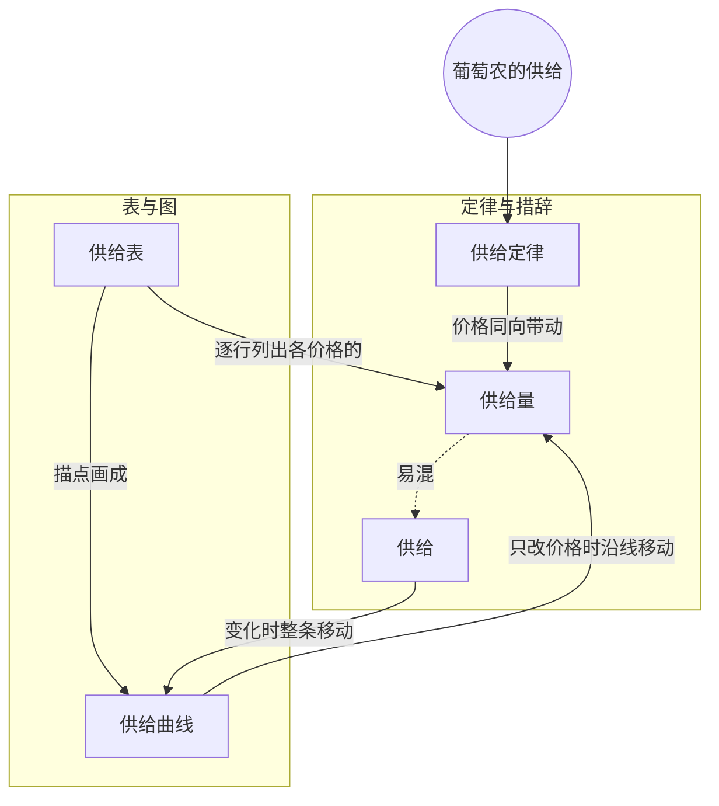

> 核心主线：其他条件不变时，葡萄价格越高，种植者越愿意把更多土地和力气投进葡萄，供给量随之增加——这就是供给定律；只改价格时沿着同一条供给曲线移动，而“供给变化”指整条关系的移动。  
> 本讲目标：读完你能回答「供给定律说的是什么，为什么符合直觉」「“供给”和“供给量”有什么区别」「只改变价格时，图上发生的是什么」  
> 课程来源：Sal Khan / Khan Academy《第13讲 供给定律》，B站 BV1Gy4y1a7aE，UP主：农夫CC，P13，约 8 分钟；[本集视频](https://www.bilibili.com/video/BV1Gy4y1a7aE/?p=13)。非官方中文转述，具体引用以本集转写为准；[官方课程总页](https://www.khanacademy.org/economics-finance-domain/microeconomics)。整课许可尚未逐讲核实。  
> 转写说明：本集英文 ASR 有两处明显缺段——每磅 2 美元情景的产量及引出 3 美元情景的一段（只剩「The price was $3.」）；画供给曲线时标横轴、描点的约两分多钟，只识别出重复的「$1,000」「$2.00」「$3.00」「at $4」等碎片。另外列供给表表头的一句不完整。笔记只整理可确认的内容，不补写 2 美元时的产量，缺段处在正文中注明。

## 目录
+ [1. 供给定律：价格涨，供给量涨](#1-供给定律价格涨供给量涨)
+ [2. 说“供给量”还是“供给”](#2-说供给量还是供给)
+ [3. 葡萄农的供给表](#3-葡萄农的供给表)
+ [4. 价格越高，越值得投入更多资源](#4-价格越高越值得投入更多资源)
+ [5. 画出供给曲线：只改价格就沿曲线移动](#5-画出供给曲线只改价格就沿曲线移动)
+ [本讲知识地图](#本讲知识地图)
+ [本讲小结](#本讲小结)
+ [概念卡片](#概念卡片)
+ [自测题（面试速答）](#自测题面试速答)
+ [视频时间索引](#视频时间索引)

---

## 1. 供给定律：价格涨，供给量涨
前几讲一直站在买方的角度讲需求，这一讲换到卖方：**供给（supply）**。讲者让我们假装自己是葡萄农，并且“为了致敬葡萄”，用紫色来写。

他先介绍**供给定律（law of supply）**，说它和需求定律一样，很符合直觉。前提照旧是**其他条件不变（all else equal）**：唯一改变的只有价格。至于那些暂时固定住的因素变了会怎样，讲者说留到接下来几讲再谈。

在这个前提下，供给定律说的是：价格上涨，**供给量（quantity supplied）**上升；价格下跌，供给量下降。价格和供给量同方向变动——这和需求定律里价格与需求量反方向变动正好相反（笔记补充对比）。

> **记住这个就够了**：其他条件不变时，价格上涨供给量就上升，价格下跌供给量就下降。

---

## 2. 说“供给量”还是“供给”
讲者在说定律时有个小停顿：本来要说“供给上升”，马上改口说“供给量上升”。为什么要这么较真？

因为这和需求那边是同一套讲究。说“需求上升或下降”，指的是**整个价格—数量关系在移动**；说某个具体数量时，要说“需求量”，不能只说“需求”。

供给完全一样：讲到某个具体数量，就说“供给量”；说“供给增加”，指的是整个价格—数量关系在移动（讲者说上移或下移）。

| 说法 | 指什么 | 需求这边的对应说法 |
| --- | --- | --- |
| 供给量 | 某个价格下的具体数量 | 需求量 |
| 供给（增加 / 减少） | 整个价格—数量关系的移动 | 需求（增加 / 减少） |

放到后面要画的**供给曲线（supply curve）**上看，供给量是曲线上的一个点，供给变化则是整条曲线的移动（笔记补充的图形化说法）。

> **记住这个就够了**：讲某个价格下的数量说“供给量”，讲整条关系的移动才说“供给”。

---

## 3. 葡萄农的供给表
供给定律直觉上说得通，但怎么具体看出来？讲者让我们把自己当成葡萄农，列一张**供给表（supply schedule）**：它其实就是一张表，列出在其他条件不变时，价格和供给量之间的关系，做法和之前的需求表一样。

表里每一行是一个情景（A、B、C……），一列写每磅葡萄的价格，另一列写这一时期（本例是这一年）的产量，也就是供给量。（列表头的这句转写不完整。）

情景 A：讲者先想说每磅 50 美分，随即改成整数，定为**每磅 1 美元**。对我们这个葡萄农来说，这是个比较低的价格。所以只用最容易种葡萄的地——最肥沃、又便宜的地，这些地别人也不想拿去干别的，只适合种葡萄。这样一年能产 **1,000 磅**。讲者还自嘲说自己从没当过葡萄农，不知道这个数是否现实，只是拿来举例。

> **记住这个就够了**：供给表把“其他条件不变时，每个价格对应多少供给量”列成表；低价时只用最适合种葡萄的地。

---

## 4. 价格越高，越值得投入更多资源
价格涨上去，葡萄农会怎么做？讲者接着往表里加情景，每一行都配了一个“为什么多种”的理由。

情景 B，价格涨到**每磅 2 美元**：不仅照原样生产，还可能想再买些地——那些本来有别的用途的地。（转写稿此处缺段：这一情景的产量没有被识别出来，笔记不补写。）

情景 C，**每磅 3 美元**：我们更想多产了。也许愿意干得更卖力、把葡萄种得更密，或者把本来用来种其他作物的地也拿来种葡萄，产量到 **2,500 磅**。

情景 D，**每磅 4 美元**：同样的逻辑继续推进——葡萄价格这么高，干脆停掉其他作物，地都改种葡萄，产量到 **2,750 磅**。

| 情景 | 每磅价格 | 增产手段 | 年产量（供给量） |
| --- | --- | --- | --- |
| A | 1 美元 | 只用肥沃、便宜、只适合种葡萄的地 | 1,000 磅 |
| B | 2 美元 | 再买些原本有其他用途的地 | 转写缺失 |
| C | 3 美元 | 更卖力、种更密、占用其他作物的地 | 2,500 磅 |
| D | 4 美元 | 停种其他作物，全改种葡萄 | 2,750 磅 |

> **记住这个就够了**：价格越高，原本不划算的土地和劳动也值得投进来，所以供给量随价格上升。

---

## 5. 画出供给曲线：只改价格就沿曲线移动
有了表，就能像画需求曲线那样画出**供给曲线**。坐标怎么放？

讲者沿用经济学的**惯例**：价格放纵轴（本例是每磅价格）。他坦言自己不喜欢这个惯例——我们通常把价格当成自变量来谈，而在大多数数学和科学里，自变量放在横轴；但经济学的习惯就是把价格放在纵轴。

（转写稿此处有一大段缺失：标横轴、把各情景描成点的过程，只识别出「$1,000」「$2.00」「$3.00」「at $4」等碎片。按上一节的表，横轴应是葡萄的数量，单位为磅。）

能确认的是讲者画完后的两点说明。第一，存在某个**最低价格**：低于它，我们根本不会开始种葡萄，总不能白送。所以曲线是从这个最低价格起步的，本讲没有给出它的具体数值。第二，这条曲线上唯一变动的只有价格——其他条件不变、价格改变时，我们**沿着这条曲线移动**。那些被固定住的其他因素在任意价格上会对这条曲线做什么，讲者说留到接下来几讲。

> **记住这个就够了**：供给曲线习惯上价格在纵轴；其他条件不变、只改价格时，是沿着同一条供给曲线移动。

---

## 本讲知识地图

## 本讲小结
| 机制/概念 | 解决什么问题 | 一句话 |
| --- | --- | --- |
| 供给定律 | 价格变了，卖方愿意供应多少 | 其他条件不变，价格越高供给量越高 |
| 供给与供给量 | 怎样说话才不混淆单点与整体 | 具体数量说供给量，整条关系移动才说供给 |
| 供给表 | 怎么把价格与供给量的关系具体列出来 | 每行一个价格情景，对应一个年产量 |
| 供给曲线 | 怎么在图上表示供给 | 价格放纵轴，只改价格时沿曲线移动 |

**学完能说的 3 句话：**
1. 供给定律：其他条件不变时，价格上涨供给量上升，价格下跌供给量下降。
2. 价格越高，原本有其他用途的土地和额外的劳动也值得投入葡萄生产，所以产量随价格增加。
3. 讲具体数量说“供给量”，只改价格是沿供给曲线移动；说“供给变化”指整条价格—数量关系移动。

## 概念卡片
### 供给定律
+ 原文：Law of Supply
+ 定义：其他条件不变时，价格上涨供给量上升、价格下跌供给量下降的规律
+ 出现：第 1 节「供给定律：价格涨，供给量涨」、第 4 节「价格越高，越值得投入更多资源」
+ 依赖：供给量
+ 易混：

### 供给量
+ 原文：Quantity Supplied
+ 定义：某个具体价格下，生产者在一段时期内愿意提供的数量
+ 出现：第 1 节「供给定律：价格涨，供给量涨」、第 2 节「说“供给量”还是“供给”」、第 3 节「葡萄农的供给表」、第 4 节「价格越高，越值得投入更多资源」
+ 依赖：
+ 易混：供给——供给量是单个价格下的数量，供给是整条价格—数量关系

### 供给
+ 原文：Supply
+ 定义：其他条件不变时，价格与供给量之间的整套关系；说供给增加或减少，指整条关系移动
+ 出现：第 1 节「供给定律：价格涨，供给量涨」、第 2 节「说“供给量”还是“供给”」、第 5 节「画出供给曲线：只改价格就沿曲线移动」
+ 依赖：供给曲线
+ 易混：供给量——只改价格时变的是供给量，不是供给

### 供给表
+ 原文：Supply Schedule
+ 定义：列出其他条件不变时，各个价格与对应供给量的表格
+ 出现：第 3 节「葡萄农的供给表」、第 4 节「价格越高，越值得投入更多资源」
+ 依赖：供给量
+ 易混：

### 供给曲线
+ 原文：Supply Curve
+ 定义：把供给表画到图上得到的线，按惯例价格在纵轴、数量在横轴，从某个最低价格起步
+ 出现：第 5 节「画出供给曲线：只改价格就沿曲线移动」、第 2 节「说“供给量”还是“供给”」
+ 依赖：供给表
+ 易混：

## 自测题（面试速答）
1. 供给定律说的是什么？为什么它符合直觉？（对应：供给定律）

**答案：** 其他条件不变时，价格上涨供给量上升，价格下跌供给量下降。因为价格越高，原本不划算的资源也值得投入生产。课程里葡萄每磅 1 美元时只用最肥沃便宜的地，产 1,000 磅；涨到 3 美元会更卖力、种更密、占用其他作物的地，产 2,500 磅；4 美元时停种其他作物，产 2,750 磅。

2. “供给”和“供给量”有什么区别？为什么讲者说定律时特意改口？（对应：供给量）

**答案：** 供给量是某个价格下的具体数量，供给是整个价格—数量关系。讲者沿用需求那边的讲究：说需求上升下降指整条关系移动，说具体数量要说需求量；供给也一样。所以价格上涨时应该说“供给量上升”，说“供给增加”就变成了整条关系在移动。

3. 其他条件不变、只有葡萄价格上涨时，图上发生的是什么？（对应：供给曲线）

**答案：** 沿着同一条供给曲线移动，变的是供给量。这条曲线上唯一变动的就是价格，其他因素都被固定住；那些因素变了才会让整条曲线移动，讲者说留到后面几讲。比如从每磅 3 美元涨到 4 美元，就是在曲线上从 2,500 磅那一点移到 2,750 磅那一点。

4. 供给表是怎么构造的？课程例子里每一行背后的逻辑是什么？（对应：供给表）

**答案：** 供给表在其他条件不变时，把每个价格情景和对应的供给量逐行列出。每一行背后都是同一个逻辑：价格越高，越值得把更多土地和劳动投到葡萄上。情景 A 每磅 1 美元只用只适合种葡萄的地，情景 B 每磅 2 美元会再买些有其他用途的地，C、D 再进一步占用其他作物的地。

5. 为什么经济学把价格放在纵轴？讲者对这个惯例怎么看？（对应：供给曲线）

**答案：** 这只是经济学的惯例，讲者本人并不喜欢它。他的理由是我们通常把价格当成自变量来谈，而大多数数学和科学都把自变量放在横轴；但经济学的习惯是价格在纵轴。所以画供给曲线时，纵轴是每磅价格，横轴是数量。

6. 供给曲线为什么不从价格为零的地方开始？（对应：供给曲线）

**答案：** 因为存在一个最低价格，低于它生产者根本不会开始生产。讲者说我们不会把葡萄白送出去，价格至少要达到某个水平才值得开始种。所以供给曲线从这个最低价格起步，本讲没有给出它的具体数值。

---

## 视频时间索引
+ [00:00](https://www.bilibili.com/video/BV1Gy4y1a7aE?p=13&t=0) 1. 供给定律：价格涨，供给量涨
+ [00:46](https://www.bilibili.com/video/BV1Gy4y1a7aE?p=13&t=46) 2. 说“供给量”还是“供给”
+ [01:42](https://www.bilibili.com/video/BV1Gy4y1a7aE?p=13&t=102) 3. 葡萄农的供给表
+ [03:21](https://www.bilibili.com/video/BV1Gy4y1a7aE?p=13&t=201) 4. 价格越高，越值得投入更多资源
+ [04:59](https://www.bilibili.com/video/BV1Gy4y1a7aE?p=13&t=299) 5. 画出供给曲线：只改价格就沿曲线移动
