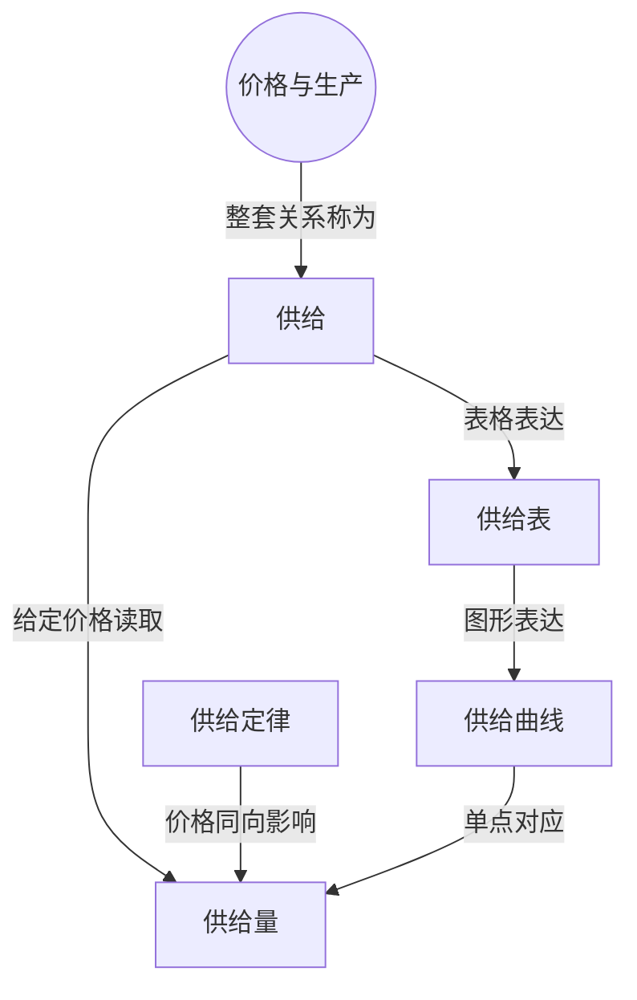

> 核心主线：其它条件不变时，更高的葡萄售价使种植者愿意投入更多土地与劳动，提高出售数量；这表现为沿同一条供给曲线移动。  
> 课程来源：Sal Khan / Khan Academy《第13讲 供给定律》，B站 BV1Gy4y1a7aE，UP主：农夫CC，P13，约 8 分钟；[本集视频](https://www.bilibili.com/video/BV1Gy4y1a7aE/?p=13)。非官方中文转述，具体引用以本集转写为准；[官方课程总页](https://www.khanacademy.org/economics-finance-domain/microeconomics)。整课许可尚未逐讲核实。

## 目录
+ [1. 葡萄价格与愿意出售的数量](#1-葡萄价格与愿意出售的数量)
+ [2. 表格与曲线中的整套关系](#2-表格与曲线中的整套关系)
+ [本讲知识地图](#本讲知识地图)
+ [概念卡片](#概念卡片)
+ [自测题（复习用）](#自测题复习用)
+ [视频时间索引](#视频时间索引)

## 1. 葡萄价格与愿意出售的数量
**核心思想：** 更高的售价让原本不值得用于葡萄生产的资源也变得值得投入。

+ **供给（Supply）**表示价格与愿意出售数量的整套关系；**供给量（Quantity Supplied）**是特定价格下、所讨论时间段内的具体数量。
+ **供给定律（Law of Supply）**描述其它条件不变时的方向：价格提高，愿意出售的数量增加；价格降低，数量减少。
+ 讲师以葡萄种植者为例。每磅价格 1 美元被设为较低价格，只采用较容易生产、肥沃且便宜的土地，示例一年生产 1,000 磅。
+ 价格上涨到每磅 2 美元时，生产者可能购买更多原本有其它用途的土地。正式转写没有清楚保留这一价格对应的产量，本笔记不补写。
+ 每磅 3 美元时，可能更努力工作、种得更密，或把原来种其它作物的土地用于葡萄，示例产量为 2,500 磅；每磅 4 美元时进一步转用土地，产量为 2,750 磅。
+ 这些是说明机制的假设数字。讲师说明自己不是葡萄种植者，未保证示例产量符合真实农场规模。

## 2. 表格与曲线中的整套关系
**核心思想：** 单个数量与整套关系应分别表达，改变价格时先固定其它条件。

+ **供给表（Supply Schedule）**把其它条件不变时的价格与供给量列成表，再把这些情景画成点，可以形成**供给曲线（Supply Curve）**。
+ 图沿用经济学惯例：价格放在纵轴，数量放在横轴。本例价格单位是每磅美元，数量是所讨论时间段内生产的葡萄磅数，不是金额。
+ 只改变价格时，供给量改变，图上沿同一条曲线移动。这就是供给定律在葡萄例子中的表现。
+ 供给改变则表示整套关系变化；哪些原先保持不变的因素能改变曲线，讲师留待后续视频展开。
+ 讲师还指出，开始生产葡萄可能需要某个最低价格，不会免费提供葡萄；本集没有给出这个最低价格的具体数值。

| 文稿明确的每磅价格 | 示例年产量 |
| --- | --- |
| 1 美元 | 1,000 磅 |
| 3 美元 | 2,500 磅 |
| 4 美元 | 2,750 磅 |

## 本讲知识地图

## 概念卡片
### 供给
+ 原文：Supply
+ 定义：其它条件不变时，价格与生产者愿意提供数量的整套关系。
+ 出现：第 1 节「葡萄价格与愿意出售的数量」、第 2 节「表格与曲线中的整套关系」
+ 依赖：
+ 易混：供给量——整套关系不同于某个价格下的数量。

### 供给量
+ 原文：Quantity Supplied
+ 定义：给定价格下、所讨论时间段内生产者愿意提供的数量。
+ 出现：第 1 节「葡萄价格与愿意出售的数量」、第 2 节「表格与曲线中的整套关系」
+ 依赖：供给
+ 易混：供给——只改变价格时沿原曲线移动，不是改变整套关系。

### 供给定律
+ 原文：Law of Supply
+ 定义：其它条件不变时，价格提高会增加生产者愿意提供数量的规律。
+ 出现：第 1 节「葡萄价格与愿意出售的数量」、第 2 节「表格与曲线中的整套关系」
+ 依赖：供给量
+ 易混：

## 自测题（复习用）
1. 为什么葡萄售价提高会让种植者愿意扩大产量？（对应：供给定律）

**答案：** 更高售价使投入更多土地、劳动或转种葡萄更有吸引力。

2. 每磅 3 美元时的 2,500 磅，应叫什么，单位是什么？（对应：供给量）

**答案：** 是该价格下的供给量，单位为所讨论一年内的葡萄磅数。

3. 价格变动时怎样区分沿原曲线移动与整套关系改变？（对应：供给）

**答案：** 其它条件不变、只改价格时沿原曲线移动；整套价格数量关系变了才是供给改变。

4. 为什么不能把“供给增加”直接当作某个数量增加的严谨表述？（对应：供给）

**答案：** 供给指整套关系，具体价格下的数量应称供给量。

5. 本例曲线两个坐标轴分别表示什么？（对应：供给量）

**答案：** 纵轴是每磅葡萄的价格，横轴是所讨论时间段内的葡萄数量。

---

## 视频时间索引
+ [00:00](https://www.bilibili.com/video/BV1Gy4y1a7aE?p=13&t=0) 1. 葡萄价格与愿意出售的数量
+ [04:31](https://www.bilibili.com/video/BV1Gy4y1a7aE?p=13&t=271) 2. 表格与曲线中的整套关系
