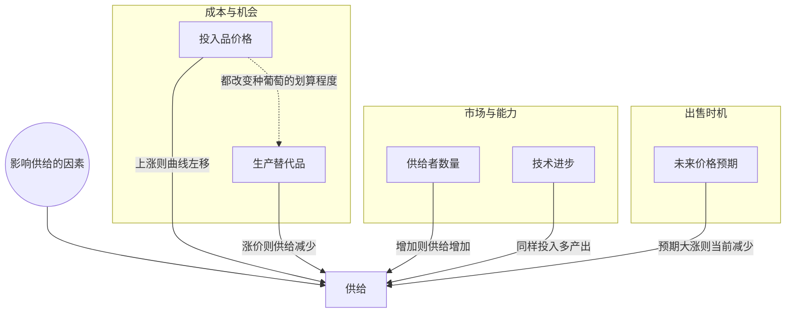

> 核心主线：葡萄自身价格变化只是沿供给曲线移动；上一讲固定住的那些因素——投入品价格、生产替代品的价格、供给者数量、技术、对未来价格的预期——一旦变化，整条供给曲线就会左移或右移。  
> 本讲目标：读完你能回答「投入品变贵为什么让整条供给曲线左移」「蓝莓涨价为什么会减少葡萄的供给」「预期未来大涨价时，现在的供给为什么反而减少」  
> 课程来源：Sal Khan / Khan Academy《第14讲 影响供给的各种因素》，B站 BV1Gy4y1a7aE，UP主：农夫CC，P14，约 7 分钟；[本集视频](https://www.bilibili.com/video/BV1Gy4y1a7aE/?p=14)。非官方中文转述，具体引用以本集转写为准；[官方课程总页](https://www.khanacademy.org/economics-finance-domain/microeconomics)。整课许可尚未逐讲核实。  
> 转写说明：本集英文 ASR 缺段较多——投入品价格的前半段讲解（识别成重复的无关网址）、引出相关产品与蓝莓的一段（只剩标题「RELATED GOODS」）、供给者数量的后半段（只剩「Adgregate Supply」一词）、技术进步的结论（句子被截断）、未来价格预期的大部分讲解（识别成无关网址）。笔记只整理可确认的内容，缺段处在正文中注明，未补造例子或数字。

## 目录
+ [1. 上一讲固定住的因素，这一讲逐个放开](#1-上一讲固定住的因素这一讲逐个放开)
+ [2. 投入品价格：成本变了，整条曲线跟着移](#2-投入品价格成本变了整条曲线跟着移)
+ [3. 相关产品价格：蓝莓涨价，葡萄供给减少](#3-相关产品价格蓝莓涨价葡萄供给减少)
+ [4. 供给者数量与技术进步](#4-供给者数量与技术进步)
+ [5. 对未来价格的预期](#5-对未来价格的预期)
+ [本讲知识地图](#本讲知识地图)
+ [本讲小结](#本讲小结)
+ [概念卡片](#概念卡片)
+ [自测题（面试速答）](#自测题面试速答)
+ [视频时间索引](#视频时间索引)

---

## 1. 上一讲固定住的因素，这一讲逐个放开
上一讲从卖方的角度认识了**供给（supply）**，以及它的基本规律**供给定律（law of supply）**：其他条件不变时，某样东西价格上涨，更多生产者有动力去生产它，或者某个生产者有动力多生产一些。价格上涨时，我们沿着供给曲线移动，产量随之上升。

可那句“其他条件不变”里，到底固定住了哪些东西？它们变了又会怎样？这一讲就逐个放开这些因素。按讲者在画面上写出的标题，依次是：

+ **投入品价格（price of inputs）**
+ 相关产品的价格（related goods），本讲重点是**生产替代品（productive substitutes）**
+ **供给者数量（number of suppliers）**
+ **技术进步（technological improvements）**
+ **未来价格预期（expected future prices）**

和自身价格不同，这些因素变化时，影响的是每一个价格上的供给，也就是整条曲线的位置。

> **记住这个就够了**：自身价格变化是沿供给曲线移动；这一讲讲的是其他因素变化时，整条供给曲线怎么移。

---

## 2. 投入品价格：成本变了，整条曲线跟着移
葡萄的售价没变，但种葡萄用的东西变贵了，会怎样？这就是投入品价格这个因素。

（转写稿此处缺段：讲者展开投入品价格的前半段被识别成重复的无关网址。从后文「同样，如果投入品价格下降……」可以确认，缺失的这段讲的是投入品价格上涨的情形。）

能确认的结论是：投入品变贵时，**整条供给曲线左移**。而且连“愿意供应任何一点葡萄所需的最低价格”也会上升——因为现在哪怕生产第一单位，成本也更高了。

反过来，如果投入品价格下降，那么在任意一个给定价格上，种葡萄都会变得更有利可图。我会更有动力种葡萄而不是种别的，把更多土地用来种葡萄，于是整条曲线右移。

| 投入品价格 | 在每个价格上种葡萄 | 供给曲线 |
| --- | --- | --- |
| 上涨 | 成本更高，起步的最低价格也更高 | 左移 |
| 下降 | 更有利可图，更多土地改种葡萄 | 右移 |

> **记住这个就够了**：投入品变贵，整条供给曲线左移、起步最低价格上升；投入品变便宜，曲线右移。

---

## 3. 相关产品价格：蓝莓涨价，葡萄供给减少
葡萄农的地不是只能种葡萄。如果另一种也能用这块地种的东西变贵了，会怎样？

（转写稿此处缺段：引出“相关产品”和蓝莓这个例子的一段只剩标题「RELATED GOODS」。）

讲者用的例子是**蓝莓**。如果蓝莓价格上涨，我会想：哇，也许种蓝莓能赚得更多。于是我把更多的地分给蓝莓，分给葡萄的就少了。

讲者马上补了一句限定：要看是哪种相关产品。他这里说的是生产替代品，也就是“我能用同样资源生产的其他东西”——这类东西价格上涨时，葡萄的供给就下降。（这句话在转写稿里有一小段断开，中间内容缺失。）

他最后强调，这些其实只是一种思考方式：如果现在种蓝莓能多赚钱，我就会把更多土地分给蓝莓而不是葡萄，葡萄的供给就会下降。

> **记住这个就够了**：生产替代品（如蓝莓）涨价，生产者把土地转去种它，葡萄的供给就减少。

---

## 4. 供给者数量与技术进步
除了单个葡萄农怎么分配土地，还有什么会改变整个市场的供给？讲者接着讲了两个因素。

第一个是供给者数量，讲者说这个很符合常识：供应这种东西的人越多，供给就越高。所以供给者数量增加，供给增加。（转写稿此处缺段：讲者紧接着提到这条曲线可能是针对……，随后只识别出「Adgregate Supply」一词，疑为 aggregate supply（总供给）；推测他在说明这里的曲线代表整个市场而非单个农户，但具体内容缺失，存疑。）

第二个是技术进步。讲者举的例子是某种创新、某种新的种子：同样的劳动、同样的土地，能多产出那么多葡萄。他还顺口说了一句“我们不会退回什么黑暗时代”，意思是这里只讨论技术进步的情形。转写稿里这句结论被截断，只剩“技术进步也会让供给……”；按同样的逻辑，它应当让供给增加、曲线右移（视频中未展开，笔记补充）。

> **记住这个就够了**：供给者越多，供给越高；技术进步让同样的土地和劳动产出更多，供给也随之增加。

---

## 5. 对未来价格的预期
如果你预计葡萄将来会大涨价，现在还会照常把葡萄卖出去吗？这就是最后一个因素：对未来价格的预期。

（转写稿此处缺段：这一部分的大部分讲解被识别成无关网址，只剩「Prices go up in the future.」一句。）

能确认的是讲者的结论：如果你预期未来价格会大幅上涨，那么**当前的供给会下降**——你会先把东西囤起来，留到将来再卖。

注意这里变的不是葡萄现在的价格，而是生产者对将来的判断；它改变的是“什么时候卖”，所以作用在当前整条供给曲线上（笔记补充的归纳）。

> **记住这个就够了**：预期未来价格大涨，生产者会囤货待售，当前的供给就会减少。

---

## 本讲知识地图

## 本讲小结
| 机制/概念 | 解决什么问题 | 一句话 |
| --- | --- | --- |
| 供给曲线移动 | 自身价格以外的因素变了怎么表示 | 自身价格变是沿曲线移动，其他因素变是整条曲线移动 |
| 投入品价格 | 成本变化如何影响供给 | 投入品变贵曲线左移、起步最低价格上升，变便宜则右移 |
| 生产替代品 | 别的作物涨价为何影响葡萄 | 蓝莓更赚钱就把地转去种蓝莓，葡萄供给减少 |
| 供给者数量与技术进步 | 市场整体产能如何变化 | 供给者越多、技术越好，供给越高 |
| 未来价格预期 | 为何预期涨价反而现在少卖 | 囤货留到将来卖，当前供给减少 |

**学完能说的 3 句话：**
1. 葡萄自身价格变化是沿供给曲线移动；投入品价格、生产替代品价格、供给者数量、技术和未来价格预期变化时，整条供给曲线移动。
2. 投入品变贵或生产替代品（如蓝莓）涨价，种葡萄就没那么划算，葡萄的供给曲线左移。
3. 预期未来价格大涨时，生产者会囤货留到以后卖，所以当前的供给反而减少。

## 概念卡片
### 供给
+ 原文：Supply
+ 定义：其他条件不变时价格与供给数量的整套关系；本讲中各种非价格因素变化时，这条关系整体左移或右移
+ 出现：第 1 节「上一讲固定住的因素，这一讲逐个放开」、第 2 节「投入品价格：成本变了，整条曲线跟着移」、第 3 节「相关产品价格：蓝莓涨价，葡萄供给减少」、第 4 节「供给者数量与技术进步」、第 5 节「对未来价格的预期」
+ 依赖：
+ 易混：

### 投入品价格
+ 原文：Price of Inputs
+ 定义：生产所用投入品的价格；上涨使整条供给曲线左移、起步的最低价格上升，下降使曲线右移
+ 出现：第 1 节「上一讲固定住的因素，这一讲逐个放开」、第 2 节「投入品价格：成本变了，整条曲线跟着移」
+ 依赖：供给
+ 易混：生产替代品——投入品价格改变的是种葡萄的成本，生产替代品价格改变的是土地改种别的东西的收益

### 生产替代品
+ 原文：Productive Substitutes
+ 定义：生产者能用同样资源转而生产的其他产品，本讲例子是可以和葡萄争用土地的蓝莓
+ 出现：第 1 节「上一讲固定住的因素，这一讲逐个放开」、第 3 节「相关产品价格：蓝莓涨价，葡萄供给减少」
+ 依赖：供给
+ 易混：投入品价格——两者都会让种葡萄变得不划算，但一个是成本上升，一个是别的选择更赚钱

### 供给者数量
+ 原文：Number of Suppliers
+ 定义：市场上供应这种产品的人数；人数越多，供给越高
+ 出现：第 1 节「上一讲固定住的因素，这一讲逐个放开」、第 4 节「供给者数量与技术进步」
+ 依赖：供给
+ 易混：

### 技术进步
+ 原文：Technological Improvements
+ 定义：如新的种子品种，让同样的劳动和土地产出更多产品的改进
+ 出现：第 1 节「上一讲固定住的因素，这一讲逐个放开」、第 4 节「供给者数量与技术进步」
+ 依赖：供给
+ 易混：

### 未来价格预期
+ 原文：Expected Future Prices
+ 定义：生产者对产品将来价格的判断；预期大幅上涨时会囤货待售，当前供给减少
+ 出现：第 1 节「上一讲固定住的因素，这一讲逐个放开」、第 5 节「对未来价格的预期」
+ 依赖：供给
+ 易混：

## 自测题（面试速答）
1. 葡萄价格上涨和投入品价格下降都会让葡萄产量增加，两者在图上有什么区别？（对应：供给）

**答案：** 葡萄自身价格上涨是沿着供给曲线移动，投入品价格下降是整条供给曲线右移。上一讲说过，其他条件不变、只改价格时，产量沿曲线上升；而投入品价格是被固定住的“其他条件”之一，它下降后在任意一个价格上种葡萄都更有利可图，所以每个价格上的供给都增加，整条曲线右移。

2. 投入品变贵时，为什么连“开始供应所需的最低价格”也会上升？（对应：投入品价格）

**答案：** 因为哪怕生产第一单位，成本也更高了。讲者说投入品价格上涨时整条供给曲线左移，而生产者愿意开始供应的最低价格也随之上升。反过来，投入品变便宜时，在任意价格上种葡萄都更划算，更多土地会改种葡萄，曲线右移。

3. 蓝莓涨价为什么会减少葡萄的供给？（对应：生产替代品）

**答案：** 因为蓝莓是葡萄的生产替代品，会和葡萄争用同一块地。蓝莓价格上涨后，生产者觉得种蓝莓能赚得更多，就把更多土地分给蓝莓，留给葡萄的地少了，葡萄的供给随之下降。讲者也提醒要看是哪种相关产品，这里说的是“我能用同样资源生产的其他东西”。

4. 投入品价格和生产替代品价格都会让葡萄供给减少，它们的作用机制有什么不同？（对应：投入品价格）

**答案：** 投入品价格改变的是种葡萄的成本，生产替代品价格改变的是土地改种别的东西的收益。投入品变贵时，每个价格上种葡萄的成本都更高，起步最低价格也上升；蓝莓变贵时，种葡萄本身成本没变，但种蓝莓更赚钱，土地被转走。两者结果都是葡萄供给减少（两者对比为笔记归纳）。

5. 供给者数量和技术进步分别怎样影响供给？（对应：技术进步）

**答案：** 两者增加都会让供给增加。供给者数量很直观：供应这种东西的人越多，供给就越高。技术进步的例子是新种子，同样的劳动和土地能多产出葡萄；转写稿里这句结论被截断，按同样逻辑应是供给增加（视频中未展开，笔记补充）。

6. 预期未来葡萄价格大涨，为什么现在的供给反而减少？（对应：未来价格预期）

**答案：** 因为生产者会把葡萄囤起来，留到将来以更高价格卖。讲者的结论是：预期未来价格大幅上涨时，当前供给下降。这里变的不是葡萄现在的价格，而是对将来的判断，它改变了出售时机，所以影响的是当前整条供给曲线。

7. 讲者说“供给者越多供给越高很符合常识”，这个因素和单个葡萄农的土地分配有什么不同？（对应：供给者数量）

**答案：** 供给者数量看的是市场上有多少人在供应，而不是某个农户怎么分配自己的地。前面的投入品价格、蓝莓价格讲的都是单个葡萄农种多少的决定；供给者数量增加时，供应的人多了，整个市场加起来的供给就更高。讲者随后提到的「Adgregate Supply」疑为总供给，转写缺失，具体说法无法确认。

---

## 视频时间索引
+ [00:00](https://www.bilibili.com/video/BV1Gy4y1a7aE?p=14&t=0) 1. 上一讲固定住的因素，这一讲逐个放开
+ [00:29](https://www.bilibili.com/video/BV1Gy4y1a7aE?p=14&t=29) 2. 投入品价格：成本变了，整条曲线跟着移
+ [02:09](https://www.bilibili.com/video/BV1Gy4y1a7aE?p=14&t=129) 3. 相关产品价格：蓝莓涨价，葡萄供给减少
+ [03:48](https://www.bilibili.com/video/BV1Gy4y1a7aE?p=14&t=228) 4. 供给者数量与技术进步
+ [04:51](https://www.bilibili.com/video/BV1Gy4y1a7aE?p=14&t=291) 5. 对未来价格的预期
