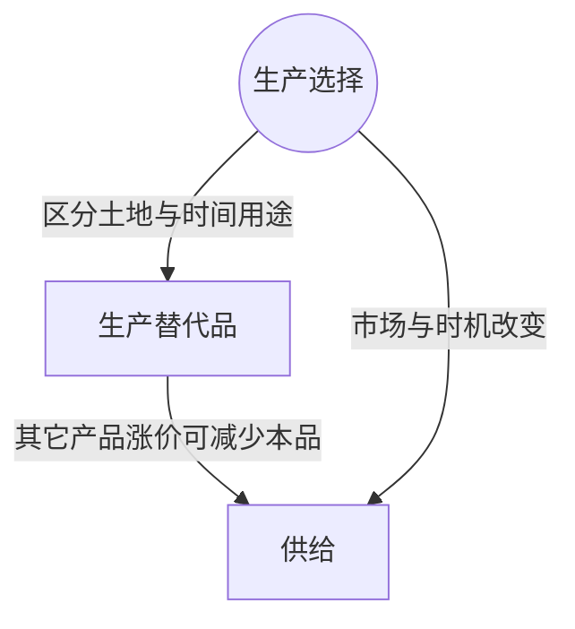

> 核心主线：投入成本、其它生产选择和市场条件会改变各价格下愿意出售的数量，未来涨价预期还可能使产品留到以后再卖。  
> 课程来源：Sal Khan / Khan Academy《第14讲 影响供给的各种因素》，B站 BV1Gy4y1a7aE，UP主：农夫CC，P14，约 7 分钟；[本集视频](https://www.bilibili.com/video/BV1Gy4y1a7aE/?p=14)。非官方中文转述，具体引用以本集转写为准；[官方课程总页](https://www.khanacademy.org/economics-finance-domain/microeconomics)。整课许可尚未逐讲核实。

## 目录
+ [1. 成本与可转种产品改变生产选择](#1-成本与可转种产品改变生产选择)
+ [2. 市场条件与出售时机](#2-市场条件与出售时机)
+ [本讲知识地图](#本讲知识地图)
+ [概念卡片](#概念卡片)
+ [自测题（复习用）](#自测题复习用)
+ [视频时间索引](#视频时间索引)

## 1. 成本与可转种产品改变生产选择
**核心思想：** 产品售价相同，成本和其它用途的收益不同，也会改变生产者愿意提供多少。

+ **供给（Supply）**表示价格与愿意提供数量的整套关系。只改变葡萄价格且其它条件不变时，是沿原曲线移动；本集讨论原先固定的条件改变后，整条关系怎样变化。
+ **投入价格（Price of Inputs）**影响生产成本。文稿说明生产第一单位的成本提高时，愿意开始提供产品所需的最低售价也提高，曲线左移。
+ 投入价格降低时，在任一给定葡萄售价下生产更有利可图，生产者更愿意把土地用于葡萄，曲线右移。不能把这种变化误写成葡萄自己的售价下降。
+ **生产替代品（Productive Substitutes）**是生产者可转而生产的其它产品。蓝莓涨价时，种植者可能认为蓝莓更赚钱，把更多土地转种蓝莓、减少葡萄土地。
+ 因而本例蓝莓涨价使葡萄供给减少。讲师提醒，要看相关产品具体是哪一种，不能把所有相关产品都套用同一方向。

## 2. 市场条件与出售时机
**核心思想：** 不仅土地用途，参与生产的人数、生产能力与何时出售，也影响当期市场关系。

+ 供应者数量增加，会提高市场供给。这里关注的不再只是某个农户怎样配置一块土地，还包括提供产品的人数。
+ 技术部分以新品种种子为例：相同劳动、相同土地可以生产更多葡萄。正式转写没有完整保留这段结尾，本笔记只保留已明确的生产能力变化。
+ 未来价格预期也会影响当前选择：若预计以后价格大幅上涨，生产者可能留存产品等未来卖出，当前供给减少。
+ 这些因素与生产替代品的逻辑都要求看清选择对象：蓝莓涨价改变土地用途，预期未来涨价改变出售时机。前者不是消费者在两种水果间选择，后者也不是当前葡萄售价已经上涨。
+ 分析时先判断改变的是自身现价、生产条件还是未来预期，再判断是沿原曲线移动，还是整套关系改变。文稿中的无关网址与缺失段落未用于补写例子。

| 已保留的变化 | 本集明确的机制或结果 |
| --- | --- |
| 投入成本提高 | 开始提供第一单位所需的最低售价提高，曲线左移 |
| 投入价格降低 | 同一售价下更有利可图，曲线右移 |
| 蓝莓售价提高 | 土地转向蓝莓，葡萄供给减少 |
| 供应者增加 | 市场供给增加 |
| 新种子技术 | 相同土地与劳动能产出更多葡萄 |
| 预期未来价格大涨 | 留存到未来出售，当前供给减少 |

## 本讲知识地图

## 概念卡片
### 供给
+ 原文：Supply
+ 定义：生产者愿意提供数量与当前价格的整套关系，会因生产条件和出售选择改变而移动。
+ 出现：第 1 节「成本与可转种产品改变生产选择」、第 2 节「市场条件与出售时机」
+ 依赖：
+ 易混：

### 生产替代品
+ 原文：Productive Substitutes
+ 定义：生产者能将土地等资源转用于生产的其它产品，本例为葡萄生产者可转种的蓝莓。
+ 出现：第 1 节「成本与可转种产品改变生产选择」、第 2 节「市场条件与出售时机」
+ 依赖：供给
+ 易混：

## 自测题（复习用）
1. 投入价格下降而葡萄售价不变，为何曲线可能右移？（对应：供给）

**答案：** 同一售价下生产更有利可图，生产者更愿意投入资源提供葡萄。

2. 蓝莓涨价如何减少葡萄的提供数量？（对应：生产替代品）

**答案：** 种植者把更多土地转种收益更高的蓝莓，留给葡萄的土地减少。

3. 这里的蓝莓例子与消费者改买另一种水果有何不同？（对应：生产替代品）

**答案：** 本例是生产者改变土地用途，讨论生产端选择而非消费端购买选择。

4. 预期未来价格大幅上涨，为何当前反而可能减少出售？（对应：供给）

**答案：** 生产者可能留存产品到未来以更高价格出售，减少当前提供数量。

5. 当前葡萄价格变化与供应者人数增加，应怎样区分图形变化？（对应：供给）

**答案：** 其它条件不变时自身价格变化沿原曲线移动，供应者增加则改变整套关系。

---

## 视频时间索引
+ [00:00](https://www.bilibili.com/video/BV1Gy4y1a7aE?p=14&t=0) 1. 成本与可转种产品改变生产选择
+ [03:48](https://www.bilibili.com/video/BV1Gy4y1a7aE?p=14&t=228) 2. 市场条件与出售时机
