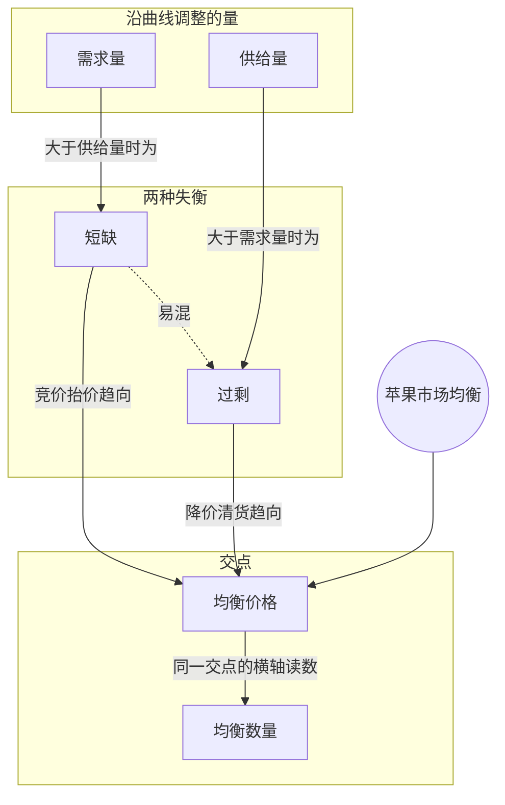

> 核心主线：苹果定价太低会出现短缺，买方抢购把价格推高；定价太高会出现过剩，卖方降价把价格拉低——两种调整都沿着供需曲线收敛到交点，那里供给量等于需求量，对应的价格和数量就是均衡价格与均衡数量。  
> 本讲目标：读完你能回答「定价太低和太高时，市场分别会怎么自我调整」「什么是均衡价格、均衡数量，在图上怎么读」「为什么价格调整时说的是“需求量”变化而不是“需求”变化」  
> 课程来源：【公开课】可汗学院：微观经济学（全71讲），第15讲 市场均衡（B站 BV1Gy4y1a7aE，UP主：农夫CC，选集 P15，约10分钟）  
> 转写说明：本集英文 ASR 有四处缺段——画需求曲线时的一段（只识别出不成句的「The price of the quantity demanded is $500.」）；“供给者以每磅 1 美元定价”这一情景的引出处（只剩「1. Suppliers」）；1 美元时的需求量与短缺大小（只剩「$1.00 per pound」「The price is going up」等碎片）；3 美元时问出需求量之后的一小段。结尾停在「均衡数量」的标题上，没有给出均衡数量的数值。笔记只整理可确认的内容，不补造缺失数据，缺段处在正文中注明。

## 目录
+ [1. 先把苹果市场的坐标定好](#1-先把苹果市场的坐标定好)
+ [2. 画出需求曲线和供给曲线](#2-画出需求曲线和供给曲线)
+ [3. 定价太低：短缺把价格往上推](#3-定价太低短缺把价格往上推)
+ [4. 定价太高：过剩把价格往下拉](#4-定价太高过剩把价格往下拉)
+ [5. 两头都收敛到交点：均衡价格与均衡数量](#5-两头都收敛到交点均衡价格与均衡数量)
+ [本讲知识地图](#本讲知识地图)
+ [本讲小结](#本讲小结)
+ [概念卡片](#概念卡片)
+ [自测题（面试速答）](#自测题面试速答)
+ [视频时间索引](#视频时间索引)

---

## 1. 先把苹果市场的坐标定好
前几讲把需求和供给分开讲，这一讲要把它们放进同一个市场里一起看：苹果市场里，不同价格下的需求和供给分别是多少？

要比较，先得把图的规矩定好。纵轴照旧是价格，这里是**每磅苹果的价格**，刻度标到 1、2、3、4、5 美元一磅。横轴是苹果的数量，单位是**千磅**，刻度是 1,000、2,000 直到 5,000 磅。

讲者还特别强调要**定一个时间段**：这里所有的数量都是指“接下来一周”的量。没有时间段，“产了多少磅”就没有意义。

> **记住这个就够了**：把供需放进同一张图前，先统一价格单位（每磅美元）、数量单位（千磅）和时间段（一周）。

---

## 2. 画出需求曲线和供给曲线
坐标定好了，两条曲线怎么画？讲者先画需求，并且建议你每次动笔画供需曲线前，都先问自己一句：价格很高时会怎样？

如果苹果价格很高，消费者会说自己不想要多少，所以**需求量（quantity demanded）**很低；价格低时需求量就高。（转写稿此处有一段缺失，只识别出一句不成句的「The price of the quantity demanded is $500.」。）画出来就是一条从左上到右下的**需求曲线（demand curve）**，讲者还顺手把它画得不那么歪歪扭扭。

再画**供给曲线（supply curve）**。存在某个价格，低于它我们根本不愿意生产苹果，讲者设为大约 50 美分。价格到每磅 1 美元时，我们愿意供应的数量——**供给量（quantity supplied）**——大约是 1,000 磅；价格越高，供给量越多。

| 曲线 | 价格高时 | 价格低时 | 本讲给出的点 |
| --- | --- | --- | --- |
| 需求曲线 | 需求量低 | 需求量高 | （画图过程部分缺失） |
| 供给曲线 | 供给量高 | 供给量低，约 50 美分以下不生产 | 每磅 1 美元时约 1,000 磅 |

> **记住这个就够了**：需求曲线向右下倾斜，供给曲线从约 50 美分起步、向右上延伸，两条线画在同一张图上。

---

## 3. 定价太低：短缺把价格往上推
假设供给者一开始把价格定低了，会发生什么？

（转写稿此处缺段：引出这个情景的一段只剩「1. Suppliers」。）能确认的设定是：供给者出于某种原因，认为苹果只能卖每磅 1 美元。按供给曲线，这个价格下他们只供应 **1,000 磅**——这是他们这一周的计划。

（转写稿此处又有一段较长的缺失：1 美元时消费者想买多少、缺口多大，只识别出「$1.00 per pound」「The price is going up」等碎片。）从后文看，这时想买的人远多于能买到的——也就是**短缺（shortage）**：同一价格下，需求量大于供给量。（定义所在的转写缺失，这里按讲者后面对“供给量大于需求量”那种情形的说法反推，笔记补充。）

接下来讲者讲的调整过程是完整的：价格开始上涨。人们太想要苹果了，开始**竞价抬价**。生产者一看：这么多人要，苹果都快卖光了，我们也得多生产。于是从供给者的角度看，价格上涨、产量也上涨，他们**沿着供给曲线往上移动**。

比如下一期价格到了每磅 2 美元，产量到了大约 1,900 磅（讲者说“我也不确定，看起来大约 1,900 磅”），短缺就比之前小了。讲者说自己正在接近图上一个“有意思的点”，但先按下不表。

> **记住这个就够了**：定价太低会出现短缺，买方竞价推高价格，生产者沿供给曲线增产，短缺随之缩小。

---

## 4. 定价太高：过剩把价格往下拉
如果反过来，价格涨过了头呢？

讲者设想：价格和数量涨得太多，冲过了上一节那个“有意思的点”——后面会知道，那里对应的就是**均衡价格（equilibrium price）**和**均衡数量（equilibrium quantity）**。下一周，供给者们想：大家这么想要我们的苹果，价格定高点，每磅 **3 美元**！在 3 美元，我们很有干劲，计划生产并卖出 **3,000 磅**。

那 3 美元时消费者想买多少？（讲者问出这句后，转写稿有一小段缺失。）接下来的回答是：价格高了，消费者可能改买别的东西，或者干脆买不起苹果，需求量只有大约 **1,300 磅**。

供给量远大于需求量，这就是**过剩（surplus）**：3,000 − 1,300，多出 **1,700 磅**苹果。

过剩时会怎样？苹果放不了太久，生产者有点急了，开始**降价**来吸引消费者。看到价格在跌、苹果大量积压、坏掉、卖不出去，他们也会减产，于是**沿着供给曲线往下移动**。而价格下降时，讲者说“需求会上升”；严格说是需求量增加，沿着需求曲线往右下移动，而不是整条需求曲线移动（措辞区分为笔记补充，与第 13 讲“供给量 / 供给”的讲究一致）。

> **记住这个就够了**：定价太高会出现过剩，卖方降价清货，供给量减少、需求量增加，过剩随之缩小。

---

## 5. 两头都收敛到交点：均衡价格与均衡数量
短缺推价格往上，过剩拉价格往下，那最后停在哪？讲者把两种情形放在一起总结：

| 情形 | 起因 | 价格怎么走 | 供给量 | 需求量 |
| --- | --- | --- | --- | --- |
| 短缺 | 一开始价格太低 | 竞价抬价，上涨 | 沿供给曲线上移，增加 | 减少 |
| 过剩 | 价格太高 | 卖方降价，下跌 | 沿供给曲线下移，减少 | 增加 |

两种调整都在向同一个地方靠拢：**两条线的交点**。在这个价格上，供给量正好等于需求量。讲者从图上读出，这个例子里它大约是**每磅 2.15 美元**，并把它叫作均衡价格。

同一个交点，在横轴上对应的数量——也就是供给量等于需求量时的那个数量——叫均衡数量。转写稿在讲者写下「Equilibrium Quantity」标题时就结束了，没有给出它的具体数值，笔记也不从图上外推。

**打个比方（笔记补充）：** 交点像碗底，价格这颗弹珠从碗的哪一边滚下去，都会往碗底滑；但就像第 4 节讲的，它可能先冲过碗底再滑回来。这个比方的边界是：市场靠的是买卖双方一期一期的调整，不是自动的物理力。

> **记住这个就够了**：短缺和过剩都会把价格推向供需曲线的交点；交点的纵轴读数是均衡价格（本例约每磅 2.15 美元），横轴读数是均衡数量。

---

## 本讲知识地图

## 本讲小结
| 机制/概念 | 解决什么问题 | 一句话 |
| --- | --- | --- |
| 短缺 | 定价太低时市场怎么调整 | 需求量大于供给量，买方竞价抬价，生产者增产 |
| 过剩 | 定价太高时市场怎么调整 | 供给量大于需求量，卖方降价清货、减产 |
| 均衡价格 | 价格最终停在哪里 | 供给量等于需求量的价格，本例约每磅 2.15 美元 |
| 均衡数量 | 交点对应多少数量 | 均衡价格下供给量与需求量相等时的那个数量 |

**学完能说的 3 句话：**
1. 定价太低会出现短缺，买方竞价把价格推高，生产者沿供给曲线增产，短缺缩小。
2. 定价太高会出现过剩，比如每磅 3 美元时供给 3,000 磅、需求约 1,300 磅，过剩 1,700 磅，卖方只能降价、减产。
3. 两种调整都收敛到供需曲线的交点，那里供给量等于需求量，纵轴读数是均衡价格，横轴读数是均衡数量。

## 概念卡片
### 需求量
+ 原文：Quantity Demanded
+ 定义：某个价格下消费者想买的数量，价格变化时沿需求曲线变动
+ 出现：第 2 节「画出需求曲线和供给曲线」、第 4 节「定价太高：过剩把价格往下拉」、第 5 节「两头都收敛到交点：均衡价格与均衡数量」
+ 依赖：
+ 易混：供给量——一个是买方想买的数量，一个是卖方愿意供应的数量

### 供给量
+ 原文：Quantity Supplied
+ 定义：某个价格下生产者愿意供应的数量，价格变化时沿供给曲线变动
+ 出现：第 2 节「画出需求曲线和供给曲线」、第 3 节「定价太低：短缺把价格往上推」、第 4 节「定价太高：过剩把价格往下拉」、第 5 节「两头都收敛到交点：均衡价格与均衡数量」
+ 依赖：
+ 易混：需求量——两者相等的地方才是均衡

### 短缺
+ 原文：Shortage
+ 定义：同一价格下需求量大于供给量的情形，会引发买方竞价、价格上涨
+ 出现：第 3 节「定价太低：短缺把价格往上推」、第 5 节「两头都收敛到交点：均衡价格与均衡数量」
+ 依赖：需求量、供给量
+ 易混：过剩——短缺是想买的多于能卖的，过剩是能卖的多于想买的

### 过剩
+ 原文：Surplus
+ 定义：同一价格下供给量大于需求量的情形，会引发卖方降价、减产
+ 出现：第 4 节「定价太高：过剩把价格往下拉」、第 5 节「两头都收敛到交点：均衡价格与均衡数量」
+ 依赖：需求量、供给量
+ 易混：短缺——两者缺口方向相反，价格调整方向也相反

### 均衡价格
+ 原文：Equilibrium Price
+ 定义：供给量等于需求量时的价格，即供需曲线交点的纵轴读数，本例约每磅 2.15 美元
+ 出现：第 4 节「定价太高：过剩把价格往下拉」、第 5 节「两头都收敛到交点：均衡价格与均衡数量」
+ 依赖：短缺、过剩
+ 易混：均衡数量——两者来自同一个交点，一个读纵轴的价格，一个读横轴的数量

### 均衡数量
+ 原文：Equilibrium Quantity
+ 定义：均衡价格下供给量与需求量相等时的数量，即供需曲线交点的横轴读数
+ 出现：第 4 节「定价太高：过剩把价格往下拉」、第 5 节「两头都收敛到交点：均衡价格与均衡数量」
+ 依赖：均衡价格
+ 易混：均衡价格——单位不同，一个是每磅美元，一个是磅

## 自测题（面试速答）
1. 苹果定价太低时，价格和供给量为什么会一起上升？（对应：短缺）

**答案：** 因为出现了短缺，买方竞价把价格推高，生产者随之增产。课程里供给者以每磅 1 美元定价，只供应 1,000 磅，想买的人更多；人们竞相抬价，生产者看到苹果快卖光就多生产，沿供给曲线往上移动。比如下一期价格到 2 美元、产量约 1,900 磅，短缺就比之前小了。

2. 每磅 3 美元时，苹果市场出现了什么情况？缺口有多大？（对应：过剩）

**答案：** 出现过剩，多出 1,700 磅。供给者看到大家抢购，把价格定到 3 美元、计划卖 3,000 磅；但价格高了，消费者改买别的或买不起，需求量只有约 1,300 磅。供给量减去需求量就是 1,700 磅过剩，苹果放不住，卖方只能降价、减产。

3. 过剩时降价，讲者说“需求会上升”，严格来说应该怎么表述？为什么？（对应：需求量）

**答案：** 应该说需求量增加，而不是需求增加。降价是价格本身的变化，消费者沿着同一条需求曲线往右下移动，整条需求曲线并没有动；同时供给量沿供给曲线减少。这和第 13 讲区分“供给量”与“供给”是同一个讲究（措辞区分为笔记补充）。

4. 什么是均衡价格？为什么市场会趋向它？（对应：均衡价格）

**答案：** 均衡价格是供给量等于需求量时的价格，也就是供需曲线交点的纵轴读数。价格低于它会出现短缺，竞价把价格往上推；高于它会出现过剩，降价把价格往下拉，两头都在向交点收敛。课程例子里它大约是每磅 2.15 美元。

5. 均衡价格和均衡数量有什么区别？在图上怎么读？（对应：均衡数量）

**答案：** 两者来自同一个交点，均衡价格读纵轴，均衡数量读横轴。均衡价格是每磅多少美元，均衡数量是在这个价格下供给量与需求量相等时的那个数量，单位是磅（本讲按一周计）。转写稿结束在均衡数量的标题处，没有给出它的具体数值。

6. 从短缺往上调整时，为什么可能“调过头”变成过剩？（对应：供给量）

**答案：** 因为供给者是一期一期地根据上次看到的情况来定价和定产量的。课程里供给者看到苹果被抢购，下一周就把价格定到 3 美元、计划卖 3,000 磅，冲过了交点；结果需求量只有约 1,300 磅，反而出现过剩，又得降价减产往回调。所以调整不一定一步到位，而是在交点两侧来回逼近（最后一句为笔记归纳）。

---

## 视频时间索引
+ [00:00](https://www.bilibili.com/video/BV1Gy4y1a7aE?p=15&t=0) 1. 先把苹果市场的坐标定好
+ [00:49](https://www.bilibili.com/video/BV1Gy4y1a7aE?p=15&t=49) 2. 画出需求曲线和供给曲线
+ [02:58](https://www.bilibili.com/video/BV1Gy4y1a7aE?p=15&t=178) 3. 定价太低：短缺把价格往上推
+ [05:35](https://www.bilibili.com/video/BV1Gy4y1a7aE?p=15&t=335) 4. 定价太高：过剩把价格往下拉
+ [08:34](https://www.bilibili.com/video/BV1Gy4y1a7aE?p=15&t=514) 5. 两头都收敛到交点：均衡价格与均衡数量
