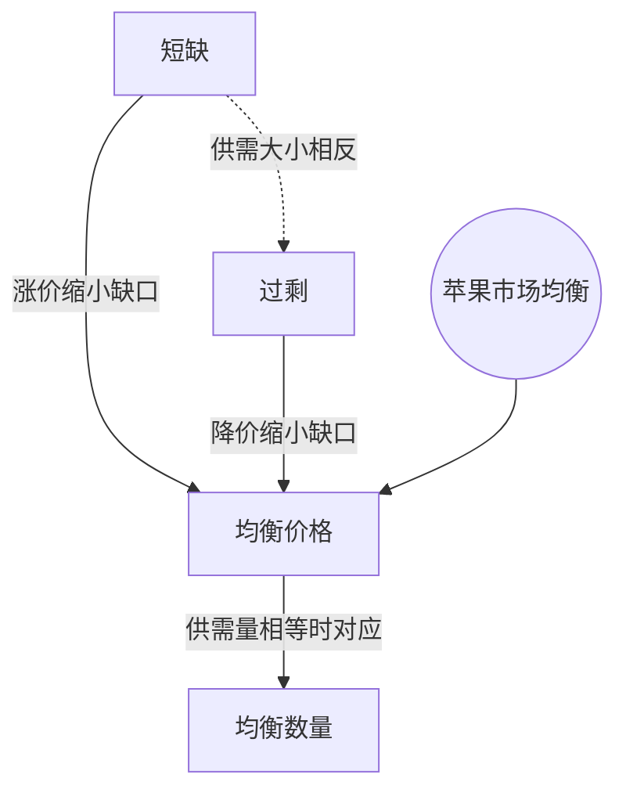

> 核心主线：苹果市场中，价格偏低引发短缺并推动涨价，价格偏高造成过剩并推动降价，两种调整都指向供给量等于需求量的交点。  
> 课程来源：【公开课】可汗学院：微观经济学（全71讲），第15讲 市场均衡（B站 BV1Gy4y1a7aE，UP主：农夫CC，选集 P15，约10分钟）  
> 转写说明：本集英文ASR部分片段仅有零散数字或不完整短句，相关说明未能完整恢复；本篇舍弃这些片段，仅整理可确认内容，未补造缺失数据。

## 目录
+ [1. 在同一张图上比较供给与需求](#1-在同一张图上比较供给与需求)
+ [2. 价格偏低时的短缺](#2-价格偏低时的短缺)
+ [3. 价格偏高时的过剩](#3-价格偏高时的过剩)
+ [4. 价格调整如何缩小供需缺口](#4-价格调整如何缩小供需缺口)
+ [5. 交点确定均衡价格与均衡数量](#5-交点确定均衡价格与均衡数量)
+ [本讲知识地图](#本讲知识地图)
+ [概念卡片](#概念卡片)
+ [自测题（复习用）](#自测题复习用)
+ [视频时间索引](#视频时间索引)

---

## 1. 在同一张图上比较供给与需求
**核心思想：** 比较供需之前，要先统一商品、数量单位和时间范围。

+ 课程以苹果市场为例：纵轴是每磅苹果的**价格（Price）**，单位为美元；横轴是苹果数量，以千磅为刻度，考察的时间范围是下一周。
+ **需求曲线（Demand Curve）**表示不同价格下消费者想购买的**需求量（Quantity Demanded）**：价格很高时，愿意购买的数量较少，因此图中的需求曲线向下倾斜。
+ **供给曲线（Supply Curve）**表示不同价格下生产者愿意提供的**供给量（Quantity Supplied）**：本例约每磅0.50美元才开始愿意生产，价格提高时愿意提供的数量增加。
+ 供需曲线必须放在同一价格、同一时期下比较；例如每磅1美元时，本例生产者计划供应约1,000磅苹果。

## 2. 价格偏低时的短缺
**核心思想：** 价格较低时，供给不足以满足购买意愿，买方竞价会形成涨价压力。

+ 如果生产者按每磅1美元安排销售，供给曲线对应的计划供给量约为1,000磅；课程随后描述了苹果不够买的情形。
+ **短缺（Shortage）**是同一价格下需求量大于供给量的情形。想买苹果的人争相购买，会把价格往上推。
+ 生产者发现苹果很快卖完、买方愿意出更高价格，会愿意增加产量，沿既有供给曲线向价格更高、供给量更大的方向移动。
+ 课程举例，价格提高到每磅2美元、供给量约1,900磅时，短缺比先前缩小；这些数值是图上的近似读数。

## 3. 价格偏高时的过剩
**核心思想：** 生产者计划卖出的数量超过消费者愿意购买的数量时，滞销会形成降价压力。

+ 课程设想下一周生产者把价格定到每磅3美元，并希望卖出3,000磅苹果；消费者面对较高价格，可能改买其他东西或买不起苹果。
+ 该价格下的需求量约为1,300磅，因此出现**过剩（Surplus）**：供给量大于需求量，过剩约为3,000 − 1,300 = 1,700磅。
+ 苹果不能无限期保持新鲜，卖不出去会促使生产者降低价格，吸引更多消费者购买。
+ 当价格下降、滞销明显时，生产者也会减少后续生产，沿既有供给曲线向供给量更小的方向移动；计划提供3,000磅不等于消费者实际买走3,000磅。

## 4. 价格调整如何缩小供需缺口
**核心思想：** 涨价和降价分别同时改变供给量与需求量，使两者从缺口两侧靠拢。

| 市场情形 | 价格压力 | 生产者的调整 | 消费者的调整 |
| --- | --- | --- | --- |
| 短缺：需求量大于供给量 | 买方竞价推动价格上升 | 愿意提供更多苹果 | 愿意购买的数量减少 |
| 过剩：供给量大于需求量 | 卖方为消化滞销而降价 | 减少后续生产 | 愿意购买的数量增加 |

+ 两种调整都指向供需曲线的交点：**均衡价格（Equilibrium Price）**是供给量与需求量相等时的价格，**均衡数量（Equilibrium Quantity）**是该价格下双方一致的数量。
+ 这里描述的是价格变化引起的沿曲线移动；买方多买或少买是需求量的变化，不应据此把需求曲线重新画到别处。
+ 课程还设想过生产者反应过大、从短缺调整到过剩的情况，因此例子的重点是理解不同缺口对应的价格压力，而非假定一次调整就恰好到达交点。

## 5. 交点确定均衡价格与均衡数量
**核心思想：** 均衡价格与均衡数量来自同一个交点，分别读纵轴和横轴。

+ **均衡价格**让供给量等于需求量；课程图中近似为每磅2.15美元，该数值是本例的读图结果。
+ **均衡数量**是均衡价格下，供给曲线和需求曲线共同对应的苹果数量；它不是只看生产者计划或只看消费者愿望得到的数量。
+ 判别均衡时可写作“供给量 = 需求量”。短缺对应需求量更大，过剩对应供给量更大，不能把价格与数量这两个不同单位的变量拿来相等比较。
+ 本集可确认的转写给出了均衡数量的定义，没有给出清晰的均衡数量数值，因此不据图外推一个具体磅数。

## 本讲知识地图

## 概念卡片
### 短缺
+ 原文：Shortage
+ 定义：同一价格、同一时期内，需求量大于供给量的市场情形。
+ 出现：第 2 节「价格偏低时的短缺」、第 4 节「价格调整如何缩小供需缺口」
+ 依赖：均衡价格
+ 易混：过剩——短缺是想买的数量更多，过剩是想卖的数量更多。

### 过剩
+ 原文：Surplus
+ 定义：同一价格、同一时期内，供给量大于需求量的市场情形。
+ 出现：第 3 节「价格偏高时的过剩」、第 4 节「价格调整如何缩小供需缺口」
+ 依赖：均衡价格
+ 易混：短缺——过剩促使卖方降价，短缺促使买方竞价。

### 均衡价格
+ 原文：Equilibrium Price
+ 定义：使供给量等于需求量的价格，在供需图交点的纵轴上读取。
+ 出现：第 4 节「价格调整如何缩小供需缺口」、第 5 节「交点确定均衡价格与均衡数量」
+ 依赖：均衡数量
+ 易混：均衡数量——前者是每磅价格，后者是在该价格下供需一致的数量。

### 均衡数量
+ 原文：Equilibrium Quantity
+ 定义：均衡价格下，生产者愿意提供且消费者愿意购买的共同数量，在供需图交点的横轴上读取。
+ 出现：第 4 节「价格调整如何缩小供需缺口」、第 5 节「交点确定均衡价格与均衡数量」
+ 依赖：均衡价格
+ 易混：均衡价格——两者来自同一交点，但读轴与单位不同。

## 自测题（复习用）
1. 苹果价格偏低、出现短缺时，价格和供给量为什么会一起上升？（对应：短缺）

**答案：** 买方竞价推高价格，较高价格又使生产者愿意沿供给曲线增加供给量，从而缩小短缺。

2. 每磅3美元时，供给量3,000磅、需求量约1,300磅，市场出现什么情形，缺口多大？（对应：过剩）

**答案：** 出现约1,700磅的过剩，即供给量减去需求量；苹果滞销会推动卖方降价并减少后续生产。

3. 过剩时降价，供给量与需求量分别如何变化？（对应：过剩）

**答案：** 供给量减少、需求量增加，两者沿既有曲线移动并缩小供需缺口。

4. 本例每磅约2.15美元为何被称为均衡价格？（对应：均衡价格）

**答案：** 这个价格对应供需曲线的交点，生产者愿意提供的数量等于消费者愿意购买的数量。

5. 均衡数量应从何处读取，它与均衡价格有什么区别？（对应：均衡数量）

**答案：** 从供需交点的横轴读数量，纵轴读均衡价格；本集可确认的转写没有给出清晰的均衡数量数值。

---

## 视频时间索引
+ [00:00](https://www.bilibili.com/video/BV1Gy4y1a7aE?p=15&t=0) 1. 在同一张图上比较供给与需求
+ [02:58](https://www.bilibili.com/video/BV1Gy4y1a7aE?p=15&t=178) 2. 价格偏低时的短缺
+ [05:35](https://www.bilibili.com/video/BV1Gy4y1a7aE?p=15&t=335) 3. 价格偏高时的过剩
+ [07:49](https://www.bilibili.com/video/BV1Gy4y1a7aE?p=15&t=469) 4. 价格调整如何缩小供需缺口
+ [08:57](https://www.bilibili.com/video/BV1Gy4y1a7aE?p=15&t=537) 5. 交点确定均衡价格与均衡数量
