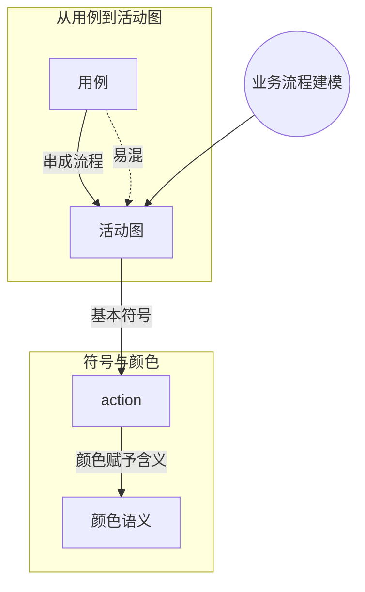

# 课堂笔记模板与规范（bilibili-douyin-notes）

**版本：v4 / v4-obsidian**（语雀直导 / Obsidian 变体；调用门禁 / 深链脚本时传对应的 `--template`）

> **版本说明**：v1（★ 符号体系）与 v2（三词文字标签）已移除，门禁与深链脚本不再支持；
> v3（frontmatter + NAV 折叠区）冻结、仍可校验——笔记 frontmatter 写
> `template_version: v3` 时按 v3 规则检查。**新笔记按 v4 或 v4-obsidian 生成**：
> 正文零时间戳、零考试向标签、按知识体系组织。v4 为**可直接导入语雀**的纯 Markdown——
> 无 frontmatter、无一级标题、`+` 列表、答案与时间索引不折叠。
> 没有 frontmatter 的笔记默认按 v4 检查，`--template v4` 可省略（写上也可以）。
> `v4-obsidian` 只增加 frontmatter、将目录换成 Wiki 标题链接，其它 v4 规则不变，详见第一节。
> 模板默认取 `config.note_template`；课程可用 `start --template v4|v4-obsidian` 显式选择，生成时以 `next` 的 `note.template` 为准。
>
> **2026-11-07 写法更新（仍属 v4，门禁参数不变）**：正文改为讲解体——小节先抛场景或问题、以段落展开、
> 节末用 `> **记住这个就够了**：` 收尾，不再在开头写 `**核心思想：**`；开头引语块加 `本讲目标`；
> 知识地图后新增 `## 本讲小结`（小结表 + 学完能说的 3 句话）；自测题改为 `## 自测题（面试速答）`，
> 答案是一段「结论 → 原因 → 例子」。新增项缺失只报 warning，旧笔记仍可通过门禁。

本文件是本 skill 生成课堂笔记的**唯一模板与规范**，包含：文件命名、lecture 完整骨架 +
short 差异表 + brief 轻量型、时间戳规范、语法契约（要点表达 / 概念卡片 / 自测题 / 知识地图 /
视频时间索引）、截图嵌入规范、生成流程、模板要点清单。
不依赖任何个人本机文件，任何人在任何机器上按本文件生成都应得到结构一致的笔记。

**定位**：笔记是“看完课替代手写笔记”的**课后复习资料**——读者通读正文即可完成复习，
不需要拿笔记跳回视频；生成后可整篇导入语雀，导入效果与源文件一致。时间戳的唯一职责是
文末时间索引里的“回看跳转”，深链由脚本补齐。

---

## 一、文件命名与元信息（v4 无 frontmatter）

- 文件名：`<序号>-<主题>.md`，如 `2.13-业务流程建模.md`、`01-认识产品经理.md`；
  序号取课程选集号（如 `2.13`）或按用户已有笔记递增（如 `01`），主题取视频标题关键词。
  文件名即语雀文档标题，所以**正文不写 `# 一级标题`**；
- **禁止** frontmatter（`---` 包围的元数据块）——语雀会把它当正文显示；
- 原 frontmatter 的元信息改由命令行与 `metadata.json` 提供：
  - 模板版本：门禁 / 深链脚本传 `--template v4`（可省略：无 frontmatter 默认按 v4）；
  - 笔记类型：`--note-type lecture|short`，缺省取 metadata.json 顶层
    `suggested_note_type`，再缺省视为 `lecture`；
  - 平台与视频 ID：取 metadata.json 的 `platform` 与 `bvid` / `video_id`；
- 课程来源（平台、视频号、UP 主、时长）写在开头引语块的 `课程来源：` 一行里，供读者查看。

### 1.1 v4-obsidian 变体（仅用于 Obsidian）

v4 **仍然禁止 frontmatter**。选择 `v4-obsidian` 时才使用下面的完整 frontmatter 示例；尖括号内容需替换为真实元数据，不能把示例当作已生成或已验收的笔记：

```markdown
---
template_version: "v4-obsidian"
title: "<序号>-<主题>"
note_type: "lecture"
platform: "bilibili"
source: "<原视频链接>"
bvid: "<真实BV号>"
page: 1
duration: "26:00"
course: "<真实课程名>"
created: "<实际生成日期 YYYY-MM-DD>"
tags:
  - "课程笔记"
  - "<真实课程名>"
---
> 核心主线：<一句话知识主线>
> 本讲目标：读完你能回答「<问题一>」「<问题二>」
> 课程来源：<视频标题、平台、视频号、作者与时长>

## 目录
+ [[#1. 从用例到活动图]]
+ [[#2. 活动图的符号与颜色语义]]
+ [[#本讲知识地图]]
+ [[#本讲小结]]
+ [[#概念卡片]]
+ [[#自测题（面试速答）]]
+ [[#视频时间索引]]
```

- `title` 取笔记标题，`note_type` 取 `lecture` / `short`；`source` 用真实来源链接，`duration` 用双引号包裹的真实时长 `mm:ss`（如 `"26:00"`），`created` 用实际生成日期。
- B站使用 `bvid` 与真实分P号 `page`；YouTube 将 `bvid` 换成 `video_id`，不写 `page`；其它平台使用其真实 `video_id`，不套用 B站字段。
- **整门课**的 `tags` 依次写 `"课程笔记"` 和真实课程名；**单视频**去掉 `course` 字段，`tags` 只写 `"课程笔记"`，不要把单视频虚构成课程。
- frontmatter 仅使用可由标准库解析的 YAML 子集：顶层键值标量（scalar）和列表（list），不用嵌套对象、锚点、别名、类型标签或多行块。字符串建议全部用双引号；含冒号、`#`、`[`、`{` 等 YAML 特殊字符的字符串必须用双引号，内部双引号与反斜杠需转义。页码等数值保持数字，时长按上述 `mm:ss` 字符串填写。
- frontmatter 闭合后紧接 `> 核心主线：` 引语块，仍然不写一级标题。目录每项使用 `+ [[#精确正文标题]]`，必须与正文标题完全一致，包含序号、空格和标点，不做 Markdown slug 转换。
- 后续正文接第四节 lecture 骨架；short 差异仍按第六节。正文写法、概念卡、本讲小结、自测题（面试速答）、知识地图、时间索引与截图规范全部沿用 v4，视频深链仍由脚本填充。
- 深链与门禁均显式传 `--template v4-obsidian`，单视频也一样；每集单独一篇时再加 `--page <分P号>`（B站）。

## 二、正文写法（讲解体：先问题、后结论）

正文按“讲给人听”的方式写，读者顺着读下来就能理解，而不是扫一串要点。每个 `## N. 小节` 遵循：

1. **开头先抛场景、问题或朴素做法**，不先给结论。常见三种起手：
   + 场景：「训练停下来了，很多人第一反应是……」
   + 问题：「为什么非要区分这两者？」
   + 朴素做法：「最简单的做法是……，但这样会……」——直接写进行文，**不加「朴素做法：」标签**；
     只在讲者本人做了这类对比时才写，视频里没有就不硬造。
2. **以段落展开**：一段 1~4 句，单句成段也可以；可以用第二人称「你」、可以中途自问一句「为什么？」再作答。
   列表只用于 3 项以上的并列或步骤（用 `+`，`-` / `*` 为 warning）；对比内容优先用表格；
   流程可用 ```` ```plain ```` 代码块画箭头图（语雀只认 `plain` 作纯文本代码块，写成 `text` 会被识别成 LaTeX）；小节太长时可用 `### N.M 小标题` 再分一层。
3. **术语先解释、再命名**：先用一句大白话说清它是什么，再给出 `**术语**`（英文课见 2.1 的
   `**中文（Original）**`）。读者扫加粗词即可抓住本节重点。
4. **比喻（可选）**：讲者用过的比喻写成 `**打个比方：** …`；笔记自己补的比喻必须写成
   `**打个比方（笔记补充）：** …`，并尽量补一句「这个比方的边界是：…」说明哪里不像。
   其它写法为 warning（V4-ANALOGY）。
5. **节末收尾**：本节**最后一行**固定为一句结论引语（缺失为 warning，V4-IDEA）：
   ```markdown
   > **记住这个就够了**：<一句话结论，读者只记这一句也够用>
   ```
6. **补充内容要标注**：讲者没讲、笔记为了讲通而补的事实或推导，标「（视频中未展开，笔记补充）」。

仍然有效的禁令：

- **禁止**三词标签前缀（`**核心必考**`、`**重点掌握**`、`**了解即可**` 及任何变体，
  含 ★ 符号）——正文残留标签即 error；
- **禁止**行内 `[mm:ss]` 时刻（见第三节）；
- 每小节 ≥3 行实质内容。
- `**核心思想：**` 开头句**不再要求、也不推荐**（旧笔记保留它不报错）；结论统一放到节末。

```markdown
## 2. 临界点：局部最小值与鞍点
训练停下来了，很多人第一反应是「卡在**局部最小值（local minima）**了」。但梯度为零的点不止这一种，这么说并不严谨。

还有一种点叫**鞍点（saddle point）**：梯度同样为零，却既不是局部最小值也不是局部最大值，某个方向上较高、另一个方向上较低，形如马鞍。两者统称**临界点（critical point）**。

为什么非要区分？因为两者的处境完全不同：

| 卡在哪里 | 周围地形 | 还有没有路走 |
|---|---|---|
| 局部最小值 | 四周都比当前点高 | 没路，往哪走 loss 都上升 |
| 鞍点 | 有些方向高、有些方向低 | 有路，逃离后 loss 还能下降 |

> **记住这个就够了**：梯度为零不等于卡在局部最小值；如果是鞍点，还有路可走。
```

### 2.1 原语言课程的术语表达

结合 `audio_lang` / `subtitle_lang` 与用户确认的语言判断课程原语言；英文原声课即使拿到中文字幕，也应保留可回查的原文术语。正文用中文写，术语首次出现写成 `**中文（Original）**`，例如 `**梯度下降（Gradient Descent）**`，后续可只写中文。

英文课概念卡使用中文卡名，并在四个既有字段之外增加原文行：

```markdown
### 梯度下降
+ 原文：Gradient Descent
+ 定义：沿损失函数梯度的反方向迭代更新参数的优化方法
+ 出现：第 1 节「优化目标」、第 2 节「参数更新」
+ 依赖：
+ 易混：
```

示例中的小节名应替换为笔记里真实存在的小节。原本中文课程无需额外的原文行；卡名本身是纯外文专名（如 `NumPy`）时也免加原文行，不必为专名硬造译名。其它概念卡、知识地图与自测题的概念引用仍使用同一卡名。此规则同时适用于 v4 与 v4-obsidian。

## 三、时间戳规范（正文零时刻）

**正文（文末“视频时间索引”节之前）任何位置出现时刻即 error**。禁令清单：

1. 目录条目（`+ [N. 小节名](#锚点)`，不带时刻）；
2. 小节标题（`## N. 小节名`，禁止 `（08:12）` 式时刻后缀）；
3. 要点行与正文段落（禁行内 `[mm:ss]`）；
4. 代码块内部（含来源标注注释）；
5. 概念卡片全部字段；
6. 自测题题干与答案；
7. 截图 caption（alt 文本）。

**唯一例外**是文末“视频时间索引”节（见 5.4）。

时间索引条目的**防虚构规则**：

- 时刻必须来自**转写稿/字幕里真实存在的 `[mm:ss]` 时间行**，禁止编造；生成前先在
  转写稿里确认该时间行存在（grep 即可）。ASR 相对画面约有 1~3 秒滞后，**引用时允许
  小幅前移**——门禁按总秒数做 ±5 秒容差校验（可跨分钟）；
- 分钟位允许 1~3 位（`[123:45]` 合法，容忍超长讲座）。

代码块来源标注为**可选**：

- 来自克隆的代码仓库：`# 来源：仓库 <子项目>/<文件路径>`（注释符随语言）；
- 按视频讲解组织的代码：可写 `# 按视频讲解还原`，也可不写；
- 语言 fence 用真实语言（java/python/js/ts/c/cpp/xml/sql/properties/yaml/json/
  bash/shell/html/css 等）；`mermaid`、`plain` 等非代码块不适用来源标注（但仍须正确闭合）；
- **任何代码块内禁止出现时刻**。

转写稿/字幕里没有的内容不要编造；确有必要补充时标注“（视频中未展开，建议补充）”。

## 四、完整骨架（lecture 型）

文件 `2.13-业务流程建模.md` 的完整内容（从第一行开始，前面没有任何元数据或标题）：

````markdown
> 核心主线：用例是散落的珠子、活动图是把它们串起来的线——用颜色区分用例、系统外活动与系统内部实现，把孤立用例串成完整的业务流程。  
> 本讲目标：读完你能回答「散落的用例怎么串成业务流程」「活动图里不同颜色的 action 各代表什么」  
> 课程来源：<视频标题>（B站 BV1xxxxxxxxx，UP主：<名字>，选集 2.13，约 26 分钟）

## 目录
+ [1. 从用例到活动图](#1-从用例到活动图)
+ [2. 活动图的符号与颜色语义](#2-活动图的符号与颜色语义)
+ [本讲知识地图](#本讲知识地图)
+ [本讲小结](#本讲小结)
+ [概念卡片](#概念卡片)
+ [自测题（面试速答）](#自测题面试速答)
+ [视频时间索引](#视频时间索引)

---

## 1. 从用例到活动图
基于用例建模时，我们从主参与者的目标出发，用 EBP 把目标切成一个个用例。切完你会发现一个问题：用例全是散的。

业务流程讲的却是事情的**先后顺序**，是好几个主参与者一起协作完成一件事。散落的用例回答不了「谁先做、谁后做、谁配合谁」。

描述「一组主参与者协作完成某件事」的工具，就是**活动图**。

> **记住这个就够了**：用例负责把目标切开，活动图负责把有关系的用例串成流程。

## 2. 活动图的符号与颜色语义
活动图最基本的符号是**action（动作）**，画成圆角矩形。但只看形状，你分不清一个 action 是用例、是系统外的人工活动，还是系统内部的实现。

所以 action 的语义由使用者自己定义。课程用**颜色语义**来扩展它：


| 颜色 | 含义 |
| --- | --- |
| 浅蓝 | 用户目标用例 |
| 黄色 | 系统范围之外的活动 |
| 红色 | 系统内部实现 |

颜色怎么约定因人因公司而异，没有标准答案，团队内部统一即可。

> **记住这个就够了**：action 本身没有固定含义，颜色是我们额外赋予它的语义。

## 本讲知识地图


## 本讲小结
| 机制/概念 | 解决什么问题 | 一句话 |
| --- | --- | --- |
| 活动图 | 散落的用例表达不了先后与协作 | 把有关系的用例串成业务流程 |
| 颜色语义 | action 符号本身没有含义 | 用颜色区分用例、系统外活动与内部实现 |

**学完能说的 3 句话：**
1. 用例切分目标，活动图把有关系的用例串成有先后顺序的业务流程。
2. action 是活动图最基本的符号，它的语义由使用者定义。
3. 课程用浅蓝、黄色、红色分别表示用户目标用例、系统外活动和系统内部实现。

## 概念卡片
### 活动图
+ 定义：用 action、对象节点、决策节点等符号描述协作与先后顺序的 UML 图
+ 出现：第 1 节「从用例到活动图」、第 2 节「活动图的符号与颜色语义」
+ 依赖：颜色语义
+ 易混：用例图——用例图是静态目录，活动图表达动态的流程与协作

### 颜色语义
+ 定义：课程为活动图 action 约定的额外含义
+ 出现：第 2 节「活动图的符号与颜色语义」、第 1 节「从用例到活动图」
+ 依赖：活动图
+ 易混：

## 自测题（面试速答）
1. 为什么基于用例的分析最后需要活动图来补充？（对应：活动图）

**答案：** 因为用例图表达不了协作与先后。EBP 切出来的用例彼此是散的，而业务流程关心的恰恰是谁先做、谁配合谁；活动图把有关系的用例串起来，才能完整描述一条业务流程。

2. 活动图的 action 符号语义由谁定义？课程的颜色约定是什么？（对应：颜色语义）

**答案：** 由使用者自己定义。课程用颜色补上这层含义：浅蓝是用户目标用例、黄色是系统外活动、红色是系统内部实现，这样一张图里能一眼看出哪些归系统管、哪些不归。

3. …（lecture 共 4~7 道）

---

## 视频时间索引
+ [00:00] 1. 从用例到活动图
+ [05:10] 2. 活动图的符号与颜色语义
````

骨架要点：

- **第一行就是引语块**：`> 核心主线：…`（一句话串起全片知识主线，行尾两个空格换行）+
  `> 本讲目标：读完你能回答「…」「…」`（2~3 个读完能回答的问题，lecture 建议写）+
  `> 课程来源：…`；有代码仓库时再加 `> 课程代码：…`；之前不写 frontmatter、不写 `#` 标题；
- 目录条目 `+ [N. 小节名](#锚点)` 不带时刻，末尾固定列出 本讲知识地图 / 本讲小结 /
  概念卡片 / 自测题（面试速答）/ 视频时间索引；
- 每个 `## N. 小节名` 标题不带时刻，正文按第二节「先问题、后结论」的讲解体书写，
  **最后一行**是 `> **记住这个就够了**：<一句话>`；全节至少 3 行实质内容；
- 概念对比优先用表格；正文各小节之间可用 `---` 分隔。

## 五、语法契约（精确、可解析）

### 5.1 概念卡片

```markdown
### <概念名>
+ 定义：<一句话；必须非空>
+ 出现：第 N 节「<小节名>」、第 M 节「<小节名>」
+ 依赖：<概念名，逗号或顿号分隔；可为空>
+ 易混：<概念名>——<一句话区别；可为空>
```

- 标题：`### ` + 非空概念名，**禁止**标签后缀（`### 控制反转（核心必考）` 非法）；
- 英文课的中文概念卡另加 `+ 原文：Original`；原本中文课程或纯外文专名卡名免加，见 2.1；
- `定义` 与 `出现` **必须存在且非空**（error）；
- `出现` 每项写作 `第 N 节「小节名」`，多项用 `、` 分隔（v3 的 `出现：1、2` 写法为 error）；
  N 必须是笔记里真实存在的 `## N.` 小节（error）；「小节名」须与该小节标题
  （去序号后）一致（warning）；**禁止时刻**（error）；
- `出现` **至少 2 个小节**（不足为 warning：单节概念不必单独成卡）；
- `依赖` / `易混` 可空；非空时引用的概念名应在概念卡片集合内（warning）。

### 5.2 知识地图（mermaid 概念关系图）与节点标签卫生

知识地图要回答**“这些概念之间是什么关系”**——目录已经给出了章节结构，地图不要再画一遍
“主题 → 小节 → 要点”的树。

```mermaid
graph TD
  R((<主题>))
  subgraph <小节或分组名>
    A[概念A] -->|依赖| B[概念B]
  end
  subgraph <另一分组>
    C[概念C]
  end
  R --> A
  B -->|推出| C
  A -.->|易混| C
```

- 写成 ```` ```mermaid ```` 代码块，**推荐 `graph TD`**（语雀导入后渲染为与样例一致的图）；
  首个非空行须为 `graph` / `flowchart` / `mindmap`；`mindmap` 时至少 2 级缩进；
- **节点 = 概念卡片里的概念**：每张概念卡都要在地图中出现（节点标签包含概念名即可，
  lecture 缺失为 error）；小节名 / 分组名放在 `subgraph` 标题上，**不要当节点**；
  分组行写成 `subgraph 分组名`（标题直接跟在 subgraph 后，不含空格、括号和引号），
  **不要写 `subgraph S1[分组名]`**——语雀的 Mermaid 解析不了这种写法，整张图会报 Parse error
  （节点大面积等于小节标题会提示“复刻目录”，warning）；
- **边要带关系标签**：`A -->|依赖| B`、`A -->|推出| B`、`A -->|组成| B`、`A -.->|易混| B`
  （也接受 `A -- 标签 --> B`、`A -. 标签 .-> B`、`A == 标签 ==> B`）；
  lecture 带标签的边**至少 = 概念卡数 − 1**（不足为 error）；关系尽量与概念卡的
  「依赖 / 易混」字段一致，根节点到概念的连线可不带标签；
- **节点标签卫生**（warning）：单个标签 ≤ 12 字（半角记 0.5 字）；`[...]` 标签内禁止
  `(` `)` `[` `]` `{` `}` `"`，需要括号时用全角（）；根节点 `R((主题))` 的圆形写法合法。

### 5.3 自测题（面试速答）

章节标题写 `## 自测题（面试速答）`（旧笔记的 `## 自测题（复习用）` 仍可识别；标题必须含「自测题」三字，
门禁与复习模式靠它定位）。每道题按“面试官问、你来答”的方式出：

```markdown
1. <题干>？（对应：<概念名>）

**答案：** <结论一句>。<原因：为什么是这样，联系相关小节>。<例子或对比：课程里的具体例子>。

2. …
```

- 每题题干后空一行，紧接以 `**答案：**` 开头的答案行（缺失为 error）；
- **答案是一段 2~6 句**，按「**先说结论 → 再说原因 → 最后举例**」组织，并把散在不同小节的内容
  串起来回答（例如原因来自第 1 节、例子来自第 3 节）；写在**同一个段落**里，不换行
  （答案多于一段为 warning）；答案去掉空白与加粗后少于 40 字为 warning（V4-QA）；
- 答案内容必须来自转写稿；为讲通而补的内容标「（视频中未展开，笔记补充）」；
- **不使用 `<details>` 折叠**（v4 出现 `<details>` 为 error——语雀导入不支持折叠），
  答案**禁止含时刻**（error）；
- `（对应：X）` 的 X 必须存在于**概念卡片集合**（lecture 缺失为 error；short 可选），
  复习模式按它把题目挂到概念上；
- 数量：lecture **4~7** 道，short 2~3 道（越界 error）；
- 选题主打**高频原理与面试易错点**（为什么、怎么选、和 X 有什么区别、会遇到什么问题），
  禁止 yes/no 题干（“是否…”、“…吗？”；warning）。

### 5.4 视频时间索引（全文唯一允许时刻的区域，文末最后一节）

```markdown
---

## 视频时间索引
+ [00:00] 1. 从用例到活动图
+ [05:10] 2. 活动图的符号与颜色语义
```

- 位置与形态：全文最后一个 `##` 小节，前接 `---` 分隔线；**不使用 `<details>` 折叠、
  不写 `NAV:BEGIN/NAV:END` 标记**（出现即 error）；
- **模型只写条目** `+ [mm:ss] <与正文一级小节同名>`：一级章节粒度一条；
  条目标题与对应小节标题一致（去序号后比较，不一致为 warning）；
- 时刻规则见第三节（转写稿真实时间行，±5s 容差，禁止虚构）；
- **模型不写 URL**：深链由 `scripts/note_nav.py --template v4` 原位填充为
  `+ [mm:ss](URL) 标题`（B站 `?p=N&t=S`；YouTube `watch?v=<id>&t=<秒>s`；
  抖音 / 小红书无深链，保持纯文本）；
- lecture **必须有本节**（缺失 error）；short 可整体省略。

### 5.5 本讲小结（知识地图之后、概念卡片之前）

```markdown
## 本讲小结
| 机制/概念 | 解决什么问题 | 一句话 |
| --- | --- | --- |
| <机制或概念> | <它要解决的问题> | <一句话说清怎么解决> |
| … | … | … |

**学完能说的 3 句话：**
1. <第一句：本讲最核心的结论>
2. <第二句>
3. <第三句>
```

- 知识地图回答“概念之间什么关系”，小结表回答“每个机制解决什么问题”，两者互补，不要互相复制；
- 表格**至少 2 行数据**，列名固定为「机制/概念 | 解决什么问题 | 一句话」；
- `**学完能说的 3 句话：**` 下**恰好 3 条**编号句子，每句都能单独拿去口头复述；
- 本节不写「记住这个就够了」，不放截图，禁止时刻；
- lecture 缺本节、表格不足 2 行、3 句话缺失或条数不对，均为 warning（V4-SUM）；short 可省，写了按同样格式检查。

## 六、short 型差异表

与 lecture 的骨架相同，差异仅下表几处：

| 项 | lecture | short |
|---|---|---|
| 概念卡片 | 必须（≥2 张） | 不要求，出现则 ≤3 张（门禁不强制数量，仅校验定义/出现非空等） |
| 本讲知识地图 | 必须（mermaid） | **可省** |
| 本讲小结 | 建议必备（缺失 warning） | **可省**，写了按同样格式检查 |
| 自测题（面试速答） | 4~7 道，每题必须带 `（对应：…）` | 2~3 道，`（对应：…）` 可选 |
| 小节写法 | 讲解体，节末「记住这个就够了」 | 同 lecture |
| 视频时间索引 | **必须有**（note_nav 填深链） | 可整体省略（note_nav 跳过 short） |

## 六之一、brief 轻量型（几分钟的短视频）

抖音、小红书 1~5 分钟的视频内容少，套 lecture / short 的编号小节只能硬凑。brief 只保留
“几条能复述的要点 + 可选细节”，没内容的小节整节删掉。

**怎么选类型**

| 场景 | 类型 |
|---|---|
| 抖音 / 小红书单条视频 ≤5 分钟（抓取脚本自动建议） | brief |
| 用户说“简短一点 / 轻量笔记”（任何平台，nav / validate 加 `--note-type brief`） | brief |
| 5~10 分钟、或短但有多个独立知识点、需要分节讲清楚 | short |
| 整门课、课程模式（`course_plan.py`） | **不用 brief**，脚本自动按 short |

**结构**（仍是 v4 版式：无 frontmatter、`+` 列表、正文禁时刻）

```markdown
> 核心主线：<一句话>  
> 课程来源：<平台>《<视频标题>》（作者：<作者>，约 N 分钟）

## 要点
+ <一句完整、能独立复述的话>
+ …（3~7 条）

## 细节
（可选：步骤、对比表格、代码块、清单；没有就整节删掉）

## 概念卡片
（可选，0~3 张；不写「出现」）
### <概念名>
+ 定义：<一句话>
+ 原文：<英文课才写>

## 自测题（复习用）
（可选，0~2 道；格式同 5.3，可不写「（对应：…）」）

---

## 视频时间索引
（可选；条目标题写「要点」或「细节」）
```

**与 lecture 的差异**

| 项 | brief |
|---|---|
| 目录、`## N.` 编号小节、本讲目标 | 不写（写了编号小节报 V4B-NUM 提示改用 short） |
| 讲解体节末「记住这个就够了」、本讲小结、知识地图 | 不要求（不跑 V4-IDEA / V4-SUM / V4-KM） |
| 要点 | **必须**：`## 要点` 下 3~7 条 `+`，每条去掉列表符号后 ≥8 字（V4B-POINTS，error） |
| 空小节 | 任何 `##` 小节没有内容都是 error（V4B-EMPTY）：可选小节没内容就删 |
| 概念卡 | 0~3 张，不要求「出现」；超过 3 张提示（V4B-CARDS） |
| 自测题 | 0~2 道，可整节省略；超过 2 道提示（V4B-QUIZ）；写了照常查答案格式、V4-QA |
| 时间索引 | 可省；写了按 5.4 检查，note_nav 照常填链 |
| v4-obsidian | frontmatter `note_type: brief`；没写 `## 目录` 时不要求维基目录 |

**完整示例**（虚构视频）

```markdown
> 核心主线：番茄钟把注意力切成 25 分钟一段，用固定的休息换来持续的专注。  
> 课程来源：抖音《两分钟学会番茄钟》（作者：示例作者，约 2 分钟）

## 要点
+ 一个番茄钟由 25 分钟专注和 5 分钟休息组成
+ 专注期间只做一件事，被打断的念头先记下来稍后处理
+ 每完成 4 个番茄钟，安排一次 15 到 30 分钟的长休息
+ 番茄钟的价值在于让开始变容易，而不是逼自己坚持更久

## 细节
| 阶段 | 时长 | 做什么 |
| --- | --- | --- |
| 专注 | 25 分钟 | 只做一件事 |
| 短休息 | 5 分钟 | 离开屏幕活动一下 |

## 自测题（复习用）
1. 番茄钟为什么能帮助拖延的人开始工作？

**答案：** 因为它把任务缩成只要坚持 25 分钟的一小段。开始的门槛变低了，人就更愿意动手；而固定的休息又让人知道很快能停下来，不会一想到长时间工作就抗拒。
```

## 七、截图嵌入规范

> 截图是可选项：只有用户要“带截图的笔记”时才做。

- **先写正文、再定截图**：正文写完后，Agent 按小节挑出真正需要画面佐证的内容
  （PPT 关键页、架构图、代码演示、表格、板书推导），写成截图清单 `shots.json`：
  ```json
  {"shots": [
    {"page": 13, "section": 2, "range": ["04:58", "06:20"], "caption": "活动图颜色约定示例", "name": "color-legend"}
  ]}
  ```
  `page` 分P号、`section` 笔记 `## N.` 小节号、`range` 这一小节在转写稿里的讲解时间段（两端都是
  **转写稿里真实存在的时刻**，±5s）、`caption` 图注、`name` 文件名（可选）；每小节 0~2 张，宁缺毋滥；
- **两步出图**：`bili_screenshot.py ... --shots shots.json --candidates` 为每条生成带编号的候选网格
  （`images/_candidates/`，各画面段写完、没被挡住的代表帧；整段只有讲师在讲时不出候选）→ Agent 看图，
  在该条写 `"pick": <编号>`（图注说的是分几步出现的内容时，选所有部分都已出现的最后一帧；都对不上就删掉这条）
  → 不带 `--candidates` 再跑一次，按编号出图；同一画面只保留一张（重复的记在输出的 `duplicates` 里）；
  候选网格不进笔记、交付前删除；
- 备用写法：只写 `t`（转写稿里真实存在的时刻）不写 `range`，脚本在 `t` 往后取 3 张候选帧、挑画面已静止
  且清晰的一张直接出图——只按讲话时刻截图，画面常常对不上图注，出图后必须逐张看；
- 用相对路径嵌入**清单里写的那个小节**：``，
  放在它佐证的要点附近；门禁检查截图所在小节与清单 `section` 一致、不放在
  目录 / 知识地图 / 概念卡片 / 自测题 / 时间索引里、不重复引用（V4-SHOT，warning）；
- **caption（alt 文本）以清单 caption 开头**，门禁按 images/manifest.json 的
  `keyword` 字段交叉校验（warning）；caption 属于正文，**禁止含时刻**；
- 截图文件名**默认可中文**；需要 ASCII 文件名时给 `bili_screenshot.py` 加 `--ascii-names`；
- 脚本画质 QC 未通过的帧（`dark`/`bright`/`blurry`）由 Agent 视觉复核后决定是否采用；
  **没看过的截图不能嵌入**，内容与 caption 不符就换编号重出或删掉；
- **导入语雀前上传 OSS**：语雀导入 Markdown 不会上传本地图片，交付前运行
  `upload_images.py <笔记.md>`（先预演）→ `--apply`，把 `images/` 路径改写成 OSS 链接
  （门禁请在上传前跑——上传后图片是网络链接，位置与图注校验会跳过）。

## 八、生成流程（谁在什么时候调用什么）

> 完整步骤与参数以 SKILL.md 第三步为准，本节为速览。下面命令按 v4 演示；
> 选择 Obsidian 时，note_nav / validate 均改传 `--template v4-obsidian`。
> 整门课以 `next` 返回的模板和命令为准，已有笔记原位修复，再由 `mark done` 的进程内门禁确认。

```
1. bili_fetch.py <URL> <outdir>            → metadata.json（含 suggested_note_type）+ 字幕 txt
   （抖音 / YouTube / 小红书走各自的 *_fetch.py）
2. bili_transcribe.py <metadata.json>      → 缺字幕分P的 txt
3. apply_glossary.py <转写稿.txt>          → ASR 术语校正（先 dry-run，确认后 --apply）
4. transcript_chunk.py <转写稿.txt>        → （单分P超约 2 万字时）分块 map-reduce
5. Agent 读 SKILL.md + 本模板，按第四节骨架写出 `<序号>-<主题>.md`
   └ 时间索引条目写成 `+ [mm:ss] 标题`（不含 URL）
6. （可选，带截图时）Agent 写 shots.json → bili_screenshot.py <meta> <txt>  --shots shots.json
                                          → images/*.png + images/manifest.json，再把截图嵌入对应小节
7. python scripts/note_nav.py <笔记.md> --template v4 --meta <metadata.json> --txt-dir <txt目录>
                                          → 原位填充时间索引深链（幂等）
8. python scripts/validate_note.py <笔记.md> --template v4 --meta <metadata.json> --txt-dir <txt目录>
                                          → errors 必须为 0 才交付
9. （可选，带截图时）upload_images.py <笔记.md> [--apply]
                                          → 截图传 OSS 并改写为 OSS 链接，便于导入语雀
10. clean_media.py <输出目录>              → 交付后询问用户是否清理缓存媒体
```

**关键分工**：第 6 步的模型输出**不含任何 URL**；第 7 步的脚本只把 `视频时间索引`
小节内的 `+ [mm:ss] 标题` 条目补成 `+ [mm:ss](URL) 标题`，不改其他任何行。

## 九、模板要点清单（条目 → 详见节号）

| 条目 | 详见 |
|---|---|
| 文件命名、v4 无 frontmatter / 无一级标题 | 一 |
| Obsidian frontmatter 与精确标题 Wiki 目录 | 1.1 |
| 原语言术语与概念卡原文 | 2.1 |
| 正文写法（先问题后结论、段落体、比喻标注、节末「记住这个就够了」、标签/时刻禁令） | 二 |
| 时间戳禁令（正文零时刻）与防虚构规则 | 三 |
| 代码块来源标注（可选） | 三 |
| 引语块（核心主线 / 本讲目标 / 课程来源）、目录、小节 | 四 |
| 概念卡片（出现：第 N 节「小节名」） | 5.1 |
| 知识地图（概念关系图：概念卡全覆盖、带标签关系边） | 5.2 |
| 自测题（面试速答：结论→原因→例子，不折叠） | 5.3 |
| 视频时间索引（不折叠、无 NAV 标记） | 5.4 |
| 本讲小结（小结表 + 学完能说的 3 句话） | 5.5 |
| brief 轻量型（短视频：要点 3~7 条、可选小节没内容就删） | 六之一 |
| 截图（shots.json 清单、所属小节、上传 OSS） | 七 |
| 生成流程（note_nav / validate 带 --template v4） | 八 |

---

## 附：v3 / v4 差异速查

（v3 完整规范见 git 历史中本文件的 v3 版本）

| 项 | v3（冻结） | v4（现行） |
|---|---|---|
| 元信息 | frontmatter（含 duration） | 无 frontmatter，metadata.json + 命令行参数 |
| 标题 | `# 课堂笔记 NN：主题` | 无一级标题，文件名 `<序号>-<主题>.md` |
| 列表符号 | `-` | `+` |
| 概念卡「出现」 | `2、5` | `第 2 节「小节名」、第 5 节「小节名」` |
| 自测答案 | `<details>` 折叠 | 不折叠，空行后 `**答案：**` |
| 时间导航 | `<details>` + NAV 标记 | 不折叠、无 NAV 标记，`+ [mm:ss](URL) 标题` |
| 知识地图 | mermaid mindmap | mermaid graph TD 概念关系图（subgraph 分组 + 带标签关系边） |

## 附：v4 写法更新速查（2026-11-07）

| 项 | 更新前 | 更新后 | 门禁 |
|---|---|---|---|
| 小节开头 | `**核心思想：**` 紧贴标题 | 先场景 / 问题 / 朴素做法，不先给结论 | 不再检查开头 |
| 小节收尾 | 无 | 最后一行 `> **记住这个就够了**：` | 缺失 warning（V4-IDEA） |
| 正文形态 | `+` 要点列表为主 | 段落为主，列表只用于并列与步骤 | `-` / `*` 列表仍为 warning |
| 比喻 | 无约定 | `**打个比方：**` / `**打个比方（笔记补充）：**` | 其它写法 warning（V4-ANALOGY） |
| 开头引语块 | 核心主线 + 课程来源 | 增加 `本讲目标` | 不检查 |
| 本讲小结 | 无 | 小结表 + 学完能说的 3 句话 | lecture 缺失 warning（V4-SUM） |
| 自测题 | `（复习用）`，答案至多一句 | `（面试速答）`，答案一段 2~6 句 | 过短 warning（V4-QA） |
| 语雀兼容 | 未检查 | 子图写 `subgraph 分组名`，纯文本代码块写 `plain` | `subgraph 编号[标题]` 或 ```` ```text ```` 为 warning（V4-YUQUE） |
