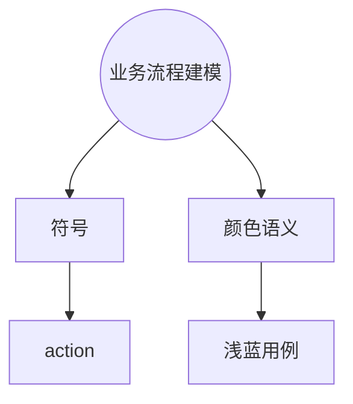
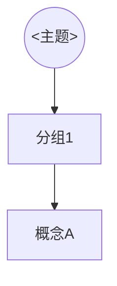

# 课堂笔记模板与规范（bilibili-douyin-notes）

**版本：v4**（语雀直导版式；调用门禁 / 深链脚本时传 `--template v4`）

> **v1 / v2 / v3 冻结说明**：v1（★ 符号体系）、v2（三词文字标签）、v3（frontmatter +
> NAV 折叠区）自本版起冻结、不再演进，但仍继续支持——质量门禁
> `scripts/validate_note.py` 不带 `--template` 时按笔记 frontmatter 的
> `template_version` 字段分派 v3 / v2 / v1 规则，既有笔记零改动继续可校验。
> **新笔记一律按本文件（v4）生成**：内容规则与 v3 相同（正文零时间戳、零考试向标签、
> 按知识体系组织），版式改为**可直接导入语雀**的纯 Markdown——无 frontmatter、
> 无一级标题、`+` 列表、答案与时间索引不折叠。

本文件是本 skill 生成课堂笔记的**唯一模板与规范**，包含：文件命名、lecture 完整骨架 +
short 差异表、时间戳规范、语法契约（要点表达 / 概念卡片 / 自测题 / 知识地图 /
视频时间索引）、截图嵌入规范、生成流程、模板要点清单。
不依赖任何个人本机文件，任何人在任何机器上按本文件生成都应得到结构一致的笔记。

**定位**：笔记是“看完课替代手写笔记”的**课后复习资料**——读者通读正文即可完成复习，
不需要拿笔记跳回视频；生成后可整篇导入语雀，导入效果与源文件一致。时间戳的唯一职责是
文末时间索引里的“回看跳转”，深链由脚本补齐。

---

## 一、文件命名与元信息（v4 无 frontmatter）

- 文件名：`<序号>-<主题>.md`，如 `2.13-业务流程建模.md`、`01-认识产品经理.md`；
  序号取课程选集号（如 `2.13`）或按用户已有笔记递增（如 `01`），主题取视频标题关键词。
  文件名即语雀文档标题，所以**正文不写 `# 一级标题`**；
- **禁止** frontmatter（`---` 包围的元数据块）——语雀会把它当正文显示；
- 原 frontmatter 的元信息改由命令行与 `metadata.json` 提供：
  - 模板版本：门禁 / 深链脚本传 `--template v4`；
  - 笔记类型：`--note-type lecture|short`，缺省取 metadata.json 顶层
    `suggested_note_type`，再缺省视为 `lecture`；
  - 平台与视频 ID：取 metadata.json 的 `platform` 与 `bvid` / `video_id`；
- 课程来源（平台、视频号、UP 主、时长）写在开头引语块的 `课程来源：` 一行里，供读者查看。

## 二、重点的表达方式（正文无标签、无时刻）

- 要点用 **`+` 无序列表** `+ 要点句`，一条一个完整可复述的句子（不是关键词罗列）；
  使用 `-` / `*` 列表为 warning（语雀导出统一为 `+`，保持一致）；
- 关键术语用 `**加粗**` 突出，读者扫加粗词即可抓住本节重点；
- **禁止**三词标签前缀（`**核心必考**`、`**重点掌握**`、`**了解即可**` 及任何变体，
  含 ★ 符号）——正文残留标签即 error；
- **禁止**行内 `[mm:ss]` 时刻（见第三节）；
- 每小节 ≥3 行实质内容；对比性内容优先用表格呈现。

```markdown
+ **控制反转**把对象的创建权交给容器，**依赖注入**是它的实现手段
+ BeanFactory 惰性实例化，ApplicationContext 默认预实例化单例
+ 需要 fail-fast 的场景选 ApplicationContext，配置错误在启动阶段暴露
```

## 三、时间戳规范（正文零时刻）

**正文（文末“视频时间索引”节之前）任何位置出现时刻即 error**。禁令清单：

1. 目录条目（`+ [N. 小节名](#锚点)`，不带时刻）；
2. 小节标题（`## N. 小节名`，禁止 `（08:12）` 式时刻后缀）；
3. 要点行与正文段落（禁行内 `[mm:ss]`）；
4. 代码块内部（含来源标注注释）；
5. 概念卡片全部字段；
6. 自测题题干与答案；
7. 截图 caption（alt 文本）。

**唯一例外**是文末“视频时间索引”节（见 5.4）。

时间索引条目的**防虚构规则**：

- 时刻必须来自**转写稿/字幕里真实存在的 `[mm:ss]` 时间行**，禁止编造；生成前先在
  转写稿里确认该时间行存在（grep 即可）。ASR 相对画面约有 1~3 秒滞后，**引用时允许
  小幅前移**——门禁按总秒数做 ±5 秒容差校验（可跨分钟）；
- 分钟位允许 1~3 位（`[123:45]` 合法，容忍超长讲座）。

代码块来源标注为**可选**：

- 来自克隆的代码仓库：`# 来源：仓库 <子项目>/<文件路径>`（注释符随语言）；
- 按视频讲解组织的代码：可写 `# 按视频讲解还原`，也可不写；
- 语言 fence 用真实语言（java/python/js/ts/c/cpp/xml/sql/properties/yaml/json/
  bash/shell/html/css 等）；`mermaid`、`text` 等非代码块不适用来源标注（但仍须正确闭合）；
- **任何代码块内禁止出现时刻**。

转写稿/字幕里没有的内容不要编造；确有必要补充时标注“（视频中未展开，建议补充）”。

## 四、完整骨架（lecture 型）

文件 `2.13-业务流程建模.md` 的完整内容（从第一行开始，前面没有任何元数据或标题）：

````markdown
> 核心主线：用例是散落的珠子、活动图是把它们串起来的线——用颜色区分用例、系统外活动与系统内部实现，把孤立用例串成完整的业务流程。  
> 课程来源：<视频标题>（B站 BV1xxxxxxxxx，UP主：<名字>，选集 2.13，约 26 分钟）

## 目录
+ [1. 从用例到活动图](#1-从用例到活动图)
+ [2. 活动图的符号与颜色语义](#2-活动图的符号与颜色语义)
+ [本讲知识地图](#本讲知识地图)
+ [概念卡片](#概念卡片)
+ [自测题（复习用）](#自测题复习用)
+ [视频时间索引](#视频时间索引)

---

## 1. 从用例到活动图
**核心思想：** EBP 把目标切成了一把散落的用例，描述协作与先后顺序需要活动图。

+ 业务流程讲的是事情的**先后顺序**，基于用例建模从主参与者的目标出发
+ 切分的结果是用例全是散的，用例之间缺一种描述方式
+ 描述“一组主参与者协作完成某件事”的工具就是**活动图**

## 2. 活动图的符号与颜色语义
**核心思想：** action 是活动图的基本符号、语义由使用者定义。

+ **action（动作）**圆角矩形是活动图最基本的符号
+ 课程用**颜色语义**扩展 action：浅蓝是用例、黄色是系统外、红色是内部实现

| 颜色 | 含义 |
| --- | --- |
| 浅蓝 | 用户目标用例 |
| 黄色 | 系统范围之外的活动 |

## 本讲知识地图


## 概念卡片
### 活动图
+ 定义：用 action、对象节点、决策节点等符号描述协作与先后顺序的 UML 图
+ 出现：第 1 节「从用例到活动图」、第 2 节「活动图的符号与颜色语义」
+ 依赖：颜色语义
+ 易混：用例图——用例图是静态目录，活动图表达动态的流程与协作

### 颜色语义
+ 定义：课程为活动图 action 约定的额外含义
+ 出现：第 2 节「活动图的符号与颜色语义」、第 1 节「从用例到活动图」
+ 依赖：活动图
+ 易混：

## 自测题（复习用）
1. 为什么基于用例的分析最后需要活动图来补充？（对应：活动图）

**答案：** 用例图无法表达协作与先后，需要活动图把有关系的用例串起来描述业务流程。

2. 活动图的 action 符号语义由谁定义？课程的颜色约定是什么？（对应：颜色语义）

**答案：** 由使用者赋予；浅蓝是用户目标用例、黄色是系统外活动、红色是系统内部实现。

3. …（lecture 共 4~7 道）

---

## 视频时间索引
+ [00:00] 1. 从用例到活动图
+ [05:10] 2. 活动图的符号与颜色语义
````

骨架要点：

- **第一行就是引语块**：`> 核心主线：…`（一句话串起全片知识主线，行尾两个空格换行）+
  `> 课程来源：…`；有代码仓库时再加 `> 课程代码：…`；之前不写 frontmatter、不写 `#` 标题；
- 目录条目 `+ [N. 小节名](#锚点)` 不带时刻，末尾固定列出 本讲知识地图 /
  概念卡片 / 自测题（复习用）/ 视频时间索引；
- 每个 `## N. 小节名` 标题不带时刻，**下一行紧接** `**核心思想：** <一句话>`
  （不空行，空行为 warning），全节至少 3 行实质内容；
- 概念对比优先用表格；正文各小节之间可用 `---` 分隔。

## 五、语法契约（精确、可解析）

### 5.1 概念卡片

```markdown
### <概念名>
+ 定义：<一句话；必须非空>
+ 出现：第 N 节「<小节名>」、第 M 节「<小节名>」
+ 依赖：<概念名，逗号或顿号分隔；可为空>
+ 易混：<概念名>——<一句话区别；可为空>
```

- 标题：`### ` + 非空概念名，**禁止**标签后缀（`### 控制反转（核心必考）` 非法）；
- `定义` 与 `出现` **必须存在且非空**（error）；
- `出现` 每项写作 `第 N 节「小节名」`，多项用 `、` 分隔（v3 的 `出现：1、2` 写法为 error）；
  N 必须是笔记里真实存在的 `## N.` 小节（error）；「小节名」须与该小节标题
  （去序号后）一致（warning）；**禁止时刻**（error）；
- `出现` **至少 2 个小节**（不足为 warning：单节概念不必单独成卡）；
- `依赖` / `易混` 可空；非空时引用的概念名应在概念卡片集合内（warning）。

### 5.2 知识地图（mermaid）与节点标签卫生



- 写成 ```` ```mermaid ```` 代码块，**推荐 `graph TD`**（语雀导入后渲染为与样例一致的图）；
  首个非空行须为 `graph` / `flowchart` / `mindmap`；`mindmap` 时至少 2 级缩进；
- **节点标签卫生**（warning）：单个标签 ≤ 12 字（半角记 0.5 字）；`[...]` 标签内禁止
  `(` `)` `[` `]` `{` `}` `"`，需要括号时用全角（）；根节点 `R((主题))` 的圆形写法合法。

### 5.3 自测题

```markdown
1. <题干>？（对应：<概念名>）

**答案：** <答案正文，至多一行>

2. …
```

- 每题题干后空一行，紧接以 `**答案：**` 开头的答案行（缺失为 error）；
- **不使用 `<details>` 折叠**（v4 出现 `<details>` 为 error——语雀导入不支持折叠）；
- **答案正文至多一行**（warning），且**禁止含时刻**（error）；
- `（对应：X）` 的 X 必须存在于**概念卡片集合**（lecture 缺失为 error；short 可选）；
- 数量：lecture **4~7** 道，short 2~3 道（越界 error）；
- 选题主打**高频原理与面试易错点**，禁止 yes/no 题干（“是否…”、“…吗？”；warning）。

### 5.4 视频时间索引（全文唯一允许时刻的区域，文末最后一节）

```markdown
---

## 视频时间索引
+ [00:00] 1. 从用例到活动图
+ [05:10] 2. 活动图的符号与颜色语义
```

- 位置与形态：全文最后一个 `##` 小节，前接 `---` 分隔线；**不使用 `<details>` 折叠、
  不写 `NAV:BEGIN/NAV:END` 标记**（出现即 error）；
- **模型只写条目** `+ [mm:ss] <与正文一级小节同名>`：一级章节粒度一条；
  条目标题与对应小节标题一致（去序号后比较，不一致为 warning）；
- 时刻规则见第三节（转写稿真实时间行，±5s 容差，禁止虚构）；
- **模型不写 URL**：深链由 `scripts/note_nav.py --template v4` 原位填充为
  `+ [mm:ss](URL) 标题`（B站 `?p=N&t=S`；YouTube `watch?v=<id>&t=<秒>s`；
  抖音 / 小红书无深链，保持纯文本）；
- lecture **必须有本节**（缺失 error）；short 可整体省略。

## 六、short 型差异表

与 lecture 的骨架相同，差异仅下表四处：

| 项 | lecture | short |
|---|---|---|
| 概念卡片 | 必须（≥2 张） | 不要求，出现则 ≤3 张（门禁不强制数量，仅校验定义/出现非空等） |
| 本讲知识地图 | 必须（mermaid） | **可省** |
| 自测题 | 4~7 道，每题必须带 `（对应：…）` | 2~3 道，`（对应：…）` 可选 |
| 视频时间索引 | **必须有**（note_nav 填深链） | 可整体省略（note_nav 跳过 short） |

## 七、截图嵌入规范

- 用相对路径嵌入对应小节：``（导入语雀前需把图片一并上传，
  或改用语雀图床地址）；
- **截图嵌在相关要点或所属小节附近**（跟随它佐证的内容，方便对照阅读）；
- **caption（alt 文本）以锚点关键词开头**，门禁按 images/manifest.json 的
  `keyword` 字段交叉校验（warning）；caption 属于正文，**禁止含时刻**；
- 截图文件名**默认可中文**；需要 ASCII 文件名时给 `bili_screenshot.py` 加 `--ascii-names`；
- 脚本画质 QC 未通过的帧（`dark`/`bright`/`blurry`）由 Agent 视觉复核后决定是否采用。

## 八、生成流程（谁在什么时候调用什么）

> 完整步骤与参数以 SKILL.md 第三步为准，本节为速览。

```
1. bili_fetch.py <URL> <outdir>            → metadata.json（含 suggested_note_type）+ 字幕 txt
   （抖音 / YouTube / 小红书走各自的 *_fetch.py）
2. bili_transcribe.py <metadata.json>      → 缺字幕分P的 txt
3. apply_glossary.py <转写稿.txt>          → ASR 术语校正（先 dry-run，确认后 --apply）
4. transcript_chunk.py <转写稿.txt>        → （单分P超约 2 万字时）分块 map-reduce
5. bili_screenshot.py <meta> <txt>    → （可选）images/*.png + images/manifest.json
6. Agent 读 SKILL.md + 本模板，按第四节骨架写出 `<序号>-<主题>.md`
   └ 时间索引条目写成 `+ [mm:ss] 标题`（不含 URL）
7. python scripts/note_nav.py <笔记.md> --template v4 --meta <metadata.json> --txt-dir <txt目录>
                                          → 原位填充时间索引深链（幂等）
8. python scripts/validate_note.py <笔记.md> --template v4 --meta <metadata.json> --txt-dir <txt目录>
                                          → errors 必须为 0 才交付
9. clean_media.py <输出目录>               → 交付后询问用户是否清理缓存媒体
```

**关键分工**：第 6 步的模型输出**不含任何 URL**；第 7 步的脚本只把 `视频时间索引`
小节内的 `+ [mm:ss] 标题` 条目补成 `+ [mm:ss](URL) 标题`，不改其他任何行。

## 九、模板要点清单（条目 → 详见节号）

| 条目 | 详见 |
|---|---|
| 文件命名、无 frontmatter / 无一级标题 | 一 |
| 要点表达（`+` 列表、术语加粗、标签/时刻禁令） | 二 |
| 时间戳禁令（正文零时刻）与防虚构规则 | 三 |
| 代码块来源标注（可选） | 三 |
| 引语块、目录、小节与核心思想 | 四 |
| 概念卡片（出现：第 N 节「小节名」） | 5.1 |
| 知识地图（mermaid graph TD） | 5.2 |
| 自测题（不折叠） | 5.3 |
| 视频时间索引（不折叠、无 NAV 标记） | 5.4 |
| 截图嵌入 | 七 |
| 生成流程（note_nav / validate 带 --template v4） | 八 |

---

## 附：v1 / v2 / v3 冻结差异速查

（v3 完整规范见 git 历史中本文件的 v3 版本）

| 项 | v1（冻结） | v2（冻结） | v3（冻结） | v4（现行） |
|---|---|---|---|---|
| 元信息 | 无 | frontmatter | frontmatter（含 duration） | 无 frontmatter，`--template v4` + metadata.json |
| 标题 | `# 课堂笔记 NN：主题` | 同左 | 同左 | 无一级标题，文件名 `<序号>-<主题>.md` |
| 列表符号 | `-` | `-` | `-` | `+` |
| 重点分级 | ★ 符号 | 三词标签 | 无标签，术语加粗 | 同 v3 |
| 时间戳 | 行内常见 | 行内可选 | 正文禁用，仅文末索引 | 同 v3 |
| 概念卡「出现」 | — | `2（mm:ss）` | `2、5` | `第 2 节「小节名」、第 5 节「小节名」` |
| 自测答案 | — | `<details>` 折叠 | `<details>` 折叠 | 不折叠，空行后 `**答案：**` |
| 时间导航 | — | “参考时间戳”可选 | `<details>` + NAV 标记 | 不折叠、无 NAV 标记，`+ [mm:ss](URL) 标题` |
| 知识地图 | — | mermaid | mermaid mindmap | mermaid graph TD（推荐） |
